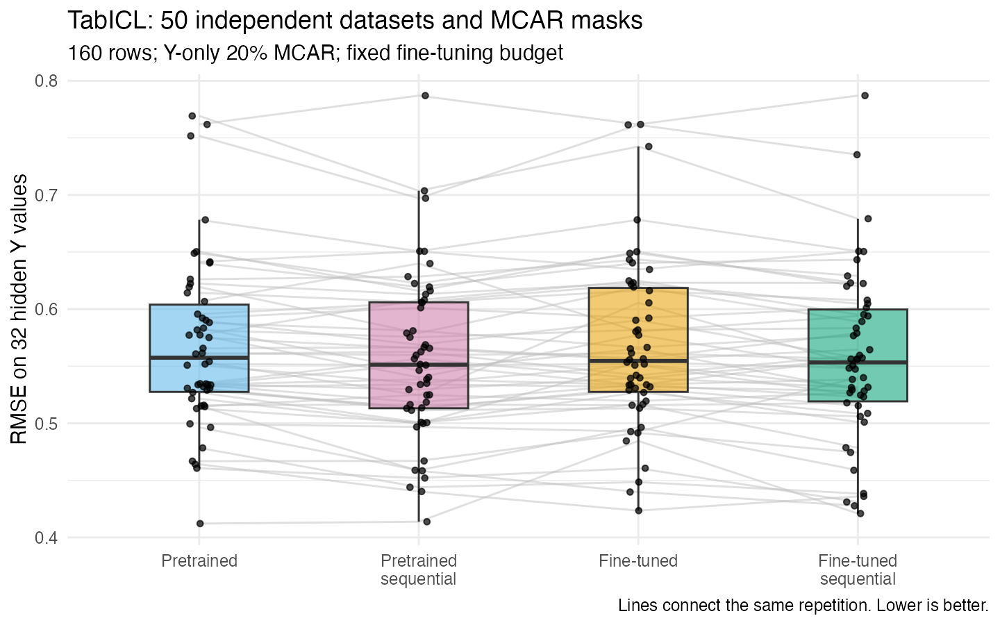
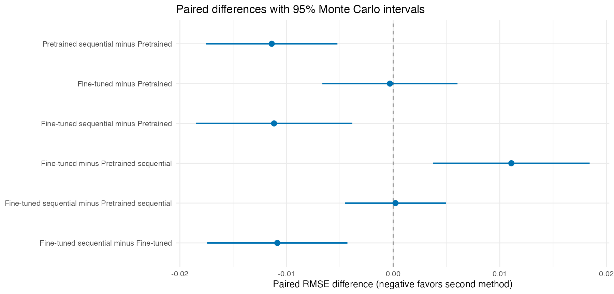

```{r setup, include=FALSE}
knitr::opts_chunk$set(echo=FALSE, message=FALSE, warning=FALSE)
summary <- read.csv('summary.csv')
paired <- read.csv('paired.csv')
```

The experiment generates **50 independent datasets**, each with 160 records.
Exactly 32 values of `Y` are hidden under MCAR in each dataset. `X`, `A` and `B`
remain fully observed and unchanged. The same data, mask and model seed are
used for all four methods within each repetition. Only hidden `Y` values
contribute to the scores.

```text
X ~ Normal(0,1)
A sampled independently from {A,B}; B from {B,C}
Y | X,A,B ~ Normal(mu[A,B] + 4*X, 0.5^2)
mu[A,B] = -8, -2, 2, 10 for (A,B), (A,C), (B,B), (B,C)
```

Fine-tuning uses a maximum of **20 epochs**, learning rate `1e-5`, patience
three and eight inference ensemble members. The sequential variant permits
up to ten sweeps with the normal convergence rule. Parameters are fixed in
advance; hidden values are never used for model selection. The default VIM
learner still uses five epochs outside this experiment.

The base data seed is `20261016 + 100*(repetition - 1)`; masking uses seed + 1
and the shared R model seed is seed + 2. The Python learner random_state
remains fixed at 42 across repetitions. Original data, masks and completions
are retained in the local repetition cache. `config.rds` records the full
configuration and source-file fingerprints; `run-info.txt` records the source
commit. No repetitions are selected based on their results.

## Accuracy and runtime

```{r summary}
labels <- c(vimpute_tabicl2='Pretrained',
  vimpute_tabicl2_seq10='Pretrained sequential',
  vimpute_tabicl2_finetune='Fine-tuned',
  vimpute_tabicl2_finetune_seq10='Fine-tuned sequential')
tab <- data.frame(Method=unname(labels[summary$method]),
  Repetitions=summary$repetitions,
  `RMSE mean (SD)`=sprintf('%.4f (%.4f)',summary$mean_rmse,summary$sd_rmse),
  `95% MC CI for mean RMSE`=sprintf('[%.4f, %.4f]',
    summary$mean_rmse_ci_low,summary$mean_rmse_ci_high),
  `Mean MAE`=round(summary$mean_mae,4),
  `Mean NRMSE`=round(summary$mean_nrmse,4),
  `Mean seconds`=round(summary$mean_seconds,2),
  `Mean sweeps`=round(summary$mean_sweeps,2),check.names=FALSE)
knitr::kable(tab)
```



## Paired comparisons

Differences below are **second method minus first method**, so negative
values favor the second method. Confidence intervals use the variation of
within-repetition differences, preserving the paired design. Wins use an
absolute RMSE difference greater than `1e-8`; smaller differences are ties.

```{r paired}
tab <- data.frame(First=unname(labels[paired$first]),
  Second=unname(labels[paired$second]),
  `Mean RMSE difference`=round(paired$mean_rmse_difference,4),
  `95% MC CI`=sprintf('[%.4f, %.4f]',paired$ci_low,paired$ci_high),
  `Second wins`=paired$second_wins,Ties=paired$ties,
  `First wins`=paired$first_wins,check.names=FALSE)
knitr::kable(tab)
```

```{r pretrained-sequential, include=FALSE}
pretrained_seq <- subset(paired, first == 'vimpute_tabicl2' &
  second == 'vimpute_tabicl2_seq10')
sequential_fine <- subset(paired, first == 'vimpute_tabicl2_seq10' &
  second == 'vimpute_tabicl2_finetune_seq10')
```

Without fine-tuning, sequential imputation changed mean RMSE by
**`r sprintf('%+.4f', pretrained_seq$mean_rmse_difference)`**, with a paired
95% interval of **`r sprintf('[%.4f, %.4f]', pretrained_seq$ci_low, pretrained_seq$ci_high)`**.
It improved RMSE in **`r pretrained_seq$second_wins`/50** repetitions,
tied in `r pretrained_seq$ties`, and worsened it in `r pretrained_seq$first_wins`.

Fine-tuning alone changed mean RMSE by only **−0.0003**; its paired 95%
interval includes zero. It improved RMSE in 13 repetitions, worsened it in 14,
and tied in 23. Sequential fine-tuning reduced mean RMSE by **0.0112 (2.0%)**
relative to pretrained TabICL, with a paired 95% interval of
**[−0.0185, −0.0038]**. It improved RMSE in 31 of 50 repetitions.
Sequential fine-tuned runs stopped after three sweeps under the convergence rule;
`seq=10` is the maximum number of sweeps.

Adding fine-tuning to sequential imputation changed mean RMSE by
**`r sprintf('%+.4f', sequential_fine$mean_rmse_difference)`**, with a paired
95% interval of **`r sprintf('[%.4f, %.4f]', sequential_fine$ci_low, sequential_fine$ci_high)`**.
There is no clear additional accuracy benefit from fine-tuning in this setup.



These are pointwise Monte Carlo intervals for this data-generating process, sample size
and missingness protocol. They do not establish superiority on other datasets
or missingness mechanisms. A missing value in the `accuracy` CSV field means
classification accuracy is inapplicable to numeric `Y`, not an unfilled target.

The original three variants ran in three separate R/Python workers; the added
pretrained sequential variant ran later in one process. Each used one Torch/BLAS thread.
The larger UCI benchmark was running concurrently, so elapsed times describe
this run rather than isolated hardware performance. Initial model loading and
caching also affect runtime comparisons.

The sequential methods receive no newly imputed predictors in this Y-only
scenario. Any difference from one pass reflects refitting rather than recovery
of missing predictor information. Lower point RMSE does not by itself establish
better distribution preservation or proper multiple imputation.

The pretrained sequential variant was added using the original 50 saved datasets
and masks. The previous 150 scores were reused unchanged.

## Reproducibility

Raw repetition artifacts stay in
`.local/benchmarks/tabicl2-correlated-y-only-typed-epochs20-50reps-four/`.
The accompanying `metrics.csv` contains all 200 method/repetition rows;
`summary.csv` and `paired.csv` contain the displayed statistics.

Source: `dev-notes/benchmarks/tabicl2-correlated.R`.
