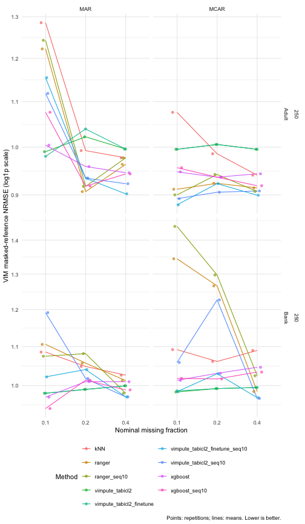
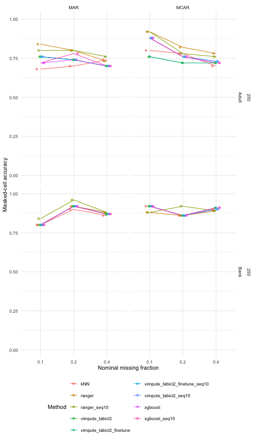
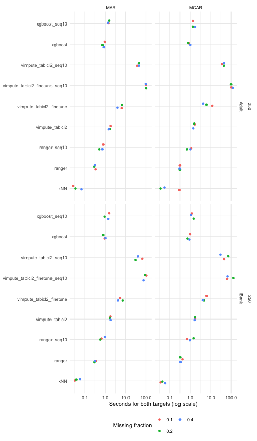
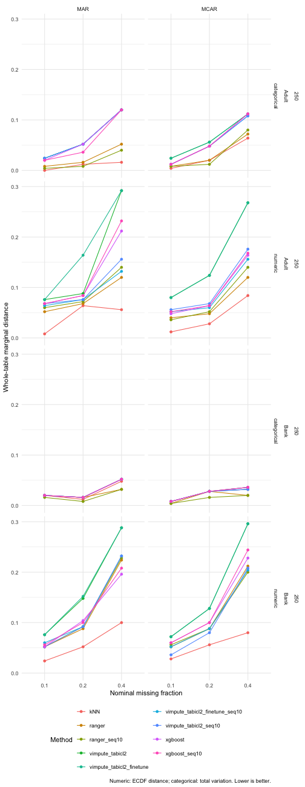
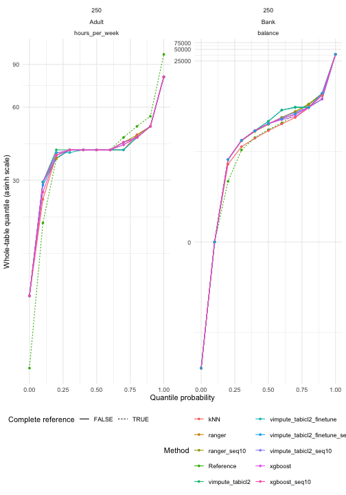
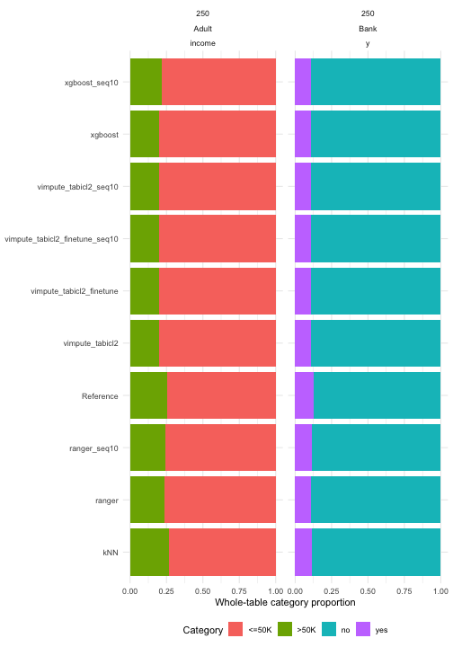

<style>
table { display: block; max-width: 100%; overflow-x: auto; }
</style>

## Introduction

This benchmark is adapted from `transformerImpute-benchmark.Rmd` on the
`transformerImpute-rebased` branch. It retains the Adult/Bank samples, common
MCAR/MAR masks and scoring protocol, and compares kNN, ranger, ranger_seq10, xgboost, xgboost_seq10 and four
TabICL variants: pretrained/fine-tuned, each with one or up to ten passes.

Like `vimpute-benchmark.Rmd`, this document is precomputed from its
`.Rmd.orig` source using `vignettes/precompute.R`. The generated `.Rmd`
contains static code examples, tables and figures. Package builds and checks
render these cached outputs without loading Python or fitting models.
Edit the `.Rmd.orig` source to change the experiment, then precompute again.

## Models and regeneration

All four TabICL variants call `vimpute(method = "tabicl2")`, with PMM and
residual noise disabled. Numeric targets use TabICLRegressor and factors use
TabICLClassifier. Fine-tuning uses the corresponding Finetuned estimators.
Each target and iteration fits a fresh model on observed target values only.

| Method | Fine-tuning | Sequential passes |
|:--|:--|:--|
| vimpute_tabicl2 | No | 1 |
| vimpute_tabicl2_finetune | Yes | 1 |
| vimpute_tabicl2_seq10 | No | Up to 10 |
| vimpute_tabicl2_finetune_seq10 | Yes | Up to 10 |

All variants use eight inference ensemble members on CPU. Fine-tuning uses
five epochs, learning rate `1e-5`, patience three, and two ensemble members
for training and validation, with mixed precision disabled. The upstream
internal validation split never receives hidden imputation truth. The seq10
variants use `sequential = TRUE, nseq = 10`; vimpute's convergence rule may
stop earlier. Fine-tuning occurs afresh at each fitted iteration.

kNN uses five neighbours. Ranger uses 100 trees and XGBoost 30 boosting rounds.
The seq10 variants use up to ten sequential passes; the other ranger/XGBoost variants
predict each target from the same incomplete table. TabICL's pretrained budget
differs from these fitted models, so this is a practical method comparison.

Python >= 3.10 and the optional R package `reticulate` are required for TabICL.
Install dependencies explicitly in the environment selected by reticulate:


``` bash
python -m pip install -r inst/python/tabicl-requirements.txt
```


``` r
# From the repository root, with the current VIM installed and the Python
# environment selected via RETICULATE_PYTHON:
# Rscript vignettes/precompute.R tabiclImpute-benchmark
# Edit config in tabiclImpute-benchmark.Rmd.orig for a different experiment.
# Set VIM_TABICL2_RESULTS to a fresh local directory if configuration changes.
# To render the already cached document only:
rmarkdown::render("vignettes/tabiclImpute-benchmark.Rmd")
```

## Datasets and preprocessing

* [Adult / Census Income](https://archive.ics.uci.edu/dataset/2/adult),
  Becker and Kohavi (1996), [DOI:10.24432/C5XW20](https://doi.org/10.24432/C5XW20):
  combine `adult.data` and `adult.test` (48,842 rows). Skip the test-file header,
  trim whitespace, remove the final period from test income labels, and parse
  `?` as missing. Combining the published splits is intentional: this is
  transductive reconstruction of missing cells, not a supervised income test.
* [Bank Marketing](https://archive.ics.uci.edu/dataset/222/bank+marketing),
  Moro, Rita and Cortez (2014), [DOI:10.24432/C5K306](https://doi.org/10.24432/C5K306):
  use `bank-full.csv` (45,211 rows), not the smaller sample or the different
  `bank-additional-full.csv`. Keep `unknown` as an observed category. It encodes
  recorded lack of knowledge; equating it with an artificially deleted value
  would change the evaluation target. Keep `pdays = -1` (no prior contact) as
  a structural sentinel in its original numeric column. Do not interpret it
  as a literal negative duration.

Both UCI datasets are distributed under CC BY 4.0. The script stores archive
URLs and MD5 checksums for provenance. Raw records are downloaded only with
explicit `download = TRUE` and are not bundled with VIM.

All character columns become unordered factors and all numeric measurements
remain numeric. No clipping, logarithms, balancing, rare-level pooling or
one-hot conversion is applied in shared preprocessing. Adult's `fnlwgt` remains
a predictor, not a survey weight; these are unweighted sample diagnostics.
Both education representations are retained. Bank's call duration is retained:
it is available for retrospective imputation, but would be inappropriate in a
pre-call subscription prediction task.

Remove rows with any existing NA to obtain complete references. Consequently,
Adult results describe its complete-case population and need not transfer to
people with naturally missing occupation or workclass. No correctness claim
is made for the unobserved true values in those removed rows.


Table: Rows before and after complete-case selection

|   |dataset |  rows| complete_rows|
|:--|:-------|-----:|-------------:|
|1  |Adult   | 48842|         45222|
|16 |Bank    | 45211|         45211|


Table: Existing missing values and retained unknown categories

|   |dataset |variable       | existing_na| unknown|
|:--|:-------|:--------------|-----------:|-------:|
|2  |Adult   |workclass      |        2799|       0|
|7  |Adult   |occupation     |        2809|       0|
|14 |Adult   |native_country |         857|       0|
|17 |Bank    |job            |           0|     288|
|19 |Bank    |education      |           0|    1857|
|24 |Bank    |contact        |           0|   13020|
|31 |Bank    |poutcome       |           0|   36959|


## Missingness simulation

Each repetition draws a new simple random sample without replacement from each
complete-case dataset at **250 rows**,
with **1 repetition(s)** per scenario.
The seed schedule is shared across sizes, so samples overlap and sample-size
comparisons are not independent replications. The sampling algorithm may change
with the requested size; exact nesting is not assumed. All methods share the
same sample and mask within each dataset/size/repetition/mechanism/rate scenario.
The column `n` records the number of rows in every result table. Seeds and
training budgets are unchanged across sizes: more rows imply more observed context and, when fine-tuning is enabled, more training batches.
The targets are Adult `hours_per_week` and `income`, and Bank `balance` and `y`.
Other columns stay observed, including the MAR driver `age`.

`makeMissing()` selects exactly `round(rate * nrow(truth))` cells per
target, without replacement. MCAR uses uniform sampling. MAR uses
`weights = c(age = 1)` explicitly: the sampling weights are the logistic
transform of standardized observed age. These weights are **not** marginal
cell-deletion probabilities; the requested number of rows is sampled using
those relative weights. Higher age favours selection. Age is never masked,
and no target's hidden value drives another target's missingness. Using the
default MAR drivers instead could include the other incomplete numeric target,
so specifying the observed driver matters here.

The `where` attribute supplies the common mask for every competing method
and for scoring. We retain the original reference separately. With 250 rows,
the three requested rates correspond to 25, 50 and 100 masked cells in each
target. With other sample sizes the fractions may differ slightly due to
rounding. Masks are never redrawn to remove difficult cases.


``` r
prepared <- uci_prepare("uci-cache", download = FALSE)
set.seed(config$seed)
truth <- prepared$data$Adult[sample(nrow(prepared$data$Adult), config$n[1L]), ]
incomplete <- makeMissing(truth, prop = .2, mechanism = "MAR",
  vars = c("hours_per_week", "income"), weights = c(age = 1), seed = config$seed)
mask <- attr(incomplete, "where")
incomplete <- droplevels(incomplete) # no levels learned solely from masked values
# truth is passed only to evaluation, never to a learner.
```


Table: Mean realized target-specific missing fractions

|   n|dataset |mechanism | rate|variable       | realized_rate|
|---:|:-------|:---------|----:|:--------------|-------------:|
| 250|Bank    |MAR       |  0.1|balance        |           0.1|
| 250|Bank    |MCAR      |  0.1|balance        |           0.1|
| 250|Bank    |MAR       |  0.2|balance        |           0.2|
| 250|Bank    |MCAR      |  0.2|balance        |           0.2|
| 250|Bank    |MAR       |  0.4|balance        |           0.4|
| 250|Bank    |MCAR      |  0.4|balance        |           0.4|
| 250|Adult   |MAR       |  0.1|hours_per_week |           0.1|
| 250|Adult   |MCAR      |  0.1|hours_per_week |           0.1|
| 250|Adult   |MAR       |  0.2|hours_per_week |           0.2|
| 250|Adult   |MCAR      |  0.2|hours_per_week |           0.2|
| 250|Adult   |MAR       |  0.4|hours_per_week |           0.4|
| 250|Adult   |MCAR      |  0.4|hours_per_week |           0.4|
| 250|Adult   |MAR       |  0.1|income         |           0.1|
| 250|Adult   |MCAR      |  0.1|income         |           0.1|
| 250|Adult   |MAR       |  0.2|income         |           0.2|
| 250|Adult   |MCAR      |  0.2|income         |           0.2|
| 250|Adult   |MAR       |  0.4|income         |           0.4|
| 250|Adult   |MCAR      |  0.4|income         |           0.4|
| 250|Bank    |MAR       |  0.1|y              |           0.1|
| 250|Bank    |MCAR      |  0.1|y              |           0.1|
| 250|Bank    |MAR       |  0.2|y              |           0.2|
| 250|Bank    |MCAR      |  0.2|y              |           0.2|
| 250|Bank    |MAR       |  0.4|y              |           0.4|
| 250|Bank    |MCAR      |  0.4|y              |           0.4|


## Evaluation

The pointwise metrics reuse VIM's existing tools and score artificially
masked cells only:

* `evaluation()` supplies numeric mean squared error (`err_num`) and the
  fraction of incorrect categories (`err_cat`). We report RMSE as
  `sqrt(err_num)`, misclassification as `err_cat`, and accuracy as
  `1 - err_cat`. Because the current implementation of `evaluation()` sums
  errors over the supplied table, the runner **subsets its inputs to masked
  cells for each target** and passes an all-TRUE `where` matrix. This makes
  the scoring boundary explicit. Whole-table calls are equivalent only when
  observed values are preserved, which the runner also checks.
* `nrmse(x, y, m = mask)` supplies **NRMSE**, using the standard deviation of
  the **masked true values**, as implemented by VIM. This is the convention
  used by the companion benchmark. Fewer than two masked values or zero
  masked-reference variance gives an undefined score, recorded as NA.
* **NRMSE_ref** (`nrmse_reference` in the CSV) retains the alternative
  `RMSE / sd(full sampled reference column)` requested for this UCI
  benchmark. It is separate from VIM's masked-reference NRMSE; under MAR the
  two denominators can differ substantially. Both denominators are common
  across methods within a scenario and are used only for evaluation.
* MAE, whole-table marginal distances and relationship diagnostics supplement
  these existing tools; they are not available from `evaluation()` itself.

## Results

The saved run contains 108 method/scenario attempts,
108 successful completions and
0 recorded failures. Every method in a scenario
uses the same `makeMissing()` mask.


|Rows |Dataset |Method                         |Status | Runs|
|:----|:-------|:------------------------------|:------|----:|
|250  |Adult   |kNN                            |ok     |    6|
|250  |Bank    |kNN                            |ok     |    6|
|250  |Adult   |ranger                         |ok     |    6|
|250  |Bank    |ranger                         |ok     |    6|
|250  |Adult   |ranger_seq10                   |ok     |    6|
|250  |Bank    |ranger_seq10                   |ok     |    6|
|250  |Adult   |vimpute_tabicl2                |ok     |    6|
|250  |Bank    |vimpute_tabicl2                |ok     |    6|
|250  |Adult   |vimpute_tabicl2_finetune       |ok     |    6|
|250  |Bank    |vimpute_tabicl2_finetune       |ok     |    6|
|250  |Adult   |vimpute_tabicl2_finetune_seq10 |ok     |    6|
|250  |Bank    |vimpute_tabicl2_finetune_seq10 |ok     |    6|
|250  |Adult   |vimpute_tabicl2_seq10          |ok     |    6|
|250  |Bank    |vimpute_tabicl2_seq10          |ok     |    6|
|250  |Adult   |xgboost                        |ok     |    6|
|250  |Bank    |xgboost                        |ok     |    6|
|250  |Adult   |xgboost_seq10                  |ok     |    6|
|250  |Bank    |xgboost_seq10                  |ok     |    6|


The following tables retain number of rows, dataset, mechanism and nominal rate. Scores are
means across successful repetitions, with their sample standard deviations in
parentheses. Counts are shown so failures cannot improve a ranking invisibly.
The saved configuration has 1 repetition(s). With one
repetition, standard deviations are unavailable; with few repetitions they
describe variation only roughly. They are not confidence intervals or significance tests. Methods are paired by
sample and mask, so formal comparisons would require paired analysis and more
repetitions. Empty cells indicate unavailable metrics. Success counts use completed
attempts as the denominator. The Coverage column distinguishes pending requested
repetitions from scenarios outside the saved experiment.


### Adult: MCAR, 250 rows


| Rate|Method                         |Coverage |Success |RMSE        |MAE        |NRMSE      |NRMSE_ref  |Accuracy   |Misclassification |Seconds      |
|----:|:------------------------------|:--------|:-------|:-----------|:----------|:----------|:----------|:----------|:-----------------|:------------|
|  0.1|kNN                            |Complete |1/1     |14.263 (NA) |8.320 (NA) |1.076 (NA) |1.158 (NA) |0.800 (NA) |0.200 (NA)        |0.293 (NA)   |
|  0.1|ranger                         |Complete |1/1     |12.085 (NA) |8.120 (NA) |0.912 (NA) |0.981 (NA) |0.920 (NA) |0.080 (NA)        |0.313 (NA)   |
|  0.1|ranger_seq10                   |Complete |1/1     |11.931 (NA) |8.200 (NA) |0.900 (NA) |0.969 (NA) |0.920 (NA) |0.080 (NA)        |1.105 (NA)   |
|  0.1|xgboost                        |Complete |1/1     |12.562 (NA) |8.040 (NA) |0.948 (NA) |1.020 (NA) |0.880 (NA) |0.120 (NA)        |0.839 (NA)   |
|  0.1|xgboost_seq10                  |Complete |1/1     |12.678 (NA) |8.720 (NA) |0.956 (NA) |1.029 (NA) |0.880 (NA) |0.120 (NA)        |1.358 (NA)   |
|  0.1|vimpute_tabicl2                |Complete |1/1     |13.194 (NA) |8.240 (NA) |0.995 (NA) |1.071 (NA) |0.760 (NA) |0.240 (NA)        |1.710 (NA)   |
|  0.1|vimpute_tabicl2_finetune       |Complete |1/1     |13.194 (NA) |8.240 (NA) |0.995 (NA) |1.071 (NA) |0.760 (NA) |0.240 (NA)        |11.796 (NA)  |
|  0.1|vimpute_tabicl2_seq10          |Complete |1/1     |11.829 (NA) |8.320 (NA) |0.892 (NA) |0.960 (NA) |0.880 (NA) |0.120 (NA)        |35.811 (NA)  |
|  0.1|vimpute_tabicl2_finetune_seq10 |Complete |1/1     |11.664 (NA) |8.200 (NA) |0.880 (NA) |0.947 (NA) |0.880 (NA) |0.120 (NA)        |103.427 (NA) |
|  0.2|kNN                            |Complete |1/1     |12.904 (NA) |7.960 (NA) |0.986 (NA) |1.047 (NA) |0.780 (NA) |0.220 (NA)        |0.035 (NA)   |
|  0.2|ranger                         |Complete |1/1     |12.093 (NA) |7.840 (NA) |0.924 (NA) |0.982 (NA) |0.820 (NA) |0.180 (NA)        |0.313 (NA)   |
|  0.2|ranger_seq10                   |Complete |1/1     |12.333 (NA) |8.060 (NA) |0.942 (NA) |1.001 (NA) |0.780 (NA) |0.220 (NA)        |0.684 (NA)   |
|  0.2|xgboost                        |Complete |1/1     |12.259 (NA) |7.560 (NA) |0.936 (NA) |0.995 (NA) |0.760 (NA) |0.240 (NA)        |0.796 (NA)   |
|  0.2|xgboost_seq10                  |Complete |1/1     |12.259 (NA) |7.760 (NA) |0.936 (NA) |0.995 (NA) |0.760 (NA) |0.240 (NA)        |1.352 (NA)   |
|  0.2|vimpute_tabicl2                |Complete |1/1     |13.165 (NA) |7.840 (NA) |1.006 (NA) |1.069 (NA) |0.720 (NA) |0.280 (NA)        |1.577 (NA)   |
|  0.2|vimpute_tabicl2_finetune       |Complete |1/1     |13.165 (NA) |7.840 (NA) |1.006 (NA) |1.069 (NA) |0.720 (NA) |0.280 (NA)        |6.262 (NA)   |
|  0.2|vimpute_tabicl2_seq10          |Complete |1/1     |11.853 (NA) |7.940 (NA) |0.905 (NA) |0.962 (NA) |0.760 (NA) |0.240 (NA)        |45.342 (NA)  |
|  0.2|vimpute_tabicl2_finetune_seq10 |Complete |1/1     |12.086 (NA) |8.140 (NA) |0.923 (NA) |0.981 (NA) |0.760 (NA) |0.240 (NA)        |99.708 (NA)  |
|  0.4|kNN                            |Complete |1/1     |12.950 (NA) |8.260 (NA) |0.941 (NA) |1.051 (NA) |0.700 (NA) |0.300 (NA)        |0.055 (NA)   |
|  0.4|ranger                         |Complete |1/1     |12.587 (NA) |8.200 (NA) |0.914 (NA) |1.022 (NA) |0.780 (NA) |0.220 (NA)        |0.304 (NA)   |
|  0.4|ranger_seq10                   |Complete |1/1     |12.486 (NA) |8.280 (NA) |0.907 (NA) |1.014 (NA) |0.760 (NA) |0.240 (NA)        |1.008 (NA)   |
|  0.4|xgboost                        |Complete |1/1     |12.990 (NA) |8.350 (NA) |0.944 (NA) |1.054 (NA) |0.720 (NA) |0.280 (NA)        |1.012 (NA)   |
|  0.4|xgboost_seq10                  |Complete |1/1     |12.650 (NA) |8.570 (NA) |0.919 (NA) |1.027 (NA) |0.720 (NA) |0.280 (NA)        |1.744 (NA)   |
|  0.4|vimpute_tabicl2                |Complete |1/1     |13.701 (NA) |8.700 (NA) |0.995 (NA) |1.112 (NA) |0.720 (NA) |0.280 (NA)        |1.412 (NA)   |
|  0.4|vimpute_tabicl2_finetune       |Complete |1/1     |13.701 (NA) |8.700 (NA) |0.995 (NA) |1.112 (NA) |0.720 (NA) |0.280 (NA)        |4.384 (NA)   |
|  0.4|vimpute_tabicl2_seq10          |Complete |1/1     |12.502 (NA) |8.570 (NA) |0.908 (NA) |1.015 (NA) |0.730 (NA) |0.270 (NA)        |44.739 (NA)  |
|  0.4|vimpute_tabicl2_finetune_seq10 |Complete |1/1     |12.381 (NA) |8.500 (NA) |0.899 (NA) |1.005 (NA) |0.730 (NA) |0.270 (NA)        |118.364 (NA) |


### Adult: MAR, 250 rows


| Rate|Method                         |Coverage |Success |RMSE        |MAE         |NRMSE      |NRMSE_ref  |Accuracy   |Misclassification |Seconds      |
|----:|:------------------------------|:--------|:-------|:-----------|:-----------|:----------|:----------|:----------|:-----------------|:------------|
|  0.1|kNN                            |Complete |1/1     |11.136 (NA) |7.360 (NA)  |1.286 (NA) |0.904 (NA) |0.680 (NA) |0.320 (NA)        |0.028 (NA)   |
|  0.1|ranger                         |Complete |1/1     |10.587 (NA) |6.880 (NA)  |1.222 (NA) |0.859 (NA) |0.840 (NA) |0.160 (NA)        |0.343 (NA)   |
|  0.1|ranger_seq10                   |Complete |1/1     |10.765 (NA) |7.000 (NA)  |1.243 (NA) |0.874 (NA) |0.800 (NA) |0.200 (NA)        |0.813 (NA)   |
|  0.1|xgboost                        |Complete |1/1     |8.697 (NA)  |6.040 (NA)  |1.004 (NA) |0.706 (NA) |0.720 (NA) |0.280 (NA)        |0.935 (NA)   |
|  0.1|xgboost_seq10                  |Complete |1/1     |9.321 (NA)  |6.720 (NA)  |1.076 (NA) |0.757 (NA) |0.720 (NA) |0.280 (NA)        |1.426 (NA)   |
|  0.1|vimpute_tabicl2                |Complete |1/1     |8.577 (NA)  |5.720 (NA)  |0.990 (NA) |0.696 (NA) |0.760 (NA) |0.240 (NA)        |1.816 (NA)   |
|  0.1|vimpute_tabicl2_finetune       |Complete |1/1     |8.490 (NA)  |5.200 (NA)  |0.980 (NA) |0.689 (NA) |0.760 (NA) |0.240 (NA)        |6.487 (NA)   |
|  0.1|vimpute_tabicl2_seq10          |Complete |1/1     |9.689 (NA)  |6.680 (NA)  |1.119 (NA) |0.787 (NA) |0.760 (NA) |0.240 (NA)        |36.298 (NA)  |
|  0.1|vimpute_tabicl2_finetune_seq10 |Complete |1/1     |10.002 (NA) |7.080 (NA)  |1.155 (NA) |0.812 (NA) |0.760 (NA) |0.240 (NA)        |99.847 (NA)  |
|  0.2|kNN                            |Complete |1/1     |16.046 (NA) |11.280 (NA) |0.993 (NA) |1.303 (NA) |0.700 (NA) |0.300 (NA)        |0.036 (NA)   |
|  0.2|ranger                         |Complete |1/1     |14.658 (NA) |10.020 (NA) |0.907 (NA) |1.190 (NA) |0.800 (NA) |0.200 (NA)        |0.296 (NA)   |
|  0.2|ranger_seq10                   |Complete |1/1     |14.832 (NA) |10.000 (NA) |0.917 (NA) |1.204 (NA) |0.800 (NA) |0.200 (NA)        |0.523 (NA)   |
|  0.2|xgboost                        |Complete |1/1     |15.500 (NA) |10.460 (NA) |0.959 (NA) |1.258 (NA) |0.740 (NA) |0.260 (NA)        |0.734 (NA)   |
|  0.2|xgboost_seq10                  |Complete |1/1     |14.840 (NA) |10.020 (NA) |0.918 (NA) |1.205 (NA) |0.780 (NA) |0.220 (NA)        |1.543 (NA)   |
|  0.2|vimpute_tabicl2                |Complete |1/1     |16.526 (NA) |10.720 (NA) |1.022 (NA) |1.342 (NA) |0.740 (NA) |0.260 (NA)        |1.675 (NA)   |
|  0.2|vimpute_tabicl2_finetune       |Complete |1/1     |16.804 (NA) |11.360 (NA) |1.039 (NA) |1.364 (NA) |0.740 (NA) |0.260 (NA)        |6.748 (NA)   |
|  0.2|vimpute_tabicl2_seq10          |Complete |1/1     |15.108 (NA) |10.380 (NA) |0.935 (NA) |1.226 (NA) |0.740 (NA) |0.260 (NA)        |44.203 (NA)  |
|  0.2|vimpute_tabicl2_finetune_seq10 |Complete |1/1     |15.106 (NA) |10.440 (NA) |0.934 (NA) |1.226 (NA) |0.740 (NA) |0.260 (NA)        |101.213 (NA) |
|  0.4|kNN                            |Complete |1/1     |11.887 (NA) |7.350 (NA)  |0.977 (NA) |0.965 (NA) |0.740 (NA) |0.260 (NA)        |0.068 (NA)   |
|  0.4|ranger                         |Complete |1/1     |11.719 (NA) |7.850 (NA)  |0.963 (NA) |0.951 (NA) |0.730 (NA) |0.270 (NA)        |0.315 (NA)   |
|  0.4|ranger_seq10                   |Complete |1/1     |11.886 (NA) |7.670 (NA)  |0.977 (NA) |0.965 (NA) |0.760 (NA) |0.240 (NA)        |0.729 (NA)   |
|  0.4|xgboost                        |Complete |1/1     |11.506 (NA) |7.400 (NA)  |0.946 (NA) |0.934 (NA) |0.700 (NA) |0.300 (NA)        |0.864 (NA)   |
|  0.4|xgboost_seq10                  |Complete |1/1     |11.475 (NA) |7.890 (NA)  |0.943 (NA) |0.931 (NA) |0.700 (NA) |0.300 (NA)        |1.364 (NA)   |
|  0.4|vimpute_tabicl2                |Complete |1/1     |12.114 (NA) |7.490 (NA)  |0.996 (NA) |0.983 (NA) |0.700 (NA) |0.300 (NA)        |1.469 (NA)   |
|  0.4|vimpute_tabicl2_finetune       |Complete |1/1     |12.114 (NA) |7.490 (NA)  |0.996 (NA) |0.983 (NA) |0.700 (NA) |0.300 (NA)        |4.010 (NA)   |
|  0.4|vimpute_tabicl2_seq10          |Complete |1/1     |11.229 (NA) |7.630 (NA)  |0.923 (NA) |0.912 (NA) |0.700 (NA) |0.300 (NA)        |45.080 (NA)  |
|  0.4|vimpute_tabicl2_finetune_seq10 |Complete |1/1     |10.975 (NA) |7.380 (NA)  |0.902 (NA) |0.891 (NA) |0.700 (NA) |0.300 (NA)        |97.295 (NA)  |


### Bank: MCAR, 250 rows


| Rate|Method                         |Coverage |Success |RMSE          |MAE           |NRMSE      |NRMSE_ref  |Accuracy   |Misclassification |Seconds      |
|----:|:------------------------------|:--------|:-------|:-------------|:-------------|:----------|:----------|:----------|:-----------------|:------------|
|  0.1|kNN                            |Complete |1/1     |3151.693 (NA) |1664.080 (NA) |1.092 (NA) |0.887 (NA) |0.920 (NA) |0.080 (NA)        |0.035 (NA)   |
|  0.1|ranger                         |Complete |1/1     |3879.610 (NA) |2435.240 (NA) |1.344 (NA) |1.092 (NA) |0.880 (NA) |0.120 (NA)        |0.410 (NA)   |
|  0.1|ranger_seq10                   |Complete |1/1     |4160.155 (NA) |2490.560 (NA) |1.442 (NA) |1.171 (NA) |0.880 (NA) |0.120 (NA)        |0.690 (NA)   |
|  0.1|xgboost                        |Complete |1/1     |2923.342 (NA) |1812.720 (NA) |1.013 (NA) |0.823 (NA) |0.920 (NA) |0.080 (NA)        |0.982 (NA)   |
|  0.1|xgboost_seq10                  |Complete |1/1     |2937.842 (NA) |1934.080 (NA) |1.018 (NA) |0.827 (NA) |0.920 (NA) |0.080 (NA)        |1.201 (NA)   |
|  0.1|vimpute_tabicl2                |Complete |1/1     |2839.268 (NA) |1947.200 (NA) |0.984 (NA) |0.799 (NA) |0.920 (NA) |0.080 (NA)        |1.745 (NA)   |
|  0.1|vimpute_tabicl2_finetune       |Complete |1/1     |2847.587 (NA) |1912.440 (NA) |0.987 (NA) |0.801 (NA) |0.920 (NA) |0.080 (NA)        |6.397 (NA)   |
|  0.1|vimpute_tabicl2_seq10          |Complete |1/1     |3055.021 (NA) |2028.160 (NA) |1.059 (NA) |0.860 (NA) |0.920 (NA) |0.080 (NA)        |45.954 (NA)  |
|  0.1|vimpute_tabicl2_finetune_seq10 |Complete |1/1     |2841.432 (NA) |1898.720 (NA) |0.985 (NA) |0.800 (NA) |0.920 (NA) |0.080 (NA)        |65.438 (NA)  |
|  0.2|kNN                            |Complete |1/1     |2556.851 (NA) |1505.900 (NA) |1.061 (NA) |0.720 (NA) |0.860 (NA) |0.140 (NA)        |0.043 (NA)   |
|  0.2|ranger                         |Complete |1/1     |3050.104 (NA) |1998.580 (NA) |1.266 (NA) |0.858 (NA) |0.860 (NA) |0.140 (NA)        |0.323 (NA)   |
|  0.2|ranger_seq10                   |Complete |1/1     |3125.028 (NA) |1959.640 (NA) |1.297 (NA) |0.879 (NA) |0.920 (NA) |0.080 (NA)        |1.465 (NA)   |
|  0.2|xgboost                        |Complete |1/1     |2483.567 (NA) |1553.100 (NA) |1.031 (NA) |0.699 (NA) |0.860 (NA) |0.140 (NA)        |0.723 (NA)   |
|  0.2|xgboost_seq10                  |Complete |1/1     |2449.050 (NA) |1586.620 (NA) |1.017 (NA) |0.689 (NA) |0.860 (NA) |0.140 (NA)        |1.488 (NA)   |
|  0.2|vimpute_tabicl2                |Complete |1/1     |2390.866 (NA) |1723.220 (NA) |0.992 (NA) |0.673 (NA) |0.860 (NA) |0.140 (NA)        |1.723 (NA)   |
|  0.2|vimpute_tabicl2_finetune       |Complete |1/1     |2390.866 (NA) |1723.220 (NA) |0.992 (NA) |0.673 (NA) |0.860 (NA) |0.140 (NA)        |4.893 (NA)   |
|  0.2|vimpute_tabicl2_seq10          |Complete |1/1     |2955.208 (NA) |1898.980 (NA) |1.227 (NA) |0.832 (NA) |0.860 (NA) |0.140 (NA)        |74.039 (NA)  |
|  0.2|vimpute_tabicl2_finetune_seq10 |Complete |1/1     |2481.096 (NA) |1750.660 (NA) |1.030 (NA) |0.698 (NA) |0.860 (NA) |0.140 (NA)        |126.593 (NA) |
|  0.4|kNN                            |Complete |1/1     |2967.893 (NA) |1606.360 (NA) |1.090 (NA) |0.835 (NA) |0.900 (NA) |0.100 (NA)        |0.059 (NA)   |
|  0.4|ranger                         |Complete |1/1     |2682.291 (NA) |1976.910 (NA) |0.985 (NA) |0.755 (NA) |0.890 (NA) |0.110 (NA)        |0.332 (NA)   |
|  0.4|ranger_seq10                   |Complete |1/1     |2789.911 (NA) |1902.830 (NA) |1.025 (NA) |0.785 (NA) |0.890 (NA) |0.110 (NA)        |0.961 (NA)   |
|  0.4|xgboost                        |Complete |1/1     |2849.102 (NA) |1549.460 (NA) |1.046 (NA) |0.802 (NA) |0.910 (NA) |0.090 (NA)        |0.906 (NA)   |
|  0.4|xgboost_seq10                  |Complete |1/1     |2815.924 (NA) |1628.680 (NA) |1.034 (NA) |0.793 (NA) |0.910 (NA) |0.090 (NA)        |1.091 (NA)   |
|  0.4|vimpute_tabicl2                |Complete |1/1     |2709.704 (NA) |1862.010 (NA) |0.995 (NA) |0.763 (NA) |0.910 (NA) |0.090 (NA)        |1.651 (NA)   |
|  0.4|vimpute_tabicl2_finetune       |Complete |1/1     |2709.704 (NA) |1862.010 (NA) |0.995 (NA) |0.763 (NA) |0.910 (NA) |0.090 (NA)        |4.193 (NA)   |
|  0.4|vimpute_tabicl2_seq10          |Complete |1/1     |2635.876 (NA) |1703.130 (NA) |0.968 (NA) |0.742 (NA) |0.900 (NA) |0.100 (NA)        |30.305 (NA)  |
|  0.4|vimpute_tabicl2_finetune_seq10 |Complete |1/1     |2640.664 (NA) |1679.400 (NA) |0.970 (NA) |0.743 (NA) |0.900 (NA) |0.100 (NA)        |68.017 (NA)  |


### Bank: MAR, 250 rows


| Rate|Method                         |Coverage |Success |RMSE          |MAE           |NRMSE      |NRMSE_ref  |Accuracy   |Misclassification |Seconds      |
|----:|:------------------------------|:--------|:-------|:-------------|:-------------|:----------|:----------|:----------|:-----------------|:------------|
|  0.1|kNN                            |Complete |1/1     |2360.260 (NA) |1424.240 (NA) |1.086 (NA) |0.664 (NA) |0.800 (NA) |0.200 (NA)        |0.034 (NA)   |
|  0.1|ranger                         |Complete |1/1     |2404.032 (NA) |1731.360 (NA) |1.106 (NA) |0.677 (NA) |0.800 (NA) |0.200 (NA)        |0.361 (NA)   |
|  0.1|ranger_seq10                   |Complete |1/1     |2336.569 (NA) |1724.120 (NA) |1.075 (NA) |0.658 (NA) |0.840 (NA) |0.160 (NA)        |0.685 (NA)   |
|  0.1|xgboost                        |Complete |1/1     |2110.764 (NA) |1420.520 (NA) |0.971 (NA) |0.594 (NA) |0.800 (NA) |0.200 (NA)        |0.922 (NA)   |
|  0.1|xgboost_seq10                  |Complete |1/1     |2050.216 (NA) |1419.280 (NA) |0.943 (NA) |0.577 (NA) |0.800 (NA) |0.200 (NA)        |1.540 (NA)   |
|  0.1|vimpute_tabicl2                |Complete |1/1     |2131.968 (NA) |1605.400 (NA) |0.981 (NA) |0.600 (NA) |0.800 (NA) |0.200 (NA)        |1.784 (NA)   |
|  0.1|vimpute_tabicl2_finetune       |Complete |1/1     |2131.968 (NA) |1605.400 (NA) |0.981 (NA) |0.600 (NA) |0.800 (NA) |0.200 (NA)        |5.389 (NA)   |
|  0.1|vimpute_tabicl2_seq10          |Complete |1/1     |2590.000 (NA) |1887.560 (NA) |1.192 (NA) |0.729 (NA) |0.800 (NA) |0.200 (NA)        |65.635 (NA)  |
|  0.1|vimpute_tabicl2_finetune_seq10 |Complete |1/1     |2221.257 (NA) |1613.600 (NA) |1.022 (NA) |0.625 (NA) |0.800 (NA) |0.200 (NA)        |104.669 (NA) |
|  0.2|kNN                            |Complete |1/1     |3293.719 (NA) |1355.760 (NA) |1.048 (NA) |0.927 (NA) |0.900 (NA) |0.100 (NA)        |0.039 (NA)   |
|  0.2|ranger                         |Complete |1/1     |3320.481 (NA) |1656.660 (NA) |1.057 (NA) |0.935 (NA) |0.920 (NA) |0.080 (NA)        |0.300 (NA)   |
|  0.2|ranger_seq10                   |Complete |1/1     |3398.311 (NA) |1692.100 (NA) |1.082 (NA) |0.956 (NA) |0.960 (NA) |0.040 (NA)        |0.588 (NA)   |
|  0.2|xgboost                        |Complete |1/1     |3172.547 (NA) |1369.000 (NA) |1.010 (NA) |0.893 (NA) |0.920 (NA) |0.080 (NA)        |0.796 (NA)   |
|  0.2|xgboost_seq10                  |Complete |1/1     |3184.285 (NA) |1418.540 (NA) |1.014 (NA) |0.896 (NA) |0.920 (NA) |0.080 (NA)        |0.919 (NA)   |
|  0.2|vimpute_tabicl2                |Complete |1/1     |3110.739 (NA) |1680.740 (NA) |0.990 (NA) |0.875 (NA) |0.920 (NA) |0.080 (NA)        |1.705 (NA)   |
|  0.2|vimpute_tabicl2_finetune       |Complete |1/1     |3112.248 (NA) |1706.060 (NA) |0.991 (NA) |0.876 (NA) |0.920 (NA) |0.080 (NA)        |7.356 (NA)   |
|  0.2|vimpute_tabicl2_seq10          |Complete |1/1     |3197.344 (NA) |1493.920 (NA) |1.018 (NA) |0.900 (NA) |0.920 (NA) |0.080 (NA)        |30.055 (NA)  |
|  0.2|vimpute_tabicl2_finetune_seq10 |Complete |1/1     |3268.832 (NA) |1540.820 (NA) |1.041 (NA) |0.920 (NA) |0.920 (NA) |0.080 (NA)        |89.776 (NA)  |
|  0.4|kNN                            |Complete |1/1     |4999.902 (NA) |1847.650 (NA) |1.026 (NA) |1.407 (NA) |0.860 (NA) |0.140 (NA)        |0.058 (NA)   |
|  0.4|ranger                         |Complete |1/1     |4932.835 (NA) |1964.340 (NA) |1.012 (NA) |1.388 (NA) |0.880 (NA) |0.120 (NA)        |0.328 (NA)   |
|  0.4|ranger_seq10                   |Complete |1/1     |4777.061 (NA) |2039.780 (NA) |0.981 (NA) |1.344 (NA) |0.880 (NA) |0.120 (NA)        |0.946 (NA)   |
|  0.4|xgboost                        |Complete |1/1     |4918.649 (NA) |1826.280 (NA) |1.010 (NA) |1.384 (NA) |0.870 (NA) |0.130 (NA)        |1.013 (NA)   |
|  0.4|xgboost_seq10                  |Complete |1/1     |4819.171 (NA) |1931.990 (NA) |0.989 (NA) |1.356 (NA) |0.870 (NA) |0.130 (NA)        |1.402 (NA)   |
|  0.4|vimpute_tabicl2                |Complete |1/1     |4869.041 (NA) |2078.600 (NA) |0.999 (NA) |1.370 (NA) |0.870 (NA) |0.130 (NA)        |1.810 (NA)   |
|  0.4|vimpute_tabicl2_finetune       |Complete |1/1     |4869.041 (NA) |2078.600 (NA) |0.999 (NA) |1.370 (NA) |0.870 (NA) |0.130 (NA)        |4.265 (NA)   |
|  0.4|vimpute_tabicl2_seq10          |Complete |1/1     |4734.399 (NA) |1991.770 (NA) |0.972 (NA) |1.332 (NA) |0.870 (NA) |0.130 (NA)        |39.645 (NA)  |
|  0.4|vimpute_tabicl2_finetune_seq10 |Complete |1/1     |4734.399 (NA) |1991.770 (NA) |0.972 (NA) |1.332 (NA) |0.870 (NA) |0.130 (NA)        |75.498 (NA)  |


```
#>
#> Attaching package: 'ggplot2'
#> The following object is masked from 'package:VIM':
#>
#>     element
```

<div class="figure" style="text-align: center">

<p class="caption">plot of chunk error-plot</p>
</div>

<div class="figure" style="text-align: center">

<p class="caption">plot of chunk categorical-plot</p>
</div>

<div class="figure" style="text-align: center">

<p class="caption">plot of chunk runtime-plot</p>
</div>

<div class="figure" style="text-align: center">

<p class="caption">plot of chunk structure-plot</p>
</div>

Sample-size scaling is omitted for this single-size demonstration.


For predeclared illustrative scenarios (repetition 1, MAR, 20% at each size), the next
plots show whole-table numeric deciles and categorical proportions. The
reference is the complete sampled data. This scenario is illustrative and
was not selected because a particular method performed well.

<div class="figure" style="text-align: center">

<p class="caption">plot of chunk marginal-plot</p>
</div>

<div class="figure" style="text-align: center">

<p class="caption">plot of chunk proportions-plot</p>
</div>


Table: Whole-table differences at 40% target missingness

|   n|dataset |mechanism |method                         |variable       |mean_difference |sd_difference  |marginal_distance |correlation_difference |
|---:|:-------|:---------|:------------------------------|:--------------|:---------------|:--------------|:-----------------|:----------------------|
| 250|Bank    |MAR       |kNN                            |balance        |-488.060 (NA)   |-1696.755 (NA) |0.100 (NA)        |-0.143 (NA)            |
| 250|Bank    |MCAR      |kNN                            |balance        |-414.632 (NA)   |-392.764 (NA)  |0.080 (NA)        |-0.023 (NA)            |
| 250|Bank    |MAR       |ranger                         |balance        |-236.040 (NA)   |-1746.442 (NA) |0.224 (NA)        |-0.160 (NA)            |
| 250|Bank    |MCAR      |ranger                         |balance        |137.652 (NA)    |-343.280 (NA)  |0.212 (NA)        |-0.013 (NA)            |
| 250|Bank    |MAR       |ranger_seq10                   |balance        |-162.144 (NA)   |-1725.213 (NA) |0.228 (NA)        |-0.075 (NA)            |
| 250|Bank    |MCAR      |ranger_seq10                   |balance        |38.396 (NA)     |-346.852 (NA)  |0.200 (NA)        |-0.014 (NA)            |
| 250|Bank    |MAR       |vimpute_tabicl2                |balance        |-182.912 (NA)   |-1784.741 (NA) |0.288 (NA)        |-0.107 (NA)            |
| 250|Bank    |MCAR      |vimpute_tabicl2                |balance        |-18.748 (NA)    |-443.013 (NA)  |0.296 (NA)        |-0.029 (NA)            |
| 250|Bank    |MAR       |vimpute_tabicl2_finetune       |balance        |-182.912 (NA)   |-1784.741 (NA) |0.288 (NA)        |-0.107 (NA)            |
| 250|Bank    |MCAR      |vimpute_tabicl2_finetune       |balance        |-18.748 (NA)    |-443.013 (NA)  |0.296 (NA)        |-0.029 (NA)            |
| 250|Bank    |MAR       |vimpute_tabicl2_finetune_seq10 |balance        |-171.556 (NA)   |-1740.172 (NA) |0.232 (NA)        |-0.060 (NA)            |
| 250|Bank    |MCAR      |vimpute_tabicl2_finetune_seq10 |balance        |-122.688 (NA)   |-417.005 (NA)  |0.204 (NA)        |-0.031 (NA)            |
| 250|Bank    |MAR       |vimpute_tabicl2_seq10          |balance        |-171.556 (NA)   |-1740.172 (NA) |0.232 (NA)        |-0.060 (NA)            |
| 250|Bank    |MCAR      |vimpute_tabicl2_seq10          |balance        |-94.892 (NA)    |-421.057 (NA)  |0.208 (NA)        |-0.027 (NA)            |
| 250|Bank    |MAR       |xgboost                        |balance        |-430.048 (NA)   |-1755.200 (NA) |0.196 (NA)        |-0.130 (NA)            |
| 250|Bank    |MCAR      |xgboost                        |balance        |-350.512 (NA)   |-423.577 (NA)  |0.228 (NA)        |-0.024 (NA)            |
| 250|Bank    |MAR       |xgboost_seq10                  |balance        |-306.956 (NA)   |-1757.112 (NA) |0.208 (NA)        |-0.098 (NA)            |
| 250|Bank    |MCAR      |xgboost_seq10                  |balance        |-267.064 (NA)   |-425.507 (NA)  |0.244 (NA)        |-0.024 (NA)            |
| 250|Adult   |MAR       |kNN                            |hours_per_week |0.140 (NA)      |-2.137 (NA)    |0.056 (NA)        |0.052 (NA)             |
| 250|Adult   |MCAR      |kNN                            |hours_per_week |0.088 (NA)      |-3.141 (NA)    |0.084 (NA)        |0.024 (NA)             |
| 250|Adult   |MAR       |ranger                         |hours_per_week |0.284 (NA)      |-2.267 (NA)    |0.120 (NA)        |0.064 (NA)             |
| 250|Adult   |MCAR      |ranger                         |hours_per_week |-0.272 (NA)     |-3.085 (NA)    |0.120 (NA)        |-0.063 (NA)            |
| 250|Adult   |MAR       |ranger_seq10                   |hours_per_week |0.460 (NA)      |-2.109 (NA)    |0.140 (NA)        |0.068 (NA)             |
| 250|Adult   |MCAR      |ranger_seq10                   |hours_per_week |0.104 (NA)      |-3.056 (NA)    |0.140 (NA)        |-0.014 (NA)            |
| 250|Adult   |MAR       |vimpute_tabicl2                |hours_per_week |0.196 (NA)      |-2.686 (NA)    |0.292 (NA)        |0.019 (NA)             |
| 250|Adult   |MCAR      |vimpute_tabicl2                |hours_per_week |-0.120 (NA)     |-3.581 (NA)    |0.268 (NA)        |-0.023 (NA)            |
| 250|Adult   |MAR       |vimpute_tabicl2_finetune       |hours_per_week |0.196 (NA)      |-2.686 (NA)    |0.292 (NA)        |0.019 (NA)             |
| 250|Adult   |MCAR      |vimpute_tabicl2_finetune       |hours_per_week |-0.120 (NA)     |-3.581 (NA)    |0.268 (NA)        |-0.023 (NA)            |
| 250|Adult   |MAR       |vimpute_tabicl2_finetune_seq10 |hours_per_week |0.144 (NA)      |-1.971 (NA)    |0.132 (NA)        |0.036 (NA)             |
| 250|Adult   |MCAR      |vimpute_tabicl2_finetune_seq10 |hours_per_week |0.136 (NA)      |-2.854 (NA)    |0.156 (NA)        |-0.035 (NA)            |
| 250|Adult   |MAR       |vimpute_tabicl2_seq10          |hours_per_week |0.564 (NA)      |-1.975 (NA)    |0.156 (NA)        |0.062 (NA)             |
| 250|Adult   |MCAR      |vimpute_tabicl2_seq10          |hours_per_week |0.276 (NA)      |-3.073 (NA)    |0.176 (NA)        |-0.013 (NA)            |
| 250|Adult   |MAR       |xgboost                        |hours_per_week |0.336 (NA)      |-2.610 (NA)    |0.212 (NA)        |0.035 (NA)             |
| 250|Adult   |MCAR      |xgboost                        |hours_per_week |-0.140 (NA)     |-3.490 (NA)    |0.164 (NA)        |-0.035 (NA)            |
| 250|Adult   |MAR       |xgboost_seq10                  |hours_per_week |0.908 (NA)      |-2.412 (NA)    |0.232 (NA)        |0.078 (NA)             |
| 250|Adult   |MCAR      |xgboost_seq10                  |hours_per_week |0.236 (NA)      |-3.207 (NA)    |0.168 (NA)        |-0.022 (NA)            |
| 250|Adult   |MAR       |kNN                            |income         |—               |—              |0.016 (NA)        |0.063 (NA)             |
| 250|Adult   |MCAR      |kNN                            |income         |—               |—              |0.064 (NA)        |-0.084 (NA)            |
| 250|Adult   |MAR       |ranger                         |income         |—               |—              |0.052 (NA)        |0.040 (NA)             |
| 250|Adult   |MCAR      |ranger                         |income         |—               |—              |0.072 (NA)        |-0.077 (NA)            |
| 250|Adult   |MAR       |ranger_seq10                   |income         |—               |—              |0.040 (NA)        |0.019 (NA)             |
| 250|Adult   |MCAR      |ranger_seq10                   |income         |—               |—              |0.080 (NA)        |-0.086 (NA)            |
| 250|Adult   |MAR       |vimpute_tabicl2                |income         |—               |—              |0.120 (NA)        |-0.101 (NA)            |
| 250|Adult   |MCAR      |vimpute_tabicl2                |income         |—               |—              |0.112 (NA)        |-0.154 (NA)            |
| 250|Adult   |MAR       |vimpute_tabicl2_finetune       |income         |—               |—              |0.120 (NA)        |-0.101 (NA)            |
| 250|Adult   |MCAR      |vimpute_tabicl2_finetune       |income         |—               |—              |0.112 (NA)        |-0.154 (NA)            |
| 250|Adult   |MAR       |vimpute_tabicl2_finetune_seq10 |income         |—               |—              |0.120 (NA)        |-0.101 (NA)            |
| 250|Adult   |MCAR      |vimpute_tabicl2_finetune_seq10 |income         |—               |—              |0.108 (NA)        |-0.145 (NA)            |
| 250|Adult   |MAR       |vimpute_tabicl2_seq10          |income         |—               |—              |0.120 (NA)        |-0.101 (NA)            |
| 250|Adult   |MCAR      |vimpute_tabicl2_seq10          |income         |—               |—              |0.108 (NA)        |-0.145 (NA)            |
| 250|Adult   |MAR       |xgboost                        |income         |—               |—              |0.120 (NA)        |-0.101 (NA)            |
| 250|Adult   |MCAR      |xgboost                        |income         |—               |—              |0.112 (NA)        |-0.154 (NA)            |
| 250|Adult   |MAR       |xgboost_seq10                  |income         |—               |—              |0.120 (NA)        |-0.101 (NA)            |
| 250|Adult   |MCAR      |xgboost_seq10                  |income         |—               |—              |0.112 (NA)        |-0.154 (NA)            |
| 250|Bank    |MAR       |kNN                            |y              |—               |—              |0.048 (NA)        |-0.143 (NA)            |
| 250|Bank    |MCAR      |kNN                            |y              |—               |—              |0.032 (NA)        |0.025 (NA)             |
| 250|Bank    |MAR       |ranger                         |y              |—               |—              |0.032 (NA)        |-0.094 (NA)            |
| 250|Bank    |MCAR      |ranger                         |y              |—               |—              |0.020 (NA)        |0.038 (NA)             |
| 250|Bank    |MAR       |ranger_seq10                   |y              |—               |—              |0.032 (NA)        |-0.098 (NA)            |
| 250|Bank    |MCAR      |ranger_seq10                   |y              |—               |—              |0.020 (NA)        |0.001 (NA)             |
| 250|Bank    |MAR       |vimpute_tabicl2                |y              |—               |—              |0.052 (NA)        |-0.146 (NA)            |
| 250|Bank    |MCAR      |vimpute_tabicl2                |y              |—               |—              |0.036 (NA)        |0.044 (NA)             |
| 250|Bank    |MAR       |vimpute_tabicl2_finetune       |y              |—               |—              |0.052 (NA)        |-0.146 (NA)            |
| 250|Bank    |MCAR      |vimpute_tabicl2_finetune       |y              |—               |—              |0.036 (NA)        |0.044 (NA)             |
| 250|Bank    |MAR       |vimpute_tabicl2_finetune_seq10 |y              |—               |—              |0.052 (NA)        |-0.146 (NA)            |
| 250|Bank    |MCAR      |vimpute_tabicl2_finetune_seq10 |y              |—               |—              |0.032 (NA)        |0.025 (NA)             |
| 250|Bank    |MAR       |vimpute_tabicl2_seq10          |y              |—               |—              |0.052 (NA)        |-0.146 (NA)            |
| 250|Bank    |MCAR      |vimpute_tabicl2_seq10          |y              |—               |—              |0.032 (NA)        |0.025 (NA)             |
| 250|Bank    |MAR       |xgboost                        |y              |—               |—              |0.052 (NA)        |-0.146 (NA)            |
| 250|Bank    |MCAR      |xgboost                        |y              |—               |—              |0.036 (NA)        |0.044 (NA)             |
| 250|Bank    |MAR       |xgboost_seq10                  |y              |—               |—              |0.052 (NA)        |-0.146 (NA)            |
| 250|Bank    |MCAR      |xgboost_seq10                  |y              |—               |—              |0.036 (NA)        |0.044 (NA)             |


## Limitations and provenance

The configured repetitions provide descriptive comparisons. Scores apply to the
complete-case populations and artificial target missingness; they do not assess
proper multiple-imputation coverage. Pretraining overlap with these datasets has
not been independently audited. Runtime includes model initialization, fitting,
prediction and scoring, so checkpoint caching and hardware affect comparisons.
The runner records failures and warnings, package/Python versions, sample indices,
truth, masks and completions. Observed values and table schema are checked before
scoring. Raw UCI records and weights are not bundled with this vignette.
