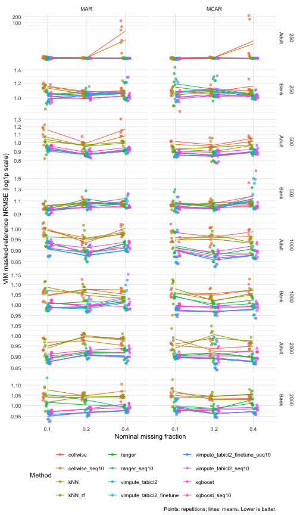
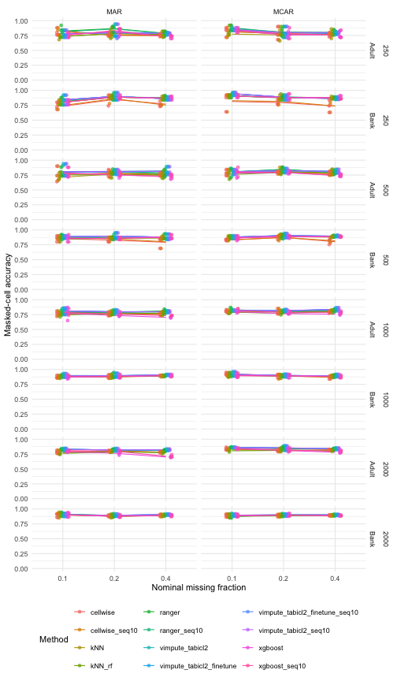
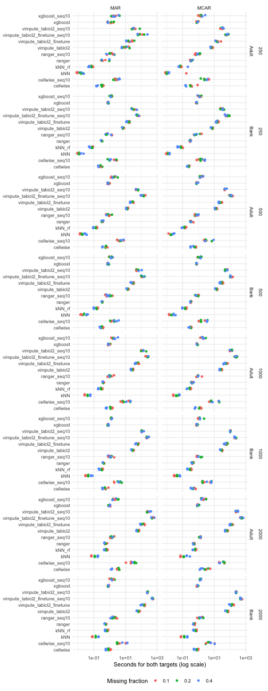
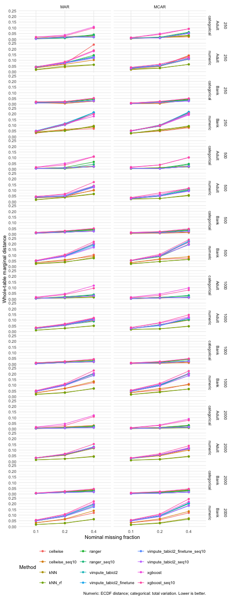
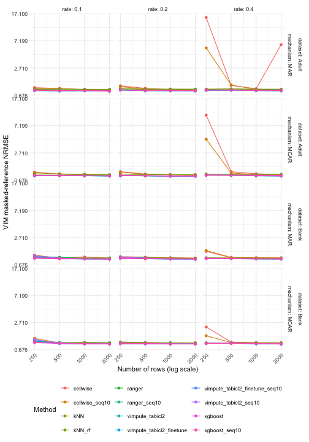
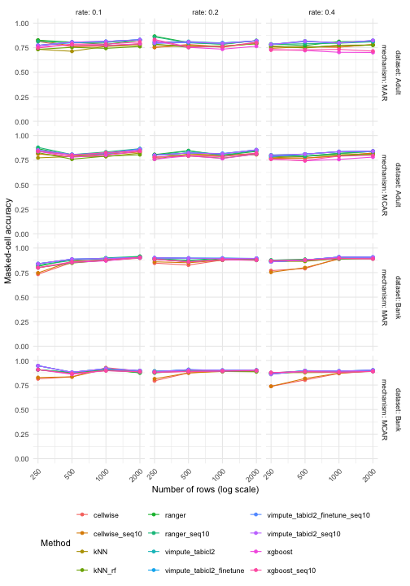
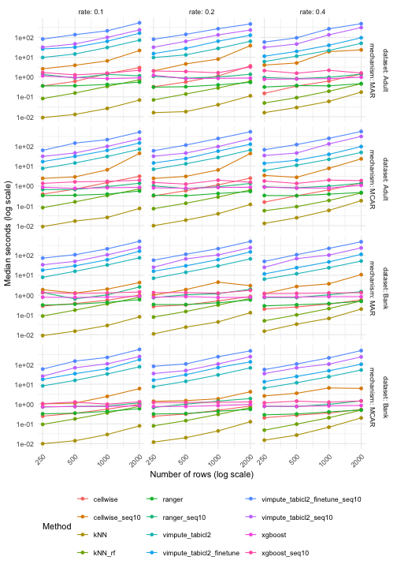
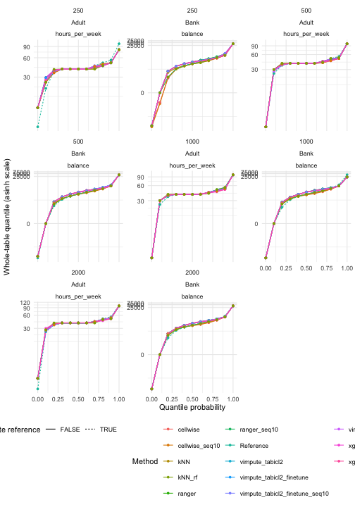
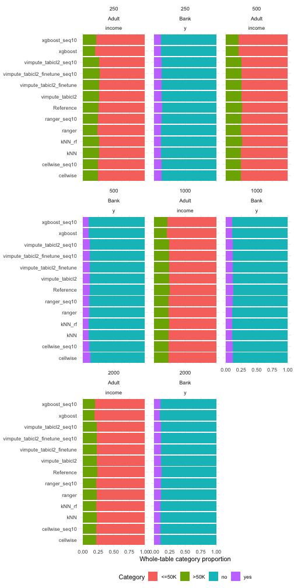

<style>
table { display: block; max-width: 100%; overflow-x: auto; }
</style>

## Introduction

This benchmark compares 12 imputation methods on numeric and categorical targets
in the Adult and Bank datasets, using shared samples and missingness masks.
The experiment uses 20 repetitions for each dataset, row count, missingness
mechanism and missingness rate. Results are evaluated on deliberately hidden
cells, whose true values are reserved for scoring.

| Method | Short explanation |
|:--|:--|
| `kNN` | Five nearest neighbours using equally weighted Gower distances; numeric medians and categorical modes. |
| `kNN_rf` | The same five-neighbour imputation with target-specific random-forest importance weights for the distances. |
| `cellwise` | Cell-weighted MM regression for numeric targets and weighted multinomial classification for categorical targets, in one pass. |
| `cellwise_seq10` | The same cellwise learners with up to ten sequential imputation passes. |
| `ranger` | Random-forest imputation with 100 trees, predicting each target from the original incomplete table. |
| `ranger_seq10` | Random-forest imputation with up to ten sequential passes. |
| `xgboost` | Gradient-boosted trees with 30 boosting rounds, predicting each target from the original incomplete table. |
| `xgboost_seq10` | Gradient-boosted tree imputation with up to ten sequential passes. |
| `vimpute_tabicl2` | Pretrained TabICL2 regression or classification with eight inference ensemble members, in one pass. |
| `vimpute_tabicl2_finetune` | TabICL2 fine-tuned on observed target values for up to five epochs, in one pass. |
| `vimpute_tabicl2_seq10` | Pretrained TabICL2 with up to ten sequential imputation passes. |
| `vimpute_tabicl2_finetune_seq10` | TabICL2 fine-tuned afresh at each fitted iteration, with up to ten sequential passes. |

This document is precomputed from its `.Rmd.orig` source. The generated `.Rmd`
contains static tables and figures, so rendering the saved report does not
initialize Python or fit models.

## Models and regeneration

All four TabICL variants call `vimpute(method = "tabicl2")`, with PMM and
residual noise disabled. Numeric targets use TabICLRegressor and factors use
TabICLClassifier. Fine-tuning uses the corresponding Finetuned estimators.
Each target and iteration fits a fresh model on observed target values only.

| Method | Fine-tuning | Sequential passes |
|:--|:--|:--|
| vimpute_tabicl2 | No | 1 |
| vimpute_tabicl2_finetune | Yes | 1 |
| vimpute_tabicl2_seq10 | No | Up to 10 |
| vimpute_tabicl2_finetune_seq10 | Yes | Up to 10 |

All variants use eight inference ensemble members on CPU. Fine-tuning uses
five epochs, learning rate `1e-5`, patience three, and two ensemble members
for training and validation, with mixed precision disabled. The upstream
internal validation split never receives hidden imputation truth. The seq10
variants use `sequential = TRUE, nseq = 10`; vimpute's convergence rule may
stop earlier. Fine-tuning occurs afresh at each fitted iteration.

Both kNN variants use five neighbours, range-standardized Gower distances,
median numeric aggregation and modal categorical aggregation. Each target
uses the original incomplete table, all other columns as distance variables,
and `useImputedDist = FALSE`. `kNN_rf` adds `weights = "auto"`: target-specific
random-forest impurity importances fitted on complete cases provide the
predictor weights (ranger's default 500 trees). This does not add RF predictions
as distance variables. Plain `kNN` uses equal predictor weights.

`cellwise` uses cell-weighted MM regression for numeric targets and weighted
multinomial classification for factors, with training-based predictor screening.
`cellwise_seq10` uses the same learners for up to ten sequential passes; it may
stop early at convergence. Both disable PMM and residual noise (`uncert = "none"`)
to match this benchmark's other vimpute variants, so donor screening is inactive.
Categorical imputation chooses the most probable class. Predictor categories
present in the task schema but absent from a target's observed training rows
are mapped internally to that predictor's training mode; supplied observed
cells remain unchanged.

The 20-repetition experiment recomputes all methods with the same configuration
and shared seed schedule. Earlier caches are preserved separately. Runtime
comparisons describe this hardware and execution environment and should not be
interpreted as universal speed ratios.

Ranger uses 100 trees and XGBoost 30 boosting rounds.
The seq10 variants use up to ten sequential passes; the other ranger/XGBoost variants
predict each target from the same incomplete table. TabICL's pretrained budget
differs from these fitted models, so this is a practical method comparison.

The full run is checkpointed by complete scenario. Restarting with the same
configuration and `resume = TRUE` retains completed scenarios and reruns an
interrupted scenario. Use a separate output directory when changing the
configuration. The report can be regenerated with `VIM_TABICL2_CACHED_ONLY=true`
and `VIM_TABICL2_RESULTS` set to a completed output directory without initializing
Python.

Python >= 3.10 and the optional R package `reticulate` are required for TabICL.
Install dependencies explicitly in the environment selected by reticulate:


``` bash
python -m pip install -r inst/python/tabicl-requirements.txt
```


``` r
# From the repository root, with the current VIM installed and the Python
# environment selected via RETICULATE_PYTHON:
# Rscript vignettes/precompute.R tabiclImpute-benchmark
# Edit config in tabiclImpute-benchmark.Rmd.orig for a different experiment.
# Set VIM_TABICL2_RESULTS to a fresh local directory if configuration changes.
# To render the already cached document only:
rmarkdown::render("vignettes/tabiclImpute-benchmark.Rmd")
```

## Datasets and preprocessing

* [Adult / Census Income](https://archive.ics.uci.edu/dataset/2/adult),
  Becker and Kohavi (1996), [DOI:10.24432/C5XW20](https://doi.org/10.24432/C5XW20):
  combine `adult.data` and `adult.test` (48,842 rows). Skip the test-file header,
  trim whitespace, remove the final period from test income labels, and parse
  `?` as missing. Combining the published splits is intentional: this is
  transductive reconstruction of missing cells, not a supervised income test.
* [Bank Marketing](https://archive.ics.uci.edu/dataset/222/bank+marketing),
  Moro, Rita and Cortez (2014), [DOI:10.24432/C5K306](https://doi.org/10.24432/C5K306):
  use `bank-full.csv` (45,211 rows), not the smaller sample or the different
  `bank-additional-full.csv`. Keep `unknown` as an observed category. It encodes
  recorded lack of knowledge; equating it with an artificially deleted value
  would change the evaluation target. Keep `pdays = -1` (no prior contact) as
  a structural sentinel in its original numeric column. Do not interpret it
  as a literal negative duration.

Both UCI datasets are distributed under CC BY 4.0. The script stores archive
URLs and MD5 checksums for provenance. Raw records are downloaded only with
explicit `download = TRUE` and are not bundled with VIM.

All character columns become unordered factors and all numeric measurements
remain numeric. No clipping, logarithms, balancing, rare-level pooling or
one-hot conversion is applied in shared preprocessing. Adult's `fnlwgt` remains
a predictor, not a survey weight; these are unweighted sample diagnostics.
Both education representations are retained. Bank's call duration is retained:
it is available for retrospective imputation, but would be inappropriate in a
pre-call subscription prediction task.

Remove rows with any existing NA to obtain complete references. Consequently,
Adult results describe its complete-case population and need not transfer to
people with naturally missing occupation or workclass. No correctness claim
is made for the unobserved true values in those removed rows.


Table: Rows before and after complete-case selection

|   |dataset |  rows| complete_rows|
|:--|:-------|-----:|-------------:|
|1  |Adult   | 48842|         45222|
|16 |Bank    | 45211|         45211|


Table: Existing missing values and retained unknown categories

|   |dataset |variable       | existing_na| unknown|
|:--|:-------|:--------------|-----------:|-------:|
|2  |Adult   |workclass      |        2799|       0|
|7  |Adult   |occupation     |        2809|       0|
|14 |Adult   |native_country |         857|       0|
|17 |Bank    |job            |           0|     288|
|19 |Bank    |education      |           0|    1857|
|24 |Bank    |contact        |           0|   13020|
|31 |Bank    |poutcome       |           0|   36959|


## Missingness simulation

Each repetition draws a new simple random sample without replacement from each
complete-case dataset at **  250,   500, 1,000, 2,000 rows**,
with **20 repetition(s)** per scenario.
The seed schedule is shared across sizes, so samples overlap and sample-size
comparisons are not independent replications. The sampling algorithm may change
with the requested size; exact nesting is not assumed. All methods share the
same sample and mask within each dataset/size/repetition/mechanism/rate scenario.
The column `n` records the number of rows in every result table. Seeds and
training budgets are unchanged across sizes: more rows imply more observed context and, when fine-tuning is enabled, more training batches.
The targets are Adult `hours_per_week` and `income`, and Bank `balance` and `y`.
Other columns stay observed, including the MAR driver `age`.

`makeMissing()` selects exactly `round(rate * nrow(truth))` cells per
target, without replacement. MCAR uses uniform sampling. MAR uses
`weights = c(age = 1)` explicitly: the sampling weights are the logistic
transform of standardized observed age. These weights are **not** marginal
cell-deletion probabilities; the requested number of rows is sampled using
those relative weights. Higher age favours selection. Age is never masked,
and no target's hidden value drives another target's missingness. Using the
default MAR drivers instead could include the other incomplete numeric target,
so specifying the observed driver matters here.

The `where` attribute supplies the common mask for every competing method
and for scoring. We retain the original reference separately. With 250 rows,
the three requested rates correspond to 25, 50 and 100 masked cells in each
target. With other sample sizes the fractions may differ slightly due to
rounding. Masks are never redrawn to remove difficult cases.


``` r
prepared <- uci_prepare("uci-cache", download = FALSE)
set.seed(config$seed)
truth <- prepared$data$Adult[sample(nrow(prepared$data$Adult), config$n[1L]), ]
incomplete <- makeMissing(truth, prop = .2, mechanism = "MAR",
  vars = c("hours_per_week", "income"), weights = c(age = 1), seed = config$seed)
mask <- attr(incomplete, "where")
incomplete <- droplevels(incomplete) # no levels learned solely from masked values
# truth is passed only to evaluation, never to a learner.
```


Table: Mean realized target-specific missing fractions

|    n|dataset |mechanism | rate|variable       | realized_rate|
|----:|:-------|:---------|----:|:--------------|-------------:|
|  250|Bank    |MAR       |  0.1|balance        |           0.1|
|  500|Bank    |MAR       |  0.1|balance        |           0.1|
| 1000|Bank    |MAR       |  0.1|balance        |           0.1|
| 2000|Bank    |MAR       |  0.1|balance        |           0.1|
|  250|Bank    |MCAR      |  0.1|balance        |           0.1|
|  500|Bank    |MCAR      |  0.1|balance        |           0.1|
| 1000|Bank    |MCAR      |  0.1|balance        |           0.1|
| 2000|Bank    |MCAR      |  0.1|balance        |           0.1|
|  250|Bank    |MAR       |  0.2|balance        |           0.2|
|  500|Bank    |MAR       |  0.2|balance        |           0.2|
| 1000|Bank    |MAR       |  0.2|balance        |           0.2|
| 2000|Bank    |MAR       |  0.2|balance        |           0.2|
|  250|Bank    |MCAR      |  0.2|balance        |           0.2|
|  500|Bank    |MCAR      |  0.2|balance        |           0.2|
| 1000|Bank    |MCAR      |  0.2|balance        |           0.2|
| 2000|Bank    |MCAR      |  0.2|balance        |           0.2|
|  250|Bank    |MAR       |  0.4|balance        |           0.4|
|  500|Bank    |MAR       |  0.4|balance        |           0.4|
| 1000|Bank    |MAR       |  0.4|balance        |           0.4|
| 2000|Bank    |MAR       |  0.4|balance        |           0.4|
|  250|Bank    |MCAR      |  0.4|balance        |           0.4|
|  500|Bank    |MCAR      |  0.4|balance        |           0.4|
| 1000|Bank    |MCAR      |  0.4|balance        |           0.4|
| 2000|Bank    |MCAR      |  0.4|balance        |           0.4|
|  250|Adult   |MAR       |  0.1|hours_per_week |           0.1|
|  500|Adult   |MAR       |  0.1|hours_per_week |           0.1|
| 1000|Adult   |MAR       |  0.1|hours_per_week |           0.1|
| 2000|Adult   |MAR       |  0.1|hours_per_week |           0.1|
|  250|Adult   |MCAR      |  0.1|hours_per_week |           0.1|
|  500|Adult   |MCAR      |  0.1|hours_per_week |           0.1|
| 1000|Adult   |MCAR      |  0.1|hours_per_week |           0.1|
| 2000|Adult   |MCAR      |  0.1|hours_per_week |           0.1|
|  250|Adult   |MAR       |  0.2|hours_per_week |           0.2|
|  500|Adult   |MAR       |  0.2|hours_per_week |           0.2|
| 1000|Adult   |MAR       |  0.2|hours_per_week |           0.2|
| 2000|Adult   |MAR       |  0.2|hours_per_week |           0.2|
|  250|Adult   |MCAR      |  0.2|hours_per_week |           0.2|
|  500|Adult   |MCAR      |  0.2|hours_per_week |           0.2|
| 1000|Adult   |MCAR      |  0.2|hours_per_week |           0.2|
| 2000|Adult   |MCAR      |  0.2|hours_per_week |           0.2|
|  250|Adult   |MAR       |  0.4|hours_per_week |           0.4|
|  500|Adult   |MAR       |  0.4|hours_per_week |           0.4|
| 1000|Adult   |MAR       |  0.4|hours_per_week |           0.4|
| 2000|Adult   |MAR       |  0.4|hours_per_week |           0.4|
|  250|Adult   |MCAR      |  0.4|hours_per_week |           0.4|
|  500|Adult   |MCAR      |  0.4|hours_per_week |           0.4|
| 1000|Adult   |MCAR      |  0.4|hours_per_week |           0.4|
| 2000|Adult   |MCAR      |  0.4|hours_per_week |           0.4|
|  250|Adult   |MAR       |  0.1|income         |           0.1|
|  500|Adult   |MAR       |  0.1|income         |           0.1|
| 1000|Adult   |MAR       |  0.1|income         |           0.1|
| 2000|Adult   |MAR       |  0.1|income         |           0.1|
|  250|Adult   |MCAR      |  0.1|income         |           0.1|
|  500|Adult   |MCAR      |  0.1|income         |           0.1|
| 1000|Adult   |MCAR      |  0.1|income         |           0.1|
| 2000|Adult   |MCAR      |  0.1|income         |           0.1|
|  250|Adult   |MAR       |  0.2|income         |           0.2|
|  500|Adult   |MAR       |  0.2|income         |           0.2|
| 1000|Adult   |MAR       |  0.2|income         |           0.2|
| 2000|Adult   |MAR       |  0.2|income         |           0.2|
|  250|Adult   |MCAR      |  0.2|income         |           0.2|
|  500|Adult   |MCAR      |  0.2|income         |           0.2|
| 1000|Adult   |MCAR      |  0.2|income         |           0.2|
| 2000|Adult   |MCAR      |  0.2|income         |           0.2|
|  250|Adult   |MAR       |  0.4|income         |           0.4|
|  500|Adult   |MAR       |  0.4|income         |           0.4|
| 1000|Adult   |MAR       |  0.4|income         |           0.4|
| 2000|Adult   |MAR       |  0.4|income         |           0.4|
|  250|Adult   |MCAR      |  0.4|income         |           0.4|
|  500|Adult   |MCAR      |  0.4|income         |           0.4|
| 1000|Adult   |MCAR      |  0.4|income         |           0.4|
| 2000|Adult   |MCAR      |  0.4|income         |           0.4|
|  250|Bank    |MAR       |  0.1|y              |           0.1|
|  500|Bank    |MAR       |  0.1|y              |           0.1|
| 1000|Bank    |MAR       |  0.1|y              |           0.1|
| 2000|Bank    |MAR       |  0.1|y              |           0.1|
|  250|Bank    |MCAR      |  0.1|y              |           0.1|
|  500|Bank    |MCAR      |  0.1|y              |           0.1|
| 1000|Bank    |MCAR      |  0.1|y              |           0.1|
| 2000|Bank    |MCAR      |  0.1|y              |           0.1|
|  250|Bank    |MAR       |  0.2|y              |           0.2|
|  500|Bank    |MAR       |  0.2|y              |           0.2|
| 1000|Bank    |MAR       |  0.2|y              |           0.2|
| 2000|Bank    |MAR       |  0.2|y              |           0.2|
|  250|Bank    |MCAR      |  0.2|y              |           0.2|
|  500|Bank    |MCAR      |  0.2|y              |           0.2|
| 1000|Bank    |MCAR      |  0.2|y              |           0.2|
| 2000|Bank    |MCAR      |  0.2|y              |           0.2|
|  250|Bank    |MAR       |  0.4|y              |           0.4|
|  500|Bank    |MAR       |  0.4|y              |           0.4|
| 1000|Bank    |MAR       |  0.4|y              |           0.4|
| 2000|Bank    |MAR       |  0.4|y              |           0.4|
|  250|Bank    |MCAR      |  0.4|y              |           0.4|
|  500|Bank    |MCAR      |  0.4|y              |           0.4|
| 1000|Bank    |MCAR      |  0.4|y              |           0.4|
| 2000|Bank    |MCAR      |  0.4|y              |           0.4|


## Evaluation

The pointwise metrics reuse VIM's existing tools and score artificially
masked cells only:

* `evaluation()` supplies numeric mean squared error (`err_num`) and the
  fraction of incorrect categories (`err_cat`). We report RMSE as
  `sqrt(err_num)`, misclassification as `err_cat`, and accuracy as
  `1 - err_cat`. Because the current implementation of `evaluation()` sums
  errors over the supplied table, the runner **subsets its inputs to masked
  cells for each target** and passes an all-TRUE `where` matrix. This makes
  the scoring boundary explicit. Whole-table calls are equivalent only when
  observed values are preserved, which the runner also checks.
* `nrmse(x, y, m = mask)` supplies **NRMSE**, using the standard deviation of
  the **masked true values**, as implemented by VIM. This is the convention
  used by the companion benchmark. Fewer than two masked values or zero
  masked-reference variance gives an undefined score, recorded as NA.
* **NRMSE_ref** (`nrmse_reference` in the CSV) retains the alternative
  `RMSE / sd(full sampled reference column)` requested for this UCI
  benchmark. It is separate from VIM's masked-reference NRMSE; under MAR the
  two denominators can differ substantially. Both denominators are common
  across methods within a scenario and are used only for evaluation.
* MAE, whole-table marginal distances and relationship diagnostics supplement
  these existing tools; they are not available from `evaluation()` itself.

## Results

The saved run contains 11520 method/scenario attempts,
11520 successful completions and
0 recorded failures. Every method in a scenario
uses the same `makeMissing()` mask. A successful completion means that the
completed table passed schema, observed-value and finite-score checks; it does
not imply optimizer convergence. Numerical warnings are retained in `runs.csv`.
The warning summary below makes nonconverged fits and explicit fallbacks visible.

### Summary


The following overview averages equally across the saved sample sizes,
missingness mechanisms, missingness rates and repetitions. Numeric error is
RMSE divided by the complete target's standard deviation; lower is better.
Categorical accuracy is measured on hidden cells; higher is better. This table
summarizes **20 repetitions**, not independent datasets.


|Method                         |Adult numeric error |Adult accuracy |Bank numeric error |Bank accuracy |
|:------------------------------|:-------------------|:--------------|:------------------|:-------------|
|kNN                            |0.986               |78.3%          |1.042              |88.7%         |
|kNN_rf                         |0.980               |78.3%          |1.040              |89.1%         |
|cellwise                       |872057266.548       |77.7%          |1.226              |86.5%         |
|cellwise_seq10                 |3.686               |77.6%          |1.162              |86.6%         |
|ranger                         |0.921               |81.7%          |1.012              |89.4%         |
|ranger_seq10                   |0.919               |82.0%          |1.015              |89.5%         |
|xgboost                        |0.925               |77.5%          |0.995              |88.9%         |
|xgboost_seq10                  |0.914               |79.0%          |0.997              |89.0%         |
|vimpute_tabicl2                |0.899               |82.4%          |0.991              |90.0%         |
|vimpute_tabicl2_finetune       |0.899               |82.4%          |0.989              |90.0%         |
|vimpute_tabicl2_seq10          |0.904               |82.4%          |1.004              |90.0%         |
|vimpute_tabicl2_finetune_seq10 |0.903               |82.4%          |0.998              |90.0%         |


Across 20 repetitions, TabICL2 has the lowest average numeric errors among these
methods and the highest or essentially tied highest categorical accuracies.
Basic TabICL2 achieves normalized numeric errors of 0.899 on Adult and 0.991 on
Bank, with categorical accuracies of 82.4% and 90.0%. Fine-tuning gives only tiny
average numeric improvements (0.899 and 0.989); sequential TabICL2 increases
numeric error on both datasets. These are descriptive comparisons, not claims
of statistical significance.

RF weighting gives kNN modest improvements: Adult numeric error falls from
0.986 to 0.980 and Bank from 1.042 to 1.040. Adult categorical accuracy remains
about 78.3%, while Bank accuracy increases from 88.7% to 89.1%. Median runtime
increases from 0.028 to 0.182 seconds.

Cellwise exhibits serious numeric instability. Single-pass Cellwise has a
normalized error of approximately 4.19e11 in one Adult scenario with 2,000 rows
and 40% missingness, driving its overall Adult mean to approximately 8.72e8.
Thus instability is not confined to the smallest sample size. Sequential
Cellwise avoids that particular extreme but still reaches about 900 at 250
rows; its overall Adult mean is 3.686. Restricting sequential Cellwise to at
least 500 rows gives an Adult mean of 0.991, still above kNN and TabICL2.
Bank numeric errors average 1.226 and 1.162 for single-pass and sequential
Cellwise. These extreme values are retained in all summaries and plots.

Categorical Cellwise also trails kNN on both datasets in the expanded experiment:
its single-pass accuracies are 77.7% on Adult and 86.5% on Bank, versus 78.3%
and 88.7% for kNN. Sequential Cellwise changes these to 77.6% and 86.6%.
Convergence warnings occur in 298 of 960 single-pass and 599 of 960 sequential
Cellwise runs. All methods return valid completed tables, and no featureless
fallbacks are recorded; validity does not establish numerical stability or
optimizer convergence.

Ranger offers a faster alternative with Adult accuracy of 81.7% (82.0%
sequentially) and Bank accuracy of 89.4% (89.5% sequentially). Sequential XGBoost
improves Adult numeric error from 0.925 to 0.914, but does not improve Bank
numeric error on average. Basic TabICL2 takes a median
16.617 seconds, compared with
38.440 seconds with fine-tuning,
96.508 seconds sequentially, and
183.646 seconds with both.
The additional TabICL2 computation provides little average accuracy benefit
under these training budgets. Timings span multiple resumed execution sessions.

The experiment uses two datasets and does not inject cellwise contamination.
It evaluates ordinary imputation performance, not contamination robustness.
Accuracy alone can conceal poor minority-class performance, and averages can
conceal unstable individual fits. The detailed scenario tables, warnings and
distribution diagnostics should therefore be read alongside the overview.


|Rows |Dataset |Method                         |Status | Runs|
|:----|:-------|:------------------------------|:------|----:|
|250  |Adult   |cellwise                       |ok     |  120|
|500  |Adult   |cellwise                       |ok     |  120|
|1000 |Adult   |cellwise                       |ok     |  120|
|2000 |Adult   |cellwise                       |ok     |  120|
|250  |Bank    |cellwise                       |ok     |  120|
|500  |Bank    |cellwise                       |ok     |  120|
|1000 |Bank    |cellwise                       |ok     |  120|
|2000 |Bank    |cellwise                       |ok     |  120|
|250  |Adult   |cellwise_seq10                 |ok     |  120|
|500  |Adult   |cellwise_seq10                 |ok     |  120|
|1000 |Adult   |cellwise_seq10                 |ok     |  120|
|2000 |Adult   |cellwise_seq10                 |ok     |  120|
|250  |Bank    |cellwise_seq10                 |ok     |  120|
|500  |Bank    |cellwise_seq10                 |ok     |  120|
|1000 |Bank    |cellwise_seq10                 |ok     |  120|
|2000 |Bank    |cellwise_seq10                 |ok     |  120|
|250  |Adult   |kNN                            |ok     |  120|
|500  |Adult   |kNN                            |ok     |  120|
|1000 |Adult   |kNN                            |ok     |  120|
|2000 |Adult   |kNN                            |ok     |  120|
|250  |Bank    |kNN                            |ok     |  120|
|500  |Bank    |kNN                            |ok     |  120|
|1000 |Bank    |kNN                            |ok     |  120|
|2000 |Bank    |kNN                            |ok     |  120|
|250  |Adult   |kNN_rf                         |ok     |  120|
|500  |Adult   |kNN_rf                         |ok     |  120|
|1000 |Adult   |kNN_rf                         |ok     |  120|
|2000 |Adult   |kNN_rf                         |ok     |  120|
|250  |Bank    |kNN_rf                         |ok     |  120|
|500  |Bank    |kNN_rf                         |ok     |  120|
|1000 |Bank    |kNN_rf                         |ok     |  120|
|2000 |Bank    |kNN_rf                         |ok     |  120|
|250  |Adult   |ranger                         |ok     |  120|
|500  |Adult   |ranger                         |ok     |  120|
|1000 |Adult   |ranger                         |ok     |  120|
|2000 |Adult   |ranger                         |ok     |  120|
|250  |Bank    |ranger                         |ok     |  120|
|500  |Bank    |ranger                         |ok     |  120|
|1000 |Bank    |ranger                         |ok     |  120|
|2000 |Bank    |ranger                         |ok     |  120|
|250  |Adult   |ranger_seq10                   |ok     |  120|
|500  |Adult   |ranger_seq10                   |ok     |  120|
|1000 |Adult   |ranger_seq10                   |ok     |  120|
|2000 |Adult   |ranger_seq10                   |ok     |  120|
|250  |Bank    |ranger_seq10                   |ok     |  120|
|500  |Bank    |ranger_seq10                   |ok     |  120|
|1000 |Bank    |ranger_seq10                   |ok     |  120|
|2000 |Bank    |ranger_seq10                   |ok     |  120|
|250  |Adult   |vimpute_tabicl2                |ok     |  120|
|500  |Adult   |vimpute_tabicl2                |ok     |  120|
|1000 |Adult   |vimpute_tabicl2                |ok     |  120|
|2000 |Adult   |vimpute_tabicl2                |ok     |  120|
|250  |Bank    |vimpute_tabicl2                |ok     |  120|
|500  |Bank    |vimpute_tabicl2                |ok     |  120|
|1000 |Bank    |vimpute_tabicl2                |ok     |  120|
|2000 |Bank    |vimpute_tabicl2                |ok     |  120|
|250  |Adult   |vimpute_tabicl2_finetune       |ok     |  120|
|500  |Adult   |vimpute_tabicl2_finetune       |ok     |  120|
|1000 |Adult   |vimpute_tabicl2_finetune       |ok     |  120|
|2000 |Adult   |vimpute_tabicl2_finetune       |ok     |  120|
|250  |Bank    |vimpute_tabicl2_finetune       |ok     |  120|
|500  |Bank    |vimpute_tabicl2_finetune       |ok     |  120|
|1000 |Bank    |vimpute_tabicl2_finetune       |ok     |  120|
|2000 |Bank    |vimpute_tabicl2_finetune       |ok     |  120|
|250  |Adult   |vimpute_tabicl2_finetune_seq10 |ok     |  120|
|500  |Adult   |vimpute_tabicl2_finetune_seq10 |ok     |  120|
|1000 |Adult   |vimpute_tabicl2_finetune_seq10 |ok     |  120|
|2000 |Adult   |vimpute_tabicl2_finetune_seq10 |ok     |  120|
|250  |Bank    |vimpute_tabicl2_finetune_seq10 |ok     |  120|
|500  |Bank    |vimpute_tabicl2_finetune_seq10 |ok     |  120|
|1000 |Bank    |vimpute_tabicl2_finetune_seq10 |ok     |  120|
|2000 |Bank    |vimpute_tabicl2_finetune_seq10 |ok     |  120|
|250  |Adult   |vimpute_tabicl2_seq10          |ok     |  120|
|500  |Adult   |vimpute_tabicl2_seq10          |ok     |  120|
|1000 |Adult   |vimpute_tabicl2_seq10          |ok     |  120|
|2000 |Adult   |vimpute_tabicl2_seq10          |ok     |  120|
|250  |Bank    |vimpute_tabicl2_seq10          |ok     |  120|
|500  |Bank    |vimpute_tabicl2_seq10          |ok     |  120|
|1000 |Bank    |vimpute_tabicl2_seq10          |ok     |  120|
|2000 |Bank    |vimpute_tabicl2_seq10          |ok     |  120|
|250  |Adult   |xgboost                        |ok     |  120|
|500  |Adult   |xgboost                        |ok     |  120|
|1000 |Adult   |xgboost                        |ok     |  120|
|2000 |Adult   |xgboost                        |ok     |  120|
|250  |Bank    |xgboost                        |ok     |  120|
|500  |Bank    |xgboost                        |ok     |  120|
|1000 |Bank    |xgboost                        |ok     |  120|
|2000 |Bank    |xgboost                        |ok     |  120|
|250  |Adult   |xgboost_seq10                  |ok     |  120|
|500  |Adult   |xgboost_seq10                  |ok     |  120|
|1000 |Adult   |xgboost_seq10                  |ok     |  120|
|2000 |Adult   |xgboost_seq10                  |ok     |  120|
|250  |Bank    |xgboost_seq10                  |ok     |  120|
|500  |Bank    |xgboost_seq10                  |ok     |  120|
|1000 |Bank    |xgboost_seq10                  |ok     |  120|
|2000 |Bank    |xgboost_seq10                  |ok     |  120|


Table: Runs with recorded warnings (counts may overlap).

|method                         | warned| convergence_warning| fallback_warning|
|:------------------------------|------:|-------------------:|----------------:|
|cellwise                       |    699|                 298|                0|
|cellwise_seq10                 |    847|                 599|                0|
|kNN                            |      0|                   0|                0|
|kNN_rf                         |      0|                   0|                0|
|ranger                         |     16|                   0|                0|
|ranger_seq10                   |     16|                   0|                0|
|vimpute_tabicl2                |      0|                   0|                0|
|vimpute_tabicl2_finetune       |      0|                   0|                0|
|vimpute_tabicl2_finetune_seq10 |      0|                   0|                0|
|vimpute_tabicl2_seq10          |      0|                   0|                0|
|xgboost                        |      0|                   0|                0|
|xgboost_seq10                  |      0|                   0|                0|


The following tables retain number of rows, dataset, mechanism and nominal rate. Scores are
means across successful repetitions, with their sample standard deviations in
parentheses. Counts are shown so failures cannot improve a ranking invisibly.
The saved configuration has 20 repetition(s). With one
repetition, standard deviations are unavailable; with few repetitions they
describe variation only roughly. They are not confidence intervals or significance tests. Methods are paired by
sample and mask, so formal comparisons would require paired analysis that accounts for the shared
samples and masks. Empty cells or `NA` indicate unavailable metrics: numeric error
measures do not apply to categorical targets, classification accuracy does not
apply to numeric targets, and a standard deviation requires at least two
successful repetitions. These are missing summary statistics, not unfilled
imputation cells. Auxiliary hurdle-model `*_zero_prob` diagnostics are excluded
from the scored data; actual target columns must contain no missing values. Success counts use completed
attempts as the denominator. The Coverage column distinguishes pending requested
repetitions from scenarios outside the saved experiment.


### Adult: MCAR, 250 rows


| Rate|Method                         |Coverage |Success |RMSE               |MAE                |NRMSE            |NRMSE_ref        |Accuracy      |Misclassification |Seconds         |
|----:|:------------------------------|:--------|:-------|:------------------|:------------------|:----------------|:----------------|:-------------|:-----------------|:---------------|
|  0.1|kNN                            |Complete |20/20   |12.416 (2.370)     |7.904 (1.487)      |1.012 (0.118)    |1.050 (0.171)    |0.810 (0.095) |0.190 (0.095)     |0.022 (0.046)   |
|  0.1|kNN_rf                         |Complete |20/20   |12.129 (2.161)     |7.730 (1.447)      |0.991 (0.118)    |1.025 (0.146)    |0.808 (0.084) |0.192 (0.084)     |0.083 (0.004)   |
|  0.1|cellwise                       |Complete |20/20   |13.701 (3.025)     |9.730 (1.777)      |1.115 (0.164)    |1.162 (0.255)    |0.766 (0.094) |0.234 (0.094)     |0.399 (0.045)   |
|  0.1|cellwise_seq10                 |Complete |20/20   |13.276 (2.034)     |9.414 (1.293)      |1.088 (0.127)    |1.125 (0.157)    |0.766 (0.094) |0.234 (0.094)     |2.836 (0.983)   |
|  0.1|ranger                         |Complete |20/20   |11.282 (1.975)     |7.812 (1.325)      |0.921 (0.096)    |0.953 (0.130)    |0.840 (0.087) |0.160 (0.087)     |0.346 (0.030)   |
|  0.1|ranger_seq10                   |Complete |20/20   |11.328 (2.001)     |7.870 (1.299)      |0.925 (0.094)    |0.958 (0.135)    |0.846 (0.087) |0.154 (0.087)     |0.874 (0.376)   |
|  0.1|xgboost                        |Complete |20/20   |11.499 (2.231)     |7.676 (1.482)      |0.932 (0.056)    |0.971 (0.154)    |0.808 (0.095) |0.192 (0.095)     |1.144 (0.203)   |
|  0.1|xgboost_seq10                  |Complete |20/20   |11.433 (2.267)     |7.850 (1.330)      |0.927 (0.077)    |0.965 (0.157)    |0.822 (0.091) |0.178 (0.091)     |1.906 (0.432)   |
|  0.1|vimpute_tabicl2                |Complete |20/20   |11.104 (2.125)     |7.752 (1.371)      |0.904 (0.083)    |0.937 (0.141)    |0.836 (0.077) |0.164 (0.077)     |7.898 (0.526)   |
|  0.1|vimpute_tabicl2_finetune       |Complete |20/20   |11.114 (2.148)     |7.694 (1.350)      |0.904 (0.085)    |0.938 (0.142)    |0.834 (0.074) |0.166 (0.074)     |17.162 (1.633)  |
|  0.1|vimpute_tabicl2_seq10          |Complete |20/20   |11.142 (2.144)     |7.846 (1.278)      |0.907 (0.093)    |0.941 (0.141)    |0.836 (0.077) |0.164 (0.077)     |28.874 (4.465)  |
|  0.1|vimpute_tabicl2_finetune_seq10 |Complete |20/20   |11.142 (2.155)     |7.804 (1.261)      |0.907 (0.091)    |0.941 (0.143)    |0.834 (0.074) |0.166 (0.074)     |63.810 (11.851) |
|  0.2|kNN                            |Complete |20/20   |11.478 (1.131)     |7.541 (0.702)      |0.999 (0.067)    |0.977 (0.109)    |0.795 (0.076) |0.205 (0.076)     |0.012 (0.002)   |
|  0.2|kNN_rf                         |Complete |20/20   |11.435 (1.058)     |7.435 (0.792)      |0.997 (0.076)    |0.973 (0.105)    |0.799 (0.070) |0.201 (0.070)     |0.072 (0.004)   |
|  0.2|cellwise                       |Complete |20/20   |13.186 (2.164)     |9.370 (1.359)      |1.150 (0.185)    |1.118 (0.166)    |0.769 (0.055) |0.231 (0.055)     |0.350 (0.034)   |
|  0.2|cellwise_seq10                 |Complete |20/20   |12.809 (1.885)     |9.024 (1.203)      |1.115 (0.141)    |1.087 (0.149)    |0.768 (0.053) |0.232 (0.053)     |2.496 (0.779)   |
|  0.2|ranger                         |Complete |20/20   |10.588 (1.419)     |7.286 (0.708)      |0.919 (0.077)    |0.901 (0.126)    |0.822 (0.059) |0.178 (0.059)     |0.336 (0.027)   |
|  0.2|ranger_seq10                   |Complete |20/20   |10.603 (1.416)     |7.349 (0.772)      |0.921 (0.082)    |0.903 (0.130)    |0.818 (0.068) |0.182 (0.068)     |0.821 (0.235)   |
|  0.2|xgboost                        |Complete |20/20   |10.756 (1.251)     |7.140 (0.657)      |0.934 (0.045)    |0.915 (0.115)    |0.790 (0.054) |0.210 (0.054)     |1.074 (0.107)   |
|  0.2|xgboost_seq10                  |Complete |20/20   |10.609 (1.361)     |7.258 (0.629)      |0.921 (0.068)    |0.902 (0.120)    |0.797 (0.049) |0.203 (0.049)     |1.891 (0.337)   |
|  0.2|vimpute_tabicl2                |Complete |20/20   |10.372 (1.306)     |7.152 (0.644)      |0.901 (0.071)    |0.883 (0.120)    |0.829 (0.072) |0.171 (0.072)     |7.151 (0.444)   |
|  0.2|vimpute_tabicl2_finetune       |Complete |20/20   |10.390 (1.330)     |7.143 (0.680)      |0.902 (0.073)    |0.884 (0.122)    |0.829 (0.071) |0.171 (0.071)     |14.859 (1.247)  |
|  0.2|vimpute_tabicl2_seq10          |Complete |20/20   |10.409 (1.301)     |7.295 (0.682)      |0.905 (0.081)    |0.886 (0.121)    |0.829 (0.072) |0.171 (0.072)     |29.421 (4.746)  |
|  0.2|vimpute_tabicl2_finetune_seq10 |Complete |20/20   |10.362 (1.351)     |7.230 (0.750)      |0.900 (0.082)    |0.882 (0.125)    |0.830 (0.070) |0.170 (0.070)     |62.346 (12.948) |
|  0.4|kNN                            |Complete |20/20   |11.492 (1.402)     |7.468 (0.883)      |0.984 (0.051)    |0.972 (0.074)    |0.784 (0.042) |0.215 (0.042)     |0.014 (0.001)   |
|  0.4|kNN_rf                         |Complete |20/20   |11.629 (1.429)     |7.530 (1.006)      |0.995 (0.049)    |0.984 (0.074)    |0.792 (0.030) |0.207 (0.030)     |0.054 (0.014)   |
|  0.4|cellwise                       |Complete |20/20   |809.617 (2656.813) |374.045 (1029.033) |72.888 (243.786) |71.381 (237.062) |0.745 (0.034) |0.255 (0.034)     |0.173 (0.019)   |
|  0.4|cellwise_seq10                 |Complete |20/20   |623.537 (2259.625) |262.967 (815.459)  |56.378 (207.626) |55.166 (201.728) |0.742 (0.036) |0.259 (0.036)     |4.069 (0.370)   |
|  0.4|ranger                         |Complete |20/20   |11.013 (1.366)     |7.636 (0.817)      |0.942 (0.039)    |0.932 (0.071)    |0.806 (0.040) |0.194 (0.040)     |0.331 (0.037)   |
|  0.4|ranger_seq10                   |Complete |20/20   |10.846 (1.494)     |7.547 (0.909)      |0.927 (0.050)    |0.917 (0.085)    |0.822 (0.039) |0.178 (0.039)     |0.796 (0.151)   |
|  0.4|xgboost                        |Complete |20/20   |11.062 (1.352)     |7.191 (0.902)      |0.946 (0.023)    |0.936 (0.071)    |0.764 (0.046) |0.236 (0.046)     |1.071 (0.082)   |
|  0.4|xgboost_seq10                  |Complete |20/20   |10.925 (1.369)     |7.415 (0.954)      |0.934 (0.034)    |0.924 (0.073)    |0.767 (0.046) |0.233 (0.046)     |1.922 (0.459)   |
|  0.4|vimpute_tabicl2                |Complete |20/20   |10.849 (1.353)     |7.548 (0.834)      |0.928 (0.048)    |0.918 (0.075)    |0.813 (0.040) |0.187 (0.040)     |6.049 (0.297)   |
|  0.4|vimpute_tabicl2_finetune       |Complete |20/20   |10.821 (1.358)     |7.506 (0.831)      |0.926 (0.047)    |0.916 (0.075)    |0.814 (0.043) |0.186 (0.043)     |13.018 (1.504)  |
|  0.4|vimpute_tabicl2_seq10          |Complete |20/20   |10.990 (1.419)     |7.798 (0.867)      |0.940 (0.056)    |0.930 (0.079)    |0.813 (0.040) |0.187 (0.040)     |31.259 (4.497)  |
|  0.4|vimpute_tabicl2_finetune_seq10 |Complete |20/20   |10.936 (1.424)     |7.743 (0.859)      |0.936 (0.055)    |0.925 (0.080)    |0.814 (0.043) |0.186 (0.043)     |62.296 (12.616) |


### Adult: MAR, 250 rows


| Rate|Method                         |Coverage |Success |RMSE              |MAE               |NRMSE           |NRMSE_ref       |Accuracy      |Misclassification |Seconds         |
|----:|:------------------------------|:--------|:-------|:-----------------|:-----------------|:---------------|:---------------|:-------------|:-----------------|:---------------|
|  0.1|kNN                            |Complete |20/20   |11.597 (1.967)    |7.526 (1.611)     |1.021 (0.134)   |0.988 (0.189)   |0.764 (0.093) |0.236 (0.093)     |0.011 (0.003)   |
|  0.1|kNN_rf                         |Complete |20/20   |11.237 (1.965)    |7.322 (1.429)     |0.989 (0.140)   |0.957 (0.184)   |0.778 (0.080) |0.222 (0.080)     |0.083 (0.005)   |
|  0.1|cellwise                       |Complete |20/20   |12.459 (2.376)    |9.162 (1.575)     |1.101 (0.194)   |1.063 (0.228)   |0.770 (0.090) |0.230 (0.090)     |0.404 (0.039)   |
|  0.1|cellwise_seq10                 |Complete |20/20   |11.967 (2.215)    |8.800 (1.492)     |1.059 (0.185)   |1.021 (0.214)   |0.774 (0.083) |0.226 (0.083)     |2.707 (1.035)   |
|  0.1|ranger                         |Complete |20/20   |10.808 (2.015)    |7.488 (1.415)     |0.951 (0.138)   |0.920 (0.184)   |0.822 (0.073) |0.178 (0.073)     |0.396 (0.155)   |
|  0.1|ranger_seq10                   |Complete |20/20   |10.978 (1.980)    |7.674 (1.198)     |0.966 (0.126)   |0.935 (0.183)   |0.818 (0.060) |0.182 (0.060)     |0.833 (0.286)   |
|  0.1|xgboost                        |Complete |20/20   |10.840 (2.258)    |7.378 (1.488)     |0.942 (0.054)   |0.923 (0.206)   |0.772 (0.074) |0.228 (0.074)     |1.080 (0.116)   |
|  0.1|xgboost_seq10                  |Complete |20/20   |10.850 (2.332)    |7.540 (1.415)     |0.944 (0.092)   |0.924 (0.212)   |0.780 (0.073) |0.220 (0.073)     |2.017 (0.883)   |
|  0.1|vimpute_tabicl2                |Complete |20/20   |10.522 (1.925)    |7.358 (1.166)     |0.922 (0.100)   |0.896 (0.179)   |0.824 (0.075) |0.176 (0.075)     |7.846 (0.716)   |
|  0.1|vimpute_tabicl2_finetune       |Complete |20/20   |10.525 (1.941)    |7.364 (1.192)     |0.922 (0.098)   |0.896 (0.181)   |0.826 (0.074) |0.174 (0.074)     |17.894 (6.513)  |
|  0.1|vimpute_tabicl2_seq10          |Complete |20/20   |10.586 (1.985)    |7.500 (1.164)     |0.928 (0.107)   |0.901 (0.179)   |0.824 (0.075) |0.176 (0.075)     |30.257 (7.543)  |
|  0.1|vimpute_tabicl2_finetune_seq10 |Complete |20/20   |10.539 (1.956)    |7.448 (1.129)     |0.924 (0.105)   |0.897 (0.178)   |0.826 (0.074) |0.174 (0.074)     |62.070 (11.533) |
|  0.2|kNN                            |Complete |20/20   |12.405 (1.695)    |8.030 (1.310)     |1.034 (0.081)   |1.056 (0.158)   |0.759 (0.053) |0.241 (0.053)     |0.012 (0.003)   |
|  0.2|kNN_rf                         |Complete |20/20   |12.257 (1.622)    |7.905 (1.157)     |1.023 (0.090)   |1.044 (0.158)   |0.761 (0.051) |0.239 (0.051)     |0.070 (0.003)   |
|  0.2|cellwise                       |Complete |20/20   |14.461 (2.328)    |10.308 (1.157)    |1.223 (0.272)   |1.229 (0.185)   |0.720 (0.044) |0.280 (0.044)     |0.347 (0.044)   |
|  0.2|cellwise_seq10                 |Complete |20/20   |13.715 (2.039)    |9.777 (1.013)     |1.156 (0.222)   |1.167 (0.178)   |0.720 (0.045) |0.280 (0.045)     |2.848 (1.404)   |
|  0.2|ranger                         |Complete |20/20   |11.759 (1.629)    |8.117 (1.077)     |0.980 (0.080)   |1.001 (0.153)   |0.822 (0.055) |0.178 (0.055)     |0.346 (0.046)   |
|  0.2|ranger_seq10                   |Complete |20/20   |11.663 (1.683)    |8.053 (1.121)     |0.971 (0.068)   |0.993 (0.155)   |0.817 (0.041) |0.183 (0.041)     |0.905 (0.272)   |
|  0.2|xgboost                        |Complete |20/20   |11.626 (1.851)    |7.688 (1.267)     |0.965 (0.037)   |0.991 (0.175)   |0.781 (0.056) |0.219 (0.056)     |1.112 (0.131)   |
|  0.2|xgboost_seq10                  |Complete |20/20   |11.527 (1.800)    |7.870 (1.133)     |0.957 (0.044)   |0.982 (0.169)   |0.798 (0.052) |0.202 (0.052)     |1.878 (0.378)   |
|  0.2|vimpute_tabicl2                |Complete |20/20   |11.416 (1.728)    |7.857 (1.162)     |0.949 (0.058)   |0.972 (0.159)   |0.807 (0.067) |0.193 (0.067)     |7.120 (0.392)   |
|  0.2|vimpute_tabicl2_finetune       |Complete |20/20   |11.414 (1.758)    |7.835 (1.182)     |0.949 (0.059)   |0.971 (0.161)   |0.806 (0.066) |0.194 (0.066)     |15.544 (1.828)  |
|  0.2|vimpute_tabicl2_seq10          |Complete |20/20   |11.564 (1.734)    |8.009 (1.194)     |0.962 (0.066)   |0.983 (0.154)   |0.807 (0.066) |0.193 (0.066)     |30.557 (6.708)  |
|  0.2|vimpute_tabicl2_finetune_seq10 |Complete |20/20   |11.572 (1.750)    |7.996 (1.252)     |0.962 (0.069)   |0.984 (0.156)   |0.806 (0.067) |0.194 (0.067)     |63.690 (9.223)  |
|  0.4|kNN                            |Complete |20/20   |11.632 (1.479)    |7.484 (0.946)     |0.997 (0.047)   |0.985 (0.095)   |0.754 (0.047) |0.245 (0.047)     |0.016 (0.004)   |
|  0.4|kNN_rf                         |Complete |20/20   |11.669 (1.413)    |7.466 (0.868)     |1.001 (0.062)   |0.989 (0.099)   |0.751 (0.052) |0.249 (0.052)     |0.049 (0.004)   |
|  0.4|cellwise                       |Complete |20/20   |403.387 (623.589) |279.552 (490.584) |34.646 (52.254) |34.414 (53.865) |0.723 (0.044) |0.278 (0.044)     |0.176 (0.016)   |
|  0.4|cellwise_seq10                 |Complete |20/20   |128.948 (228.017) |69.634 (107.010)  |10.847 (18.469) |11.056 (19.632) |0.714 (0.037) |0.286 (0.037)     |4.082 (0.381)   |
|  0.4|ranger                         |Complete |20/20   |11.208 (1.630)    |7.811 (1.027)     |0.959 (0.059)   |0.950 (0.119)   |0.778 (0.043) |0.222 (0.043)     |0.335 (0.027)   |
|  0.4|ranger_seq10                   |Complete |20/20   |10.984 (1.451)    |7.613 (0.920)     |0.941 (0.049)   |0.931 (0.103)   |0.792 (0.042) |0.208 (0.042)     |0.781 (0.137)   |
|  0.4|xgboost                        |Complete |20/20   |11.252 (1.582)    |7.215 (1.055)     |0.962 (0.018)   |0.953 (0.108)   |0.723 (0.043) |0.278 (0.043)     |1.111 (0.105)   |
|  0.4|xgboost_seq10                  |Complete |20/20   |11.080 (1.554)    |7.455 (1.026)     |0.947 (0.031)   |0.939 (0.109)   |0.727 (0.041) |0.273 (0.041)     |1.935 (0.505)   |
|  0.4|vimpute_tabicl2                |Complete |20/20   |10.932 (1.442)    |7.587 (1.005)     |0.937 (0.050)   |0.926 (0.098)   |0.791 (0.037) |0.209 (0.037)     |6.131 (0.426)   |
|  0.4|vimpute_tabicl2_finetune       |Complete |20/20   |10.880 (1.455)    |7.490 (1.012)     |0.932 (0.046)   |0.922 (0.099)   |0.791 (0.036) |0.208 (0.036)     |12.462 (1.265)  |
|  0.4|vimpute_tabicl2_seq10          |Complete |20/20   |11.041 (1.404)    |7.766 (1.028)     |0.947 (0.062)   |0.936 (0.095)   |0.790 (0.036) |0.210 (0.036)     |30.635 (5.224)  |
|  0.4|vimpute_tabicl2_finetune_seq10 |Complete |20/20   |10.965 (1.434)    |7.687 (1.059)     |0.940 (0.053)   |0.929 (0.098)   |0.790 (0.035) |0.210 (0.035)     |65.977 (12.031) |


### Bank: MCAR, 250 rows


| Rate|Method                         |Coverage |Success |RMSE                  |MAE                   |NRMSE          |NRMSE_ref     |Accuracy      |Misclassification |Seconds         |
|----:|:------------------------------|:--------|:-------|:---------------------|:---------------------|:--------------|:-------------|:-------------|:-----------------|:---------------|
|  0.1|kNN                            |Complete |20/20   |3394.766 (2346.200)   |1649.180 (667.050)    |1.139 (0.178)  |1.037 (0.512) |0.904 (0.068) |0.096 (0.068)     |0.012 (0.003)   |
|  0.1|kNN_rf                         |Complete |20/20   |3356.362 (2330.293)   |1619.578 (679.091)    |1.144 (0.314)  |1.030 (0.523) |0.914 (0.067) |0.086 (0.067)     |0.092 (0.010)   |
|  0.1|cellwise                       |Complete |20/20   |3336.882 (2322.680)   |1639.478 (637.348)    |1.148 (0.342)  |1.022 (0.509) |0.822 (0.088) |0.178 (0.088)     |0.321 (0.115)   |
|  0.1|cellwise_seq10                 |Complete |20/20   |3898.765 (2959.209)   |2177.182 (2316.902)   |2.095 (4.554)  |1.143 (0.595) |0.824 (0.096) |0.176 (0.096)     |1.656 (0.903)   |
|  0.1|ranger                         |Complete |20/20   |3374.087 (2261.327)   |1935.690 (716.713)    |1.236 (0.660)  |1.020 (0.470) |0.914 (0.063) |0.086 (0.063)     |0.399 (0.129)   |
|  0.1|ranger_seq10                   |Complete |20/20   |3391.427 (2283.298)   |1955.338 (692.908)    |1.210 (0.472)  |1.029 (0.476) |0.910 (0.066) |0.090 (0.066)     |0.841 (0.388)   |
|  0.1|xgboost                        |Complete |20/20   |3193.456 (2319.520)   |1664.474 (643.471)    |1.064 (0.210)  |0.972 (0.509) |0.908 (0.066) |0.092 (0.066)     |1.067 (0.106)   |
|  0.1|xgboost_seq10                  |Complete |20/20   |3213.000 (2313.755)   |1758.124 (676.608)    |1.099 (0.336)  |0.975 (0.500) |0.908 (0.066) |0.092 (0.066)     |1.552 (0.525)   |
|  0.1|vimpute_tabicl2                |Complete |20/20   |3290.072 (2244.917)   |1846.832 (658.373)    |1.209 (0.721)  |0.996 (0.474) |0.922 (0.054) |0.078 (0.054)     |8.190 (1.013)   |
|  0.1|vimpute_tabicl2_finetune       |Complete |20/20   |3265.675 (2258.964)   |1811.376 (668.090)    |1.170 (0.579)  |0.989 (0.480) |0.922 (0.054) |0.078 (0.054)     |18.310 (2.441)  |
|  0.1|vimpute_tabicl2_seq10          |Complete |20/20   |3523.093 (2342.794)   |2012.678 (875.869)    |1.607 (2.430)  |1.048 (0.462) |0.922 (0.054) |0.078 (0.054)     |30.469 (13.809) |
|  0.1|vimpute_tabicl2_finetune_seq10 |Complete |20/20   |3506.640 (2380.984)   |1991.012 (906.063)    |1.623 (2.595)  |1.040 (0.472) |0.922 (0.054) |0.078 (0.054)     |66.685 (31.314) |
|  0.2|kNN                            |Complete |20/20   |3710.546 (2243.847)   |1572.131 (539.593)    |1.047 (0.056)  |1.074 (0.341) |0.891 (0.052) |0.109 (0.052)     |0.013 (0.003)   |
|  0.2|kNN_rf                         |Complete |20/20   |3734.041 (2230.439)   |1598.269 (527.321)    |1.057 (0.072)  |1.081 (0.334) |0.893 (0.052) |0.107 (0.052)     |0.075 (0.005)   |
|  0.2|cellwise                       |Complete |20/20   |3784.229 (2226.695)   |1676.844 (514.019)    |1.069 (0.094)  |1.097 (0.349) |0.824 (0.056) |0.176 (0.056)     |0.286 (0.076)   |
|  0.2|cellwise_seq10                 |Complete |20/20   |3907.378 (2289.447)   |1877.659 (1072.161)   |1.109 (0.230)  |1.149 (0.444) |0.825 (0.059) |0.175 (0.059)     |1.767 (0.694)   |
|  0.2|ranger                         |Complete |20/20   |3672.726 (2154.033)   |1881.979 (589.901)    |1.055 (0.165)  |1.065 (0.313) |0.888 (0.054) |0.112 (0.054)     |0.410 (0.155)   |
|  0.2|ranger_seq10                   |Complete |20/20   |3664.665 (2150.744)   |1892.605 (583.399)    |1.053 (0.157)  |1.063 (0.311) |0.893 (0.053) |0.107 (0.053)     |0.922 (0.340)   |
|  0.2|xgboost                        |Complete |20/20   |3589.270 (2249.440)   |1586.414 (542.231)    |0.999 (0.038)  |1.033 (0.351) |0.890 (0.052) |0.110 (0.052)     |1.088 (0.181)   |
|  0.2|xgboost_seq10                  |Complete |20/20   |3587.251 (2230.370)   |1681.546 (541.423)    |1.004 (0.078)  |1.033 (0.344) |0.890 (0.052) |0.110 (0.052)     |1.511 (0.245)   |
|  0.2|vimpute_tabicl2                |Complete |20/20   |3580.173 (2174.178)   |1790.787 (573.090)    |1.011 (0.114)  |1.032 (0.328) |0.895 (0.057) |0.105 (0.057)     |7.455 (1.079)   |
|  0.2|vimpute_tabicl2_finetune       |Complete |20/20   |3576.342 (2179.925)   |1764.643 (577.255)    |1.008 (0.100)  |1.031 (0.331) |0.893 (0.056) |0.107 (0.056)     |16.524 (2.634)  |
|  0.2|vimpute_tabicl2_seq10          |Complete |20/20   |3663.790 (2190.497)   |1848.651 (624.840)    |1.036 (0.160)  |1.054 (0.333) |0.895 (0.057) |0.105 (0.057)     |31.610 (17.586) |
|  0.2|vimpute_tabicl2_finetune_seq10 |Complete |20/20   |3557.342 (2201.248)   |1762.797 (572.047)    |0.995 (0.080)  |1.023 (0.339) |0.893 (0.056) |0.107 (0.056)     |64.151 (14.042) |
|  0.4|kNN                            |Complete |20/20   |3432.522 (1286.529)   |1554.170 (353.464)    |1.042 (0.042)  |1.055 (0.205) |0.891 (0.032) |0.108 (0.032)     |0.029 (0.049)   |
|  0.4|kNN_rf                         |Complete |20/20   |3442.468 (1294.253)   |1576.287 (368.640)    |1.045 (0.042)  |1.056 (0.196) |0.887 (0.035) |0.113 (0.035)     |0.053 (0.004)   |
|  0.4|cellwise                       |Complete |20/20   |17865.250 (44944.257) |10944.663 (28323.848) |5.007 (11.389) |4.728 (9.686) |0.813 (0.074) |0.187 (0.074)     |0.213 (0.042)   |
|  0.4|cellwise_seq10                 |Complete |20/20   |11213.254 (33039.959) |7229.705 (23455.906)  |3.053 (8.337)  |2.740 (6.837) |0.821 (0.072) |0.179 (0.072)     |2.203 (0.699)   |
|  0.4|ranger                         |Complete |20/20   |3352.620 (1249.753)   |1839.598 (409.409)    |1.018 (0.032)  |1.031 (0.196) |0.893 (0.032) |0.106 (0.032)     |0.357 (0.084)   |
|  0.4|ranger_seq10                   |Complete |20/20   |3351.711 (1256.296)   |1854.551 (373.797)    |1.018 (0.036)  |1.028 (0.189) |0.892 (0.033) |0.108 (0.033)     |0.846 (0.241)   |
|  0.4|xgboost                        |Complete |20/20   |3351.394 (1300.695)   |1505.975 (340.997)    |1.012 (0.023)  |1.026 (0.204) |0.891 (0.035) |0.108 (0.035)     |1.048 (0.121)   |
|  0.4|xgboost_seq10                  |Complete |20/20   |3343.327 (1296.849)   |1631.120 (350.015)    |1.010 (0.032)  |1.022 (0.196) |0.891 (0.035) |0.108 (0.035)     |1.586 (0.350)   |
|  0.4|vimpute_tabicl2                |Complete |20/20   |3325.787 (1290.487)   |1801.351 (412.253)    |1.005 (0.038)  |1.015 (0.189) |0.900 (0.035) |0.100 (0.035)     |6.560 (0.604)   |
|  0.4|vimpute_tabicl2_finetune       |Complete |20/20   |3320.599 (1293.362)   |1771.958 (411.176)    |1.003 (0.039)  |1.013 (0.189) |0.900 (0.034) |0.100 (0.034)     |13.604 (1.330)  |
|  0.4|vimpute_tabicl2_seq10          |Complete |20/20   |3368.956 (1301.014)   |1823.705 (437.220)    |1.018 (0.051)  |1.028 (0.189) |0.900 (0.035) |0.100 (0.035)     |30.174 (7.587)  |
|  0.4|vimpute_tabicl2_finetune_seq10 |Complete |20/20   |3348.452 (1299.310)   |1785.086 (440.957)    |1.012 (0.050)  |1.022 (0.189) |0.900 (0.034) |0.100 (0.034)     |62.485 (17.299) |


### Bank: MAR, 250 rows


| Rate|Method                         |Coverage |Success |RMSE                |MAE                 |NRMSE         |NRMSE_ref     |Accuracy      |Misclassification |Seconds         |
|----:|:------------------------------|:--------|:-------|:-------------------|:-------------------|:-------------|:-------------|:-------------|:-----------------|:---------------|
|  0.1|kNN                            |Complete |20/20   |2812.616 (1205.449) |1518.242 (496.530)  |1.172 (0.251) |0.879 (0.299) |0.894 (0.055) |0.106 (0.055)     |0.012 (0.002)   |
|  0.1|kNN_rf                         |Complete |20/20   |2682.075 (1285.633) |1485.540 (537.091)  |1.084 (0.138) |0.831 (0.326) |0.896 (0.057) |0.104 (0.057)     |0.089 (0.006)   |
|  0.1|cellwise                       |Complete |20/20   |2678.322 (1311.520) |1508.936 (622.731)  |1.077 (0.169) |0.823 (0.312) |0.820 (0.067) |0.180 (0.067)     |0.291 (0.051)   |
|  0.1|cellwise_seq10                 |Complete |20/20   |3156.645 (2148.503) |1964.806 (1980.215) |1.287 (0.623) |0.948 (0.441) |0.826 (0.070) |0.174 (0.070)     |1.690 (0.733)   |
|  0.1|ranger                         |Complete |20/20   |2644.921 (1089.475) |1759.754 (479.226)  |1.114 (0.205) |0.817 (0.223) |0.896 (0.060) |0.104 (0.060)     |0.387 (0.126)   |
|  0.1|ranger_seq10                   |Complete |20/20   |2700.909 (1057.480) |1840.918 (482.362)  |1.150 (0.250) |0.837 (0.219) |0.904 (0.054) |0.096 (0.054)     |0.947 (0.332)   |
|  0.1|xgboost                        |Complete |20/20   |2528.330 (1187.716) |1480.774 (453.926)  |1.022 (0.068) |0.782 (0.285) |0.900 (0.057) |0.100 (0.057)     |1.041 (0.091)   |
|  0.1|xgboost_seq10                  |Complete |20/20   |2578.523 (1111.967) |1583.078 (423.807)  |1.064 (0.124) |0.799 (0.256) |0.898 (0.059) |0.102 (0.059)     |1.538 (0.344)   |
|  0.1|vimpute_tabicl2                |Complete |20/20   |2618.175 (1102.587) |1739.048 (470.772)  |1.090 (0.168) |0.811 (0.244) |0.908 (0.058) |0.092 (0.058)     |8.105 (0.910)   |
|  0.1|vimpute_tabicl2_finetune       |Complete |20/20   |2589.487 (1110.444) |1688.968 (438.456)  |1.073 (0.145) |0.803 (0.254) |0.908 (0.058) |0.092 (0.058)     |17.813 (2.136)  |
|  0.1|vimpute_tabicl2_seq10          |Complete |20/20   |2932.023 (1549.572) |1999.486 (1059.527) |1.209 (0.311) |0.888 (0.285) |0.908 (0.058) |0.092 (0.058)     |32.404 (14.205) |
|  0.1|vimpute_tabicl2_finetune_seq10 |Complete |20/20   |2775.133 (1240.046) |1852.316 (718.248)  |1.153 (0.224) |0.852 (0.248) |0.908 (0.058) |0.092 (0.058)     |70.834 (29.956) |
|  0.2|kNN                            |Complete |20/20   |3330.403 (1723.634) |1568.418 (468.893)  |1.073 (0.056) |1.039 (0.432) |0.893 (0.040) |0.107 (0.040)     |0.012 (0.001)   |
|  0.2|kNN_rf                         |Complete |20/20   |3324.827 (1659.315) |1525.148 (416.382)  |1.084 (0.111) |1.039 (0.408) |0.895 (0.037) |0.105 (0.037)     |0.075 (0.004)   |
|  0.2|cellwise                       |Complete |20/20   |3461.598 (1645.470) |1689.327 (423.294)  |1.139 (0.167) |1.075 (0.401) |0.834 (0.063) |0.166 (0.063)     |0.263 (0.046)   |
|  0.2|cellwise_seq10                 |Complete |20/20   |3332.670 (1709.540) |1606.184 (443.683)  |1.077 (0.078) |1.044 (0.431) |0.832 (0.063) |0.168 (0.063)     |1.819 (0.814)   |
|  0.2|ranger                         |Complete |20/20   |3302.097 (1615.019) |1849.084 (433.026)  |1.087 (0.151) |1.023 (0.377) |0.895 (0.038) |0.105 (0.038)     |0.379 (0.118)   |
|  0.2|ranger_seq10                   |Complete |20/20   |3354.642 (1604.593) |1927.424 (451.200)  |1.106 (0.162) |1.034 (0.364) |0.893 (0.041) |0.107 (0.041)     |0.922 (0.349)   |
|  0.2|xgboost                        |Complete |20/20   |3182.670 (1715.357) |1557.073 (462.773)  |1.013 (0.034) |0.987 (0.431) |0.893 (0.040) |0.107 (0.040)     |1.050 (0.113)   |
|  0.2|xgboost_seq10                  |Complete |20/20   |3271.917 (1702.203) |1726.961 (458.704)  |1.056 (0.097) |1.009 (0.402) |0.894 (0.042) |0.106 (0.042)     |1.750 (0.322)   |
|  0.2|vimpute_tabicl2                |Complete |20/20   |3284.677 (1661.426) |1820.545 (442.688)  |1.068 (0.099) |1.015 (0.388) |0.902 (0.040) |0.098 (0.040)     |7.537 (0.952)   |
|  0.2|vimpute_tabicl2_finetune       |Complete |20/20   |3264.228 (1663.876) |1782.665 (446.258)  |1.060 (0.095) |1.010 (0.392) |0.901 (0.040) |0.099 (0.040)     |16.084 (2.765)  |
|  0.2|vimpute_tabicl2_seq10          |Complete |20/20   |3344.791 (1641.700) |1857.778 (429.083)  |1.097 (0.130) |1.033 (0.373) |0.902 (0.040) |0.098 (0.040)     |28.574 (5.304)  |
|  0.2|vimpute_tabicl2_finetune_seq10 |Complete |20/20   |3278.362 (1644.906) |1803.370 (422.227)  |1.068 (0.093) |1.014 (0.383) |0.901 (0.040) |0.099 (0.040)     |59.558 (13.772) |
|  0.4|kNN                            |Complete |20/20   |3670.224 (1378.267) |1620.280 (307.387)  |1.063 (0.057) |1.120 (0.213) |0.889 (0.035) |0.111 (0.035)     |0.017 (0.003)   |
|  0.4|kNN_rf                         |Complete |20/20   |3644.533 (1408.893) |1629.648 (343.060)  |1.051 (0.033) |1.111 (0.224) |0.887 (0.035) |0.113 (0.035)     |0.055 (0.005)   |
|  0.4|cellwise                       |Complete |20/20   |5522.317 (4429.535) |3273.240 (3401.229) |1.763 (1.794) |1.727 (1.427) |0.819 (0.050) |0.181 (0.050)     |0.231 (0.071)   |
|  0.4|cellwise_seq10                 |Complete |20/20   |5888.251 (5139.974) |3367.133 (3811.489) |1.902 (2.100) |1.839 (1.658) |0.814 (0.050) |0.186 (0.050)     |2.093 (0.677)   |
|  0.4|ranger                         |Complete |20/20   |3570.086 (1425.977) |1942.057 (460.771)  |1.029 (0.069) |1.083 (0.207) |0.893 (0.036) |0.107 (0.036)     |0.401 (0.178)   |
|  0.4|ranger_seq10                   |Complete |20/20   |3535.186 (1398.501) |1919.242 (403.033)  |1.020 (0.060) |1.074 (0.208) |0.886 (0.040) |0.114 (0.040)     |0.879 (0.241)   |
|  0.4|xgboost                        |Complete |20/20   |3553.653 (1391.901) |1582.368 (313.987)  |1.022 (0.020) |1.083 (0.230) |0.890 (0.037) |0.110 (0.037)     |1.071 (0.147)   |
|  0.4|xgboost_seq10                  |Complete |20/20   |3513.605 (1377.757) |1691.174 (313.894)  |1.011 (0.022) |1.070 (0.223) |0.889 (0.036) |0.111 (0.036)     |1.623 (0.353)   |
|  0.4|vimpute_tabicl2                |Complete |20/20   |3540.802 (1345.042) |1907.467 (342.330)  |1.027 (0.067) |1.078 (0.194) |0.884 (0.036) |0.116 (0.036)     |6.364 (0.675)   |
|  0.4|vimpute_tabicl2_finetune       |Complete |20/20   |3526.148 (1336.348) |1868.391 (303.855)  |1.023 (0.060) |1.075 (0.197) |0.883 (0.037) |0.117 (0.037)     |12.965 (1.454)  |
|  0.4|vimpute_tabicl2_seq10          |Complete |20/20   |3601.049 (1312.966) |1954.293 (343.273)  |1.051 (0.094) |1.100 (0.185) |0.884 (0.036) |0.116 (0.036)     |30.597 (7.327)  |
|  0.4|vimpute_tabicl2_finetune_seq10 |Complete |20/20   |3581.526 (1316.739) |1914.724 (329.573)  |1.044 (0.088) |1.094 (0.189) |0.883 (0.037) |0.117 (0.037)     |57.641 (8.892)  |


### Adult: MCAR, 500 rows


| Rate|Method                         |Coverage |Success |RMSE           |MAE           |NRMSE         |NRMSE_ref     |Accuracy      |Misclassification |Seconds          |
|----:|:------------------------------|:--------|:-------|:--------------|:-------------|:-------------|:-------------|:-------------|:-----------------|:----------------|
|  0.1|kNN                            |Complete |20/20   |11.448 (1.734) |7.494 (1.316) |1.008 (0.068) |0.971 (0.149) |0.802 (0.077) |0.198 (0.077)     |0.015 (0.004)    |
|  0.1|kNN_rf                         |Complete |20/20   |11.350 (1.725) |7.389 (1.261) |1.001 (0.085) |0.962 (0.142) |0.798 (0.073) |0.202 (0.073)     |0.158 (0.005)    |
|  0.1|cellwise                       |Complete |20/20   |11.470 (2.248) |8.119 (1.528) |1.005 (0.100) |0.973 (0.190) |0.799 (0.050) |0.201 (0.050)     |0.681 (0.088)    |
|  0.1|cellwise_seq10                 |Complete |20/20   |11.280 (2.277) |8.026 (1.589) |0.988 (0.112) |0.956 (0.188) |0.799 (0.054) |0.201 (0.054)     |4.721 (2.457)    |
|  0.1|ranger                         |Complete |20/20   |10.573 (1.720) |7.481 (1.212) |0.931 (0.074) |0.896 (0.141) |0.828 (0.070) |0.172 (0.070)     |0.362 (0.024)    |
|  0.1|ranger_seq10                   |Complete |20/20   |10.543 (1.759) |7.450 (1.202) |0.927 (0.063) |0.894 (0.148) |0.830 (0.068) |0.170 (0.068)     |0.868 (0.283)    |
|  0.1|xgboost                        |Complete |20/20   |10.521 (1.842) |7.138 (1.238) |0.923 (0.044) |0.893 (0.159) |0.802 (0.061) |0.198 (0.061)     |1.022 (0.061)    |
|  0.1|xgboost_seq10                  |Complete |20/20   |10.481 (1.797) |7.249 (1.180) |0.920 (0.057) |0.889 (0.153) |0.820 (0.065) |0.180 (0.065)     |1.819 (0.382)    |
|  0.1|vimpute_tabicl2                |Complete |20/20   |10.297 (1.676) |7.197 (1.113) |0.906 (0.065) |0.874 (0.142) |0.843 (0.060) |0.157 (0.060)     |14.600 (0.167)   |
|  0.1|vimpute_tabicl2_finetune       |Complete |20/20   |10.287 (1.677) |7.170 (1.084) |0.905 (0.067) |0.873 (0.143) |0.841 (0.059) |0.159 (0.059)     |31.184 (2.537)   |
|  0.1|vimpute_tabicl2_seq10          |Complete |20/20   |10.333 (1.596) |7.313 (1.065) |0.910 (0.067) |0.876 (0.135) |0.843 (0.060) |0.157 (0.060)     |49.416 (5.832)   |
|  0.1|vimpute_tabicl2_finetune_seq10 |Complete |20/20   |10.315 (1.633) |7.285 (1.127) |0.908 (0.067) |0.875 (0.137) |0.841 (0.059) |0.159 (0.059)     |113.840 (22.394) |
|  0.2|kNN                            |Complete |20/20   |11.427 (1.458) |7.435 (1.059) |0.969 (0.064) |0.969 (0.117) |0.800 (0.039) |0.200 (0.039)     |0.020 (0.003)    |
|  0.2|kNN_rf                         |Complete |20/20   |11.495 (1.486) |7.506 (1.093) |0.974 (0.063) |0.974 (0.116) |0.798 (0.044) |0.202 (0.044)     |0.134 (0.005)    |
|  0.2|cellwise                       |Complete |20/20   |11.781 (1.637) |8.210 (1.176) |0.999 (0.087) |0.998 (0.130) |0.797 (0.030) |0.203 (0.030)     |0.538 (0.030)    |
|  0.2|cellwise_seq10                 |Complete |20/20   |11.671 (1.514) |7.976 (1.104) |0.989 (0.070) |0.989 (0.125) |0.795 (0.028) |0.205 (0.028)     |5.251 (1.939)    |
|  0.2|ranger                         |Complete |20/20   |10.643 (1.388) |7.439 (0.890) |0.902 (0.054) |0.902 (0.112) |0.816 (0.035) |0.184 (0.035)     |0.358 (0.028)    |
|  0.2|ranger_seq10                   |Complete |20/20   |10.651 (1.390) |7.448 (0.857) |0.903 (0.058) |0.903 (0.112) |0.824 (0.034) |0.176 (0.034)     |0.861 (0.190)    |
|  0.2|xgboost                        |Complete |20/20   |10.754 (1.404) |7.132 (0.954) |0.911 (0.037) |0.911 (0.113) |0.783 (0.041) |0.216 (0.041)     |1.031 (0.061)    |
|  0.2|xgboost_seq10                  |Complete |20/20   |10.575 (1.529) |7.206 (0.970) |0.895 (0.057) |0.896 (0.124) |0.798 (0.041) |0.202 (0.041)     |2.185 (0.727)    |
|  0.2|vimpute_tabicl2                |Complete |20/20   |10.511 (1.454) |7.271 (0.877) |0.890 (0.055) |0.891 (0.118) |0.829 (0.027) |0.171 (0.027)     |13.199 (0.196)   |
|  0.2|vimpute_tabicl2_finetune       |Complete |20/20   |10.512 (1.434) |7.244 (0.857) |0.890 (0.054) |0.891 (0.117) |0.829 (0.028) |0.172 (0.028)     |27.100 (2.734)   |
|  0.2|vimpute_tabicl2_seq10          |Complete |20/20   |10.553 (1.532) |7.383 (0.931) |0.893 (0.066) |0.894 (0.124) |0.830 (0.027) |0.171 (0.027)     |53.021 (8.387)   |
|  0.2|vimpute_tabicl2_finetune_seq10 |Complete |20/20   |10.551 (1.486) |7.361 (0.874) |0.894 (0.063) |0.894 (0.121) |0.829 (0.028) |0.171 (0.028)     |116.193 (21.245) |
|  0.4|kNN                            |Complete |20/20   |11.471 (0.917) |7.499 (0.675) |0.986 (0.038) |0.974 (0.090) |0.779 (0.039) |0.221 (0.039)     |0.028 (0.006)    |
|  0.4|kNN_rf                         |Complete |20/20   |11.414 (0.838) |7.386 (0.652) |0.982 (0.032) |0.969 (0.080) |0.777 (0.034) |0.223 (0.034)     |0.098 (0.019)    |
|  0.4|cellwise                       |Complete |20/20   |13.278 (1.539) |9.422 (0.689) |1.146 (0.152) |1.127 (0.134) |0.779 (0.032) |0.221 (0.032)     |0.360 (0.023)    |
|  0.4|cellwise_seq10                 |Complete |20/20   |12.287 (1.019) |8.671 (0.614) |1.058 (0.072) |1.043 (0.101) |0.780 (0.035) |0.220 (0.035)     |5.939 (2.782)    |
|  0.4|ranger                         |Complete |20/20   |10.801 (0.754) |7.545 (0.568) |0.929 (0.037) |0.917 (0.075) |0.814 (0.037) |0.186 (0.037)     |0.333 (0.019)    |
|  0.4|ranger_seq10                   |Complete |20/20   |10.791 (0.767) |7.477 (0.592) |0.928 (0.039) |0.916 (0.076) |0.820 (0.038) |0.180 (0.038)     |0.826 (0.128)    |
|  0.4|xgboost                        |Complete |20/20   |10.902 (0.715) |7.072 (0.502) |0.938 (0.018) |0.926 (0.075) |0.764 (0.028) |0.237 (0.028)     |1.053 (0.055)    |
|  0.4|xgboost_seq10                  |Complete |20/20   |10.748 (0.678) |7.282 (0.457) |0.925 (0.028) |0.912 (0.072) |0.778 (0.033) |0.222 (0.033)     |2.153 (0.635)    |
|  0.4|vimpute_tabicl2                |Complete |20/20   |10.668 (0.778) |7.314 (0.541) |0.918 (0.035) |0.905 (0.073) |0.824 (0.029) |0.176 (0.029)     |11.193 (0.159)   |
|  0.4|vimpute_tabicl2_finetune       |Complete |20/20   |10.660 (0.792) |7.302 (0.553) |0.917 (0.035) |0.904 (0.073) |0.824 (0.030) |0.176 (0.030)     |21.307 (1.995)   |
|  0.4|vimpute_tabicl2_seq10          |Complete |20/20   |10.788 (0.800) |7.479 (0.548) |0.928 (0.041) |0.915 (0.074) |0.824 (0.029) |0.176 (0.029)     |58.304 (12.740)  |
|  0.4|vimpute_tabicl2_finetune_seq10 |Complete |20/20   |10.762 (0.760) |7.433 (0.515) |0.926 (0.039) |0.913 (0.070) |0.824 (0.030) |0.176 (0.030)     |118.136 (32.945) |


### Adult: MAR, 500 rows


| Rate|Method                         |Coverage |Success |RMSE            |MAE            |NRMSE         |NRMSE_ref     |Accuracy      |Misclassification |Seconds          |
|----:|:------------------------------|:--------|:-------|:---------------|:--------------|:-------------|:-------------|:-------------|:-----------------|:----------------|
|  0.1|kNN                            |Complete |20/20   |11.337 (1.640)  |7.587 (1.218)  |1.004 (0.118) |0.961 (0.131) |0.762 (0.063) |0.238 (0.063)     |0.016 (0.004)    |
|  0.1|kNN_rf                         |Complete |20/20   |11.228 (1.531)  |7.369 (1.167)  |0.996 (0.124) |0.950 (0.111) |0.757 (0.065) |0.243 (0.065)     |0.157 (0.004)    |
|  0.1|cellwise                       |Complete |20/20   |11.795 (1.841)  |8.288 (1.277)  |1.047 (0.154) |0.998 (0.142) |0.765 (0.065) |0.235 (0.065)     |0.671 (0.067)    |
|  0.1|cellwise_seq10                 |Complete |20/20   |11.701 (1.938)  |8.105 (1.232)  |1.035 (0.139) |0.989 (0.141) |0.762 (0.068) |0.238 (0.068)     |4.777 (2.026)    |
|  0.1|ranger                         |Complete |20/20   |10.459 (1.649)  |7.493 (1.199)  |0.920 (0.050) |0.886 (0.131) |0.806 (0.066) |0.194 (0.066)     |0.357 (0.019)    |
|  0.1|ranger_seq10                   |Complete |20/20   |10.504 (1.620)  |7.532 (1.153)  |0.924 (0.049) |0.890 (0.129) |0.808 (0.058) |0.192 (0.058)     |1.115 (0.346)    |
|  0.1|xgboost                        |Complete |20/20   |10.526 (1.639)  |7.200 (1.173)  |0.926 (0.044) |0.891 (0.129) |0.765 (0.081) |0.235 (0.081)     |1.026 (0.064)    |
|  0.1|xgboost_seq10                  |Complete |20/20   |10.458 (1.733)  |7.295 (1.184)  |0.919 (0.053) |0.885 (0.136) |0.785 (0.081) |0.215 (0.081)     |1.973 (0.516)    |
|  0.1|vimpute_tabicl2                |Complete |20/20   |10.207 (1.693)  |7.233 (1.150)  |0.897 (0.060) |0.864 (0.132) |0.822 (0.053) |0.178 (0.053)     |14.654 (0.157)   |
|  0.1|vimpute_tabicl2_finetune       |Complete |20/20   |10.250 (1.675)  |7.246 (1.136)  |0.901 (0.058) |0.867 (0.130) |0.820 (0.051) |0.180 (0.051)     |31.522 (3.012)   |
|  0.1|vimpute_tabicl2_seq10          |Complete |20/20   |10.301 (1.698)  |7.380 (1.141)  |0.906 (0.069) |0.871 (0.129) |0.821 (0.053) |0.179 (0.053)     |53.479 (8.104)   |
|  0.1|vimpute_tabicl2_finetune_seq10 |Complete |20/20   |10.312 (1.720)  |7.381 (1.144)  |0.907 (0.068) |0.872 (0.131) |0.821 (0.053) |0.179 (0.053)     |121.044 (22.624) |
|  0.2|kNN                            |Complete |20/20   |11.673 (1.483)  |7.566 (0.832)  |0.995 (0.052) |0.988 (0.110) |0.752 (0.039) |0.248 (0.039)     |0.020 (0.005)    |
|  0.2|kNN_rf                         |Complete |20/20   |11.670 (1.473)  |7.598 (0.798)  |0.994 (0.037) |0.988 (0.113) |0.744 (0.046) |0.257 (0.046)     |0.134 (0.005)    |
|  0.2|cellwise                       |Complete |20/20   |12.325 (1.634)  |8.438 (0.888)  |1.053 (0.100) |1.043 (0.121) |0.749 (0.049) |0.251 (0.049)     |0.556 (0.070)    |
|  0.2|cellwise_seq10                 |Complete |20/20   |11.980 (1.455)  |8.179 (0.869)  |1.023 (0.081) |1.015 (0.111) |0.745 (0.048) |0.255 (0.048)     |4.705 (1.599)    |
|  0.2|ranger                         |Complete |20/20   |10.976 (1.615)  |7.553 (0.832)  |0.934 (0.054) |0.929 (0.121) |0.774 (0.043) |0.226 (0.043)     |0.368 (0.052)    |
|  0.2|ranger_seq10                   |Complete |20/20   |10.900 (1.580)  |7.508 (0.845)  |0.927 (0.052) |0.923 (0.120) |0.784 (0.045) |0.216 (0.045)     |0.879 (0.199)    |
|  0.2|xgboost                        |Complete |20/20   |10.990 (1.511)  |7.235 (0.814)  |0.935 (0.036) |0.930 (0.113) |0.735 (0.048) |0.266 (0.048)     |1.023 (0.081)    |
|  0.2|xgboost_seq10                  |Complete |20/20   |10.871 (1.510)  |7.399 (0.822)  |0.925 (0.044) |0.920 (0.114) |0.750 (0.044) |0.250 (0.044)     |2.421 (0.726)    |
|  0.2|vimpute_tabicl2                |Complete |20/20   |10.712 (1.414)  |7.344 (0.733)  |0.912 (0.042) |0.907 (0.106) |0.780 (0.043) |0.220 (0.043)     |13.285 (0.295)   |
|  0.2|vimpute_tabicl2_finetune       |Complete |20/20   |10.691 (1.434)  |7.311 (0.755)  |0.910 (0.042) |0.905 (0.107) |0.777 (0.042) |0.223 (0.042)     |26.999 (2.444)   |
|  0.2|vimpute_tabicl2_seq10          |Complete |20/20   |10.787 (1.480)  |7.466 (0.789)  |0.919 (0.053) |0.913 (0.111) |0.780 (0.043) |0.220 (0.043)     |57.326 (8.248)   |
|  0.2|vimpute_tabicl2_finetune_seq10 |Complete |20/20   |10.783 (1.479)  |7.454 (0.813)  |0.918 (0.054) |0.913 (0.111) |0.777 (0.043) |0.223 (0.043)     |125.281 (16.220) |
|  0.4|kNN                            |Complete |20/20   |11.807 (0.856)  |7.538 (0.611)  |1.012 (0.034) |1.000 (0.046) |0.752 (0.030) |0.248 (0.030)     |0.027 (0.004)    |
|  0.4|kNN_rf                         |Complete |20/20   |11.831 (0.838)  |7.564 (0.642)  |1.014 (0.040) |1.002 (0.044) |0.751 (0.036) |0.248 (0.036)     |0.094 (0.005)    |
|  0.4|cellwise                       |Complete |20/20   |14.369 (1.852)  |10.216 (1.047) |1.231 (0.141) |1.216 (0.136) |0.743 (0.032) |0.257 (0.032)     |0.366 (0.032)    |
|  0.4|cellwise_seq10                 |Complete |20/20   |15.915 (11.919) |10.713 (6.071) |1.345 (0.911) |1.326 (0.880) |0.745 (0.033) |0.255 (0.033)     |5.877 (2.199)    |
|  0.4|ranger                         |Complete |20/20   |11.148 (0.820)  |7.679 (0.576)  |0.955 (0.040) |0.944 (0.051) |0.783 (0.033) |0.217 (0.033)     |0.344 (0.037)    |
|  0.4|ranger_seq10                   |Complete |20/20   |11.078 (0.755)  |7.538 (0.523)  |0.950 (0.037) |0.939 (0.050) |0.802 (0.035) |0.198 (0.035)     |0.770 (0.121)    |
|  0.4|xgboost                        |Complete |20/20   |11.175 (0.662)  |7.114 (0.498)  |0.958 (0.018) |0.947 (0.040) |0.716 (0.035) |0.284 (0.035)     |1.036 (0.051)    |
|  0.4|xgboost_seq10                  |Complete |20/20   |11.040 (0.712)  |7.325 (0.536)  |0.946 (0.030) |0.936 (0.047) |0.719 (0.036) |0.281 (0.036)     |1.874 (0.501)    |
|  0.4|vimpute_tabicl2                |Complete |20/20   |10.953 (0.825)  |7.423 (0.551)  |0.939 (0.040) |0.928 (0.056) |0.812 (0.033) |0.188 (0.033)     |11.134 (0.142)   |
|  0.4|vimpute_tabicl2_finetune       |Complete |20/20   |10.946 (0.818)  |7.403 (0.558)  |0.938 (0.037) |0.927 (0.055) |0.812 (0.032) |0.188 (0.032)     |21.609 (1.862)   |
|  0.4|vimpute_tabicl2_seq10          |Complete |20/20   |11.019 (0.791)  |7.574 (0.518)  |0.945 (0.041) |0.934 (0.054) |0.812 (0.033) |0.188 (0.033)     |60.858 (18.176)  |
|  0.4|vimpute_tabicl2_finetune_seq10 |Complete |20/20   |11.023 (0.809)  |7.554 (0.538)  |0.945 (0.041) |0.934 (0.056) |0.812 (0.034) |0.188 (0.034)     |133.063 (34.822) |


### Bank: MCAR, 500 rows


| Rate|Method                         |Coverage |Success |RMSE                |MAE                |NRMSE         |NRMSE_ref     |Accuracy      |Misclassification |Seconds          |
|----:|:------------------------------|:--------|:-------|:-------------------|:------------------|:-------------|:-------------|:-------------|:-----------------|:----------------|
|  0.1|kNN                            |Complete |20/20   |2851.997 (1106.353) |1411.772 (350.869) |1.054 (0.051) |0.949 (0.361) |0.875 (0.041) |0.125 (0.041)     |0.016 (0.002)    |
|  0.1|kNN_rf                         |Complete |20/20   |2840.838 (1137.531) |1387.911 (373.002) |1.044 (0.043) |0.946 (0.372) |0.882 (0.044) |0.118 (0.044)     |0.171 (0.006)    |
|  0.1|cellwise                       |Complete |20/20   |2821.139 (1164.400) |1310.100 (362.622) |1.033 (0.035) |0.939 (0.378) |0.869 (0.040) |0.131 (0.040)     |0.359 (0.051)    |
|  0.1|cellwise_seq10                 |Complete |20/20   |2841.237 (1187.294) |1317.929 (391.717) |1.038 (0.041) |0.945 (0.385) |0.869 (0.039) |0.131 (0.039)     |1.725 (0.901)    |
|  0.1|ranger                         |Complete |20/20   |2791.235 (1046.943) |1627.109 (280.570) |1.042 (0.106) |0.930 (0.341) |0.883 (0.042) |0.117 (0.042)     |0.370 (0.026)    |
|  0.1|ranger_seq10                   |Complete |20/20   |2846.821 (1011.667) |1679.425 (270.774) |1.072 (0.136) |0.945 (0.325) |0.890 (0.041) |0.110 (0.041)     |0.845 (0.346)    |
|  0.1|xgboost                        |Complete |20/20   |2730.008 (1114.884) |1450.527 (298.819) |1.004 (0.034) |0.908 (0.361) |0.876 (0.041) |0.124 (0.041)     |0.991 (0.061)    |
|  0.1|xgboost_seq10                  |Complete |20/20   |2770.647 (1049.428) |1534.910 (267.119) |1.035 (0.117) |0.920 (0.337) |0.879 (0.042) |0.121 (0.042)     |1.463 (0.428)    |
|  0.1|vimpute_tabicl2                |Complete |20/20   |2719.623 (1079.052) |1536.052 (277.150) |1.006 (0.066) |0.904 (0.350) |0.895 (0.045) |0.105 (0.045)     |15.733 (0.125)   |
|  0.1|vimpute_tabicl2_finetune       |Complete |20/20   |2719.039 (1074.963) |1532.345 (269.356) |1.006 (0.064) |0.904 (0.349) |0.895 (0.045) |0.105 (0.045)     |33.916 (2.885)   |
|  0.1|vimpute_tabicl2_seq10          |Complete |20/20   |2741.177 (1061.023) |1550.582 (273.126) |1.019 (0.088) |0.912 (0.345) |0.895 (0.045) |0.105 (0.045)     |53.043 (6.128)   |
|  0.1|vimpute_tabicl2_finetune_seq10 |Complete |20/20   |2750.413 (1049.024) |1562.488 (274.848) |1.026 (0.111) |0.914 (0.341) |0.895 (0.045) |0.105 (0.045)     |121.099 (18.901) |
|  0.2|kNN                            |Complete |20/20   |3312.634 (1032.494) |1521.647 (233.163) |1.049 (0.030) |1.088 (0.259) |0.888 (0.046) |0.112 (0.046)     |0.021 (0.003)    |
|  0.2|kNN_rf                         |Complete |20/20   |3295.632 (1018.351) |1526.209 (218.292) |1.046 (0.041) |1.083 (0.256) |0.895 (0.048) |0.105 (0.048)     |0.145 (0.004)    |
|  0.2|cellwise                       |Complete |20/20   |3382.344 (1157.123) |1509.651 (353.666) |1.065 (0.094) |1.103 (0.268) |0.878 (0.044) |0.122 (0.044)     |0.338 (0.055)    |
|  0.2|cellwise_seq10                 |Complete |20/20   |3340.913 (1038.148) |1477.981 (290.699) |1.059 (0.041) |1.098 (0.266) |0.870 (0.039) |0.130 (0.039)     |2.310 (1.051)    |
|  0.2|ranger                         |Complete |20/20   |3204.582 (1003.069) |1758.809 (237.570) |1.016 (0.041) |1.052 (0.252) |0.892 (0.050) |0.107 (0.050)     |0.387 (0.100)    |
|  0.2|ranger_seq10                   |Complete |20/20   |3200.911 (985.732)  |1783.319 (228.501) |1.017 (0.052) |1.051 (0.247) |0.893 (0.049) |0.106 (0.049)     |0.866 (0.212)    |
|  0.2|xgboost                        |Complete |20/20   |3181.628 (1023.572) |1549.733 (206.796) |1.006 (0.018) |1.044 (0.260) |0.891 (0.045) |0.108 (0.045)     |0.994 (0.053)    |
|  0.2|xgboost_seq10                  |Complete |20/20   |3186.636 (1019.908) |1643.184 (214.924) |1.008 (0.037) |1.045 (0.254) |0.891 (0.046) |0.108 (0.046)     |1.502 (0.266)    |
|  0.2|vimpute_tabicl2                |Complete |20/20   |3132.051 (1011.921) |1657.885 (225.192) |0.990 (0.032) |1.027 (0.255) |0.898 (0.048) |0.102 (0.048)     |13.975 (0.950)   |
|  0.2|vimpute_tabicl2_finetune       |Complete |20/20   |3127.587 (1013.028) |1647.202 (240.328) |0.988 (0.026) |1.026 (0.256) |0.898 (0.048) |0.102 (0.048)     |30.447 (3.522)   |
|  0.2|vimpute_tabicl2_seq10          |Complete |20/20   |3149.626 (1000.943) |1665.081 (222.741) |0.997 (0.043) |1.033 (0.251) |0.898 (0.048) |0.102 (0.048)     |50.415 (4.339)   |
|  0.2|vimpute_tabicl2_finetune_seq10 |Complete |20/20   |3138.934 (1003.846) |1657.216 (240.630) |0.993 (0.038) |1.030 (0.252) |0.898 (0.048) |0.102 (0.048)     |114.508 (18.508) |
|  0.4|kNN                            |Complete |20/20   |3124.016 (722.767)  |1411.131 (189.736) |1.038 (0.019) |1.037 (0.200) |0.885 (0.023) |0.115 (0.023)     |0.030 (0.004)    |
|  0.4|kNN_rf                         |Complete |20/20   |3144.492 (696.014)  |1411.996 (170.369) |1.047 (0.024) |1.044 (0.195) |0.889 (0.025) |0.111 (0.025)     |0.100 (0.007)    |
|  0.4|cellwise                       |Complete |20/20   |3285.561 (681.528)  |1524.284 (208.712) |1.101 (0.111) |1.096 (0.219) |0.835 (0.039) |0.165 (0.039)     |0.268 (0.047)    |
|  0.4|cellwise_seq10                 |Complete |20/20   |3202.435 (703.523)  |1420.032 (177.777) |1.066 (0.024) |1.066 (0.209) |0.838 (0.040) |0.162 (0.040)     |2.906 (0.775)    |
|  0.4|ranger                         |Complete |20/20   |3091.630 (634.104)  |1652.802 (152.011) |1.036 (0.083) |1.025 (0.164) |0.891 (0.021) |0.109 (0.021)     |0.367 (0.095)    |
|  0.4|ranger_seq10                   |Complete |20/20   |3087.973 (626.485)  |1692.512 (163.351) |1.034 (0.062) |1.024 (0.162) |0.892 (0.021) |0.108 (0.021)     |0.802 (0.213)    |
|  0.4|xgboost                        |Complete |20/20   |3040.637 (705.785)  |1387.244 (129.523) |1.010 (0.009) |1.010 (0.200) |0.887 (0.022) |0.114 (0.022)     |0.983 (0.062)    |
|  0.4|xgboost_seq10                  |Complete |20/20   |3028.958 (667.456)  |1523.513 (127.833) |1.009 (0.028) |1.005 (0.181) |0.887 (0.022) |0.113 (0.022)     |1.557 (0.200)    |
|  0.4|vimpute_tabicl2                |Complete |20/20   |3055.604 (631.347)  |1588.615 (164.288) |1.027 (0.119) |1.012 (0.157) |0.896 (0.022) |0.104 (0.022)     |11.715 (0.721)   |
|  0.4|vimpute_tabicl2_finetune       |Complete |20/20   |3039.162 (643.552)  |1557.229 (161.615) |1.019 (0.096) |1.008 (0.166) |0.896 (0.022) |0.104 (0.022)     |23.553 (1.696)   |
|  0.4|vimpute_tabicl2_seq10          |Complete |20/20   |3105.928 (612.988)  |1602.037 (157.100) |1.048 (0.154) |1.028 (0.148) |0.896 (0.022) |0.104 (0.022)     |53.026 (7.565)   |
|  0.4|vimpute_tabicl2_finetune_seq10 |Complete |20/20   |3089.320 (615.112)  |1579.431 (161.592) |1.040 (0.122) |1.023 (0.151) |0.896 (0.022) |0.104 (0.022)     |109.347 (15.411) |


### Bank: MAR, 500 rows


| Rate|Method                         |Coverage |Success |RMSE                |MAE                |NRMSE         |NRMSE_ref     |Accuracy      |Misclassification |Seconds          |
|----:|:------------------------------|:--------|:-------|:-------------------|:------------------|:-------------|:-------------|:-------------|:-----------------|:----------------|
|  0.1|kNN                            |Complete |20/20   |2901.446 (977.018)  |1454.342 (360.693) |1.078 (0.083) |0.967 (0.316) |0.881 (0.050) |0.119 (0.050)     |0.016 (0.003)    |
|  0.1|kNN_rf                         |Complete |20/20   |2910.323 (968.436)  |1474.999 (414.246) |1.080 (0.088) |0.971 (0.314) |0.887 (0.046) |0.113 (0.046)     |0.170 (0.005)    |
|  0.1|cellwise                       |Complete |20/20   |2891.146 (1010.954) |1383.015 (370.036) |1.069 (0.128) |0.965 (0.329) |0.888 (0.046) |0.112 (0.046)     |0.359 (0.034)    |
|  0.1|cellwise_seq10                 |Complete |20/20   |2856.926 (1064.142) |1359.450 (394.703) |1.041 (0.033) |0.953 (0.347) |0.888 (0.044) |0.112 (0.044)     |1.614 (0.726)    |
|  0.1|ranger                         |Complete |20/20   |2820.574 (868.715)  |1712.264 (357.642) |1.067 (0.171) |0.936 (0.266) |0.902 (0.042) |0.098 (0.042)     |0.365 (0.019)    |
|  0.1|ranger_seq10                   |Complete |20/20   |2903.851 (888.051)  |1777.886 (427.919) |1.106 (0.242) |0.962 (0.268) |0.894 (0.043) |0.106 (0.043)     |1.152 (0.427)    |
|  0.1|xgboost                        |Complete |20/20   |2717.331 (991.581)  |1488.887 (326.063) |0.996 (0.042) |0.904 (0.317) |0.885 (0.042) |0.115 (0.042)     |1.011 (0.077)    |
|  0.1|xgboost_seq10                  |Complete |20/20   |2769.100 (926.160)  |1594.414 (324.513) |1.032 (0.128) |0.920 (0.291) |0.892 (0.047) |0.108 (0.047)     |1.510 (0.418)    |
|  0.1|vimpute_tabicl2                |Complete |20/20   |2754.599 (958.433)  |1621.474 (378.242) |1.019 (0.102) |0.914 (0.301) |0.901 (0.048) |0.099 (0.048)     |15.662 (0.252)   |
|  0.1|vimpute_tabicl2_finetune       |Complete |20/20   |2754.866 (957.854)  |1624.250 (379.081) |1.020 (0.105) |0.915 (0.301) |0.902 (0.048) |0.098 (0.048)     |32.762 (2.905)   |
|  0.1|vimpute_tabicl2_seq10          |Complete |20/20   |2793.122 (930.830)  |1642.278 (380.339) |1.044 (0.170) |0.927 (0.290) |0.901 (0.048) |0.099 (0.048)     |53.051 (8.534)   |
|  0.1|vimpute_tabicl2_finetune_seq10 |Complete |20/20   |2793.230 (933.504)  |1637.140 (387.594) |1.044 (0.171) |0.927 (0.290) |0.902 (0.048) |0.098 (0.048)     |119.307 (25.737) |
|  0.2|kNN                            |Complete |20/20   |3123.085 (1111.570) |1530.981 (317.856) |1.060 (0.029) |1.027 (0.295) |0.874 (0.040) |0.126 (0.040)     |0.021 (0.003)    |
|  0.2|kNN_rf                         |Complete |20/20   |3085.826 (1086.951) |1515.105 (293.814) |1.049 (0.037) |1.015 (0.283) |0.877 (0.038) |0.123 (0.038)     |0.148 (0.015)    |
|  0.2|cellwise                       |Complete |20/20   |3222.642 (1087.206) |1522.341 (321.668) |1.108 (0.189) |1.059 (0.281) |0.862 (0.046) |0.139 (0.046)     |0.331 (0.046)    |
|  0.2|cellwise_seq10                 |Complete |20/20   |3189.416 (1118.644) |1476.349 (323.685) |1.089 (0.168) |1.047 (0.292) |0.867 (0.046) |0.134 (0.046)     |2.308 (1.001)    |
|  0.2|ranger                         |Complete |20/20   |3043.082 (1018.389) |1766.466 (309.525) |1.041 (0.075) |1.001 (0.263) |0.887 (0.037) |0.113 (0.037)     |0.353 (0.020)    |
|  0.2|ranger_seq10                   |Complete |20/20   |3074.750 (989.800)  |1802.488 (309.688) |1.058 (0.112) |1.011 (0.247) |0.890 (0.035) |0.110 (0.035)     |0.908 (0.196)    |
|  0.2|xgboost                        |Complete |20/20   |2967.607 (1086.165) |1518.672 (283.950) |1.003 (0.018) |0.976 (0.291) |0.880 (0.036) |0.120 (0.036)     |0.978 (0.071)    |
|  0.2|xgboost_seq10                  |Complete |20/20   |3006.511 (1058.572) |1641.673 (299.868) |1.022 (0.061) |0.986 (0.271) |0.881 (0.036) |0.118 (0.036)     |1.624 (0.301)    |
|  0.2|vimpute_tabicl2                |Complete |20/20   |2955.682 (1027.210) |1652.353 (286.680) |1.007 (0.051) |0.971 (0.265) |0.895 (0.032) |0.105 (0.032)     |14.128 (0.180)   |
|  0.2|vimpute_tabicl2_finetune       |Complete |20/20   |2965.653 (1027.720) |1642.456 (272.534) |1.010 (0.061) |0.974 (0.264) |0.895 (0.035) |0.105 (0.035)     |29.463 (2.703)   |
|  0.2|vimpute_tabicl2_seq10          |Complete |20/20   |3042.030 (1016.377) |1693.045 (304.493) |1.043 (0.120) |0.998 (0.251) |0.895 (0.032) |0.105 (0.032)     |56.026 (13.190)  |
|  0.2|vimpute_tabicl2_finetune_seq10 |Complete |20/20   |3055.976 (1016.014) |1689.822 (303.517) |1.049 (0.129) |1.001 (0.248) |0.895 (0.035) |0.105 (0.035)     |122.336 (31.445) |
|  0.4|kNN                            |Complete |20/20   |3552.449 (771.015)  |1605.523 (180.341) |1.048 (0.026) |1.167 (0.145) |0.881 (0.019) |0.119 (0.019)     |0.029 (0.004)    |
|  0.4|kNN_rf                         |Complete |20/20   |3573.074 (791.037)  |1625.624 (202.915) |1.052 (0.021) |1.173 (0.151) |0.883 (0.022) |0.117 (0.022)     |0.101 (0.006)    |
|  0.4|cellwise                       |Complete |20/20   |3604.153 (776.930)  |1662.177 (190.287) |1.063 (0.039) |1.184 (0.155) |0.849 (0.050) |0.151 (0.050)     |0.274 (0.039)    |
|  0.4|cellwise_seq10                 |Complete |20/20   |3675.062 (775.717)  |1668.688 (211.868) |1.086 (0.068) |1.209 (0.161) |0.847 (0.050) |0.153 (0.050)     |2.944 (0.911)    |
|  0.4|ranger                         |Complete |20/20   |3456.644 (790.306)  |1829.486 (301.788) |1.016 (0.027) |1.132 (0.146) |0.889 (0.024) |0.111 (0.024)     |0.341 (0.019)    |
|  0.4|ranger_seq10                   |Complete |20/20   |3427.296 (761.758)  |1818.993 (242.265) |1.009 (0.028) |1.124 (0.142) |0.894 (0.026) |0.106 (0.026)     |0.839 (0.197)    |
|  0.4|xgboost                        |Complete |20/20   |3477.992 (787.792)  |1562.811 (187.262) |1.023 (0.014) |1.142 (0.157) |0.885 (0.022) |0.115 (0.022)     |1.010 (0.056)    |
|  0.4|xgboost_seq10                  |Complete |20/20   |3418.998 (796.155)  |1655.659 (201.134) |1.004 (0.011) |1.121 (0.158) |0.884 (0.023) |0.116 (0.023)     |1.586 (0.223)    |
|  0.4|vimpute_tabicl2                |Complete |20/20   |3424.051 (753.563)  |1748.718 (196.997) |1.010 (0.040) |1.124 (0.140) |0.892 (0.024) |0.108 (0.024)     |11.954 (0.185)   |
|  0.4|vimpute_tabicl2_finetune       |Complete |20/20   |3423.188 (753.011)  |1726.090 (190.201) |1.010 (0.040) |1.124 (0.141) |0.893 (0.024) |0.107 (0.024)     |23.662 (1.937)   |
|  0.4|vimpute_tabicl2_seq10          |Complete |20/20   |3469.870 (740.831)  |1781.229 (224.735) |1.026 (0.073) |1.139 (0.135) |0.893 (0.024) |0.107 (0.024)     |54.122 (13.634)  |
|  0.4|vimpute_tabicl2_finetune_seq10 |Complete |20/20   |3443.765 (742.802)  |1755.762 (199.339) |1.017 (0.053) |1.131 (0.137) |0.893 (0.024) |0.107 (0.024)     |107.848 (15.894) |


### Adult: MCAR, 1000 rows


| Rate|Method                         |Coverage |Success |RMSE           |MAE           |NRMSE         |NRMSE_ref     |Accuracy      |Misclassification |Seconds          |
|----:|:------------------------------|:--------|:-------|:--------------|:-------------|:-------------|:-------------|:-------------|:-----------------|:----------------|
|  0.1|kNN                            |Complete |20/20   |11.792 (1.493) |7.637 (1.101) |0.982 (0.061) |0.984 (0.122) |0.812 (0.032) |0.188 (0.032)     |0.027 (0.002)    |
|  0.1|kNN_rf                         |Complete |20/20   |11.778 (1.363) |7.590 (1.082) |0.982 (0.062) |0.983 (0.112) |0.811 (0.042) |0.189 (0.042)     |0.333 (0.011)    |
|  0.1|cellwise                       |Complete |20/20   |11.622 (1.781) |7.944 (1.417) |0.964 (0.054) |0.970 (0.146) |0.809 (0.032) |0.191 (0.032)     |1.644 (0.379)    |
|  0.1|cellwise_seq10                 |Complete |20/20   |11.522 (1.602) |7.885 (1.274) |0.957 (0.050) |0.962 (0.131) |0.808 (0.032) |0.192 (0.032)     |10.615 (5.663)   |
|  0.1|ranger                         |Complete |20/20   |11.145 (1.620) |7.726 (1.065) |0.925 (0.052) |0.930 (0.130) |0.845 (0.035) |0.155 (0.035)     |0.433 (0.046)    |
|  0.1|ranger_seq10                   |Complete |20/20   |11.179 (1.608) |7.734 (1.095) |0.928 (0.048) |0.933 (0.130) |0.850 (0.031) |0.150 (0.031)     |1.149 (0.343)    |
|  0.1|xgboost                        |Complete |20/20   |10.938 (1.715) |7.296 (1.235) |0.906 (0.033) |0.913 (0.142) |0.830 (0.040) |0.171 (0.040)     |1.046 (0.082)    |
|  0.1|xgboost_seq10                  |Complete |20/20   |10.867 (1.664) |7.312 (1.175) |0.901 (0.040) |0.907 (0.137) |0.840 (0.037) |0.160 (0.037)     |1.992 (0.441)    |
|  0.1|vimpute_tabicl2                |Complete |20/20   |10.784 (1.535) |7.348 (1.089) |0.896 (0.050) |0.900 (0.126) |0.846 (0.036) |0.154 (0.036)     |31.028 (0.787)   |
|  0.1|vimpute_tabicl2_finetune       |Complete |20/20   |10.774 (1.519) |7.325 (1.076) |0.895 (0.049) |0.899 (0.125) |0.846 (0.037) |0.154 (0.037)     |64.782 (6.914)   |
|  0.1|vimpute_tabicl2_seq10          |Complete |20/20   |10.817 (1.482) |7.428 (1.049) |0.899 (0.053) |0.903 (0.121) |0.845 (0.036) |0.155 (0.036)     |105.684 (13.746) |
|  0.1|vimpute_tabicl2_finetune_seq10 |Complete |20/20   |10.806 (1.475) |7.420 (1.044) |0.898 (0.053) |0.902 (0.121) |0.846 (0.038) |0.154 (0.038)     |229.013 (41.892) |
|  0.2|kNN                            |Complete |20/20   |11.304 (0.846) |7.196 (0.553) |0.964 (0.030) |0.943 (0.064) |0.801 (0.026) |0.199 (0.026)     |0.043 (0.005)    |
|  0.2|kNN_rf                         |Complete |20/20   |11.170 (0.900) |7.032 (0.579) |0.953 (0.040) |0.932 (0.070) |0.799 (0.033) |0.201 (0.033)     |0.283 (0.010)    |
|  0.2|cellwise                       |Complete |20/20   |11.286 (0.898) |7.530 (0.495) |0.963 (0.049) |0.942 (0.074) |0.808 (0.029) |0.192 (0.029)     |1.117 (0.180)    |
|  0.2|cellwise_seq10                 |Complete |20/20   |11.226 (0.939) |7.391 (0.482) |0.958 (0.052) |0.937 (0.077) |0.810 (0.028) |0.190 (0.028)     |11.909 (5.881)   |
|  0.2|ranger                         |Complete |20/20   |10.398 (0.907) |7.125 (0.525) |0.886 (0.037) |0.868 (0.072) |0.829 (0.025) |0.171 (0.025)     |0.415 (0.030)    |
|  0.2|ranger_seq10                   |Complete |20/20   |10.413 (0.918) |7.132 (0.524) |0.888 (0.037) |0.869 (0.071) |0.829 (0.023) |0.171 (0.023)     |0.967 (0.230)    |
|  0.2|xgboost                        |Complete |20/20   |10.542 (0.814) |6.868 (0.497) |0.899 (0.022) |0.880 (0.066) |0.801 (0.036) |0.199 (0.036)     |1.040 (0.065)    |
|  0.2|xgboost_seq10                  |Complete |20/20   |10.342 (0.849) |6.910 (0.531) |0.882 (0.029) |0.863 (0.069) |0.816 (0.032) |0.184 (0.032)     |2.561 (0.565)    |
|  0.2|vimpute_tabicl2                |Complete |20/20   |10.182 (0.821) |6.901 (0.480) |0.868 (0.033) |0.850 (0.067) |0.836 (0.028) |0.164 (0.028)     |28.076 (1.364)   |
|  0.2|vimpute_tabicl2_finetune       |Complete |20/20   |10.189 (0.818) |6.901 (0.484) |0.869 (0.034) |0.851 (0.067) |0.837 (0.027) |0.163 (0.027)     |59.128 (5.526)   |
|  0.2|vimpute_tabicl2_seq10          |Complete |20/20   |10.216 (0.835) |7.018 (0.495) |0.871 (0.038) |0.853 (0.065) |0.836 (0.028) |0.164 (0.028)     |113.809 (22.316) |
|  0.2|vimpute_tabicl2_finetune_seq10 |Complete |20/20   |10.211 (0.821) |7.000 (0.478) |0.871 (0.036) |0.852 (0.064) |0.837 (0.027) |0.164 (0.027)     |250.841 (43.480) |
|  0.4|kNN                            |Complete |20/20   |11.777 (0.575) |7.540 (0.380) |0.974 (0.030) |0.984 (0.050) |0.796 (0.021) |0.204 (0.021)     |0.064 (0.006)    |
|  0.4|kNN_rf                         |Complete |20/20   |11.704 (0.571) |7.433 (0.361) |0.967 (0.029) |0.977 (0.044) |0.794 (0.024) |0.206 (0.024)     |0.193 (0.008)    |
|  0.4|cellwise                       |Complete |20/20   |12.306 (0.903) |8.355 (0.490) |1.016 (0.051) |1.027 (0.075) |0.792 (0.019) |0.208 (0.019)     |0.617 (0.046)    |
|  0.4|cellwise_seq10                 |Complete |20/20   |11.737 (0.692) |8.097 (0.415) |0.970 (0.025) |0.980 (0.056) |0.789 (0.021) |0.211 (0.021)     |15.990 (5.566)   |
|  0.4|ranger                         |Complete |20/20   |11.155 (0.623) |7.593 (0.411) |0.922 (0.018) |0.931 (0.049) |0.823 (0.021) |0.177 (0.021)     |0.387 (0.027)    |
|  0.4|ranger_seq10                   |Complete |20/20   |11.008 (0.625) |7.469 (0.382) |0.910 (0.022) |0.919 (0.047) |0.827 (0.022) |0.173 (0.022)     |0.997 (0.105)    |
|  0.4|xgboost                        |Complete |20/20   |11.289 (0.580) |7.247 (0.369) |0.933 (0.012) |0.943 (0.046) |0.761 (0.027) |0.239 (0.027)     |1.062 (0.071)    |
|  0.4|xgboost_seq10                  |Complete |20/20   |10.977 (0.576) |7.294 (0.400) |0.907 (0.017) |0.916 (0.046) |0.783 (0.032) |0.217 (0.032)     |2.516 (0.720)    |
|  0.4|vimpute_tabicl2                |Complete |20/20   |10.785 (0.609) |7.247 (0.391) |0.891 (0.019) |0.900 (0.048) |0.830 (0.020) |0.171 (0.020)     |22.526 (0.753)   |
|  0.4|vimpute_tabicl2_finetune       |Complete |20/20   |10.783 (0.607) |7.249 (0.395) |0.891 (0.020) |0.900 (0.049) |0.829 (0.019) |0.171 (0.019)     |45.631 (4.345)   |
|  0.4|vimpute_tabicl2_seq10          |Complete |20/20   |10.840 (0.610) |7.365 (0.369) |0.896 (0.023) |0.905 (0.048) |0.830 (0.020) |0.170 (0.020)     |126.975 (25.193) |
|  0.4|vimpute_tabicl2_finetune_seq10 |Complete |20/20   |10.829 (0.632) |7.335 (0.397) |0.895 (0.025) |0.904 (0.050) |0.830 (0.019) |0.170 (0.019)     |256.258 (58.261) |


### Adult: MAR, 1000 rows


| Rate|Method                         |Coverage |Success |RMSE           |MAE           |NRMSE         |NRMSE_ref     |Accuracy      |Misclassification |Seconds          |
|----:|:------------------------------|:--------|:-------|:--------------|:-------------|:-------------|:-------------|:-------------|:-----------------|:----------------|
|  0.1|kNN                            |Complete |20/20   |11.831 (1.203) |7.403 (0.710) |0.998 (0.054) |0.987 (0.091) |0.768 (0.027) |0.232 (0.027)     |0.028 (0.003)    |
|  0.1|kNN_rf                         |Complete |20/20   |11.765 (1.342) |7.316 (0.732) |0.991 (0.066) |0.981 (0.102) |0.768 (0.039) |0.232 (0.039)     |0.329 (0.010)    |
|  0.1|cellwise                       |Complete |20/20   |11.644 (1.326) |7.598 (0.694) |0.981 (0.058) |0.971 (0.103) |0.774 (0.041) |0.226 (0.041)     |1.536 (0.296)    |
|  0.1|cellwise_seq10                 |Complete |20/20   |11.638 (1.289) |7.613 (0.530) |0.981 (0.056) |0.971 (0.097) |0.774 (0.038) |0.226 (0.038)     |11.741 (5.831)   |
|  0.1|ranger                         |Complete |20/20   |11.050 (1.291) |7.394 (0.576) |0.930 (0.040) |0.922 (0.099) |0.816 (0.026) |0.184 (0.026)     |0.441 (0.044)    |
|  0.1|ranger_seq10                   |Complete |20/20   |11.042 (1.331) |7.357 (0.613) |0.929 (0.043) |0.921 (0.103) |0.821 (0.030) |0.179 (0.030)     |1.208 (0.432)    |
|  0.1|xgboost                        |Complete |20/20   |11.034 (1.378) |7.120 (0.614) |0.927 (0.030) |0.920 (0.107) |0.797 (0.054) |0.203 (0.054)     |1.048 (0.117)    |
|  0.1|xgboost_seq10                  |Complete |20/20   |10.960 (1.386) |7.160 (0.652) |0.921 (0.035) |0.914 (0.107) |0.811 (0.036) |0.189 (0.036)     |1.914 (0.558)    |
|  0.1|vimpute_tabicl2                |Complete |20/20   |10.818 (1.287) |7.142 (0.613) |0.910 (0.041) |0.902 (0.100) |0.822 (0.026) |0.178 (0.026)     |31.261 (1.534)   |
|  0.1|vimpute_tabicl2_finetune       |Complete |20/20   |10.824 (1.268) |7.124 (0.600) |0.911 (0.041) |0.903 (0.099) |0.822 (0.026) |0.178 (0.026)     |65.802 (6.185)   |
|  0.1|vimpute_tabicl2_seq10          |Complete |20/20   |10.877 (1.299) |7.249 (0.600) |0.915 (0.041) |0.907 (0.101) |0.820 (0.027) |0.180 (0.027)     |110.934 (15.612) |
|  0.1|vimpute_tabicl2_finetune_seq10 |Complete |20/20   |10.879 (1.302) |7.232 (0.612) |0.915 (0.041) |0.907 (0.102) |0.821 (0.026) |0.179 (0.026)     |241.024 (46.714) |
|  0.2|kNN                            |Complete |20/20   |11.729 (1.015) |7.538 (0.778) |1.008 (0.049) |0.979 (0.079) |0.764 (0.031) |0.236 (0.031)     |0.044 (0.005)    |
|  0.2|kNN_rf                         |Complete |20/20   |11.547 (0.877) |7.413 (0.733) |0.993 (0.045) |0.964 (0.072) |0.762 (0.027) |0.238 (0.027)     |0.278 (0.016)    |
|  0.2|cellwise                       |Complete |20/20   |11.398 (0.976) |7.783 (0.744) |0.979 (0.053) |0.951 (0.074) |0.769 (0.031) |0.231 (0.031)     |1.124 (0.139)    |
|  0.2|cellwise_seq10                 |Complete |20/20   |11.377 (1.034) |7.546 (0.816) |0.977 (0.046) |0.949 (0.080) |0.767 (0.032) |0.233 (0.032)     |12.841 (5.152)   |
|  0.2|ranger                         |Complete |20/20   |10.887 (1.042) |7.516 (0.691) |0.934 (0.036) |0.909 (0.082) |0.793 (0.026) |0.206 (0.026)     |0.406 (0.028)    |
|  0.2|ranger_seq10                   |Complete |20/20   |10.889 (0.977) |7.523 (0.680) |0.935 (0.036) |0.909 (0.076) |0.794 (0.029) |0.206 (0.029)     |1.000 (0.201)    |
|  0.2|xgboost                        |Complete |20/20   |10.825 (0.952) |7.135 (0.728) |0.929 (0.018) |0.903 (0.076) |0.759 (0.028) |0.240 (0.028)     |1.035 (0.082)    |
|  0.2|xgboost_seq10                  |Complete |20/20   |10.705 (0.915) |7.264 (0.700) |0.919 (0.022) |0.893 (0.073) |0.785 (0.024) |0.215 (0.024)     |2.736 (0.705)    |
|  0.2|vimpute_tabicl2                |Complete |20/20   |10.575 (0.943) |7.217 (0.664) |0.908 (0.031) |0.883 (0.075) |0.805 (0.030) |0.195 (0.030)     |28.010 (1.413)   |
|  0.2|vimpute_tabicl2_finetune       |Complete |20/20   |10.585 (0.948) |7.221 (0.680) |0.909 (0.031) |0.884 (0.076) |0.806 (0.031) |0.194 (0.031)     |59.058 (5.895)   |
|  0.2|vimpute_tabicl2_seq10          |Complete |20/20   |10.654 (0.942) |7.374 (0.664) |0.915 (0.037) |0.889 (0.075) |0.805 (0.030) |0.195 (0.030)     |119.691 (30.218) |
|  0.2|vimpute_tabicl2_finetune_seq10 |Complete |20/20   |10.647 (0.940) |7.349 (0.677) |0.914 (0.036) |0.889 (0.075) |0.806 (0.030) |0.194 (0.030)     |239.977 (46.513) |
|  0.4|kNN                            |Complete |20/20   |12.040 (0.863) |7.708 (0.551) |1.003 (0.022) |1.005 (0.058) |0.768 (0.023) |0.232 (0.023)     |0.062 (0.005)    |
|  0.4|kNN_rf                         |Complete |20/20   |11.924 (0.797) |7.603 (0.479) |0.994 (0.019) |0.995 (0.052) |0.768 (0.026) |0.232 (0.026)     |0.197 (0.018)    |
|  0.4|cellwise                       |Complete |20/20   |12.363 (1.396) |8.553 (0.787) |1.030 (0.090) |1.031 (0.102) |0.758 (0.026) |0.242 (0.026)     |0.634 (0.048)    |
|  0.4|cellwise_seq10                 |Complete |20/20   |11.980 (1.022) |8.179 (0.723) |0.998 (0.044) |0.999 (0.066) |0.757 (0.026) |0.243 (0.026)     |16.940 (4.996)   |
|  0.4|ranger                         |Complete |20/20   |11.349 (0.870) |7.779 (0.551) |0.946 (0.026) |0.946 (0.054) |0.805 (0.019) |0.195 (0.019)     |0.427 (0.143)    |
|  0.4|ranger_seq10                   |Complete |20/20   |11.286 (0.878) |7.702 (0.549) |0.940 (0.026) |0.941 (0.056) |0.805 (0.022) |0.195 (0.022)     |0.988 (0.130)    |
|  0.4|xgboost                        |Complete |20/20   |11.357 (0.862) |7.221 (0.525) |0.946 (0.013) |0.947 (0.057) |0.723 (0.027) |0.277 (0.027)     |1.047 (0.079)    |
|  0.4|xgboost_seq10                  |Complete |20/20   |11.195 (0.872) |7.393 (0.541) |0.933 (0.021) |0.934 (0.056) |0.741 (0.028) |0.259 (0.028)     |2.404 (0.746)    |
|  0.4|vimpute_tabicl2                |Complete |20/20   |10.990 (0.810) |7.420 (0.523) |0.916 (0.018) |0.917 (0.052) |0.806 (0.017) |0.194 (0.017)     |22.367 (0.516)   |
|  0.4|vimpute_tabicl2_finetune       |Complete |20/20   |10.978 (0.810) |7.415 (0.518) |0.915 (0.018) |0.916 (0.053) |0.806 (0.018) |0.194 (0.018)     |43.848 (4.172)   |
|  0.4|vimpute_tabicl2_seq10          |Complete |20/20   |11.074 (0.786) |7.556 (0.520) |0.923 (0.018) |0.924 (0.049) |0.806 (0.017) |0.194 (0.017)     |120.466 (19.230) |
|  0.4|vimpute_tabicl2_finetune_seq10 |Complete |20/20   |11.057 (0.801) |7.534 (0.518) |0.921 (0.018) |0.922 (0.051) |0.806 (0.018) |0.194 (0.018)     |229.378 (42.964) |


### Bank: MCAR, 1000 rows


| Rate|Method                         |Coverage |Success |RMSE               |MAE                |NRMSE         |NRMSE_ref     |Accuracy      |Misclassification |Seconds          |
|----:|:------------------------------|:--------|:-------|:------------------|:------------------|:-------------|:-------------|:-------------|:-----------------|:----------------|
|  0.1|kNN                            |Complete |20/20   |2700.319 (887.695) |1356.075 (172.995) |1.060 (0.077) |0.876 (0.194) |0.894 (0.028) |0.106 (0.028)     |0.029 (0.001)    |
|  0.1|kNN_rf                         |Complete |20/20   |2713.205 (841.667) |1387.349 (172.108) |1.068 (0.069) |0.883 (0.193) |0.901 (0.030) |0.099 (0.030)     |0.352 (0.005)    |
|  0.1|cellwise                       |Complete |20/20   |2685.073 (893.816) |1264.649 (184.024) |1.051 (0.036) |0.870 (0.192) |0.908 (0.029) |0.092 (0.029)     |0.573 (0.091)    |
|  0.1|cellwise_seq10                 |Complete |20/20   |2689.325 (897.719) |1258.802 (183.003) |1.052 (0.031) |0.871 (0.194) |0.904 (0.028) |0.096 (0.028)     |2.432 (1.204)    |
|  0.1|ranger                         |Complete |20/20   |2599.828 (871.903) |1570.695 (208.609) |1.020 (0.051) |0.842 (0.183) |0.905 (0.035) |0.095 (0.035)     |0.432 (0.019)    |
|  0.1|ranger_seq10                   |Complete |20/20   |2606.629 (882.691) |1599.706 (225.874) |1.022 (0.059) |0.844 (0.185) |0.903 (0.037) |0.097 (0.037)     |1.026 (0.422)    |
|  0.1|xgboost                        |Complete |20/20   |2533.015 (881.194) |1418.928 (166.650) |0.989 (0.017) |0.820 (0.189) |0.899 (0.032) |0.101 (0.032)     |0.975 (0.046)    |
|  0.1|xgboost_seq10                  |Complete |20/20   |2553.606 (868.685) |1491.201 (169.548) |1.000 (0.032) |0.827 (0.185) |0.898 (0.033) |0.102 (0.033)     |1.550 (0.340)    |
|  0.1|vimpute_tabicl2                |Complete |20/20   |2526.945 (880.194) |1486.053 (194.460) |0.987 (0.033) |0.817 (0.185) |0.908 (0.031) |0.091 (0.031)     |32.369 (0.428)   |
|  0.1|vimpute_tabicl2_finetune       |Complete |20/20   |2522.291 (883.368) |1475.043 (210.527) |0.985 (0.036) |0.816 (0.187) |0.909 (0.031) |0.091 (0.031)     |65.077 (4.844)   |
|  0.1|vimpute_tabicl2_seq10          |Complete |20/20   |2536.099 (873.735) |1493.224 (201.919) |0.992 (0.041) |0.821 (0.184) |0.908 (0.031) |0.091 (0.031)     |104.754 (0.597)  |
|  0.1|vimpute_tabicl2_finetune_seq10 |Complete |20/20   |2526.522 (866.785) |1479.774 (213.778) |0.989 (0.045) |0.818 (0.182) |0.909 (0.031) |0.091 (0.031)     |227.792 (32.436) |
|  0.2|kNN                            |Complete |20/20   |2923.662 (685.046) |1392.421 (172.395) |1.036 (0.041) |0.961 (0.218) |0.887 (0.023) |0.113 (0.023)     |0.046 (0.003)    |
|  0.2|kNN_rf                         |Complete |20/20   |2944.194 (660.728) |1408.670 (164.507) |1.045 (0.037) |0.967 (0.208) |0.892 (0.024) |0.108 (0.024)     |0.295 (0.006)    |
|  0.2|cellwise                       |Complete |20/20   |2925.739 (686.149) |1335.419 (206.958) |1.035 (0.021) |0.962 (0.216) |0.880 (0.022) |0.120 (0.022)     |0.484 (0.050)    |
|  0.2|cellwise_seq10                 |Complete |20/20   |2969.503 (690.697) |1302.625 (181.240) |1.051 (0.022) |0.975 (0.213) |0.881 (0.023) |0.118 (0.023)     |3.600 (1.905)    |
|  0.2|ranger                         |Complete |20/20   |2846.415 (628.126) |1617.626 (159.670) |1.011 (0.041) |0.935 (0.199) |0.893 (0.020) |0.107 (0.020)     |0.422 (0.017)    |
|  0.2|ranger_seq10                   |Complete |20/20   |2855.343 (648.425) |1657.211 (180.693) |1.013 (0.040) |0.936 (0.195) |0.893 (0.018) |0.106 (0.018)     |1.034 (0.316)    |
|  0.2|xgboost                        |Complete |20/20   |2785.512 (694.580) |1428.022 (162.335) |0.982 (0.018) |0.914 (0.215) |0.888 (0.023) |0.112 (0.023)     |1.008 (0.048)    |
|  0.2|xgboost_seq10                  |Complete |20/20   |2787.421 (678.161) |1530.952 (161.360) |0.985 (0.016) |0.915 (0.210) |0.887 (0.023) |0.113 (0.023)     |1.689 (0.465)    |
|  0.2|vimpute_tabicl2                |Complete |20/20   |2766.883 (661.541) |1532.274 (154.047) |0.979 (0.029) |0.908 (0.203) |0.895 (0.017) |0.105 (0.017)     |29.114 (0.351)   |
|  0.2|vimpute_tabicl2_finetune       |Complete |20/20   |2763.534 (663.689) |1515.967 (141.923) |0.978 (0.025) |0.907 (0.204) |0.895 (0.017) |0.105 (0.017)     |62.107 (6.207)   |
|  0.2|vimpute_tabicl2_seq10          |Complete |20/20   |2776.849 (662.634) |1526.887 (166.296) |0.983 (0.029) |0.911 (0.202) |0.895 (0.017) |0.105 (0.017)     |103.726 (1.583)  |
|  0.2|vimpute_tabicl2_finetune_seq10 |Complete |20/20   |2773.361 (667.720) |1508.628 (164.587) |0.981 (0.021) |0.910 (0.204) |0.895 (0.017) |0.105 (0.017)     |218.694 (19.486) |
|  0.4|kNN                            |Complete |20/20   |3441.859 (918.421) |1465.749 (146.343) |1.040 (0.017) |1.111 (0.176) |0.885 (0.019) |0.115 (0.019)     |0.068 (0.008)    |
|  0.4|kNN_rf                         |Complete |20/20   |3436.437 (878.527) |1470.035 (135.892) |1.042 (0.032) |1.111 (0.165) |0.885 (0.017) |0.115 (0.017)     |0.205 (0.009)    |
|  0.4|cellwise                       |Complete |20/20   |3461.401 (906.229) |1412.498 (161.587) |1.047 (0.023) |1.119 (0.176) |0.871 (0.029) |0.129 (0.029)     |0.364 (0.070)    |
|  0.4|cellwise_seq10                 |Complete |20/20   |3501.575 (886.987) |1414.685 (149.193) |1.061 (0.034) |1.133 (0.174) |0.876 (0.023) |0.124 (0.023)     |4.343 (1.652)    |
|  0.4|ranger                         |Complete |20/20   |3377.593 (888.639) |1699.203 (168.775) |1.022 (0.038) |1.088 (0.151) |0.890 (0.019) |0.110 (0.019)     |0.415 (0.121)    |
|  0.4|ranger_seq10                   |Complete |20/20   |3356.872 (885.752) |1695.146 (149.442) |1.015 (0.029) |1.083 (0.158) |0.887 (0.018) |0.113 (0.018)     |1.033 (0.348)    |
|  0.4|xgboost                        |Complete |20/20   |3375.247 (937.723) |1439.065 (128.691) |1.018 (0.068) |1.086 (0.173) |0.885 (0.018) |0.115 (0.018)     |1.010 (0.055)    |
|  0.4|xgboost_seq10                  |Complete |20/20   |3367.260 (936.861) |1576.039 (128.910) |1.016 (0.076) |1.082 (0.165) |0.885 (0.019) |0.115 (0.019)     |1.583 (0.286)    |
|  0.4|vimpute_tabicl2                |Complete |20/20   |3282.737 (912.027) |1576.911 (115.274) |0.990 (0.016) |1.058 (0.172) |0.896 (0.018) |0.104 (0.018)     |23.154 (1.468)   |
|  0.4|vimpute_tabicl2_finetune       |Complete |20/20   |3281.045 (911.717) |1565.889 (114.971) |0.989 (0.016) |1.058 (0.173) |0.897 (0.017) |0.103 (0.017)     |46.161 (4.160)   |
|  0.4|vimpute_tabicl2_seq10          |Complete |20/20   |3294.964 (907.158) |1577.224 (115.241) |0.994 (0.023) |1.063 (0.172) |0.896 (0.018) |0.104 (0.018)     |101.629 (1.641)  |
|  0.4|vimpute_tabicl2_finetune_seq10 |Complete |20/20   |3288.322 (911.825) |1560.828 (121.618) |0.991 (0.020) |1.060 (0.174) |0.897 (0.017) |0.103 (0.017)     |206.709 (12.942) |


### Bank: MAR, 1000 rows


| Rate|Method                         |Coverage |Success |RMSE                |MAE                |NRMSE         |NRMSE_ref     |Accuracy      |Misclassification |Seconds          |
|----:|:------------------------------|:--------|:-------|:-------------------|:------------------|:-------------|:-------------|:-------------|:-----------------|:----------------|
|  0.1|kNN                            |Complete |20/20   |3486.866 (1178.156) |1634.128 (325.012) |1.042 (0.041) |1.143 (0.335) |0.886 (0.032) |0.114 (0.032)     |0.029 (0.001)    |
|  0.1|kNN_rf                         |Complete |20/20   |3499.713 (1182.153) |1632.986 (333.526) |1.046 (0.031) |1.147 (0.333) |0.894 (0.041) |0.106 (0.041)     |0.353 (0.008)    |
|  0.1|cellwise                       |Complete |20/20   |3686.826 (1238.284) |1609.828 (340.019) |1.123 (0.301) |1.193 (0.305) |0.889 (0.041) |0.111 (0.041)     |0.575 (0.091)    |
|  0.1|cellwise_seq10                 |Complete |20/20   |3529.847 (1196.065) |1551.522 (300.431) |1.054 (0.026) |1.158 (0.341) |0.892 (0.037) |0.107 (0.037)     |2.756 (1.433)    |
|  0.1|ranger                         |Complete |20/20   |3415.455 (1139.101) |1859.920 (318.423) |1.024 (0.059) |1.114 (0.304) |0.890 (0.040) |0.110 (0.040)     |0.433 (0.020)    |
|  0.1|ranger_seq10                   |Complete |20/20   |3418.955 (1134.296) |1890.287 (308.837) |1.026 (0.059) |1.116 (0.302) |0.895 (0.037) |0.105 (0.037)     |1.337 (0.521)    |
|  0.1|xgboost                        |Complete |20/20   |3348.768 (1176.489) |1685.477 (282.057) |0.998 (0.016) |1.097 (0.330) |0.889 (0.038) |0.111 (0.038)     |0.996 (0.048)    |
|  0.1|xgboost_seq10                  |Complete |20/20   |3379.624 (1183.866) |1773.102 (294.913) |1.007 (0.029) |1.105 (0.323) |0.893 (0.037) |0.107 (0.037)     |1.588 (0.442)    |
|  0.1|vimpute_tabicl2                |Complete |20/20   |3344.045 (1173.126) |1765.785 (282.074) |0.998 (0.041) |1.092 (0.318) |0.901 (0.035) |0.099 (0.035)     |32.350 (0.345)   |
|  0.1|vimpute_tabicl2_finetune       |Complete |20/20   |3332.771 (1182.632) |1747.159 (287.382) |0.993 (0.032) |1.089 (0.323) |0.900 (0.035) |0.100 (0.035)     |66.928 (5.869)   |
|  0.1|vimpute_tabicl2_seq10          |Complete |20/20   |3337.632 (1180.691) |1770.550 (298.225) |0.995 (0.044) |1.089 (0.319) |0.901 (0.035) |0.099 (0.035)     |105.619 (1.923)  |
|  0.1|vimpute_tabicl2_finetune_seq10 |Complete |20/20   |3324.210 (1185.373) |1761.351 (295.947) |0.990 (0.033) |1.086 (0.322) |0.900 (0.035) |0.100 (0.035)     |229.210 (27.482) |
|  0.2|kNN                            |Complete |20/20   |3287.722 (923.191)  |1545.218 (216.355) |1.053 (0.026) |1.073 (0.253) |0.882 (0.018) |0.118 (0.018)     |0.045 (0.002)    |
|  0.2|kNN_rf                         |Complete |20/20   |3263.900 (920.165)  |1541.050 (223.671) |1.045 (0.030) |1.065 (0.253) |0.886 (0.020) |0.114 (0.020)     |0.301 (0.008)    |
|  0.2|cellwise                       |Complete |20/20   |3266.560 (922.380)  |1438.316 (221.759) |1.045 (0.023) |1.066 (0.255) |0.882 (0.018) |0.118 (0.018)     |0.479 (0.026)    |
|  0.2|cellwise_seq10                 |Complete |20/20   |3324.491 (937.517)  |1460.731 (244.081) |1.064 (0.042) |1.084 (0.255) |0.878 (0.019) |0.122 (0.019)     |3.543 (1.832)    |
|  0.2|ranger                         |Complete |20/20   |3170.546 (924.040)  |1747.463 (223.337) |1.013 (0.049) |1.032 (0.244) |0.890 (0.019) |0.110 (0.019)     |0.417 (0.028)    |
|  0.2|ranger_seq10                   |Complete |20/20   |3191.425 (922.570)  |1782.760 (229.243) |1.020 (0.048) |1.038 (0.240) |0.891 (0.025) |0.109 (0.025)     |1.221 (0.282)    |
|  0.2|xgboost                        |Complete |20/20   |3127.068 (939.299)  |1543.682 (214.710) |0.996 (0.016) |1.019 (0.257) |0.885 (0.018) |0.115 (0.018)     |0.981 (0.055)    |
|  0.2|xgboost_seq10                  |Complete |20/20   |3187.967 (988.102)  |1658.996 (223.785) |1.015 (0.095) |1.035 (0.257) |0.886 (0.018) |0.114 (0.018)     |1.819 (0.661)    |
|  0.2|vimpute_tabicl2                |Complete |20/20   |3092.675 (920.242)  |1649.572 (213.663) |0.987 (0.029) |1.008 (0.247) |0.897 (0.023) |0.103 (0.023)     |29.121 (0.386)   |
|  0.2|vimpute_tabicl2_finetune       |Complete |20/20   |3086.654 (916.870)  |1643.020 (211.683) |0.985 (0.029) |1.006 (0.247) |0.898 (0.022) |0.102 (0.022)     |60.634 (4.152)   |
|  0.2|vimpute_tabicl2_seq10          |Complete |20/20   |3105.869 (923.700)  |1660.916 (222.514) |0.991 (0.038) |1.012 (0.247) |0.897 (0.023) |0.103 (0.023)     |105.596 (8.259)  |
|  0.2|vimpute_tabicl2_finetune_seq10 |Complete |20/20   |3098.323 (924.452)  |1646.172 (223.307) |0.989 (0.034) |1.009 (0.248) |0.898 (0.022) |0.102 (0.022)     |219.559 (20.041) |
|  0.4|kNN                            |Complete |20/20   |3486.976 (988.606)  |1527.028 (167.434) |1.045 (0.017) |1.122 (0.157) |0.887 (0.016) |0.113 (0.016)     |0.072 (0.008)    |
|  0.4|kNN_rf                         |Complete |20/20   |3463.792 (970.999)  |1506.880 (151.496) |1.039 (0.018) |1.115 (0.153) |0.888 (0.015) |0.112 (0.015)     |0.205 (0.004)    |
|  0.4|cellwise                       |Complete |20/20   |3492.588 (993.453)  |1464.464 (163.289) |1.047 (0.018) |1.123 (0.157) |0.866 (0.058) |0.134 (0.058)     |0.382 (0.071)    |
|  0.4|cellwise_seq10                 |Complete |20/20   |3565.612 (1007.387) |1522.985 (196.734) |1.069 (0.047) |1.145 (0.153) |0.877 (0.020) |0.123 (0.020)     |4.333 (1.484)    |
|  0.4|ranger                         |Complete |20/20   |3377.143 (980.268)  |1737.600 (157.791) |1.011 (0.022) |1.086 (0.154) |0.894 (0.014) |0.106 (0.014)     |0.416 (0.122)    |
|  0.4|ranger_seq10                   |Complete |20/20   |3384.145 (974.477)  |1770.798 (165.826) |1.014 (0.027) |1.087 (0.145) |0.895 (0.016) |0.105 (0.016)     |1.117 (0.298)    |
|  0.4|xgboost                        |Complete |20/20   |3372.742 (1001.231) |1475.534 (152.034) |1.008 (0.008) |1.083 (0.161) |0.887 (0.017) |0.113 (0.017)     |1.007 (0.050)    |
|  0.4|xgboost_seq10                  |Complete |20/20   |3327.536 (998.334)  |1609.193 (152.291) |0.994 (0.011) |1.068 (0.160) |0.887 (0.017) |0.113 (0.017)     |1.736 (0.412)    |
|  0.4|vimpute_tabicl2                |Complete |20/20   |3327.260 (977.141)  |1651.936 (159.650) |0.995 (0.028) |1.068 (0.152) |0.899 (0.015) |0.101 (0.015)     |23.168 (1.493)   |
|  0.4|vimpute_tabicl2_finetune       |Complete |20/20   |3326.268 (982.135)  |1639.870 (159.847) |0.995 (0.023) |1.068 (0.154) |0.899 (0.014) |0.101 (0.014)     |46.482 (3.957)   |
|  0.4|vimpute_tabicl2_seq10          |Complete |20/20   |3349.432 (974.505)  |1659.575 (159.897) |1.003 (0.040) |1.075 (0.149) |0.899 (0.015) |0.101 (0.015)     |103.822 (8.805)  |
|  0.4|vimpute_tabicl2_finetune_seq10 |Complete |20/20   |3342.189 (975.940)  |1648.002 (167.177) |1.000 (0.033) |1.073 (0.151) |0.899 (0.014) |0.101 (0.014)     |212.313 (30.435) |


### Adult: MCAR, 2000 rows


| Rate|Method                         |Coverage |Success |RMSE           |MAE           |NRMSE         |NRMSE_ref     |Accuracy      |Misclassification |Seconds          |
|----:|:------------------------------|:--------|:-------|:--------------|:-------------|:-------------|:-------------|:-------------|:-----------------|:----------------|
|  0.1|kNN                            |Complete |20/20   |11.826 (1.089) |7.411 (0.612) |0.957 (0.030) |0.976 (0.084) |0.815 (0.028) |0.185 (0.028)     |0.072 (0.012)    |
|  0.1|kNN_rf                         |Complete |20/20   |11.852 (1.042) |7.455 (0.623) |0.960 (0.040) |0.978 (0.083) |0.811 (0.028) |0.189 (0.028)     |0.711 (0.015)    |
|  0.1|cellwise                       |Complete |20/20   |11.602 (1.222) |7.653 (0.634) |0.938 (0.026) |0.958 (0.097) |0.822 (0.026) |0.178 (0.026)     |3.245 (0.812)    |
|  0.1|cellwise_seq10                 |Complete |20/20   |11.761 (1.327) |7.719 (0.637) |0.951 (0.036) |0.971 (0.106) |0.823 (0.025) |0.177 (0.025)     |28.255 (12.822)  |
|  0.1|ranger                         |Complete |20/20   |11.129 (1.098) |7.511 (0.607) |0.901 (0.035) |0.918 (0.085) |0.852 (0.022) |0.148 (0.022)     |0.566 (0.014)    |
|  0.1|ranger_seq10                   |Complete |20/20   |11.129 (1.114) |7.513 (0.628) |0.901 (0.035) |0.918 (0.086) |0.851 (0.025) |0.149 (0.025)     |1.377 (0.394)    |
|  0.1|xgboost                        |Complete |20/20   |11.100 (1.172) |7.274 (0.613) |0.897 (0.025) |0.916 (0.092) |0.841 (0.026) |0.159 (0.026)     |1.048 (0.056)    |
|  0.1|xgboost_seq10                  |Complete |20/20   |11.027 (1.144) |7.298 (0.612) |0.892 (0.030) |0.910 (0.090) |0.845 (0.023) |0.155 (0.023)     |2.140 (0.503)    |
|  0.1|vimpute_tabicl2                |Complete |20/20   |10.918 (1.157) |7.263 (0.654) |0.883 (0.034) |0.901 (0.090) |0.855 (0.017) |0.145 (0.017)     |72.175 (2.026)   |
|  0.1|vimpute_tabicl2_finetune       |Complete |20/20   |10.921 (1.169) |7.260 (0.660) |0.883 (0.033) |0.901 (0.091) |0.856 (0.018) |0.145 (0.018)     |148.647 (11.917) |
|  0.1|vimpute_tabicl2_seq10          |Complete |20/20   |10.922 (1.128) |7.345 (0.645) |0.884 (0.035) |0.901 (0.088) |0.854 (0.017) |0.146 (0.017)     |259.990 (44.158) |
|  0.1|vimpute_tabicl2_finetune_seq10 |Complete |20/20   |10.911 (1.140) |7.335 (0.661) |0.882 (0.035) |0.900 (0.089) |0.855 (0.018) |0.145 (0.018)     |493.861 (45.388) |
|  0.2|kNN                            |Complete |20/20   |11.767 (0.713) |7.495 (0.455) |0.969 (0.039) |0.971 (0.048) |0.811 (0.023) |0.189 (0.023)     |0.116 (0.008)    |
|  0.2|kNN_rf                         |Complete |20/20   |11.632 (0.592) |7.406 (0.385) |0.958 (0.032) |0.960 (0.039) |0.812 (0.020) |0.188 (0.020)     |0.621 (0.010)    |
|  0.2|cellwise                       |Complete |20/20   |11.454 (0.702) |7.696 (0.370) |0.943 (0.027) |0.945 (0.048) |0.819 (0.018) |0.181 (0.018)     |2.525 (0.577)    |
|  0.2|cellwise_seq10                 |Complete |20/20   |11.383 (0.689) |7.636 (0.426) |0.937 (0.030) |0.939 (0.045) |0.820 (0.017) |0.180 (0.017)     |31.093 (12.343)  |
|  0.2|ranger                         |Complete |20/20   |10.807 (0.610) |7.383 (0.396) |0.890 (0.035) |0.892 (0.041) |0.850 (0.019) |0.150 (0.019)     |0.549 (0.048)    |
|  0.2|ranger_seq10                   |Complete |20/20   |10.798 (0.585) |7.371 (0.403) |0.889 (0.036) |0.891 (0.039) |0.850 (0.021) |0.150 (0.021)     |1.289 (0.159)    |
|  0.2|xgboost                        |Complete |20/20   |10.933 (0.578) |7.172 (0.382) |0.900 (0.019) |0.902 (0.036) |0.822 (0.021) |0.178 (0.021)     |1.099 (0.083)    |
|  0.2|xgboost_seq10                  |Complete |20/20   |10.766 (0.574) |7.206 (0.372) |0.886 (0.026) |0.888 (0.037) |0.837 (0.022) |0.163 (0.022)     |2.455 (0.632)    |
|  0.2|vimpute_tabicl2                |Complete |20/20   |10.572 (0.554) |7.140 (0.323) |0.871 (0.031) |0.872 (0.036) |0.858 (0.025) |0.142 (0.025)     |64.276 (1.558)   |
|  0.2|vimpute_tabicl2_finetune       |Complete |20/20   |10.572 (0.554) |7.140 (0.338) |0.871 (0.031) |0.872 (0.037) |0.858 (0.025) |0.142 (0.025)     |133.293 (7.821)  |
|  0.2|vimpute_tabicl2_seq10          |Complete |20/20   |10.578 (0.568) |7.215 (0.338) |0.871 (0.034) |0.873 (0.038) |0.857 (0.025) |0.143 (0.025)     |247.330 (40.974) |
|  0.2|vimpute_tabicl2_finetune_seq10 |Complete |20/20   |10.585 (0.577) |7.216 (0.345) |0.872 (0.035) |0.874 (0.039) |0.857 (0.025) |0.143 (0.025)     |496.535 (58.209) |
|  0.4|kNN                            |Complete |20/20   |11.854 (0.405) |7.563 (0.300) |0.979 (0.021) |0.979 (0.032) |0.807 (0.013) |0.193 (0.013)     |0.178 (0.007)    |
|  0.4|kNN_rf                         |Complete |20/20   |11.789 (0.472) |7.519 (0.300) |0.973 (0.020) |0.973 (0.036) |0.808 (0.013) |0.192 (0.013)     |0.464 (0.068)    |
|  0.4|cellwise                       |Complete |20/20   |11.733 (0.445) |7.840 (0.296) |0.969 (0.038) |0.968 (0.027) |0.815 (0.013) |0.185 (0.013)     |1.397 (0.312)    |
|  0.4|cellwise_seq10                 |Complete |20/20   |11.329 (0.417) |7.854 (0.272) |0.935 (0.017) |0.935 (0.031) |0.814 (0.014) |0.186 (0.014)     |28.072 (9.619)   |
|  0.4|ranger                         |Complete |20/20   |11.051 (0.399) |7.535 (0.222) |0.912 (0.015) |0.912 (0.031) |0.838 (0.014) |0.162 (0.014)     |0.485 (0.036)    |
|  0.4|ranger_seq10                   |Complete |20/20   |10.964 (0.429) |7.423 (0.253) |0.905 (0.015) |0.905 (0.033) |0.837 (0.012) |0.163 (0.012)     |1.333 (0.168)    |
|  0.4|xgboost                        |Complete |20/20   |11.201 (0.482) |7.195 (0.305) |0.924 (0.011) |0.925 (0.037) |0.770 (0.016) |0.230 (0.016)     |1.061 (0.041)    |
|  0.4|xgboost_seq10                  |Complete |20/20   |10.910 (0.424) |7.243 (0.271) |0.900 (0.013) |0.901 (0.033) |0.799 (0.018) |0.201 (0.018)     |2.733 (0.830)    |
|  0.4|vimpute_tabicl2                |Complete |20/20   |10.677 (0.423) |7.161 (0.272) |0.881 (0.016) |0.882 (0.034) |0.846 (0.012) |0.154 (0.012)     |50.251 (1.287)   |
|  0.4|vimpute_tabicl2_finetune       |Complete |20/20   |10.681 (0.425) |7.149 (0.272) |0.882 (0.016) |0.882 (0.034) |0.845 (0.013) |0.155 (0.013)     |95.241 (8.225)   |
|  0.4|vimpute_tabicl2_seq10          |Complete |20/20   |10.731 (0.418) |7.252 (0.275) |0.886 (0.018) |0.886 (0.034) |0.847 (0.012) |0.153 (0.012)     |251.569 (39.419) |
|  0.4|vimpute_tabicl2_finetune_seq10 |Complete |20/20   |10.714 (0.410) |7.225 (0.262) |0.884 (0.018) |0.885 (0.033) |0.846 (0.013) |0.154 (0.013)     |482.285 (86.934) |


### Adult: MAR, 2000 rows


| Rate|Method                         |Coverage |Success |RMSE                                 |MAE                                |NRMSE                             |NRMSE_ref                         |Accuracy      |Misclassification |Seconds           |
|----:|:------------------------------|:--------|:-------|:------------------------------------|:----------------------------------|:---------------------------------|:---------------------------------|:-------------|:-----------------|:-----------------|
|  0.1|kNN                            |Complete |20/20   |12.125 (1.041)                       |7.769 (0.699)                      |0.991 (0.039)                     |1.001 (0.078)                     |0.785 (0.033) |0.214 (0.033)     |0.070 (0.004)     |
|  0.1|kNN_rf                         |Complete |20/20   |11.996 (1.013)                       |7.697 (0.721)                      |0.980 (0.033)                     |0.990 (0.075)                     |0.786 (0.035) |0.213 (0.035)     |0.717 (0.036)     |
|  0.1|cellwise                       |Complete |20/20   |11.628 (0.890)                       |7.789 (0.607)                      |0.950 (0.021)                     |0.960 (0.067)                     |0.790 (0.032) |0.209 (0.032)     |3.130 (0.656)     |
|  0.1|cellwise_seq10                 |Complete |20/20   |11.780 (1.073)                       |7.816 (0.724)                      |0.962 (0.039)                     |0.972 (0.082)                     |0.791 (0.035) |0.209 (0.035)     |24.835 (13.080)   |
|  0.1|ranger                         |Complete |20/20   |11.076 (0.925)                       |7.558 (0.708)                      |0.905 (0.029)                     |0.914 (0.071)                     |0.822 (0.030) |0.178 (0.030)     |0.581 (0.060)     |
|  0.1|ranger_seq10                   |Complete |20/20   |11.076 (0.849)                       |7.552 (0.668)                      |0.905 (0.028)                     |0.914 (0.064)                     |0.822 (0.029) |0.178 (0.029)     |1.661 (0.578)     |
|  0.1|xgboost                        |Complete |20/20   |11.099 (0.819)                       |7.347 (0.623)                      |0.907 (0.022)                     |0.916 (0.062)                     |0.813 (0.037) |0.187 (0.037)     |1.066 (0.051)     |
|  0.1|xgboost_seq10                  |Complete |20/20   |11.022 (0.779)                       |7.367 (0.608)                      |0.901 (0.026)                     |0.910 (0.059)                     |0.818 (0.032) |0.182 (0.032)     |2.330 (0.732)     |
|  0.1|vimpute_tabicl2                |Complete |20/20   |10.778 (0.757)                       |7.266 (0.593)                      |0.881 (0.026)                     |0.890 (0.056)                     |0.828 (0.028) |0.172 (0.028)     |71.797 (1.554)    |
|  0.1|vimpute_tabicl2_finetune       |Complete |20/20   |10.782 (0.758)                       |7.259 (0.593)                      |0.882 (0.025)                     |0.890 (0.056)                     |0.827 (0.030) |0.173 (0.030)     |152.957 (11.143)  |
|  0.1|vimpute_tabicl2_seq10          |Complete |20/20   |10.791 (0.772)                       |7.334 (0.593)                      |0.882 (0.028)                     |0.891 (0.058)                     |0.827 (0.029) |0.173 (0.029)     |246.130 (28.290)  |
|  0.1|vimpute_tabicl2_finetune_seq10 |Complete |20/20   |10.780 (0.766)                       |7.314 (0.588)                      |0.881 (0.029)                     |0.890 (0.057)                     |0.827 (0.031) |0.173 (0.031)     |563.978 (94.595)  |
|  0.2|kNN                            |Complete |20/20   |11.784 (0.709)                       |7.470 (0.432)                      |1.002 (0.034)                     |0.972 (0.049)                     |0.775 (0.018) |0.225 (0.018)     |0.116 (0.004)     |
|  0.2|kNN_rf                         |Complete |20/20   |11.702 (0.695)                       |7.391 (0.392)                      |0.995 (0.035)                     |0.966 (0.048)                     |0.776 (0.024) |0.224 (0.024)     |0.615 (0.014)     |
|  0.2|cellwise                       |Complete |20/20   |11.479 (0.823)                       |7.631 (0.510)                      |0.976 (0.031)                     |0.947 (0.060)                     |0.784 (0.020) |0.216 (0.020)     |2.612 (0.608)     |
|  0.2|cellwise_seq10                 |Complete |20/20   |11.463 (0.771)                       |7.604 (0.515)                      |0.974 (0.022)                     |0.946 (0.055)                     |0.782 (0.021) |0.218 (0.021)     |25.280 (9.436)    |
|  0.2|ranger                         |Complete |20/20   |10.926 (0.688)                       |7.459 (0.376)                      |0.929 (0.029)                     |0.902 (0.052)                     |0.808 (0.020) |0.192 (0.020)     |0.541 (0.041)     |
|  0.2|ranger_seq10                   |Complete |20/20   |10.859 (0.704)                       |7.383 (0.391)                      |0.923 (0.027)                     |0.896 (0.051)                     |0.809 (0.017) |0.191 (0.017)     |1.414 (0.163)     |
|  0.2|xgboost                        |Complete |20/20   |10.897 (0.807)                       |7.090 (0.460)                      |0.926 (0.016)                     |0.899 (0.059)                     |0.763 (0.027) |0.237 (0.027)     |1.065 (0.065)     |
|  0.2|xgboost_seq10                  |Complete |20/20   |10.780 (0.745)                       |7.179 (0.441)                      |0.916 (0.022)                     |0.890 (0.055)                     |0.789 (0.021) |0.211 (0.021)     |2.576 (0.883)     |
|  0.2|vimpute_tabicl2                |Complete |20/20   |10.606 (0.693)                       |7.116 (0.402)                      |0.902 (0.027)                     |0.875 (0.050)                     |0.814 (0.022) |0.186 (0.022)     |64.949 (2.252)    |
|  0.2|vimpute_tabicl2_finetune       |Complete |20/20   |10.607 (0.689)                       |7.107 (0.401)                      |0.902 (0.027)                     |0.875 (0.050)                     |0.813 (0.021) |0.187 (0.021)     |129.315 (10.242)  |
|  0.2|vimpute_tabicl2_seq10          |Complete |20/20   |10.629 (0.663)                       |7.213 (0.389)                      |0.904 (0.028)                     |0.877 (0.048)                     |0.814 (0.021) |0.186 (0.021)     |261.551 (39.222)  |
|  0.2|vimpute_tabicl2_finetune_seq10 |Complete |20/20   |10.618 (0.672)                       |7.195 (0.392)                      |0.903 (0.027)                     |0.876 (0.049)                     |0.813 (0.022) |0.187 (0.022)     |545.319 (104.765) |
|  0.4|kNN                            |Complete |20/20   |12.073 (0.374)                       |7.634 (0.247)                      |0.997 (0.022)                     |0.997 (0.028)                     |0.782 (0.017) |0.217 (0.017)     |0.175 (0.005)     |
|  0.4|kNN_rf                         |Complete |20/20   |12.041 (0.373)                       |7.657 (0.268)                      |0.995 (0.027)                     |0.994 (0.026)                     |0.780 (0.018) |0.220 (0.018)     |0.448 (0.010)     |
|  0.4|cellwise                       |Complete |20/20   |257856814656.277 (1153170732012.156) |30236391687.722 (135221254380.199) |21289310792.277 (95208692246.853) |20929374269.769 (93599007183.027) |0.787 (0.012) |0.213 (0.012)     |1.362 (0.152)     |
|  0.4|cellwise_seq10                 |Complete |20/20   |11.698 (0.403)                       |7.979 (0.266)                      |0.966 (0.017)                     |0.966 (0.025)                     |0.787 (0.012) |0.213 (0.012)     |29.920 (8.812)    |
|  0.4|ranger                         |Complete |20/20   |11.343 (0.389)                       |7.636 (0.233)                      |0.937 (0.031)                     |0.936 (0.026)                     |0.816 (0.012) |0.184 (0.012)     |0.480 (0.013)     |
|  0.4|ranger_seq10                   |Complete |20/20   |11.249 (0.379)                       |7.549 (0.203)                      |0.929 (0.024)                     |0.929 (0.026)                     |0.814 (0.011) |0.186 (0.011)     |1.353 (0.123)     |
|  0.4|xgboost                        |Complete |20/20   |11.409 (0.438)                       |7.217 (0.243)                      |0.942 (0.013)                     |0.942 (0.028)                     |0.723 (0.022) |0.277 (0.022)     |1.090 (0.057)     |
|  0.4|xgboost_seq10                  |Complete |20/20   |11.186 (0.405)                       |7.367 (0.224)                      |0.924 (0.018)                     |0.923 (0.027)                     |0.751 (0.031) |0.249 (0.031)     |2.895 (0.862)     |
|  0.4|vimpute_tabicl2                |Complete |20/20   |10.966 (0.384)                       |7.308 (0.225)                      |0.906 (0.022)                     |0.905 (0.028)                     |0.823 (0.012) |0.177 (0.012)     |50.032 (1.160)    |
|  0.4|vimpute_tabicl2_finetune       |Complete |20/20   |10.964 (0.387)                       |7.295 (0.239)                      |0.906 (0.022)                     |0.905 (0.028)                     |0.821 (0.011) |0.179 (0.011)     |100.887 (6.454)   |
|  0.4|vimpute_tabicl2_seq10          |Complete |20/20   |11.021 (0.393)                       |7.414 (0.244)                      |0.910 (0.024)                     |0.910 (0.028)                     |0.823 (0.012) |0.177 (0.012)     |269.730 (56.462)  |
|  0.4|vimpute_tabicl2_finetune_seq10 |Complete |20/20   |11.006 (0.387)                       |7.385 (0.241)                      |0.909 (0.024)                     |0.909 (0.028)                     |0.822 (0.011) |0.178 (0.011)     |525.257 (88.980)  |


### Bank: MCAR, 2000 rows


| Rate|Method                         |Coverage |Success |RMSE                |MAE                |NRMSE         |NRMSE_ref     |Accuracy      |Misclassification |Seconds          |
|----:|:------------------------------|:--------|:-------|:-------------------|:------------------|:-------------|:-------------|:-------------|:-----------------|:----------------|
|  0.1|kNN                            |Complete |20/20   |2921.123 (999.312)  |1385.168 (224.318) |1.056 (0.045) |0.958 (0.282) |0.888 (0.023) |0.112 (0.023)     |0.082 (0.009)    |
|  0.1|kNN_rf                         |Complete |20/20   |2910.554 (1021.983) |1370.591 (238.892) |1.049 (0.035) |0.954 (0.287) |0.888 (0.026) |0.112 (0.026)     |0.775 (0.010)    |
|  0.1|cellwise                       |Complete |20/20   |2893.891 (1047.521) |1265.346 (242.370) |1.040 (0.013) |0.949 (0.297) |0.892 (0.027) |0.108 (0.027)     |0.921 (0.164)    |
|  0.1|cellwise_seq10                 |Complete |20/20   |2905.956 (1049.260) |1263.325 (246.333) |1.044 (0.017) |0.953 (0.297) |0.892 (0.025) |0.108 (0.025)     |5.133 (2.679)    |
|  0.1|ranger                         |Complete |20/20   |2792.768 (971.124)  |1565.632 (194.883) |1.010 (0.047) |0.916 (0.274) |0.889 (0.023) |0.111 (0.023)     |0.613 (0.033)    |
|  0.1|ranger_seq10                   |Complete |20/20   |2807.307 (956.034)  |1588.329 (200.305) |1.017 (0.061) |0.920 (0.267) |0.893 (0.024) |0.107 (0.024)     |1.644 (0.702)    |
|  0.1|xgboost                        |Complete |20/20   |2736.060 (1017.750) |1435.688 (218.564) |0.981 (0.017) |0.897 (0.290) |0.890 (0.026) |0.110 (0.026)     |1.046 (0.044)    |
|  0.1|xgboost_seq10                  |Complete |20/20   |2740.784 (1009.027) |1490.526 (217.029) |0.985 (0.025) |0.898 (0.288) |0.891 (0.026) |0.108 (0.026)     |1.835 (0.715)    |
|  0.1|vimpute_tabicl2                |Complete |20/20   |2747.334 (992.346)  |1504.128 (207.918) |0.989 (0.034) |0.900 (0.280) |0.902 (0.022) |0.098 (0.022)     |75.889 (1.135)   |
|  0.1|vimpute_tabicl2_finetune       |Complete |20/20   |2738.577 (999.584)  |1486.377 (218.789) |0.985 (0.029) |0.898 (0.283) |0.900 (0.021) |0.100 (0.021)     |159.096 (13.362) |
|  0.1|vimpute_tabicl2_seq10          |Complete |20/20   |2749.162 (987.138)  |1503.913 (209.862) |0.991 (0.036) |0.901 (0.279) |0.902 (0.022) |0.098 (0.022)     |249.660 (3.629)  |
|  0.1|vimpute_tabicl2_finetune_seq10 |Complete |20/20   |2739.701 (998.192)  |1480.580 (216.942) |0.986 (0.030) |0.898 (0.283) |0.900 (0.021) |0.100 (0.021)     |524.166 (33.981) |
|  0.2|kNN                            |Complete |20/20   |2854.159 (362.035)  |1364.307 (103.083) |1.044 (0.026) |0.951 (0.161) |0.887 (0.020) |0.113 (0.020)     |0.131 (0.004)    |
|  0.2|kNN_rf                         |Complete |20/20   |2861.908 (363.666)  |1358.828 (96.395)  |1.047 (0.025) |0.952 (0.157) |0.890 (0.017) |0.110 (0.017)     |0.675 (0.011)    |
|  0.2|cellwise                       |Complete |20/20   |2858.424 (363.507)  |1257.826 (111.576) |1.046 (0.039) |0.953 (0.166) |0.894 (0.016) |0.106 (0.016)     |0.773 (0.101)    |
|  0.2|cellwise_seq10                 |Complete |20/20   |2866.665 (375.143)  |1247.620 (108.668) |1.048 (0.010) |0.954 (0.161) |0.895 (0.014) |0.105 (0.014)     |4.586 (1.717)    |
|  0.2|ranger                         |Complete |20/20   |2746.663 (313.172)  |1552.627 (79.810)  |1.007 (0.034) |0.914 (0.140) |0.896 (0.013) |0.104 (0.013)     |0.589 (0.019)    |
|  0.2|ranger_seq10                   |Complete |20/20   |2765.545 (310.934)  |1593.129 (71.994)  |1.014 (0.043) |0.920 (0.138) |0.898 (0.011) |0.102 (0.011)     |1.693 (0.539)    |
|  0.2|xgboost                        |Complete |20/20   |2696.250 (378.636)  |1387.981 (95.805)  |0.985 (0.012) |0.897 (0.157) |0.891 (0.016) |0.109 (0.016)     |1.059 (0.074)    |
|  0.2|xgboost_seq10                  |Complete |20/20   |2702.709 (367.391)  |1484.755 (91.717)  |0.988 (0.021) |0.899 (0.153) |0.893 (0.017) |0.106 (0.017)     |1.794 (0.451)    |
|  0.2|vimpute_tabicl2                |Complete |20/20   |2673.106 (358.160)  |1479.968 (90.806)  |0.977 (0.016) |0.890 (0.151) |0.908 (0.010) |0.092 (0.010)     |67.141 (1.018)   |
|  0.2|vimpute_tabicl2_finetune       |Complete |20/20   |2669.256 (361.531)  |1455.061 (79.167)  |0.976 (0.015) |0.888 (0.152) |0.908 (0.010) |0.092 (0.010)     |138.919 (9.294)  |
|  0.2|vimpute_tabicl2_seq10          |Complete |20/20   |2678.194 (357.208)  |1474.587 (96.526)  |0.979 (0.020) |0.891 (0.151) |0.908 (0.010) |0.092 (0.010)     |244.133 (1.662)  |
|  0.2|vimpute_tabicl2_finetune_seq10 |Complete |20/20   |2673.864 (358.573)  |1453.939 (104.170) |0.977 (0.019) |0.890 (0.152) |0.908 (0.010) |0.092 (0.010)     |502.518 (30.447) |
|  0.4|kNN                            |Complete |20/20   |3240.422 (700.883)  |1409.009 (98.076)  |1.038 (0.014) |1.057 (0.129) |0.890 (0.015) |0.110 (0.015)     |0.205 (0.005)    |
|  0.4|kNN_rf                         |Complete |20/20   |3236.172 (697.614)  |1406.417 (94.267)  |1.036 (0.013) |1.056 (0.131) |0.892 (0.014) |0.108 (0.014)     |0.490 (0.009)    |
|  0.4|cellwise                       |Complete |20/20   |3225.780 (708.440)  |1316.006 (106.914) |1.032 (0.009) |1.052 (0.134) |0.893 (0.012) |0.107 (0.012)     |0.545 (0.060)    |
|  0.4|cellwise_seq10                 |Complete |20/20   |3291.860 (712.288)  |1336.071 (106.530) |1.054 (0.019) |1.074 (0.135) |0.894 (0.014) |0.106 (0.014)     |5.922 (2.629)    |
|  0.4|ranger                         |Complete |20/20   |3150.647 (672.434)  |1608.677 (95.668)  |1.010 (0.027) |1.028 (0.123) |0.898 (0.013) |0.102 (0.013)     |0.506 (0.022)    |
|  0.4|ranger_seq10                   |Complete |20/20   |3140.045 (673.332)  |1619.472 (82.589)  |1.006 (0.021) |1.024 (0.122) |0.897 (0.013) |0.103 (0.013)     |1.373 (0.189)    |
|  0.4|xgboost                        |Complete |20/20   |3124.151 (708.047)  |1383.743 (92.349)  |0.998 (0.007) |1.018 (0.135) |0.889 (0.014) |0.111 (0.014)     |1.036 (0.052)    |
|  0.4|xgboost_seq10                  |Complete |20/20   |3106.541 (701.616)  |1510.523 (85.915)  |0.993 (0.023) |1.012 (0.132) |0.890 (0.014) |0.110 (0.014)     |1.615 (0.157)    |
|  0.4|vimpute_tabicl2                |Complete |20/20   |3064.666 (689.410)  |1519.430 (86.355)  |0.980 (0.012) |0.999 (0.131) |0.903 (0.012) |0.097 (0.012)     |52.051 (0.600)   |
|  0.4|vimpute_tabicl2_finetune       |Complete |20/20   |3065.462 (690.883)  |1517.411 (87.163)  |0.980 (0.012) |0.999 (0.132) |0.904 (0.012) |0.096 (0.012)     |105.347 (9.264)  |
|  0.4|vimpute_tabicl2_seq10          |Complete |20/20   |3067.798 (690.256)  |1506.440 (86.860)  |0.981 (0.013) |1.000 (0.132) |0.903 (0.012) |0.097 (0.012)     |239.356 (1.282)  |
|  0.4|vimpute_tabicl2_finetune_seq10 |Complete |20/20   |3065.730 (693.784)  |1482.974 (89.212)  |0.980 (0.012) |0.999 (0.133) |0.904 (0.012) |0.096 (0.012)     |498.182 (26.508) |


### Bank: MAR, 2000 rows


| Rate|Method                         |Coverage |Success |RMSE                |MAE                |NRMSE         |NRMSE_ref     |Accuracy      |Misclassification |Seconds          |
|----:|:------------------------------|:--------|:-------|:-------------------|:------------------|:-------------|:-------------|:-------------|:-----------------|:----------------|
|  0.1|kNN                            |Complete |20/20   |3249.374 (1025.013) |1497.977 (241.677) |1.050 (0.027) |1.069 (0.300) |0.887 (0.028) |0.113 (0.028)     |0.082 (0.004)    |
|  0.1|kNN_rf                         |Complete |20/20   |3247.881 (1057.615) |1501.799 (254.578) |1.046 (0.035) |1.067 (0.308) |0.896 (0.020) |0.104 (0.020)     |0.775 (0.012)    |
|  0.1|cellwise                       |Complete |20/20   |3231.663 (1048.866) |1379.625 (243.941) |1.041 (0.013) |1.062 (0.307) |0.894 (0.020) |0.106 (0.020)     |0.893 (0.127)    |
|  0.1|cellwise_seq10                 |Complete |20/20   |3242.264 (1047.991) |1377.530 (246.575) |1.044 (0.014) |1.065 (0.306) |0.896 (0.021) |0.104 (0.021)     |4.209 (2.137)    |
|  0.1|ranger                         |Complete |20/20   |3126.316 (980.799)  |1677.829 (214.681) |1.012 (0.046) |1.027 (0.282) |0.900 (0.021) |0.100 (0.021)     |0.611 (0.024)    |
|  0.1|ranger_seq10                   |Complete |20/20   |3141.329 (961.487)  |1709.939 (212.166) |1.020 (0.064) |1.031 (0.274) |0.897 (0.020) |0.103 (0.020)     |2.125 (0.733)    |
|  0.1|xgboost                        |Complete |20/20   |3065.756 (1019.586) |1528.255 (219.637) |0.985 (0.017) |1.007 (0.298) |0.893 (0.023) |0.107 (0.023)     |1.062 (0.058)    |
|  0.1|xgboost_seq10                  |Complete |20/20   |3060.742 (1006.083) |1586.994 (215.810) |0.985 (0.024) |1.005 (0.293) |0.895 (0.022) |0.105 (0.022)     |1.810 (0.518)    |
|  0.1|vimpute_tabicl2                |Complete |20/20   |3047.713 (1003.832) |1596.329 (218.856) |0.981 (0.025) |1.000 (0.291) |0.903 (0.020) |0.097 (0.020)     |76.245 (1.455)   |
|  0.1|vimpute_tabicl2_finetune       |Complete |20/20   |3045.554 (1006.586) |1587.468 (219.423) |0.980 (0.023) |1.000 (0.293) |0.904 (0.019) |0.096 (0.019)     |156.373 (13.504) |
|  0.1|vimpute_tabicl2_seq10          |Complete |20/20   |3048.033 (1006.657) |1601.498 (219.917) |0.981 (0.029) |1.000 (0.292) |0.903 (0.020) |0.097 (0.020)     |249.753 (5.232)  |
|  0.1|vimpute_tabicl2_finetune_seq10 |Complete |20/20   |3042.873 (1013.288) |1576.767 (228.460) |0.978 (0.026) |0.999 (0.294) |0.904 (0.019) |0.096 (0.019)     |519.679 (30.949) |
|  0.2|kNN                            |Complete |20/20   |3472.716 (961.206)  |1472.593 (121.617) |1.033 (0.023) |1.132 (0.219) |0.888 (0.021) |0.112 (0.021)     |0.131 (0.003)    |
|  0.2|kNN_rf                         |Complete |20/20   |3485.987 (952.878)  |1486.134 (127.804) |1.038 (0.018) |1.136 (0.215) |0.892 (0.022) |0.108 (0.022)     |0.681 (0.021)    |
|  0.2|cellwise                       |Complete |20/20   |3500.778 (964.299)  |1386.554 (132.191) |1.041 (0.019) |1.141 (0.221) |0.891 (0.015) |0.108 (0.015)     |0.759 (0.039)    |
|  0.2|cellwise_seq10                 |Complete |20/20   |3520.834 (967.580)  |1389.527 (138.126) |1.048 (0.016) |1.148 (0.222) |0.892 (0.020) |0.108 (0.020)     |5.278 (2.600)    |
|  0.2|ranger                         |Complete |20/20   |3364.299 (956.693)  |1672.265 (145.773) |0.999 (0.023) |1.095 (0.214) |0.895 (0.018) |0.105 (0.018)     |0.577 (0.025)    |
|  0.2|ranger_seq10                   |Complete |20/20   |3369.804 (942.545)  |1699.367 (124.704) |1.003 (0.033) |1.098 (0.212) |0.896 (0.019) |0.104 (0.019)     |1.812 (0.527)    |
|  0.2|xgboost                        |Complete |20/20   |3344.285 (974.287)  |1486.639 (126.341) |0.992 (0.011) |1.089 (0.224) |0.889 (0.020) |0.111 (0.020)     |1.079 (0.081)    |
|  0.2|xgboost_seq10                  |Complete |20/20   |3353.663 (963.143)  |1580.717 (130.565) |0.996 (0.047) |1.092 (0.218) |0.889 (0.022) |0.111 (0.022)     |1.778 (0.423)    |
|  0.2|vimpute_tabicl2                |Complete |20/20   |3294.845 (968.546)  |1587.895 (123.944) |0.977 (0.012) |1.072 (0.222) |0.901 (0.019) |0.099 (0.019)     |67.245 (0.737)   |
|  0.2|vimpute_tabicl2_finetune       |Complete |20/20   |3293.004 (971.466)  |1572.714 (132.449) |0.976 (0.011) |1.072 (0.223) |0.901 (0.019) |0.099 (0.019)     |143.705 (9.843)  |
|  0.2|vimpute_tabicl2_seq10          |Complete |20/20   |3304.425 (964.500)  |1592.808 (121.104) |0.980 (0.015) |1.076 (0.220) |0.901 (0.019) |0.099 (0.019)     |245.566 (2.345)  |
|  0.2|vimpute_tabicl2_finetune_seq10 |Complete |20/20   |3299.452 (970.156)  |1561.692 (131.001) |0.978 (0.013) |1.074 (0.223) |0.901 (0.019) |0.099 (0.019)     |518.123 (39.441) |
|  0.4|kNN                            |Complete |20/20   |3429.755 (647.658)  |1478.392 (74.539)  |1.038 (0.015) |1.121 (0.105) |0.886 (0.014) |0.114 (0.014)     |0.205 (0.011)    |
|  0.4|kNN_rf                         |Complete |20/20   |3420.049 (621.952)  |1484.249 (72.383)  |1.037 (0.020) |1.119 (0.099) |0.887 (0.016) |0.113 (0.016)     |0.507 (0.011)    |
|  0.4|cellwise                       |Complete |20/20   |3451.528 (638.260)  |1433.370 (158.803) |1.046 (0.026) |1.128 (0.099) |0.890 (0.014) |0.110 (0.014)     |0.609 (0.103)    |
|  0.4|cellwise_seq10                 |Complete |20/20   |3506.175 (643.424)  |1444.801 (112.415) |1.063 (0.031) |1.147 (0.107) |0.890 (0.016) |0.110 (0.016)     |7.426 (2.785)    |
|  0.4|ranger                         |Complete |20/20   |3338.684 (641.593)  |1720.824 (127.960) |1.011 (0.030) |1.090 (0.096) |0.894 (0.013) |0.106 (0.013)     |0.516 (0.038)    |
|  0.4|ranger_seq10                   |Complete |20/20   |3310.327 (649.320)  |1701.244 (97.117)  |1.001 (0.017) |1.081 (0.102) |0.895 (0.013) |0.105 (0.013)     |1.535 (0.249)    |
|  0.4|xgboost                        |Complete |20/20   |3326.019 (657.277)  |1435.903 (81.267)  |1.005 (0.006) |1.086 (0.112) |0.884 (0.014) |0.116 (0.014)     |1.037 (0.071)    |
|  0.4|xgboost_seq10                  |Complete |20/20   |3282.432 (653.297)  |1561.311 (76.894)  |0.992 (0.008) |1.072 (0.110) |0.885 (0.015) |0.115 (0.015)     |1.673 (0.204)    |
|  0.4|vimpute_tabicl2                |Complete |20/20   |3268.895 (683.532)  |1590.864 (94.556)  |0.986 (0.024) |1.066 (0.113) |0.903 (0.013) |0.097 (0.013)     |52.335 (0.667)   |
|  0.4|vimpute_tabicl2_finetune       |Complete |20/20   |3265.615 (679.949)  |1584.696 (87.438)  |0.986 (0.022) |1.065 (0.112) |0.903 (0.012) |0.097 (0.012)     |104.859 (9.114)  |
|  0.4|vimpute_tabicl2_seq10          |Complete |20/20   |3275.795 (685.383)  |1587.181 (94.473)  |0.989 (0.027) |1.068 (0.112) |0.903 (0.013) |0.097 (0.013)     |240.414 (2.501)  |
|  0.4|vimpute_tabicl2_finetune_seq10 |Complete |20/20   |3277.020 (689.000)  |1566.546 (96.724)  |0.989 (0.028) |1.069 (0.114) |0.903 (0.012) |0.097 (0.012)     |488.798 (28.005) |


```
#>
#> Attaching package: 'ggplot2'
#> The following object is masked from 'package:VIM':
#>
#>     element
```

<div class="figure" style="text-align: center">

<p class="caption">plot of chunk error-plot</p>
</div>

<div class="figure" style="text-align: center">

<p class="caption">plot of chunk categorical-plot</p>
</div>

<div class="figure" style="text-align: center">

<p class="caption">plot of chunk runtime-plot</p>
</div>

<div class="figure" style="text-align: center">

<p class="caption">plot of chunk structure-plot</p>
</div>

Sample-size scaling is shown separately at each missingness rate.

<div class="figure" style="text-align: center">

<p class="caption">plot of chunk size-scaling</p>
</div>

<div class="figure" style="text-align: center">

<p class="caption">plot of chunk size-accuracy</p>
</div>

<div class="figure" style="text-align: center">

<p class="caption">plot of chunk size-runtime</p>
</div>

For predeclared illustrative scenarios (repetition 1, MAR, 20% at each size), the next
plots show whole-table numeric deciles and categorical proportions. The
reference is the complete sampled data. This scenario is illustrative and
was not selected because a particular method performed well.

<div class="figure" style="text-align: center">

<p class="caption">plot of chunk marginal-plot</p>
</div>

<div class="figure" style="text-align: center">

<p class="caption">plot of chunk proportions-plot</p>
</div>


Table: Whole-table differences at 40% target missingness

|    n|dataset |mechanism |method                         |variable       |mean_difference                    |sd_difference                       |marginal_distance |correlation_difference |
|----:|:-------|:---------|:------------------------------|:--------------|:----------------------------------|:-----------------------------------|:-----------------|:----------------------|
|  250|Bank    |MAR       |cellwise                       |balance        |-189.478 (1016.549)                |244.295 (2803.197)                  |0.104 (0.049)     |-0.032 (0.119)         |
|  500|Bank    |MAR       |cellwise                       |balance        |-368.294 (109.845)                 |-829.799 (426.614)                  |0.091 (0.017)     |-0.070 (0.056)         |
| 1000|Bank    |MAR       |cellwise                       |balance        |-380.173 (117.213)                 |-823.501 (498.703)                  |0.117 (0.011)     |-0.063 (0.018)         |
| 2000|Bank    |MAR       |cellwise                       |balance        |-354.567 (127.864)                 |-794.210 (299.531)                  |0.126 (0.019)     |-0.053 (0.036)         |
|  250|Bank    |MCAR      |cellwise                       |balance        |-1933.917 (5864.569)               |8131.419 (27380.625)                |0.106 (0.046)     |-0.036 (0.083)         |
|  500|Bank    |MCAR      |cellwise                       |balance        |-303.594 (128.719)                 |-563.471 (369.079)                  |0.098 (0.061)     |-0.011 (0.033)         |
| 1000|Bank    |MCAR      |cellwise                       |balance        |-347.966 (94.761)                  |-793.960 (412.402)                  |0.104 (0.017)     |-0.016 (0.022)         |
| 2000|Bank    |MCAR      |cellwise                       |balance        |-334.875 (51.731)                  |-707.186 (310.156)                  |0.117 (0.010)     |-0.014 (0.025)         |
|  250|Bank    |MAR       |cellwise_seq10                 |balance        |-301.326 (992.905)                 |428.577 (3318.099)                  |0.102 (0.046)     |-0.058 (0.115)         |
|  500|Bank    |MAR       |cellwise_seq10                 |balance        |-409.872 (139.928)                 |-797.682 (456.387)                  |0.104 (0.028)     |-0.072 (0.056)         |
| 1000|Bank    |MAR       |cellwise_seq10                 |balance        |-395.240 (146.371)                 |-788.100 (511.879)                  |0.124 (0.019)     |-0.061 (0.025)         |
| 2000|Bank    |MAR       |cellwise_seq10                 |balance        |-411.794 (86.416)                  |-771.151 (283.039)                  |0.139 (0.029)     |-0.055 (0.032)         |
|  250|Bank    |MCAR      |cellwise_seq10                 |balance        |-1062.583 (3710.935)               |4040.426 (20100.202)                |0.087 (0.034)     |0.005 (0.072)          |
|  500|Bank    |MCAR      |cellwise_seq10                 |balance        |-371.828 (78.760)                  |-622.565 (319.930)                  |0.103 (0.024)     |-0.012 (0.029)         |
| 1000|Bank    |MCAR      |cellwise_seq10                 |balance        |-395.063 (85.830)                  |-774.879 (424.457)                  |0.117 (0.023)     |-0.018 (0.020)         |
| 2000|Bank    |MCAR      |cellwise_seq10                 |balance        |-396.645 (62.446)                  |-682.840 (304.259)                  |0.127 (0.023)     |-0.017 (0.020)         |
|  250|Bank    |MAR       |kNN                            |balance        |-384.068 (156.524)                 |-881.897 (675.697)                  |0.102 (0.024)     |-0.078 (0.065)         |
|  500|Bank    |MAR       |kNN                            |balance        |-393.506 (99.611)                  |-868.836 (407.064)                  |0.086 (0.016)     |-0.082 (0.048)         |
| 1000|Bank    |MAR       |kNN                            |balance        |-331.924 (83.071)                  |-808.532 (499.092)                  |0.073 (0.011)     |-0.052 (0.026)         |
| 2000|Bank    |MAR       |kNN                            |balance        |-317.231 (51.218)                  |-775.856 (291.316)                  |0.067 (0.008)     |-0.048 (0.019)         |
|  250|Bank    |MCAR      |kNN                            |balance        |-326.676 (150.992)                 |-755.363 (585.930)                  |0.093 (0.021)     |-0.020 (0.044)         |
|  500|Bank    |MCAR      |kNN                            |balance        |-290.833 (82.474)                  |-643.091 (315.354)                  |0.078 (0.012)     |-0.010 (0.035)         |
| 1000|Bank    |MCAR      |kNN                            |balance        |-302.437 (80.900)                  |-784.173 (406.240)                  |0.069 (0.006)     |-0.014 (0.021)         |
| 2000|Bank    |MCAR      |kNN                            |balance        |-278.372 (55.428)                  |-674.562 (314.371)                  |0.066 (0.007)     |-0.010 (0.020)         |
|  250|Bank    |MAR       |kNN_rf                         |balance        |-365.513 (146.276)                 |-877.167 (659.022)                  |0.098 (0.021)     |-0.068 (0.062)         |
|  500|Bank    |MAR       |kNN_rf                         |balance        |-372.680 (119.397)                 |-858.394 (410.173)                  |0.082 (0.019)     |-0.081 (0.052)         |
| 1000|Bank    |MAR       |kNN_rf                         |balance        |-337.305 (82.102)                  |-810.872 (496.096)                  |0.071 (0.011)     |-0.053 (0.027)         |
| 2000|Bank    |MAR       |kNN_rf                         |balance        |-309.700 (53.148)                  |-774.652 (291.502)                  |0.066 (0.008)     |-0.040 (0.018)         |
|  250|Bank    |MCAR      |kNN_rf                         |balance        |-310.084 (160.545)                 |-749.545 (586.818)                  |0.096 (0.015)     |-0.025 (0.042)         |
|  500|Bank    |MCAR      |kNN_rf                         |balance        |-286.877 (88.995)                  |-638.834 (319.858)                  |0.077 (0.017)     |-0.002 (0.034)         |
| 1000|Bank    |MCAR      |kNN_rf                         |balance        |-293.845 (80.362)                  |-779.414 (410.223)                  |0.066 (0.008)     |-0.012 (0.023)         |
| 2000|Bank    |MCAR      |kNN_rf                         |balance        |-279.143 (56.071)                  |-672.820 (313.485)                  |0.062 (0.007)     |-0.006 (0.020)         |
|  250|Bank    |MAR       |ranger                         |balance        |13.160 (208.903)                   |-868.362 (649.406)                  |0.210 (0.029)     |0.025 (0.078)          |
|  500|Bank    |MAR       |ranger                         |balance        |-38.291 (150.695)                  |-855.781 (410.679)                  |0.187 (0.028)     |0.010 (0.066)          |
| 1000|Bank    |MAR       |ranger                         |balance        |20.095 (97.482)                    |-799.794 (497.333)                  |0.193 (0.017)     |0.048 (0.039)          |
| 2000|Bank    |MAR       |ranger                         |balance        |52.545 (91.361)                    |-748.874 (294.615)                  |0.191 (0.012)     |0.060 (0.040)          |
|  250|Bank    |MCAR      |ranger                         |balance        |24.164 (141.852)                   |-762.667 (558.598)                  |0.214 (0.040)     |0.000 (0.075)          |
|  500|Bank    |MCAR      |ranger                         |balance        |29.847 (138.699)                   |-641.089 (335.342)                  |0.191 (0.024)     |0.023 (0.040)          |
| 1000|Bank    |MCAR      |ranger                         |balance        |31.950 (139.328)                   |-778.165 (415.201)                  |0.193 (0.018)     |0.021 (0.026)          |
| 2000|Bank    |MCAR      |ranger                         |balance        |30.664 (80.227)                    |-682.581 (312.063)                  |0.196 (0.010)     |0.013 (0.024)          |
|  250|Bank    |MAR       |ranger_seq10                   |balance        |26.478 (198.694)                   |-874.870 (649.249)                  |0.222 (0.033)     |0.025 (0.071)          |
|  500|Bank    |MAR       |ranger_seq10                   |balance        |-18.578 (131.678)                  |-858.760 (415.737)                  |0.201 (0.025)     |0.018 (0.066)          |
| 1000|Bank    |MAR       |ranger_seq10                   |balance        |58.046 (91.384)                    |-793.706 (505.271)                  |0.209 (0.023)     |0.056 (0.038)          |
| 2000|Bank    |MAR       |ranger_seq10                   |balance        |56.220 (67.512)                    |-761.017 (290.750)                  |0.202 (0.011)     |0.060 (0.032)          |
|  250|Bank    |MCAR      |ranger_seq10                   |balance        |51.832 (130.199)                   |-756.569 (575.983)                  |0.223 (0.036)     |0.018 (0.064)          |
|  500|Bank    |MCAR      |ranger_seq10                   |balance        |69.244 (124.872)                   |-644.483 (327.319)                  |0.212 (0.030)     |0.023 (0.040)          |
| 1000|Bank    |MCAR      |ranger_seq10                   |balance        |41.747 (118.759)                   |-788.230 (411.538)                  |0.209 (0.022)     |0.018 (0.023)          |
| 2000|Bank    |MCAR      |ranger_seq10                   |balance        |53.808 (66.347)                    |-679.525 (314.662)                  |0.205 (0.007)     |0.018 (0.023)          |
|  250|Bank    |MAR       |vimpute_tabicl2                |balance        |15.891 (208.451)                   |-869.897 (664.853)                  |0.216 (0.034)     |0.029 (0.081)          |
|  500|Bank    |MAR       |vimpute_tabicl2                |balance        |-70.987 (131.365)                  |-871.704 (435.333)                  |0.209 (0.031)     |0.008 (0.065)          |
| 1000|Bank    |MAR       |vimpute_tabicl2                |balance        |-17.691 (86.319)                   |-830.958 (503.911)                  |0.212 (0.017)     |0.034 (0.044)          |
| 2000|Bank    |MAR       |vimpute_tabicl2                |balance        |-13.000 (61.710)                   |-788.090 (283.692)                  |0.201 (0.014)     |0.038 (0.039)          |
|  250|Bank    |MCAR      |vimpute_tabicl2                |balance        |29.125 (136.558)                   |-771.908 (591.432)                  |0.223 (0.033)     |0.016 (0.064)          |
|  500|Bank    |MCAR      |vimpute_tabicl2                |balance        |9.498 (134.247)                    |-664.822 (336.651)                  |0.212 (0.031)     |0.018 (0.039)          |
| 1000|Bank    |MCAR      |vimpute_tabicl2                |balance        |-27.441 (95.106)                   |-827.780 (400.107)                  |0.206 (0.017)     |0.015 (0.024)          |
| 2000|Bank    |MCAR      |vimpute_tabicl2                |balance        |1.521 (57.764)                     |-709.232 (311.264)                  |0.203 (0.010)     |0.020 (0.028)          |
|  250|Bank    |MAR       |vimpute_tabicl2_finetune       |balance        |-13.237 (210.567)                  |-882.598 (666.173)                  |0.218 (0.035)     |0.020 (0.082)          |
|  500|Bank    |MAR       |vimpute_tabicl2_finetune       |balance        |-89.755 (128.383)                  |-876.150 (433.925)                  |0.208 (0.031)     |0.003 (0.065)          |
| 1000|Bank    |MAR       |vimpute_tabicl2_finetune       |balance        |-29.618 (100.272)                  |-835.717 (506.746)                  |0.212 (0.018)     |0.029 (0.045)          |
| 2000|Bank    |MAR       |vimpute_tabicl2_finetune       |balance        |-18.658 (67.077)                   |-792.509 (283.101)                  |0.201 (0.014)     |0.035 (0.037)          |
|  250|Bank    |MCAR      |vimpute_tabicl2_finetune       |balance        |6.338 (147.479)                    |-779.805 (593.070)                  |0.225 (0.033)     |0.011 (0.062)          |
|  500|Bank    |MCAR      |vimpute_tabicl2_finetune       |balance        |-14.578 (125.488)                  |-673.046 (329.957)                  |0.213 (0.030)     |0.015 (0.038)          |
| 1000|Bank    |MCAR      |vimpute_tabicl2_finetune       |balance        |-35.775 (91.072)                   |-829.498 (400.112)                  |0.206 (0.018)     |0.014 (0.024)          |
| 2000|Bank    |MCAR      |vimpute_tabicl2_finetune       |balance        |-1.685 (68.871)                    |-712.004 (311.297)                  |0.204 (0.011)     |0.019 (0.029)          |
|  250|Bank    |MAR       |vimpute_tabicl2_finetune_seq10 |balance        |10.276 (222.679)                   |-847.171 (670.527)                  |0.208 (0.039)     |0.037 (0.088)          |
|  500|Bank    |MAR       |vimpute_tabicl2_finetune_seq10 |balance        |-70.784 (137.949)                  |-849.157 (439.885)                  |0.190 (0.032)     |0.022 (0.070)          |
| 1000|Bank    |MAR       |vimpute_tabicl2_finetune_seq10 |balance        |-24.318 (87.136)                   |-814.265 (505.843)                  |0.196 (0.020)     |0.040 (0.043)          |
| 2000|Bank    |MAR       |vimpute_tabicl2_finetune_seq10 |balance        |-38.847 (70.506)                   |-780.274 (281.074)                  |0.183 (0.015)     |0.036 (0.038)          |
|  250|Bank    |MCAR      |vimpute_tabicl2_finetune_seq10 |balance        |8.495 (125.787)                    |-750.729 (572.030)                  |0.210 (0.036)     |0.020 (0.067)          |
|  500|Bank    |MCAR      |vimpute_tabicl2_finetune_seq10 |balance        |-8.543 (129.121)                   |-642.771 (342.951)                  |0.194 (0.032)     |0.019 (0.042)          |
| 1000|Bank    |MCAR      |vimpute_tabicl2_finetune_seq10 |balance        |-45.288 (92.286)                   |-815.376 (403.247)                  |0.191 (0.019)     |0.016 (0.024)          |
| 2000|Bank    |MCAR      |vimpute_tabicl2_finetune_seq10 |balance        |-30.949 (59.257)                   |-700.019 (310.330)                  |0.182 (0.011)     |0.022 (0.028)          |
|  250|Bank    |MAR       |vimpute_tabicl2_seq10          |balance        |39.381 (216.307)                   |-826.139 (672.026)                  |0.205 (0.038)     |0.048 (0.085)          |
|  500|Bank    |MAR       |vimpute_tabicl2_seq10          |balance        |-53.848 (147.864)                  |-830.019 (461.934)                  |0.188 (0.032)     |0.028 (0.075)          |
| 1000|Bank    |MAR       |vimpute_tabicl2_seq10          |balance        |-14.082 (89.102)                   |-808.620 (506.294)                  |0.197 (0.019)     |0.043 (0.043)          |
| 2000|Bank    |MAR       |vimpute_tabicl2_seq10          |balance        |-18.568 (60.260)                   |-776.363 (281.493)                  |0.186 (0.014)     |0.040 (0.039)          |
|  250|Bank    |MCAR      |vimpute_tabicl2_seq10          |balance        |33.458 (121.488)                   |-737.072 (569.286)                  |0.208 (0.037)     |0.025 (0.071)          |
|  500|Bank    |MCAR      |vimpute_tabicl2_seq10          |balance        |10.671 (131.531)                   |-632.116 (352.736)                  |0.195 (0.033)     |0.022 (0.042)          |
| 1000|Bank    |MCAR      |vimpute_tabicl2_seq10          |balance        |-32.476 (99.110)                   |-810.870 (404.188)                  |0.192 (0.020)     |0.017 (0.024)          |
| 2000|Bank    |MCAR      |vimpute_tabicl2_seq10          |balance        |-8.664 (55.265)                    |-693.461 (310.870)                  |0.184 (0.011)     |0.025 (0.028)          |
|  250|Bank    |MAR       |xgboost                        |balance        |-316.083 (140.696)                 |-933.906 (664.009)                  |0.186 (0.034)     |-0.075 (0.059)         |
|  500|Bank    |MAR       |xgboost                        |balance        |-314.700 (91.017)                  |-924.019 (401.674)                  |0.192 (0.023)     |-0.084 (0.042)         |
| 1000|Bank    |MAR       |xgboost                        |balance        |-243.032 (78.981)                  |-873.781 (493.400)                  |0.202 (0.015)     |-0.052 (0.023)         |
| 2000|Bank    |MAR       |xgboost                        |balance        |-221.748 (45.193)                  |-839.489 (287.364)                  |0.202 (0.010)     |-0.046 (0.020)         |
|  250|Bank    |MCAR      |xgboost                        |balance        |-263.361 (147.490)                 |-806.342 (584.285)                  |0.202 (0.032)     |-0.019 (0.049)         |
|  500|Bank    |MCAR      |xgboost                        |balance        |-202.627 (97.974)                  |-699.011 (318.212)                  |0.201 (0.027)     |-0.004 (0.034)         |
| 1000|Bank    |MCAR      |xgboost                        |balance        |-196.677 (86.069)                  |-829.406 (423.704)                  |0.203 (0.016)     |-0.008 (0.020)         |
| 2000|Bank    |MCAR      |xgboost                        |balance        |-170.607 (54.394)                  |-738.466 (311.514)                  |0.211 (0.010)     |-0.006 (0.023)         |
|  250|Bank    |MAR       |xgboost_seq10                  |balance        |-175.144 (164.860)                 |-924.365 (662.039)                  |0.209 (0.032)     |-0.041 (0.066)         |
|  500|Bank    |MAR       |xgboost_seq10                  |balance        |-179.591 (107.870)                 |-920.638 (402.132)                  |0.216 (0.024)     |-0.046 (0.047)         |
| 1000|Bank    |MAR       |xgboost_seq10                  |balance        |-81.187 (81.050)                   |-868.008 (488.752)                  |0.226 (0.013)     |-0.007 (0.028)         |
| 2000|Bank    |MAR       |xgboost_seq10                  |balance        |-69.857 (56.964)                   |-830.998 (290.453)                  |0.226 (0.010)     |-0.003 (0.025)         |
|  250|Bank    |MCAR      |xgboost_seq10                  |balance        |-135.927 (149.234)                 |-796.999 (582.187)                  |0.219 (0.034)     |-0.007 (0.050)         |
|  500|Bank    |MCAR      |xgboost_seq10                  |balance        |-60.703 (112.088)                  |-695.271 (320.677)                  |0.222 (0.028)     |0.005 (0.034)          |
| 1000|Bank    |MCAR      |xgboost_seq10                  |balance        |-57.422 (102.165)                  |-822.176 (429.198)                  |0.228 (0.016)     |0.001 (0.025)          |
| 2000|Bank    |MCAR      |xgboost_seq10                  |balance        |-33.434 (60.718)                   |-728.314 (314.539)                  |0.234 (0.012)     |0.003 (0.026)          |
|  250|Adult   |MAR       |cellwise                       |hours_per_week |20.973 (103.148)                   |238.766 (384.584)                   |0.189 (0.051)     |-0.092 (0.140)         |
|  500|Adult   |MAR       |cellwise                       |hours_per_week |-0.182 (0.661)                     |-0.694 (0.739)                      |0.113 (0.015)     |0.077 (0.064)          |
| 1000|Adult   |MAR       |cellwise                       |hours_per_week |0.023 (0.397)                      |-1.652 (0.767)                      |0.112 (0.023)     |0.069 (0.039)          |
| 2000|Adult   |MAR       |cellwise                       |hours_per_week |-12094556671.984 (54088501752.077) |162674546089.891 (727502686541.189) |0.115 (0.020)     |0.064 (0.050)          |
|  250|Adult   |MCAR      |cellwise                       |hours_per_week |-22.472 (83.016)                   |500.740 (1681.692)                  |0.162 (0.034)     |-0.071 (0.128)         |
|  500|Adult   |MCAR      |cellwise                       |hours_per_week |0.025 (0.695)                      |-0.805 (0.979)                      |0.104 (0.022)     |0.029 (0.054)          |
| 1000|Adult   |MCAR      |cellwise                       |hours_per_week |-0.137 (0.380)                     |-1.892 (0.361)                      |0.094 (0.012)     |0.007 (0.043)          |
| 2000|Adult   |MCAR      |cellwise                       |hours_per_week |-0.132 (0.228)                     |-2.180 (0.360)                      |0.097 (0.012)     |0.014 (0.021)          |
|  250|Adult   |MAR       |cellwise_seq10                 |hours_per_week |0.127 (13.305)                     |70.071 (144.002)                    |0.133 (0.043)     |-0.015 (0.149)         |
|  500|Adult   |MAR       |cellwise_seq10                 |hours_per_week |-0.498 (1.596)                     |0.349 (6.706)                       |0.109 (0.018)     |0.073 (0.064)          |
| 1000|Adult   |MAR       |cellwise_seq10                 |hours_per_week |0.051 (0.438)                      |-1.934 (0.477)                      |0.112 (0.020)     |0.060 (0.029)          |
| 2000|Adult   |MAR       |cellwise_seq10                 |hours_per_week |-0.041 (0.252)                     |-2.083 (0.258)                      |0.109 (0.013)     |0.066 (0.030)          |
|  250|Adult   |MCAR      |cellwise_seq10                 |hours_per_week |-51.114 (207.458)                  |380.832 (1416.697)                  |0.131 (0.035)     |-0.031 (0.118)         |
|  500|Adult   |MCAR      |cellwise_seq10                 |hours_per_week |-0.114 (0.556)                     |-1.378 (0.611)                      |0.100 (0.024)     |0.027 (0.049)          |
| 1000|Adult   |MCAR      |cellwise_seq10                 |hours_per_week |-0.080 (0.309)                     |-1.989 (0.378)                      |0.096 (0.014)     |0.006 (0.035)          |
| 2000|Adult   |MCAR      |cellwise_seq10                 |hours_per_week |-0.118 (0.204)                     |-2.062 (0.226)                      |0.098 (0.012)     |0.021 (0.019)          |
|  250|Adult   |MAR       |kNN                            |hours_per_week |-0.180 (0.479)                     |-2.034 (0.649)                      |0.067 (0.014)     |0.079 (0.044)          |
|  500|Adult   |MAR       |kNN                            |hours_per_week |-0.159 (0.321)                     |-1.941 (0.244)                      |0.057 (0.014)     |0.089 (0.036)          |
| 1000|Adult   |MAR       |kNN                            |hours_per_week |-0.039 (0.328)                     |-2.047 (0.391)                      |0.052 (0.008)     |0.071 (0.030)          |
| 2000|Adult   |MAR       |kNN                            |hours_per_week |-0.106 (0.230)                     |-1.977 (0.222)                      |0.045 (0.006)     |0.077 (0.020)          |
|  250|Adult   |MCAR      |kNN                            |hours_per_week |-0.220 (0.559)                     |-1.954 (0.583)                      |0.067 (0.019)     |0.050 (0.060)          |
|  500|Adult   |MCAR      |kNN                            |hours_per_week |-0.194 (0.400)                     |-1.783 (0.441)                      |0.056 (0.015)     |0.052 (0.039)          |
| 1000|Adult   |MCAR      |kNN                            |hours_per_week |-0.182 (0.222)                     |-1.909 (0.309)                      |0.047 (0.006)     |0.042 (0.025)          |
| 2000|Adult   |MCAR      |kNN                            |hours_per_week |-0.171 (0.169)                     |-1.823 (0.244)                      |0.042 (0.006)     |0.048 (0.018)          |
|  250|Adult   |MAR       |kNN_rf                         |hours_per_week |-0.148 (0.468)                     |-2.010 (0.721)                      |0.063 (0.013)     |0.080 (0.047)          |
|  500|Adult   |MAR       |kNN_rf                         |hours_per_week |-0.114 (0.333)                     |-1.906 (0.257)                      |0.056 (0.015)     |0.086 (0.041)          |
| 1000|Adult   |MAR       |kNN_rf                         |hours_per_week |-0.006 (0.321)                     |-2.021 (0.376)                      |0.051 (0.008)     |0.070 (0.029)          |
| 2000|Adult   |MAR       |kNN_rf                         |hours_per_week |-0.112 (0.202)                     |-1.965 (0.221)                      |0.043 (0.005)     |0.070 (0.019)          |
|  250|Adult   |MCAR      |kNN_rf                         |hours_per_week |-0.198 (0.559)                     |-1.867 (0.501)                      |0.065 (0.016)     |0.051 (0.054)          |
|  500|Adult   |MCAR      |kNN_rf                         |hours_per_week |-0.144 (0.348)                     |-1.675 (0.456)                      |0.051 (0.013)     |0.053 (0.040)          |
| 1000|Adult   |MCAR      |kNN_rf                         |hours_per_week |-0.178 (0.250)                     |-1.875 (0.318)                      |0.046 (0.006)     |0.041 (0.026)          |
| 2000|Adult   |MCAR      |kNN_rf                         |hours_per_week |-0.180 (0.162)                     |-1.779 (0.273)                      |0.040 (0.006)     |0.043 (0.018)          |
|  250|Adult   |MAR       |ranger                         |hours_per_week |-0.028 (0.497)                     |-2.176 (0.690)                      |0.134 (0.038)     |0.093 (0.069)          |
|  500|Adult   |MAR       |ranger                         |hours_per_week |0.080 (0.438)                      |-2.068 (0.270)                      |0.127 (0.030)     |0.096 (0.050)          |
| 1000|Adult   |MAR       |ranger                         |hours_per_week |0.137 (0.384)                      |-2.153 (0.408)                      |0.124 (0.023)     |0.065 (0.035)          |
| 2000|Adult   |MAR       |ranger                         |hours_per_week |0.000 (0.277)                      |-2.158 (0.231)                      |0.126 (0.019)     |0.059 (0.043)          |
|  250|Adult   |MCAR      |ranger                         |hours_per_week |-0.009 (0.554)                     |-2.053 (0.605)                      |0.122 (0.035)     |0.051 (0.069)          |
|  500|Adult   |MCAR      |ranger                         |hours_per_week |0.000 (0.438)                      |-1.971 (0.419)                      |0.114 (0.024)     |0.049 (0.044)          |
| 1000|Adult   |MCAR      |ranger                         |hours_per_week |-0.100 (0.314)                     |-2.125 (0.282)                      |0.103 (0.015)     |0.035 (0.031)          |
| 2000|Adult   |MCAR      |ranger                         |hours_per_week |-0.042 (0.229)                     |-2.078 (0.248)                      |0.110 (0.016)     |0.036 (0.020)          |
|  250|Adult   |MAR       |ranger_seq10                   |hours_per_week |-0.026 (0.434)                     |-2.146 (0.686)                      |0.128 (0.037)     |0.080 (0.056)          |
|  500|Adult   |MAR       |ranger_seq10                   |hours_per_week |0.071 (0.423)                      |-2.065 (0.238)                      |0.125 (0.036)     |0.092 (0.049)          |
| 1000|Adult   |MAR       |ranger_seq10                   |hours_per_week |0.193 (0.378)                      |-2.147 (0.409)                      |0.124 (0.027)     |0.066 (0.031)          |
| 2000|Adult   |MAR       |ranger_seq10                   |hours_per_week |0.039 (0.227)                      |-2.162 (0.194)                      |0.122 (0.018)     |0.062 (0.033)          |
|  250|Adult   |MCAR      |ranger_seq10                   |hours_per_week |-0.054 (0.510)                     |-2.021 (0.572)                      |0.121 (0.024)     |0.058 (0.058)          |
|  500|Adult   |MCAR      |ranger_seq10                   |hours_per_week |-0.007 (0.450)                     |-1.926 (0.411)                      |0.109 (0.028)     |0.050 (0.043)          |
| 1000|Adult   |MCAR      |ranger_seq10                   |hours_per_week |-0.032 (0.278)                     |-2.093 (0.285)                      |0.103 (0.013)     |0.037 (0.027)          |
| 2000|Adult   |MCAR      |ranger_seq10                   |hours_per_week |-0.032 (0.168)                     |-2.047 (0.240)                      |0.109 (0.012)     |0.038 (0.018)          |
|  250|Adult   |MAR       |vimpute_tabicl2                |hours_per_week |0.039 (0.470)                      |-2.091 (0.699)                      |0.137 (0.045)     |0.070 (0.062)          |
|  500|Adult   |MAR       |vimpute_tabicl2                |hours_per_week |0.035 (0.421)                      |-2.065 (0.240)                      |0.137 (0.039)     |0.075 (0.064)          |
| 1000|Adult   |MAR       |vimpute_tabicl2                |hours_per_week |0.150 (0.373)                      |-2.183 (0.415)                      |0.129 (0.021)     |0.051 (0.036)          |
| 2000|Adult   |MAR       |vimpute_tabicl2                |hours_per_week |0.043 (0.240)                      |-2.142 (0.181)                      |0.128 (0.016)     |0.046 (0.036)          |
|  250|Adult   |MCAR      |vimpute_tabicl2                |hours_per_week |-0.121 (0.558)                     |-1.918 (0.555)                      |0.118 (0.037)     |0.051 (0.064)          |
|  500|Adult   |MCAR      |vimpute_tabicl2                |hours_per_week |0.006 (0.439)                      |-1.923 (0.444)                      |0.117 (0.028)     |0.037 (0.044)          |
| 1000|Adult   |MCAR      |vimpute_tabicl2                |hours_per_week |-0.031 (0.285)                     |-2.109 (0.305)                      |0.111 (0.014)     |0.025 (0.027)          |
| 2000|Adult   |MCAR      |vimpute_tabicl2                |hours_per_week |-0.027 (0.173)                     |-2.042 (0.232)                      |0.112 (0.010)     |0.026 (0.016)          |
|  250|Adult   |MAR       |vimpute_tabicl2_finetune       |hours_per_week |-0.027 (0.393)                     |-2.167 (0.704)                      |0.135 (0.044)     |0.066 (0.058)          |
|  500|Adult   |MAR       |vimpute_tabicl2_finetune       |hours_per_week |0.028 (0.435)                      |-2.095 (0.234)                      |0.139 (0.041)     |0.074 (0.064)          |
| 1000|Adult   |MAR       |vimpute_tabicl2_finetune       |hours_per_week |0.125 (0.328)                      |-2.175 (0.406)                      |0.128 (0.021)     |0.049 (0.037)          |
| 2000|Adult   |MAR       |vimpute_tabicl2_finetune       |hours_per_week |0.019 (0.249)                      |-2.151 (0.168)                      |0.126 (0.017)     |0.045 (0.035)          |
|  250|Adult   |MCAR      |vimpute_tabicl2_finetune       |hours_per_week |-0.080 (0.559)                     |-1.982 (0.567)                      |0.119 (0.036)     |0.050 (0.063)          |
|  500|Adult   |MCAR      |vimpute_tabicl2_finetune       |hours_per_week |-0.019 (0.465)                     |-1.932 (0.448)                      |0.117 (0.029)     |0.036 (0.044)          |
| 1000|Adult   |MCAR      |vimpute_tabicl2_finetune       |hours_per_week |-0.078 (0.257)                     |-2.102 (0.325)                      |0.107 (0.014)     |0.025 (0.028)          |
| 2000|Adult   |MCAR      |vimpute_tabicl2_finetune       |hours_per_week |-0.039 (0.164)                     |-2.059 (0.244)                      |0.112 (0.010)     |0.026 (0.017)          |
|  250|Adult   |MAR       |vimpute_tabicl2_finetune_seq10 |hours_per_week |0.071 (0.470)                      |-1.950 (0.683)                      |0.136 (0.047)     |0.067 (0.065)          |
|  500|Adult   |MAR       |vimpute_tabicl2_finetune_seq10 |hours_per_week |0.064 (0.468)                      |-1.866 (0.251)                      |0.131 (0.040)     |0.069 (0.071)          |
| 1000|Adult   |MAR       |vimpute_tabicl2_finetune_seq10 |hours_per_week |0.195 (0.347)                      |-2.000 (0.396)                      |0.126 (0.022)     |0.046 (0.038)          |
| 2000|Adult   |MAR       |vimpute_tabicl2_finetune_seq10 |hours_per_week |0.050 (0.244)                      |-2.032 (0.190)                      |0.125 (0.016)     |0.044 (0.036)          |
|  250|Adult   |MCAR      |vimpute_tabicl2_finetune_seq10 |hours_per_week |-0.086 (0.581)                     |-1.698 (0.588)                      |0.119 (0.039)     |0.053 (0.066)          |
|  500|Adult   |MCAR      |vimpute_tabicl2_finetune_seq10 |hours_per_week |0.011 (0.456)                      |-1.723 (0.506)                      |0.111 (0.030)     |0.038 (0.045)          |
| 1000|Adult   |MCAR      |vimpute_tabicl2_finetune_seq10 |hours_per_week |-0.037 (0.281)                     |-1.911 (0.304)                      |0.107 (0.016)     |0.026 (0.029)          |
| 2000|Adult   |MCAR      |vimpute_tabicl2_finetune_seq10 |hours_per_week |-0.002 (0.159)                     |-1.920 (0.248)                      |0.112 (0.011)     |0.028 (0.016)          |
|  250|Adult   |MAR       |vimpute_tabicl2_seq10          |hours_per_week |0.136 (0.500)                      |-1.878 (0.715)                      |0.134 (0.045)     |0.070 (0.064)          |
|  500|Adult   |MAR       |vimpute_tabicl2_seq10          |hours_per_week |0.087 (0.458)                      |-1.827 (0.245)                      |0.129 (0.039)     |0.068 (0.072)          |
| 1000|Adult   |MAR       |vimpute_tabicl2_seq10          |hours_per_week |0.188 (0.394)                      |-1.978 (0.399)                      |0.124 (0.024)     |0.046 (0.039)          |
| 2000|Adult   |MAR       |vimpute_tabicl2_seq10          |hours_per_week |0.078 (0.248)                      |-1.999 (0.187)                      |0.126 (0.015)     |0.045 (0.037)          |
|  250|Adult   |MCAR      |vimpute_tabicl2_seq10          |hours_per_week |-0.085 (0.572)                     |-1.647 (0.569)                      |0.117 (0.040)     |0.054 (0.065)          |
|  500|Adult   |MCAR      |vimpute_tabicl2_seq10          |hours_per_week |0.039 (0.459)                      |-1.678 (0.465)                      |0.110 (0.029)     |0.040 (0.045)          |
| 1000|Adult   |MCAR      |vimpute_tabicl2_seq10          |hours_per_week |0.026 (0.273)                      |-1.887 (0.319)                      |0.109 (0.016)     |0.027 (0.029)          |
| 2000|Adult   |MCAR      |vimpute_tabicl2_seq10          |hours_per_week |0.000 (0.173)                      |-1.893 (0.236)                      |0.112 (0.010)     |0.028 (0.016)          |
|  250|Adult   |MAR       |xgboost                        |hours_per_week |-0.345 (0.373)                     |-2.599 (0.700)                      |0.149 (0.037)     |0.054 (0.053)          |
|  500|Adult   |MAR       |xgboost                        |hours_per_week |-0.330 (0.276)                     |-2.505 (0.232)                      |0.140 (0.028)     |0.058 (0.039)          |
| 1000|Adult   |MAR       |xgboost                        |hours_per_week |-0.239 (0.275)                     |-2.619 (0.397)                      |0.130 (0.015)     |0.044 (0.025)          |
| 2000|Adult   |MAR       |xgboost                        |hours_per_week |-0.347 (0.183)                     |-2.620 (0.199)                      |0.125 (0.009)     |0.042 (0.024)          |
|  250|Adult   |MCAR      |xgboost                        |hours_per_week |-0.154 (0.436)                     |-2.523 (0.526)                      |0.124 (0.029)     |0.015 (0.047)          |
|  500|Adult   |MCAR      |xgboost                        |hours_per_week |-0.130 (0.359)                     |-2.458 (0.352)                      |0.129 (0.023)     |0.012 (0.042)          |
| 1000|Adult   |MCAR      |xgboost                        |hours_per_week |-0.166 (0.253)                     |-2.632 (0.269)                      |0.119 (0.013)     |-0.000 (0.024)         |
| 2000|Adult   |MCAR      |xgboost                        |hours_per_week |-0.197 (0.164)                     |-2.589 (0.239)                      |0.117 (0.012)     |0.005 (0.016)          |
|  250|Adult   |MAR       |xgboost_seq10                  |hours_per_week |-0.074 (0.440)                     |-2.417 (0.691)                      |0.166 (0.055)     |0.076 (0.060)          |
|  500|Adult   |MAR       |xgboost_seq10                  |hours_per_week |-0.063 (0.375)                     |-2.303 (0.236)                      |0.156 (0.035)     |0.078 (0.053)          |
| 1000|Adult   |MAR       |xgboost_seq10                  |hours_per_week |0.054 (0.360)                      |-2.420 (0.388)                      |0.141 (0.029)     |0.060 (0.034)          |
| 2000|Adult   |MAR       |xgboost_seq10                  |hours_per_week |-0.051 (0.223)                     |-2.426 (0.212)                      |0.142 (0.023)     |0.057 (0.034)          |
|  250|Adult   |MCAR      |xgboost_seq10                  |hours_per_week |-0.014 (0.459)                     |-2.280 (0.516)                      |0.133 (0.035)     |0.039 (0.052)          |
|  500|Adult   |MCAR      |xgboost_seq10                  |hours_per_week |0.013 (0.434)                      |-2.191 (0.391)                      |0.139 (0.037)     |0.035 (0.044)          |
| 1000|Adult   |MCAR      |xgboost_seq10                  |hours_per_week |-0.035 (0.285)                     |-2.373 (0.257)                      |0.123 (0.022)     |0.021 (0.028)          |
| 2000|Adult   |MCAR      |xgboost_seq10                  |hours_per_week |-0.076 (0.163)                     |-2.350 (0.242)                      |0.122 (0.017)     |0.023 (0.017)          |
|  250|Adult   |MAR       |cellwise                       |income         |—                                  |—                                   |0.026 (0.015)     |0.006 (0.066)          |
|  500|Adult   |MAR       |cellwise                       |income         |—                                  |—                                   |0.026 (0.014)     |-0.013 (0.048)         |
| 1000|Adult   |MAR       |cellwise                       |income         |—                                  |—                                   |0.020 (0.014)     |0.010 (0.033)          |
| 2000|Adult   |MAR       |cellwise                       |income         |—                                  |—                                   |0.028 (0.008)     |0.006 (0.025)          |
|  250|Adult   |MCAR      |cellwise                       |income         |—                                  |—                                   |0.024 (0.019)     |-0.000 (0.059)         |
|  500|Adult   |MCAR      |cellwise                       |income         |—                                  |—                                   |0.022 (0.014)     |-0.003 (0.042)         |
| 1000|Adult   |MCAR      |cellwise                       |income         |—                                  |—                                   |0.028 (0.013)     |-0.002 (0.023)         |
| 2000|Adult   |MCAR      |cellwise                       |income         |—                                  |—                                   |0.030 (0.009)     |0.008 (0.017)          |
|  250|Adult   |MAR       |cellwise_seq10                 |income         |—                                  |—                                   |0.024 (0.015)     |0.001 (0.063)          |
|  500|Adult   |MAR       |cellwise_seq10                 |income         |—                                  |—                                   |0.030 (0.017)     |-0.016 (0.051)         |
| 1000|Adult   |MAR       |cellwise_seq10                 |income         |—                                  |—                                   |0.021 (0.014)     |0.008 (0.031)          |
| 2000|Adult   |MAR       |cellwise_seq10                 |income         |—                                  |—                                   |0.030 (0.008)     |-0.004 (0.025)         |
|  250|Adult   |MCAR      |cellwise_seq10                 |income         |—                                  |—                                   |0.023 (0.017)     |0.001 (0.055)          |
|  500|Adult   |MCAR      |cellwise_seq10                 |income         |—                                  |—                                   |0.023 (0.014)     |-0.001 (0.042)         |
| 1000|Adult   |MCAR      |cellwise_seq10                 |income         |—                                  |—                                   |0.028 (0.014)     |-0.000 (0.026)         |
| 2000|Adult   |MCAR      |cellwise_seq10                 |income         |—                                  |—                                   |0.031 (0.010)     |0.007 (0.019)          |
|  250|Adult   |MAR       |kNN                            |income         |—                                  |—                                   |0.035 (0.022)     |-0.015 (0.060)         |
|  500|Adult   |MAR       |kNN                            |income         |—                                  |—                                   |0.031 (0.017)     |-0.022 (0.054)         |
| 1000|Adult   |MAR       |kNN                            |income         |—                                  |—                                   |0.018 (0.014)     |-0.005 (0.029)         |
| 2000|Adult   |MAR       |kNN                            |income         |—                                  |—                                   |0.020 (0.010)     |-0.013 (0.021)         |
|  250|Adult   |MCAR      |kNN                            |income         |—                                  |—                                   |0.037 (0.023)     |-0.018 (0.052)         |
|  500|Adult   |MCAR      |kNN                            |income         |—                                  |—                                   |0.023 (0.014)     |-0.012 (0.026)         |
| 1000|Adult   |MCAR      |kNN                            |income         |—                                  |—                                   |0.021 (0.010)     |-0.016 (0.015)         |
| 2000|Adult   |MCAR      |kNN                            |income         |—                                  |—                                   |0.013 (0.008)     |-0.005 (0.016)         |
|  250|Adult   |MAR       |kNN_rf                         |income         |—                                  |—                                   |0.033 (0.022)     |-0.011 (0.058)         |
|  500|Adult   |MAR       |kNN_rf                         |income         |—                                  |—                                   |0.027 (0.015)     |-0.013 (0.053)         |
| 1000|Adult   |MAR       |kNN_rf                         |income         |—                                  |—                                   |0.018 (0.010)     |-0.005 (0.030)         |
| 2000|Adult   |MAR       |kNN_rf                         |income         |—                                  |—                                   |0.018 (0.009)     |-0.011 (0.018)         |
|  250|Adult   |MCAR      |kNN_rf                         |income         |—                                  |—                                   |0.034 (0.020)     |-0.002 (0.047)         |
|  500|Adult   |MCAR      |kNN_rf                         |income         |—                                  |—                                   |0.020 (0.013)     |-0.005 (0.030)         |
| 1000|Adult   |MCAR      |kNN_rf                         |income         |—                                  |—                                   |0.020 (0.011)     |-0.015 (0.018)         |
| 2000|Adult   |MCAR      |kNN_rf                         |income         |—                                  |—                                   |0.014 (0.008)     |-0.002 (0.016)         |
|  250|Adult   |MAR       |ranger                         |income         |—                                  |—                                   |0.049 (0.033)     |-0.030 (0.061)         |
|  500|Adult   |MAR       |ranger                         |income         |—                                  |—                                   |0.052 (0.020)     |-0.028 (0.063)         |
| 1000|Adult   |MAR       |ranger                         |income         |—                                  |—                                   |0.029 (0.016)     |-0.007 (0.035)         |
| 2000|Adult   |MAR       |ranger                         |income         |—                                  |—                                   |0.025 (0.010)     |-0.008 (0.029)         |
|  250|Adult   |MCAR      |ranger                         |income         |—                                  |—                                   |0.051 (0.024)     |0.002 (0.051)          |
|  500|Adult   |MCAR      |ranger                         |income         |—                                  |—                                   |0.033 (0.019)     |0.006 (0.035)          |
| 1000|Adult   |MCAR      |ranger                         |income         |—                                  |—                                   |0.034 (0.014)     |-0.012 (0.020)         |
| 2000|Adult   |MCAR      |ranger                         |income         |—                                  |—                                   |0.029 (0.007)     |-0.004 (0.016)         |
|  250|Adult   |MAR       |ranger_seq10                   |income         |—                                  |—                                   |0.041 (0.024)     |-0.030 (0.052)         |
|  500|Adult   |MAR       |ranger_seq10                   |income         |—                                  |—                                   |0.040 (0.017)     |-0.035 (0.043)         |
| 1000|Adult   |MAR       |ranger_seq10                   |income         |—                                  |—                                   |0.027 (0.013)     |-0.020 (0.029)         |
| 2000|Adult   |MAR       |ranger_seq10                   |income         |—                                  |—                                   |0.027 (0.010)     |-0.022 (0.021)         |
|  250|Adult   |MCAR      |ranger_seq10                   |income         |—                                  |—                                   |0.046 (0.020)     |0.000 (0.043)          |
|  500|Adult   |MCAR      |ranger_seq10                   |income         |—                                  |—                                   |0.031 (0.016)     |-0.000 (0.029)         |
| 1000|Adult   |MCAR      |ranger_seq10                   |income         |—                                  |—                                   |0.033 (0.011)     |-0.012 (0.021)         |
| 2000|Adult   |MCAR      |ranger_seq10                   |income         |—                                  |—                                   |0.027 (0.005)     |-0.004 (0.015)         |
|  250|Adult   |MAR       |vimpute_tabicl2                |income         |—                                  |—                                   |0.028 (0.023)     |-0.015 (0.054)         |
|  500|Adult   |MAR       |vimpute_tabicl2                |income         |—                                  |—                                   |0.028 (0.017)     |-0.022 (0.041)         |
| 1000|Adult   |MAR       |vimpute_tabicl2                |income         |—                                  |—                                   |0.017 (0.014)     |-0.002 (0.031)         |
| 2000|Adult   |MAR       |vimpute_tabicl2                |income         |—                                  |—                                   |0.016 (0.009)     |-0.001 (0.022)         |
|  250|Adult   |MCAR      |vimpute_tabicl2                |income         |—                                  |—                                   |0.035 (0.017)     |0.010 (0.044)          |
|  500|Adult   |MCAR      |vimpute_tabicl2                |income         |—                                  |—                                   |0.020 (0.012)     |0.003 (0.036)          |
| 1000|Adult   |MCAR      |vimpute_tabicl2                |income         |—                                  |—                                   |0.022 (0.010)     |-0.008 (0.017)         |
| 2000|Adult   |MCAR      |vimpute_tabicl2                |income         |—                                  |—                                   |0.021 (0.007)     |0.003 (0.017)          |
|  250|Adult   |MAR       |vimpute_tabicl2_finetune       |income         |—                                  |—                                   |0.028 (0.023)     |-0.013 (0.053)         |
|  500|Adult   |MAR       |vimpute_tabicl2_finetune       |income         |—                                  |—                                   |0.028 (0.017)     |-0.020 (0.040)         |
| 1000|Adult   |MAR       |vimpute_tabicl2_finetune       |income         |—                                  |—                                   |0.016 (0.014)     |-0.001 (0.031)         |
| 2000|Adult   |MAR       |vimpute_tabicl2_finetune       |income         |—                                  |—                                   |0.016 (0.010)     |-0.001 (0.023)         |
|  250|Adult   |MCAR      |vimpute_tabicl2_finetune       |income         |—                                  |—                                   |0.035 (0.019)     |0.011 (0.045)          |
|  500|Adult   |MCAR      |vimpute_tabicl2_finetune       |income         |—                                  |—                                   |0.020 (0.012)     |0.003 (0.036)          |
| 1000|Adult   |MCAR      |vimpute_tabicl2_finetune       |income         |—                                  |—                                   |0.023 (0.011)     |-0.008 (0.018)         |
| 2000|Adult   |MCAR      |vimpute_tabicl2_finetune       |income         |—                                  |—                                   |0.021 (0.007)     |0.003 (0.016)          |
|  250|Adult   |MAR       |vimpute_tabicl2_finetune_seq10 |income         |—                                  |—                                   |0.029 (0.023)     |-0.013 (0.054)         |
|  500|Adult   |MAR       |vimpute_tabicl2_finetune_seq10 |income         |—                                  |—                                   |0.028 (0.017)     |-0.021 (0.040)         |
| 1000|Adult   |MAR       |vimpute_tabicl2_finetune_seq10 |income         |—                                  |—                                   |0.017 (0.014)     |-0.002 (0.030)         |
| 2000|Adult   |MAR       |vimpute_tabicl2_finetune_seq10 |income         |—                                  |—                                   |0.016 (0.010)     |-0.001 (0.024)         |
|  250|Adult   |MCAR      |vimpute_tabicl2_finetune_seq10 |income         |—                                  |—                                   |0.035 (0.019)     |0.011 (0.045)          |
|  500|Adult   |MCAR      |vimpute_tabicl2_finetune_seq10 |income         |—                                  |—                                   |0.021 (0.012)     |0.002 (0.036)          |
| 1000|Adult   |MCAR      |vimpute_tabicl2_finetune_seq10 |income         |—                                  |—                                   |0.023 (0.011)     |-0.008 (0.019)         |
| 2000|Adult   |MCAR      |vimpute_tabicl2_finetune_seq10 |income         |—                                  |—                                   |0.021 (0.007)     |0.003 (0.016)          |
|  250|Adult   |MAR       |vimpute_tabicl2_seq10          |income         |—                                  |—                                   |0.030 (0.024)     |-0.016 (0.056)         |
|  500|Adult   |MAR       |vimpute_tabicl2_seq10          |income         |—                                  |—                                   |0.028 (0.017)     |-0.022 (0.041)         |
| 1000|Adult   |MAR       |vimpute_tabicl2_seq10          |income         |—                                  |—                                   |0.017 (0.014)     |-0.003 (0.030)         |
| 2000|Adult   |MAR       |vimpute_tabicl2_seq10          |income         |—                                  |—                                   |0.016 (0.010)     |-0.001 (0.023)         |
|  250|Adult   |MCAR      |vimpute_tabicl2_seq10          |income         |—                                  |—                                   |0.035 (0.017)     |0.010 (0.044)          |
|  500|Adult   |MCAR      |vimpute_tabicl2_seq10          |income         |—                                  |—                                   |0.020 (0.012)     |0.003 (0.036)          |
| 1000|Adult   |MCAR      |vimpute_tabicl2_seq10          |income         |—                                  |—                                   |0.022 (0.010)     |-0.009 (0.018)         |
| 2000|Adult   |MCAR      |vimpute_tabicl2_seq10          |income         |—                                  |—                                   |0.021 (0.007)     |0.003 (0.017)          |
|  250|Adult   |MAR       |xgboost                        |income         |—                                  |—                                   |0.111 (0.017)     |-0.139 (0.042)         |
|  500|Adult   |MAR       |xgboost                        |income         |—                                  |—                                   |0.114 (0.014)     |-0.138 (0.034)         |
| 1000|Adult   |MAR       |xgboost                        |income         |—                                  |—                                   |0.110 (0.011)     |-0.124 (0.021)         |
| 2000|Adult   |MAR       |xgboost                        |income         |—                                  |—                                   |0.111 (0.009)     |-0.132 (0.019)         |
|  250|Adult   |MCAR      |xgboost                        |income         |—                                  |—                                   |0.093 (0.019)     |-0.059 (0.045)         |
|  500|Adult   |MCAR      |xgboost                        |income         |—                                  |—                                   |0.093 (0.011)     |-0.057 (0.033)         |
| 1000|Adult   |MCAR      |xgboost                        |income         |—                                  |—                                   |0.095 (0.011)     |-0.060 (0.020)         |
| 2000|Adult   |MCAR      |xgboost                        |income         |—                                  |—                                   |0.092 (0.007)     |-0.053 (0.017)         |
|  250|Adult   |MAR       |xgboost_seq10                  |income         |—                                  |—                                   |0.106 (0.020)     |-0.136 (0.042)         |
|  500|Adult   |MAR       |xgboost_seq10                  |income         |—                                  |—                                   |0.109 (0.018)     |-0.133 (0.036)         |
| 1000|Adult   |MAR       |xgboost_seq10                  |income         |—                                  |—                                   |0.097 (0.015)     |-0.109 (0.029)         |
| 2000|Adult   |MAR       |xgboost_seq10                  |income         |—                                  |—                                   |0.091 (0.019)     |-0.110 (0.028)         |
|  250|Adult   |MCAR      |xgboost_seq10                  |income         |—                                  |—                                   |0.090 (0.022)     |-0.057 (0.046)         |
|  500|Adult   |MCAR      |xgboost_seq10                  |income         |—                                  |—                                   |0.083 (0.016)     |-0.046 (0.032)         |
| 1000|Adult   |MCAR      |xgboost_seq10                  |income         |—                                  |—                                   |0.081 (0.017)     |-0.048 (0.022)         |
| 2000|Adult   |MCAR      |xgboost_seq10                  |income         |—                                  |—                                   |0.074 (0.011)     |-0.039 (0.015)         |
|  250|Bank    |MAR       |cellwise                       |y              |—                                  |—                                   |0.021 (0.021)     |-0.006 (0.095)         |
|  500|Bank    |MAR       |cellwise                       |y              |—                                  |—                                   |0.021 (0.015)     |-0.028 (0.051)         |
| 1000|Bank    |MAR       |cellwise                       |y              |—                                  |—                                   |0.025 (0.022)     |-0.026 (0.048)         |
| 2000|Bank    |MAR       |cellwise                       |y              |—                                  |—                                   |0.024 (0.008)     |-0.035 (0.027)         |
|  250|Bank    |MCAR      |cellwise                       |y              |—                                  |—                                   |0.030 (0.022)     |-0.014 (0.067)         |
|  500|Bank    |MCAR      |cellwise                       |y              |—                                  |—                                   |0.014 (0.009)     |0.005 (0.052)          |
| 1000|Bank    |MCAR      |cellwise                       |y              |—                                  |—                                   |0.021 (0.011)     |-0.008 (0.028)         |
| 2000|Bank    |MCAR      |cellwise                       |y              |—                                  |—                                   |0.023 (0.006)     |0.003 (0.025)          |
|  250|Bank    |MAR       |cellwise_seq10                 |y              |—                                  |—                                   |0.025 (0.021)     |-0.003 (0.103)         |
|  500|Bank    |MAR       |cellwise_seq10                 |y              |—                                  |—                                   |0.021 (0.014)     |-0.031 (0.060)         |
| 1000|Bank    |MAR       |cellwise_seq10                 |y              |—                                  |—                                   |0.023 (0.013)     |-0.041 (0.049)         |
| 2000|Bank    |MAR       |cellwise_seq10                 |y              |—                                  |—                                   |0.031 (0.008)     |-0.056 (0.038)         |
|  250|Bank    |MCAR      |cellwise_seq10                 |y              |—                                  |—                                   |0.025 (0.019)     |-0.008 (0.068)         |
|  500|Bank    |MCAR      |cellwise_seq10                 |y              |—                                  |—                                   |0.017 (0.011)     |-0.002 (0.048)         |
| 1000|Bank    |MCAR      |cellwise_seq10                 |y              |—                                  |—                                   |0.022 (0.010)     |-0.003 (0.034)         |
| 2000|Bank    |MCAR      |cellwise_seq10                 |y              |—                                  |—                                   |0.028 (0.007)     |0.004 (0.026)          |
|  250|Bank    |MAR       |kNN                            |y              |—                                  |—                                   |0.040 (0.016)     |-0.102 (0.086)         |
|  500|Bank    |MAR       |kNN                            |y              |—                                  |—                                   |0.041 (0.009)     |-0.081 (0.034)         |
| 1000|Bank    |MAR       |kNN                            |y              |—                                  |—                                   |0.039 (0.008)     |-0.076 (0.036)         |
| 2000|Bank    |MAR       |kNN                            |y              |—                                  |—                                   |0.040 (0.006)     |-0.075 (0.027)         |
|  250|Bank    |MCAR      |kNN                            |y              |—                                  |—                                   |0.039 (0.014)     |0.003 (0.059)          |
|  500|Bank    |MCAR      |kNN                            |y              |—                                  |—                                   |0.039 (0.008)     |0.002 (0.042)          |
| 1000|Bank    |MCAR      |kNN                            |y              |—                                  |—                                   |0.041 (0.008)     |-0.009 (0.031)         |
| 2000|Bank    |MCAR      |kNN                            |y              |—                                  |—                                   |0.036 (0.006)     |-0.002 (0.028)         |
|  250|Bank    |MAR       |kNN_rf                         |y              |—                                  |—                                   |0.040 (0.016)     |-0.104 (0.085)         |
|  500|Bank    |MAR       |kNN_rf                         |y              |—                                  |—                                   |0.041 (0.009)     |-0.086 (0.032)         |
| 1000|Bank    |MAR       |kNN_rf                         |y              |—                                  |—                                   |0.036 (0.007)     |-0.062 (0.032)         |
| 2000|Bank    |MAR       |kNN_rf                         |y              |—                                  |—                                   |0.037 (0.006)     |-0.070 (0.023)         |
|  250|Bank    |MCAR      |kNN_rf                         |y              |—                                  |—                                   |0.039 (0.016)     |0.004 (0.056)          |
|  500|Bank    |MCAR      |kNN_rf                         |y              |—                                  |—                                   |0.038 (0.009)     |0.001 (0.049)          |
| 1000|Bank    |MCAR      |kNN_rf                         |y              |—                                  |—                                   |0.039 (0.007)     |-0.007 (0.033)         |
| 2000|Bank    |MCAR      |kNN_rf                         |y              |—                                  |—                                   |0.034 (0.005)     |-0.002 (0.022)         |
|  250|Bank    |MAR       |ranger                         |y              |—                                  |—                                   |0.036 (0.015)     |-0.106 (0.079)         |
|  500|Bank    |MAR       |ranger                         |y              |—                                  |—                                   |0.037 (0.011)     |-0.082 (0.037)         |
| 1000|Bank    |MAR       |ranger                         |y              |—                                  |—                                   |0.032 (0.008)     |-0.062 (0.046)         |
| 2000|Bank    |MAR       |ranger                         |y              |—                                  |—                                   |0.027 (0.008)     |-0.045 (0.046)         |
|  250|Bank    |MCAR      |ranger                         |y              |—                                  |—                                   |0.035 (0.018)     |0.008 (0.052)          |
|  500|Bank    |MCAR      |ranger                         |y              |—                                  |—                                   |0.032 (0.012)     |0.006 (0.048)          |
| 1000|Bank    |MCAR      |ranger                         |y              |—                                  |—                                   |0.036 (0.010)     |0.003 (0.039)          |
| 2000|Bank    |MCAR      |ranger                         |y              |—                                  |—                                   |0.026 (0.009)     |0.001 (0.034)          |
|  250|Bank    |MAR       |ranger_seq10                   |y              |—                                  |—                                   |0.032 (0.019)     |-0.084 (0.112)         |
|  500|Bank    |MAR       |ranger_seq10                   |y              |—                                  |—                                   |0.033 (0.011)     |-0.057 (0.045)         |
| 1000|Bank    |MAR       |ranger_seq10                   |y              |—                                  |—                                   |0.029 (0.009)     |-0.033 (0.054)         |
| 2000|Bank    |MAR       |ranger_seq10                   |y              |—                                  |—                                   |0.028 (0.007)     |-0.043 (0.036)         |
|  250|Bank    |MCAR      |ranger_seq10                   |y              |—                                  |—                                   |0.032 (0.018)     |0.019 (0.056)          |
|  500|Bank    |MCAR      |ranger_seq10                   |y              |—                                  |—                                   |0.031 (0.011)     |0.010 (0.049)          |
| 1000|Bank    |MCAR      |ranger_seq10                   |y              |—                                  |—                                   |0.030 (0.009)     |0.004 (0.043)          |
| 2000|Bank    |MCAR      |ranger_seq10                   |y              |—                                  |—                                   |0.024 (0.007)     |-0.001 (0.028)         |
|  250|Bank    |MAR       |vimpute_tabicl2                |y              |—                                  |—                                   |0.022 (0.019)     |-0.052 (0.110)         |
|  500|Bank    |MAR       |vimpute_tabicl2                |y              |—                                  |—                                   |0.024 (0.009)     |-0.051 (0.040)         |
| 1000|Bank    |MAR       |vimpute_tabicl2                |y              |—                                  |—                                   |0.019 (0.009)     |-0.015 (0.046)         |
| 2000|Bank    |MAR       |vimpute_tabicl2                |y              |—                                  |—                                   |0.018 (0.006)     |-0.025 (0.034)         |
|  250|Bank    |MCAR      |vimpute_tabicl2                |y              |—                                  |—                                   |0.022 (0.015)     |0.020 (0.063)          |
|  500|Bank    |MCAR      |vimpute_tabicl2                |y              |—                                  |—                                   |0.021 (0.013)     |0.009 (0.044)          |
| 1000|Bank    |MCAR      |vimpute_tabicl2                |y              |—                                  |—                                   |0.023 (0.008)     |0.006 (0.031)          |
| 2000|Bank    |MCAR      |vimpute_tabicl2                |y              |—                                  |—                                   |0.015 (0.006)     |0.003 (0.026)          |
|  250|Bank    |MAR       |vimpute_tabicl2_finetune       |y              |—                                  |—                                   |0.021 (0.018)     |-0.050 (0.107)         |
|  500|Bank    |MAR       |vimpute_tabicl2_finetune       |y              |—                                  |—                                   |0.024 (0.009)     |-0.054 (0.041)         |
| 1000|Bank    |MAR       |vimpute_tabicl2_finetune       |y              |—                                  |—                                   |0.019 (0.009)     |-0.012 (0.046)         |
| 2000|Bank    |MAR       |vimpute_tabicl2_finetune       |y              |—                                  |—                                   |0.018 (0.006)     |-0.024 (0.033)         |
|  250|Bank    |MCAR      |vimpute_tabicl2_finetune       |y              |—                                  |—                                   |0.022 (0.016)     |0.020 (0.061)          |
|  500|Bank    |MCAR      |vimpute_tabicl2_finetune       |y              |—                                  |—                                   |0.021 (0.013)     |0.011 (0.047)          |
| 1000|Bank    |MCAR      |vimpute_tabicl2_finetune       |y              |—                                  |—                                   |0.023 (0.008)     |0.006 (0.032)          |
| 2000|Bank    |MCAR      |vimpute_tabicl2_finetune       |y              |—                                  |—                                   |0.014 (0.006)     |0.004 (0.027)          |
|  250|Bank    |MAR       |vimpute_tabicl2_finetune_seq10 |y              |—                                  |—                                   |0.021 (0.018)     |-0.050 (0.107)         |
|  500|Bank    |MAR       |vimpute_tabicl2_finetune_seq10 |y              |—                                  |—                                   |0.024 (0.009)     |-0.054 (0.041)         |
| 1000|Bank    |MAR       |vimpute_tabicl2_finetune_seq10 |y              |—                                  |—                                   |0.019 (0.009)     |-0.012 (0.046)         |
| 2000|Bank    |MAR       |vimpute_tabicl2_finetune_seq10 |y              |—                                  |—                                   |0.018 (0.006)     |-0.024 (0.033)         |
|  250|Bank    |MCAR      |vimpute_tabicl2_finetune_seq10 |y              |—                                  |—                                   |0.022 (0.016)     |0.020 (0.061)          |
|  500|Bank    |MCAR      |vimpute_tabicl2_finetune_seq10 |y              |—                                  |—                                   |0.021 (0.013)     |0.011 (0.047)          |
| 1000|Bank    |MCAR      |vimpute_tabicl2_finetune_seq10 |y              |—                                  |—                                   |0.023 (0.008)     |0.006 (0.032)          |
| 2000|Bank    |MCAR      |vimpute_tabicl2_finetune_seq10 |y              |—                                  |—                                   |0.014 (0.006)     |0.004 (0.027)          |
|  250|Bank    |MAR       |vimpute_tabicl2_seq10          |y              |—                                  |—                                   |0.022 (0.019)     |-0.052 (0.110)         |
|  500|Bank    |MAR       |vimpute_tabicl2_seq10          |y              |—                                  |—                                   |0.024 (0.009)     |-0.051 (0.040)         |
| 1000|Bank    |MAR       |vimpute_tabicl2_seq10          |y              |—                                  |—                                   |0.019 (0.009)     |-0.015 (0.046)         |
| 2000|Bank    |MAR       |vimpute_tabicl2_seq10          |y              |—                                  |—                                   |0.018 (0.006)     |-0.025 (0.034)         |
|  250|Bank    |MCAR      |vimpute_tabicl2_seq10          |y              |—                                  |—                                   |0.022 (0.015)     |0.020 (0.063)          |
|  500|Bank    |MCAR      |vimpute_tabicl2_seq10          |y              |—                                  |—                                   |0.021 (0.013)     |0.009 (0.044)          |
| 1000|Bank    |MCAR      |vimpute_tabicl2_seq10          |y              |—                                  |—                                   |0.023 (0.008)     |0.006 (0.031)          |
| 2000|Bank    |MCAR      |vimpute_tabicl2_seq10          |y              |—                                  |—                                   |0.015 (0.006)     |0.003 (0.026)          |
|  250|Bank    |MAR       |xgboost                        |y              |—                                  |—                                   |0.044 (0.015)     |-0.113 (0.078)         |
|  500|Bank    |MAR       |xgboost                        |y              |—                                  |—                                   |0.046 (0.009)     |-0.089 (0.032)         |
| 1000|Bank    |MAR       |xgboost                        |y              |—                                  |—                                   |0.045 (0.007)     |-0.093 (0.032)         |
| 2000|Bank    |MAR       |xgboost                        |y              |—                                  |—                                   |0.046 (0.006)     |-0.095 (0.022)         |
|  250|Bank    |MCAR      |xgboost                        |y              |—                                  |—                                   |0.043 (0.014)     |-0.002 (0.054)         |
|  500|Bank    |MCAR      |xgboost                        |y              |—                                  |—                                   |0.045 (0.009)     |-0.002 (0.037)         |
| 1000|Bank    |MCAR      |xgboost                        |y              |—                                  |—                                   |0.046 (0.008)     |-0.014 (0.032)         |
| 2000|Bank    |MCAR      |xgboost                        |y              |—                                  |—                                   |0.044 (0.005)     |-0.010 (0.021)         |
|  250|Bank    |MAR       |xgboost_seq10                  |y              |—                                  |—                                   |0.044 (0.015)     |-0.112 (0.079)         |
|  500|Bank    |MAR       |xgboost_seq10                  |y              |—                                  |—                                   |0.045 (0.009)     |-0.090 (0.033)         |
| 1000|Bank    |MAR       |xgboost_seq10                  |y              |—                                  |—                                   |0.044 (0.007)     |-0.094 (0.031)         |
| 2000|Bank    |MAR       |xgboost_seq10                  |y              |—                                  |—                                   |0.045 (0.006)     |-0.094 (0.023)         |
|  250|Bank    |MCAR      |xgboost_seq10                  |y              |—                                  |—                                   |0.043 (0.014)     |-0.002 (0.054)         |
|  500|Bank    |MCAR      |xgboost_seq10                  |y              |—                                  |—                                   |0.045 (0.008)     |-0.003 (0.038)         |
| 1000|Bank    |MCAR      |xgboost_seq10                  |y              |—                                  |—                                   |0.046 (0.007)     |-0.014 (0.031)         |
| 2000|Bank    |MCAR      |xgboost_seq10                  |y              |—                                  |—                                   |0.043 (0.005)     |-0.011 (0.022)         |


## Limitations and provenance

The configured repetitions provide descriptive comparisons. Scores apply to the
complete-case populations and artificial target missingness; they do not assess
proper multiple-imputation coverage. Pretraining overlap with these datasets has
not been independently audited. Runtime includes model initialization, fitting,
prediction and scoring, so checkpoint caching and hardware affect comparisons.
The runner records failures and warnings, package/Python versions, sample indices,
truth, masks and completions. Observed values and table schema are checked before
scoring. Raw UCI records and weights are not bundled with this vignette.
