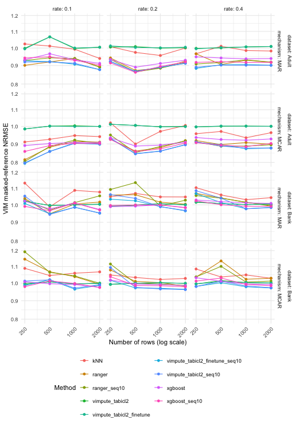
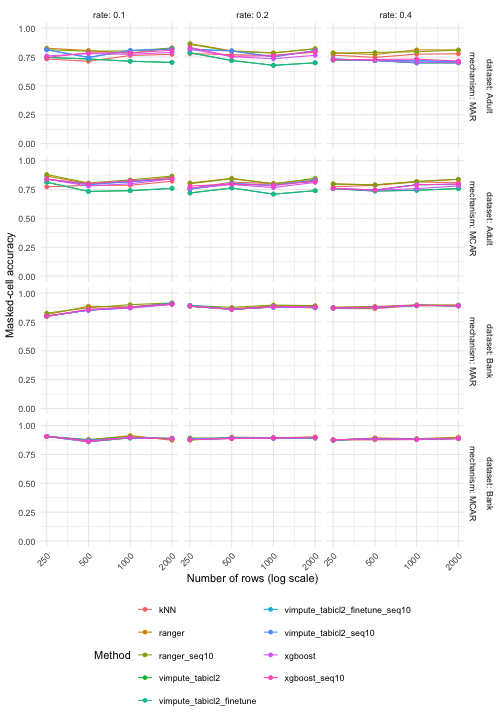
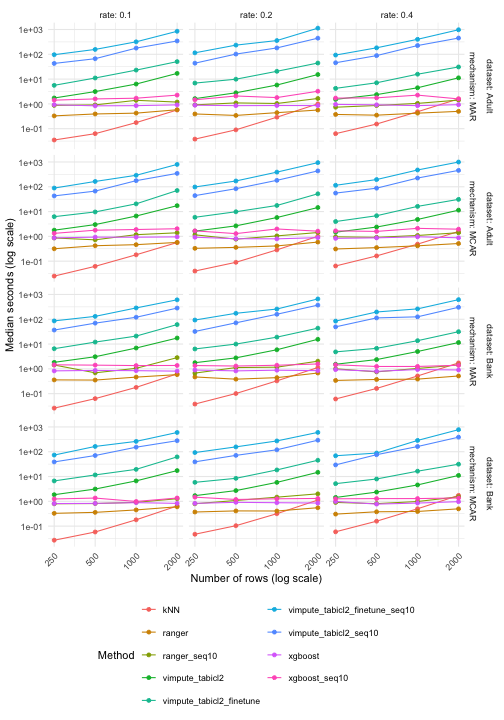

> **Superseded results:** These cached results predate the TabICL predictor  preprocessing fix. Missingness indicators replaced the original predictors  during affected fits. The TabICL comparisons below require a fresh run  and should not be interpreted as a comparison of the corrected variants.

<style>
table { display: block; max-width: 100%; overflow-x: auto; }
</style>

## Introduction

This benchmark is adapted from `transformerImpute-benchmark.Rmd` on the
`transformerImpute-rebased` branch. It retains the Adult/Bank samples, common
MCAR/MAR masks and scoring protocol, and compares kNN, ranger, ranger_seq10, xgboost, xgboost_seq10 and four
TabICL variants: pretrained/fine-tuned, each with one or up to ten passes.

Like `vimpute-benchmark.Rmd`, this document is precomputed from its
`.Rmd.orig` source using `vignettes/precompute.R`. The generated `.Rmd`
contains static code examples, tables and figures. Package builds and checks
render these cached outputs without loading Python or fitting models.
Edit the `.Rmd.orig` source to change the experiment, then precompute again.

## Models and regeneration

All four TabICL variants call `vimpute(method = "tabicl2")`, with PMM and
residual noise disabled. Numeric targets use TabICLRegressor and factors use
TabICLClassifier. Fine-tuning uses the corresponding Finetuned estimators.
Each target and iteration fits a fresh model on observed target values only.

| Method | Fine-tuning | Sequential passes |
|:--|:--|:--|
| vimpute_tabicl2 | No | 1 |
| vimpute_tabicl2_finetune | Yes | 1 |
| vimpute_tabicl2_seq10 | No | Up to 10 |
| vimpute_tabicl2_finetune_seq10 | Yes | Up to 10 |

All variants use eight inference ensemble members on CPU. Fine-tuning uses
five epochs, learning rate `1e-5`, patience three, and two ensemble members
for training and validation, with mixed precision disabled. The upstream
internal validation split never receives hidden imputation truth. The seq10
variants use `sequential = TRUE, nseq = 10`; vimpute's convergence rule may
stop earlier. Fine-tuning occurs afresh at each fitted iteration.

kNN uses five neighbours. Ranger uses 100 trees and XGBoost 30 boosting rounds.
The seq10 variants use up to ten sequential passes; the other ranger/XGBoost variants
predict each target from the same incomplete table. TabICL's pretrained budget
differs from these fitted models, so this is a practical method comparison.

Python >= 3.10 and the optional R package `reticulate` are required for TabICL.
Install dependencies explicitly in the environment selected by reticulate:


``` bash
python -m pip install -r inst/python/tabicl-requirements.txt
```


``` r
# From the repository root, with the current VIM installed and the Python
# environment selected via RETICULATE_PYTHON:
# Rscript vignettes/precompute.R tabiclImpute-benchmark
# Edit config in tabiclImpute-benchmark.Rmd.orig for a different experiment.
# Set VIM_TABICL2_RESULTS to a fresh local directory if configuration changes.
# To render the already cached document only:
rmarkdown::render("vignettes/tabiclImpute-benchmark.Rmd")
```

## Datasets and preprocessing

* [Adult / Census Income](https://archive.ics.uci.edu/dataset/2/adult),
  Becker and Kohavi (1996), [DOI:10.24432/C5XW20](https://doi.org/10.24432/C5XW20):
  combine `adult.data` and `adult.test` (48,842 rows). Skip the test-file header,
  trim whitespace, remove the final period from test income labels, and parse
  `?` as missing. Combining the published splits is intentional: this is
  transductive reconstruction of missing cells, not a supervised income test.
* [Bank Marketing](https://archive.ics.uci.edu/dataset/222/bank+marketing),
  Moro, Rita and Cortez (2014), [DOI:10.24432/C5K306](https://doi.org/10.24432/C5K306):
  use `bank-full.csv` (45,211 rows), not the smaller sample or the different
  `bank-additional-full.csv`. Keep `unknown` as an observed category. It encodes
  recorded lack of knowledge; equating it with an artificially deleted value
  would change the evaluation target. Keep `pdays = -1` (no prior contact) as
  a structural sentinel in its original numeric column. Do not interpret it
  as a literal negative duration.

Both UCI datasets are distributed under CC BY 4.0. The script stores archive
URLs and MD5 checksums for provenance. Raw records are downloaded only with
explicit `download = TRUE` and are not bundled with VIM.

All character columns become unordered factors and all numeric measurements
remain numeric. No clipping, logarithms, balancing, rare-level pooling or
one-hot conversion is applied in shared preprocessing. Adult's `fnlwgt` remains
a predictor, not a survey weight; these are unweighted sample diagnostics.
Both education representations are retained. Bank's call duration is retained:
it is available for retrospective imputation, but would be inappropriate in a
pre-call subscription prediction task.

Remove rows with any existing NA to obtain complete references. Consequently,
Adult results describe its complete-case population and need not transfer to
people with naturally missing occupation or workclass. No correctness claim
is made for the unobserved true values in those removed rows.


Table: Rows before and after complete-case selection

|   |dataset |  rows| complete_rows|
|:--|:-------|-----:|-------------:|
|1  |Adult   | 48842|         45222|
|16 |Bank    | 45211|         45211|


Table: Existing missing values and retained unknown categories

|   |dataset |variable       | existing_na| unknown|
|:--|:-------|:--------------|-----------:|-------:|
|2  |Adult   |workclass      |        2799|       0|
|7  |Adult   |occupation     |        2809|       0|
|14 |Adult   |native_country |         857|       0|
|17 |Bank    |job            |           0|     288|
|19 |Bank    |education      |           0|    1857|
|24 |Bank    |contact        |           0|   13020|
|31 |Bank    |poutcome       |           0|   36959|


## Missingness simulation

Each repetition draws a new simple random sample without replacement from each
complete-case dataset at **  250,   500, 1,000, 2,000 rows**,
with **3 repetition(s)** per scenario.
The seed schedule is shared across sizes, so samples overlap and sample-size
comparisons are not independent replications. The sampling algorithm may change
with the requested size; exact nesting is not assumed. All methods share the
same sample and mask within each dataset/size/repetition/mechanism/rate scenario.
The column `n` records the number of rows in every result table. Seeds and
training budgets are unchanged across sizes: more rows imply more observed context and, when fine-tuning is enabled, more training batches.
The targets are Adult `hours_per_week` and `income`, and Bank `balance` and `y`.
Other columns stay observed, including the MAR driver `age`.

`makeMissing()` selects exactly `round(rate * nrow(truth))` cells per
target, without replacement. MCAR uses uniform sampling. MAR uses
`weights = c(age = 1)` explicitly: the sampling weights are the logistic
transform of standardized observed age. These weights are **not** marginal
cell-deletion probabilities; the requested number of rows is sampled using
those relative weights. Higher age favours selection. Age is never masked,
and no target's hidden value drives another target's missingness. Using the
default MAR drivers instead could include the other incomplete numeric target,
so specifying the observed driver matters here.

The `where` attribute supplies the common mask for every competing method
and for scoring. We retain the original reference separately. With 250 rows,
the three requested rates correspond to 25, 50 and 100 masked cells in each
target. With other sample sizes the fractions may differ slightly due to
rounding. Masks are never redrawn to remove difficult cases.


``` r
prepared <- uci_prepare("uci-cache", download = FALSE)
set.seed(config$seed)
truth <- prepared$data$Adult[sample(nrow(prepared$data$Adult), config$n[1L]), ]
incomplete <- makeMissing(truth, prop = .2, mechanism = "MAR",
  vars = c("hours_per_week", "income"), weights = c(age = 1), seed = config$seed)
mask <- attr(incomplete, "where")
incomplete <- droplevels(incomplete) # no levels learned solely from masked values
# truth is passed only to evaluation, never to a learner.
```


Table: Mean realized target-specific missing fractions

|    n|dataset |mechanism | rate|variable       | realized_rate|
|----:|:-------|:---------|----:|:--------------|-------------:|
|  250|Bank    |MAR       |  0.1|balance        |           0.1|
|  500|Bank    |MAR       |  0.1|balance        |           0.1|
| 1000|Bank    |MAR       |  0.1|balance        |           0.1|
| 2000|Bank    |MAR       |  0.1|balance        |           0.1|
|  250|Bank    |MCAR      |  0.1|balance        |           0.1|
|  500|Bank    |MCAR      |  0.1|balance        |           0.1|
| 1000|Bank    |MCAR      |  0.1|balance        |           0.1|
| 2000|Bank    |MCAR      |  0.1|balance        |           0.1|
|  250|Bank    |MAR       |  0.2|balance        |           0.2|
|  500|Bank    |MAR       |  0.2|balance        |           0.2|
| 1000|Bank    |MAR       |  0.2|balance        |           0.2|
| 2000|Bank    |MAR       |  0.2|balance        |           0.2|
|  250|Bank    |MCAR      |  0.2|balance        |           0.2|
|  500|Bank    |MCAR      |  0.2|balance        |           0.2|
| 1000|Bank    |MCAR      |  0.2|balance        |           0.2|
| 2000|Bank    |MCAR      |  0.2|balance        |           0.2|
|  250|Bank    |MAR       |  0.4|balance        |           0.4|
|  500|Bank    |MAR       |  0.4|balance        |           0.4|
| 1000|Bank    |MAR       |  0.4|balance        |           0.4|
| 2000|Bank    |MAR       |  0.4|balance        |           0.4|
|  250|Bank    |MCAR      |  0.4|balance        |           0.4|
|  500|Bank    |MCAR      |  0.4|balance        |           0.4|
| 1000|Bank    |MCAR      |  0.4|balance        |           0.4|
| 2000|Bank    |MCAR      |  0.4|balance        |           0.4|
|  250|Adult   |MAR       |  0.1|hours_per_week |           0.1|
|  500|Adult   |MAR       |  0.1|hours_per_week |           0.1|
| 1000|Adult   |MAR       |  0.1|hours_per_week |           0.1|
| 2000|Adult   |MAR       |  0.1|hours_per_week |           0.1|
|  250|Adult   |MCAR      |  0.1|hours_per_week |           0.1|
|  500|Adult   |MCAR      |  0.1|hours_per_week |           0.1|
| 1000|Adult   |MCAR      |  0.1|hours_per_week |           0.1|
| 2000|Adult   |MCAR      |  0.1|hours_per_week |           0.1|
|  250|Adult   |MAR       |  0.2|hours_per_week |           0.2|
|  500|Adult   |MAR       |  0.2|hours_per_week |           0.2|
| 1000|Adult   |MAR       |  0.2|hours_per_week |           0.2|
| 2000|Adult   |MAR       |  0.2|hours_per_week |           0.2|
|  250|Adult   |MCAR      |  0.2|hours_per_week |           0.2|
|  500|Adult   |MCAR      |  0.2|hours_per_week |           0.2|
| 1000|Adult   |MCAR      |  0.2|hours_per_week |           0.2|
| 2000|Adult   |MCAR      |  0.2|hours_per_week |           0.2|
|  250|Adult   |MAR       |  0.4|hours_per_week |           0.4|
|  500|Adult   |MAR       |  0.4|hours_per_week |           0.4|
| 1000|Adult   |MAR       |  0.4|hours_per_week |           0.4|
| 2000|Adult   |MAR       |  0.4|hours_per_week |           0.4|
|  250|Adult   |MCAR      |  0.4|hours_per_week |           0.4|
|  500|Adult   |MCAR      |  0.4|hours_per_week |           0.4|
| 1000|Adult   |MCAR      |  0.4|hours_per_week |           0.4|
| 2000|Adult   |MCAR      |  0.4|hours_per_week |           0.4|
|  250|Adult   |MAR       |  0.1|income         |           0.1|
|  500|Adult   |MAR       |  0.1|income         |           0.1|
| 1000|Adult   |MAR       |  0.1|income         |           0.1|
| 2000|Adult   |MAR       |  0.1|income         |           0.1|
|  250|Adult   |MCAR      |  0.1|income         |           0.1|
|  500|Adult   |MCAR      |  0.1|income         |           0.1|
| 1000|Adult   |MCAR      |  0.1|income         |           0.1|
| 2000|Adult   |MCAR      |  0.1|income         |           0.1|
|  250|Adult   |MAR       |  0.2|income         |           0.2|
|  500|Adult   |MAR       |  0.2|income         |           0.2|
| 1000|Adult   |MAR       |  0.2|income         |           0.2|
| 2000|Adult   |MAR       |  0.2|income         |           0.2|
|  250|Adult   |MCAR      |  0.2|income         |           0.2|
|  500|Adult   |MCAR      |  0.2|income         |           0.2|
| 1000|Adult   |MCAR      |  0.2|income         |           0.2|
| 2000|Adult   |MCAR      |  0.2|income         |           0.2|
|  250|Adult   |MAR       |  0.4|income         |           0.4|
|  500|Adult   |MAR       |  0.4|income         |           0.4|
| 1000|Adult   |MAR       |  0.4|income         |           0.4|
| 2000|Adult   |MAR       |  0.4|income         |           0.4|
|  250|Adult   |MCAR      |  0.4|income         |           0.4|
|  500|Adult   |MCAR      |  0.4|income         |           0.4|
| 1000|Adult   |MCAR      |  0.4|income         |           0.4|
| 2000|Adult   |MCAR      |  0.4|income         |           0.4|
|  250|Bank    |MAR       |  0.1|y              |           0.1|
|  500|Bank    |MAR       |  0.1|y              |           0.1|
| 1000|Bank    |MAR       |  0.1|y              |           0.1|
| 2000|Bank    |MAR       |  0.1|y              |           0.1|
|  250|Bank    |MCAR      |  0.1|y              |           0.1|
|  500|Bank    |MCAR      |  0.1|y              |           0.1|
| 1000|Bank    |MCAR      |  0.1|y              |           0.1|
| 2000|Bank    |MCAR      |  0.1|y              |           0.1|
|  250|Bank    |MAR       |  0.2|y              |           0.2|
|  500|Bank    |MAR       |  0.2|y              |           0.2|
| 1000|Bank    |MAR       |  0.2|y              |           0.2|
| 2000|Bank    |MAR       |  0.2|y              |           0.2|
|  250|Bank    |MCAR      |  0.2|y              |           0.2|
|  500|Bank    |MCAR      |  0.2|y              |           0.2|
| 1000|Bank    |MCAR      |  0.2|y              |           0.2|
| 2000|Bank    |MCAR      |  0.2|y              |           0.2|
|  250|Bank    |MAR       |  0.4|y              |           0.4|
|  500|Bank    |MAR       |  0.4|y              |           0.4|
| 1000|Bank    |MAR       |  0.4|y              |           0.4|
| 2000|Bank    |MAR       |  0.4|y              |           0.4|
|  250|Bank    |MCAR      |  0.4|y              |           0.4|
|  500|Bank    |MCAR      |  0.4|y              |           0.4|
| 1000|Bank    |MCAR      |  0.4|y              |           0.4|
| 2000|Bank    |MCAR      |  0.4|y              |           0.4|


## Evaluation

The pointwise metrics reuse VIM's existing tools and score artificially
masked cells only:

* `evaluation()` supplies numeric mean squared error (`err_num`) and the
  fraction of incorrect categories (`err_cat`). We report RMSE as
  `sqrt(err_num)`, misclassification as `err_cat`, and accuracy as
  `1 - err_cat`. Because the current implementation of `evaluation()` sums
  errors over the supplied table, the runner **subsets its inputs to masked
  cells for each target** and passes an all-TRUE `where` matrix. This makes
  the scoring boundary explicit. Whole-table calls are equivalent only when
  observed values are preserved, which the runner also checks.
* `nrmse(x, y, m = mask)` supplies **NRMSE**, using the standard deviation of
  the **masked true values**, as implemented by VIM. This is the convention
  used by the companion benchmark. Fewer than two masked values or zero
  masked-reference variance gives an undefined score, recorded as NA.
* **NRMSE_ref** (`nrmse_reference` in the CSV) retains the alternative
  `RMSE / sd(full sampled reference column)` requested for this UCI
  benchmark. It is separate from VIM's masked-reference NRMSE; under MAR the
  two denominators can differ substantially. Both denominators are common
  across methods within a scenario and are used only for evaluation.
* MAE, whole-table marginal distances and relationship diagnostics supplement
  these existing tools; they are not available from `evaluation()` itself.

## Results

The saved run contains 1296 method/scenario attempts,
1296 successful completions and
0 recorded failures. Every method in a scenario
uses the same `makeMissing()` mask.


|Rows |Dataset |Method                         |Status | Runs|
|:----|:-------|:------------------------------|:------|----:|
|250  |Adult   |kNN                            |ok     |   18|
|500  |Adult   |kNN                            |ok     |   18|
|1000 |Adult   |kNN                            |ok     |   18|
|2000 |Adult   |kNN                            |ok     |   18|
|250  |Bank    |kNN                            |ok     |   18|
|500  |Bank    |kNN                            |ok     |   18|
|1000 |Bank    |kNN                            |ok     |   18|
|2000 |Bank    |kNN                            |ok     |   18|
|250  |Adult   |ranger                         |ok     |   18|
|500  |Adult   |ranger                         |ok     |   18|
|1000 |Adult   |ranger                         |ok     |   18|
|2000 |Adult   |ranger                         |ok     |   18|
|250  |Bank    |ranger                         |ok     |   18|
|500  |Bank    |ranger                         |ok     |   18|
|1000 |Bank    |ranger                         |ok     |   18|
|2000 |Bank    |ranger                         |ok     |   18|
|250  |Adult   |ranger_seq10                   |ok     |   18|
|500  |Adult   |ranger_seq10                   |ok     |   18|
|1000 |Adult   |ranger_seq10                   |ok     |   18|
|2000 |Adult   |ranger_seq10                   |ok     |   18|
|250  |Bank    |ranger_seq10                   |ok     |   18|
|500  |Bank    |ranger_seq10                   |ok     |   18|
|1000 |Bank    |ranger_seq10                   |ok     |   18|
|2000 |Bank    |ranger_seq10                   |ok     |   18|
|250  |Adult   |vimpute_tabicl2                |ok     |   18|
|500  |Adult   |vimpute_tabicl2                |ok     |   18|
|1000 |Adult   |vimpute_tabicl2                |ok     |   18|
|2000 |Adult   |vimpute_tabicl2                |ok     |   18|
|250  |Bank    |vimpute_tabicl2                |ok     |   18|
|500  |Bank    |vimpute_tabicl2                |ok     |   18|
|1000 |Bank    |vimpute_tabicl2                |ok     |   18|
|2000 |Bank    |vimpute_tabicl2                |ok     |   18|
|250  |Adult   |vimpute_tabicl2_finetune       |ok     |   18|
|500  |Adult   |vimpute_tabicl2_finetune       |ok     |   18|
|1000 |Adult   |vimpute_tabicl2_finetune       |ok     |   18|
|2000 |Adult   |vimpute_tabicl2_finetune       |ok     |   18|
|250  |Bank    |vimpute_tabicl2_finetune       |ok     |   18|
|500  |Bank    |vimpute_tabicl2_finetune       |ok     |   18|
|1000 |Bank    |vimpute_tabicl2_finetune       |ok     |   18|
|2000 |Bank    |vimpute_tabicl2_finetune       |ok     |   18|
|250  |Adult   |vimpute_tabicl2_finetune_seq10 |ok     |   18|
|500  |Adult   |vimpute_tabicl2_finetune_seq10 |ok     |   18|
|1000 |Adult   |vimpute_tabicl2_finetune_seq10 |ok     |   18|
|2000 |Adult   |vimpute_tabicl2_finetune_seq10 |ok     |   18|
|250  |Bank    |vimpute_tabicl2_finetune_seq10 |ok     |   18|
|500  |Bank    |vimpute_tabicl2_finetune_seq10 |ok     |   18|
|1000 |Bank    |vimpute_tabicl2_finetune_seq10 |ok     |   18|
|2000 |Bank    |vimpute_tabicl2_finetune_seq10 |ok     |   18|
|250  |Adult   |vimpute_tabicl2_seq10          |ok     |   18|
|500  |Adult   |vimpute_tabicl2_seq10          |ok     |   18|
|1000 |Adult   |vimpute_tabicl2_seq10          |ok     |   18|
|2000 |Adult   |vimpute_tabicl2_seq10          |ok     |   18|
|250  |Bank    |vimpute_tabicl2_seq10          |ok     |   18|
|500  |Bank    |vimpute_tabicl2_seq10          |ok     |   18|
|1000 |Bank    |vimpute_tabicl2_seq10          |ok     |   18|
|2000 |Bank    |vimpute_tabicl2_seq10          |ok     |   18|
|250  |Adult   |xgboost                        |ok     |   18|
|500  |Adult   |xgboost                        |ok     |   18|
|1000 |Adult   |xgboost                        |ok     |   18|
|2000 |Adult   |xgboost                        |ok     |   18|
|250  |Bank    |xgboost                        |ok     |   18|
|500  |Bank    |xgboost                        |ok     |   18|
|1000 |Bank    |xgboost                        |ok     |   18|
|2000 |Bank    |xgboost                        |ok     |   18|
|250  |Adult   |xgboost_seq10                  |ok     |   18|
|500  |Adult   |xgboost_seq10                  |ok     |   18|
|1000 |Adult   |xgboost_seq10                  |ok     |   18|
|2000 |Adult   |xgboost_seq10                  |ok     |   18|
|250  |Bank    |xgboost_seq10                  |ok     |   18|
|500  |Bank    |xgboost_seq10                  |ok     |   18|
|1000 |Bank    |xgboost_seq10                  |ok     |   18|
|2000 |Bank    |xgboost_seq10                  |ok     |   18|


The following tables retain number of rows, dataset, mechanism and nominal rate. Scores are
means across successful repetitions, with their sample standard deviations in
parentheses. Counts are shown so failures cannot improve a ranking invisibly.
The saved configuration has 3 repetition(s). With one
repetition, standard deviations are unavailable; with few repetitions they
describe variation only roughly. They are not confidence intervals or significance tests. Methods are paired by
sample and mask, so formal comparisons would require paired analysis and more
repetitions. Empty cells or `NA` indicate unavailable metrics: numeric error
measures do not apply to categorical targets, classification accuracy does not
apply to numeric targets, and a standard deviation requires at least two
successful repetitions. These are missing summary statistics, not unfilled
imputation cells. Auxiliary hurdle-model `*_zero_prob` diagnostics are excluded
from the scored data; actual target columns must contain no missing values. Success counts use completed
attempts as the denominator. The Coverage column distinguishes pending requested
repetitions from scenarios outside the saved experiment.


### Adult: MCAR, 250 rows


| Rate|Method                         |Coverage |Success |RMSE           |MAE           |NRMSE         |NRMSE_ref     |Accuracy      |Misclassification |Seconds          |
|----:|:------------------------------|:--------|:-------|:--------------|:-------------|:-------------|:-------------|:-------------|:-----------------|:----------------|
|  0.1|kNN                            |Complete |3/3     |12.541 (1.501) |7.533 (0.845) |0.916 (0.178) |1.031 (0.110) |0.773 (0.023) |0.227 (0.023)     |0.114 (0.156)    |
|  0.1|ranger                         |Complete |3/3     |11.238 (1.024) |7.800 (1.271) |0.816 (0.104) |0.924 (0.060) |0.867 (0.046) |0.133 (0.046)     |0.338 (0.043)    |
|  0.1|ranger_seq10                   |Complete |3/3     |11.102 (0.953) |7.893 (1.249) |0.807 (0.106) |0.913 (0.055) |0.880 (0.040) |0.120 (0.040)     |0.923 (0.191)    |
|  0.1|xgboost                        |Complete |3/3     |12.312 (0.998) |8.387 (1.589) |0.892 (0.077) |1.012 (0.051) |0.840 (0.040) |0.160 (0.040)     |0.887 (0.106)    |
|  0.1|xgboost_seq10                  |Complete |3/3     |11.848 (1.002) |8.387 (1.332) |0.861 (0.109) |0.974 (0.056) |0.840 (0.040) |0.160 (0.040)     |1.390 (0.147)    |
|  0.1|vimpute_tabicl2                |Complete |3/3     |13.709 (2.111) |9.040 (2.117) |0.985 (0.009) |1.126 (0.145) |0.813 (0.061) |0.187 (0.061)     |1.795 (0.051)    |
|  0.1|vimpute_tabicl2_finetune       |Complete |3/3     |13.709 (2.111) |9.040 (2.117) |0.985 (0.009) |1.126 (0.145) |0.813 (0.061) |0.187 (0.061)     |7.828 (3.597)    |
|  0.1|vimpute_tabicl2_seq10          |Complete |3/3     |11.013 (1.038) |7.960 (0.990) |0.799 (0.099) |0.905 (0.060) |0.840 (0.040) |0.160 (0.040)     |39.993 (5.193)   |
|  0.1|vimpute_tabicl2_finetune_seq10 |Complete |3/3     |10.973 (0.951) |7.880 (1.038) |0.796 (0.094) |0.902 (0.053) |0.840 (0.040) |0.160 (0.040)     |89.808 (10.880)  |
|  0.2|kNN                            |Complete |3/3     |11.756 (1.323) |7.913 (0.611) |1.021 (0.031) |0.969 (0.121) |0.760 (0.092) |0.240 (0.092)     |0.043 (0.010)    |
|  0.2|ranger                         |Complete |3/3     |10.672 (1.245) |7.307 (0.496) |0.927 (0.051) |0.878 (0.098) |0.807 (0.061) |0.193 (0.061)     |0.392 (0.121)    |
|  0.2|ranger_seq10                   |Complete |3/3     |10.936 (1.220) |7.553 (0.441) |0.951 (0.056) |0.900 (0.096) |0.800 (0.092) |0.200 (0.092)     |1.135 (0.319)    |
|  0.2|xgboost                        |Complete |3/3     |10.780 (1.428) |7.013 (0.571) |0.935 (0.010) |0.888 (0.121) |0.760 (0.060) |0.240 (0.060)     |0.941 (0.142)    |
|  0.2|xgboost_seq10                  |Complete |3/3     |10.662 (1.399) |7.160 (0.520) |0.925 (0.049) |0.877 (0.110) |0.780 (0.092) |0.220 (0.092)     |1.524 (0.414)    |
|  0.2|vimpute_tabicl2                |Complete |3/3     |11.666 (1.401) |7.400 (0.485) |1.013 (0.026) |0.961 (0.117) |0.720 (0.020) |0.280 (0.020)     |1.671 (0.171)    |
|  0.2|vimpute_tabicl2_finetune       |Complete |3/3     |11.666 (1.401) |7.400 (0.485) |1.013 (0.026) |0.961 (0.117) |0.720 (0.020) |0.280 (0.020)     |5.884 (1.229)    |
|  0.2|vimpute_tabicl2_seq10          |Complete |3/3     |10.748 (1.345) |7.393 (0.674) |0.932 (0.030) |0.886 (0.123) |0.753 (0.050) |0.247 (0.050)     |46.537 (4.616)   |
|  0.2|vimpute_tabicl2_finetune_seq10 |Complete |3/3     |10.736 (1.423) |7.393 (0.750) |0.931 (0.009) |0.885 (0.124) |0.753 (0.050) |0.247 (0.050)     |91.649 (12.485)  |
|  0.4|kNN                            |Complete |3/3     |12.508 (0.508) |7.703 (0.545) |0.958 (0.030) |1.029 (0.019) |0.773 (0.081) |0.227 (0.081)     |0.066 (0.014)    |
|  0.4|ranger                         |Complete |3/3     |12.006 (0.635) |8.133 (0.414) |0.919 (0.020) |0.988 (0.030) |0.800 (0.044) |0.200 (0.044)     |0.320 (0.030)    |
|  0.4|ranger_seq10                   |Complete |3/3     |11.922 (0.739) |7.910 (0.548) |0.912 (0.008) |0.980 (0.034) |0.797 (0.040) |0.203 (0.040)     |0.996 (0.272)    |
|  0.4|xgboost                        |Complete |3/3     |12.241 (0.844) |7.617 (0.923) |0.936 (0.010) |1.007 (0.044) |0.760 (0.061) |0.240 (0.061)     |1.012 (0.315)    |
|  0.4|xgboost_seq10                  |Complete |3/3     |11.856 (0.795) |7.620 (0.877) |0.907 (0.020) |0.975 (0.045) |0.760 (0.069) |0.240 (0.069)     |1.896 (0.474)    |
|  0.4|vimpute_tabicl2                |Complete |3/3     |13.042 (0.906) |8.220 (1.019) |0.997 (0.002) |1.072 (0.044) |0.757 (0.055) |0.243 (0.055)     |1.482 (0.020)    |
|  0.4|vimpute_tabicl2_finetune       |Complete |3/3     |13.042 (0.906) |8.220 (1.019) |0.997 (0.002) |1.072 (0.044) |0.757 (0.055) |0.243 (0.055)     |4.161 (0.344)    |
|  0.4|vimpute_tabicl2_seq10          |Complete |3/3     |11.915 (0.777) |7.870 (0.749) |0.911 (0.004) |0.980 (0.037) |0.760 (0.061) |0.240 (0.061)     |54.894 (10.062)  |
|  0.4|vimpute_tabicl2_finetune_seq10 |Complete |3/3     |11.880 (0.726) |7.840 (0.727) |0.909 (0.009) |0.977 (0.031) |0.760 (0.061) |0.240 (0.061)     |115.055 (14.409) |


### Adult: MAR, 250 rows


| Rate|Method                         |Coverage |Success |RMSE           |MAE           |NRMSE         |NRMSE_ref     |Accuracy      |Misclassification |Seconds          |
|----:|:------------------------------|:--------|:-------|:--------------|:-------------|:-------------|:-------------|:-------------|:-----------------|:----------------|
|  0.1|kNN                            |Complete |3/3     |11.231 (0.625) |7.000 (0.461) |1.035 (0.252) |0.926 (0.081) |0.733 (0.046) |0.267 (0.046)     |0.061 (0.055)    |
|  0.1|ranger                         |Complete |3/3     |9.994 (2.347)  |6.680 (1.709) |0.916 (0.290) |0.819 (0.170) |0.827 (0.101) |0.173 (0.101)     |0.341 (0.031)    |
|  0.1|ranger_seq10                   |Complete |3/3     |10.259 (1.940) |6.960 (1.220) |0.941 (0.274) |0.841 (0.135) |0.813 (0.023) |0.187 (0.023)     |0.889 (0.091)    |
|  0.1|xgboost                        |Complete |3/3     |10.453 (2.183) |7.013 (1.450) |0.934 (0.078) |0.859 (0.167) |0.760 (0.040) |0.240 (0.040)     |0.905 (0.050)    |
|  0.1|xgboost_seq10                  |Complete |3/3     |10.523 (2.108) |7.320 (1.253) |0.945 (0.134) |0.864 (0.156) |0.747 (0.046) |0.253 (0.046)     |1.506 (0.176)    |
|  0.1|vimpute_tabicl2                |Complete |3/3     |11.257 (2.602) |7.120 (1.442) |0.998 (0.011) |0.926 (0.210) |0.747 (0.023) |0.253 (0.023)     |1.763 (0.102)    |
|  0.1|vimpute_tabicl2_finetune       |Complete |3/3     |11.228 (2.647) |6.947 (1.702) |0.995 (0.015) |0.924 (0.214) |0.747 (0.023) |0.253 (0.023)     |5.758 (0.405)    |
|  0.1|vimpute_tabicl2_seq10          |Complete |3/3     |10.246 (2.173) |7.133 (1.187) |0.926 (0.194) |0.840 (0.157) |0.813 (0.046) |0.187 (0.046)     |42.642 (8.603)   |
|  0.1|vimpute_tabicl2_finetune_seq10 |Complete |3/3     |10.313 (2.191) |7.240 (1.168) |0.935 (0.216) |0.846 (0.157) |0.813 (0.046) |0.187 (0.046)     |96.009 (4.979)   |
|  0.2|kNN                            |Complete |3/3     |13.122 (2.535) |8.593 (2.338) |1.008 (0.049) |1.079 (0.197) |0.780 (0.072) |0.220 (0.072)     |0.043 (0.010)    |
|  0.2|ranger                         |Complete |3/3     |12.245 (2.104) |8.407 (1.398) |0.943 (0.045) |1.007 (0.165) |0.867 (0.058) |0.133 (0.058)     |0.379 (0.071)    |
|  0.2|ranger_seq10                   |Complete |3/3     |12.165 (2.310) |8.267 (1.539) |0.936 (0.053) |1.000 (0.179) |0.860 (0.053) |0.140 (0.053)     |0.881 (0.331)    |
|  0.2|xgboost                        |Complete |3/3     |12.235 (2.864) |8.033 (2.108) |0.935 (0.024) |1.006 (0.227) |0.820 (0.069) |0.180 (0.069)     |0.914 (0.087)    |
|  0.2|xgboost_seq10                  |Complete |3/3     |11.933 (2.521) |8.060 (1.698) |0.915 (0.040) |0.981 (0.197) |0.833 (0.046) |0.167 (0.046)     |1.440 (0.224)    |
|  0.2|vimpute_tabicl2                |Complete |3/3     |13.157 (2.969) |8.153 (2.366) |1.006 (0.016) |1.082 (0.236) |0.787 (0.042) |0.213 (0.042)     |1.678 (0.107)    |
|  0.2|vimpute_tabicl2_finetune       |Complete |3/3     |13.261 (3.119) |8.513 (2.672) |1.013 (0.024) |1.091 (0.248) |0.787 (0.042) |0.213 (0.042)     |7.140 (1.114)    |
|  0.2|vimpute_tabicl2_seq10          |Complete |3/3     |12.056 (2.656) |8.133 (1.946) |0.925 (0.074) |0.990 (0.204) |0.813 (0.064) |0.187 (0.064)     |43.701 (1.166)   |
|  0.2|vimpute_tabicl2_finetune_seq10 |Complete |3/3     |12.028 (2.673) |8.107 (2.022) |0.922 (0.069) |0.988 (0.206) |0.820 (0.069) |0.180 (0.069)     |112.443 (10.624) |
|  0.4|kNN                            |Complete |3/3     |12.163 (0.309) |7.600 (0.391) |0.967 (0.025) |1.002 (0.056) |0.767 (0.046) |0.233 (0.046)     |0.062 (0.008)    |
|  0.4|ranger                         |Complete |3/3     |12.174 (1.137) |8.297 (0.970) |0.968 (0.091) |1.004 (0.127) |0.787 (0.049) |0.213 (0.049)     |0.451 (0.166)    |
|  0.4|ranger_seq10                   |Complete |3/3     |11.425 (0.481) |7.630 (0.292) |0.909 (0.065) |0.941 (0.054) |0.783 (0.032) |0.217 (0.032)     |0.825 (0.308)    |
|  0.4|xgboost                        |Complete |3/3     |11.942 (0.397) |7.550 (0.173) |0.949 (0.017) |0.984 (0.059) |0.730 (0.026) |0.270 (0.026)     |0.920 (0.083)    |
|  0.4|xgboost_seq10                  |Complete |3/3     |11.544 (0.183) |7.597 (0.259) |0.918 (0.030) |0.951 (0.046) |0.727 (0.023) |0.273 (0.023)     |1.784 (0.300)    |
|  0.4|vimpute_tabicl2                |Complete |3/3     |12.564 (0.421) |8.013 (0.506) |0.998 (0.005) |1.034 (0.048) |0.723 (0.025) |0.277 (0.025)     |1.506 (0.066)    |
|  0.4|vimpute_tabicl2_finetune       |Complete |3/3     |12.532 (0.379) |7.833 (0.577) |0.996 (0.001) |1.032 (0.047) |0.723 (0.025) |0.277 (0.025)     |4.483 (0.665)    |
|  0.4|vimpute_tabicl2_seq10          |Complete |3/3     |11.207 (0.530) |7.483 (0.439) |0.891 (0.056) |0.924 (0.072) |0.733 (0.035) |0.267 (0.035)     |49.035 (6.381)   |
|  0.4|vimpute_tabicl2_finetune_seq10 |Complete |3/3     |11.126 (0.540) |7.390 (0.435) |0.885 (0.050) |0.917 (0.074) |0.733 (0.035) |0.267 (0.035)     |93.657 (4.712)   |


### Bank: MCAR, 250 rows


| Rate|Method                         |Coverage |Success |RMSE                |MAE                |NRMSE         |NRMSE_ref     |Accuracy      |Misclassification |Seconds         |
|----:|:------------------------------|:--------|:-------|:-------------------|:------------------|:-------------|:-------------|:-------------|:-----------------|:---------------|
|  0.1|kNN                            |Complete |3/3     |2451.795 (799.379)  |1372.173 (288.502) |1.089 (0.056) |0.866 (0.267) |0.907 (0.023) |0.093 (0.023)     |0.033 (0.011)   |
|  0.1|ranger                         |Complete |3/3     |2616.204 (1133.768) |1710.680 (629.068) |1.154 (0.231) |0.899 (0.241) |0.907 (0.023) |0.093 (0.023)     |0.341 (0.036)   |
|  0.1|ranger_seq10                   |Complete |3/3     |2761.704 (1287.026) |1807.160 (595.264) |1.201 (0.230) |0.949 (0.301) |0.907 (0.023) |0.093 (0.023)     |0.941 (0.461)   |
|  0.1|xgboost                        |Complete |3/3     |2268.020 (736.282)  |1461.827 (308.788) |1.009 (0.058) |0.801 (0.242) |0.907 (0.023) |0.093 (0.023)     |0.969 (0.294)   |
|  0.1|xgboost_seq10                  |Complete |3/3     |2190.660 (712.035)  |1475.533 (397.452) |0.983 (0.137) |0.766 (0.177) |0.907 (0.023) |0.093 (0.023)     |1.350 (0.427)   |
|  0.1|vimpute_tabicl2                |Complete |3/3     |2255.874 (750.826)  |1539.347 (359.476) |0.998 (0.019) |0.801 (0.276) |0.907 (0.023) |0.093 (0.023)     |1.935 (0.218)   |
|  0.1|vimpute_tabicl2_finetune       |Complete |3/3     |2248.827 (771.472)  |1511.267 (358.794) |0.992 (0.005) |0.798 (0.282) |0.907 (0.023) |0.093 (0.023)     |7.080 (1.008)   |
|  0.1|vimpute_tabicl2_seq10          |Complete |3/3     |2302.689 (835.375)  |1594.773 (406.376) |1.013 (0.048) |0.810 (0.266) |0.907 (0.023) |0.093 (0.023)     |39.829 (11.022) |
|  0.1|vimpute_tabicl2_finetune_seq10 |Complete |3/3     |2228.255 (742.154)  |1530.253 (342.326) |0.987 (0.028) |0.789 (0.261) |0.907 (0.023) |0.093 (0.023)     |75.884 (17.430) |
|  0.2|kNN                            |Complete |3/3     |2445.837 (186.685)  |1356.580 (143.177) |1.048 (0.019) |0.875 (0.135) |0.880 (0.035) |0.120 (0.035)     |0.071 (0.047)   |
|  0.2|ranger                         |Complete |3/3     |2528.903 (453.920)  |1613.373 (333.627) |1.083 (0.162) |0.891 (0.051) |0.873 (0.023) |0.127 (0.023)     |0.397 (0.047)   |
|  0.2|ranger_seq10                   |Complete |3/3     |2615.005 (451.829)  |1635.660 (296.167) |1.119 (0.155) |0.921 (0.045) |0.893 (0.046) |0.107 (0.046)     |0.986 (0.505)   |
|  0.2|xgboost                        |Complete |3/3     |2374.573 (145.187)  |1389.680 (175.151) |1.019 (0.012) |0.850 (0.133) |0.880 (0.053) |0.120 (0.053)     |0.843 (0.029)   |
|  0.2|xgboost_seq10                  |Complete |3/3     |2419.335 (126.716)  |1530.500 (150.200) |1.038 (0.019) |0.869 (0.157) |0.880 (0.053) |0.120 (0.053)     |1.434 (0.276)   |
|  0.2|vimpute_tabicl2                |Complete |3/3     |2314.144 (142.563)  |1540.567 (169.066) |0.993 (0.003) |0.830 (0.136) |0.880 (0.053) |0.120 (0.053)     |1.736 (0.150)   |
|  0.2|vimpute_tabicl2_finetune       |Complete |3/3     |2315.987 (139.374)  |1518.793 (199.673) |0.993 (0.002) |0.830 (0.137) |0.880 (0.053) |0.120 (0.053)     |5.872 (1.025)   |
|  0.2|vimpute_tabicl2_seq10          |Complete |3/3     |2556.806 (345.351)  |1631.147 (232.033) |1.096 (0.123) |0.906 (0.087) |0.880 (0.053) |0.120 (0.053)     |48.449 (25.661) |
|  0.2|vimpute_tabicl2_finetune_seq10 |Complete |3/3     |2369.140 (113.714)  |1536.200 (195.832) |1.017 (0.030) |0.849 (0.137) |0.887 (0.046) |0.113 (0.046)     |95.239 (38.993) |
|  0.4|kNN                            |Complete |3/3     |2821.466 (159.058)  |1477.830 (175.238) |1.085 (0.027) |1.010 (0.156) |0.877 (0.021) |0.123 (0.021)     |0.071 (0.022)   |
|  0.4|ranger                         |Complete |3/3     |2690.915 (69.077)   |1797.717 (161.699) |1.037 (0.059) |0.972 (0.214) |0.873 (0.015) |0.127 (0.015)     |0.316 (0.036)   |
|  0.4|ranger_seq10                   |Complete |3/3     |2695.847 (83.293)   |1730.890 (171.492) |1.037 (0.021) |0.969 (0.178) |0.870 (0.017) |0.130 (0.017)     |0.916 (0.106)   |
|  0.4|xgboost                        |Complete |3/3     |2684.751 (148.257)  |1407.160 (182.443) |1.032 (0.013) |0.961 (0.149) |0.877 (0.029) |0.123 (0.029)     |0.945 (0.148)   |
|  0.4|xgboost_seq10                  |Complete |3/3     |2633.194 (159.558)  |1482.997 (201.735) |1.012 (0.019) |0.942 (0.144) |0.877 (0.029) |0.123 (0.029)     |1.254 (0.068)   |
|  0.4|vimpute_tabicl2                |Complete |3/3     |2587.109 (109.413)  |1658.697 (241.392) |0.995 (0.000) |0.928 (0.155) |0.877 (0.029) |0.123 (0.029)     |1.516 (0.166)   |
|  0.4|vimpute_tabicl2_finetune       |Complete |3/3     |2589.895 (106.991)  |1653.837 (278.535) |0.996 (0.001) |0.929 (0.156) |0.877 (0.029) |0.123 (0.029)     |4.943 (0.394)   |
|  0.4|vimpute_tabicl2_seq10          |Complete |3/3     |2549.115 (75.910)   |1556.083 (147.780) |0.981 (0.013) |0.916 (0.164) |0.873 (0.023) |0.127 (0.023)     |27.337 (5.457)  |
|  0.4|vimpute_tabicl2_finetune_seq10 |Complete |3/3     |2550.366 (78.797)   |1520.623 (183.377) |0.981 (0.012) |0.916 (0.163) |0.873 (0.023) |0.127 (0.023)     |64.219 (12.941) |


### Bank: MAR, 250 rows


| Rate|Method                         |Coverage |Success |RMSE                |MAE                |NRMSE         |NRMSE_ref     |Accuracy      |Misclassification |Seconds         |
|----:|:------------------------------|:--------|:-------|:-------------------|:------------------|:-------------|:-------------|:-------------|:-----------------|:---------------|
|  0.1|kNN                            |Complete |3/3     |3001.849 (562.547)  |1847.920 (368.276) |1.132 (0.042) |1.110 (0.406) |0.800 (0.040) |0.200 (0.040)     |0.027 (0.001)   |
|  0.1|ranger                         |Complete |3/3     |2728.866 (327.192)  |1920.267 (301.656) |1.039 (0.093) |0.994 (0.275) |0.813 (0.061) |0.187 (0.061)     |0.362 (0.033)   |
|  0.1|ranger_seq10                   |Complete |3/3     |2707.544 (385.626)  |1945.227 (364.592) |1.029 (0.097) |0.988 (0.286) |0.827 (0.061) |0.173 (0.061)     |1.182 (0.480)   |
|  0.1|xgboost                        |Complete |3/3     |2713.330 (523.416)  |1786.293 (370.715) |1.022 (0.053) |1.002 (0.360) |0.800 (0.040) |0.200 (0.040)     |0.835 (0.054)   |
|  0.1|xgboost_seq10                  |Complete |3/3     |2629.434 (505.830)  |1800.640 (412.414) |0.991 (0.056) |0.970 (0.345) |0.800 (0.040) |0.200 (0.040)     |1.530 (0.246)   |
|  0.1|vimpute_tabicl2                |Complete |3/3     |2705.438 (496.726)  |1847.493 (245.696) |1.020 (0.039) |0.999 (0.354) |0.800 (0.040) |0.200 (0.040)     |1.844 (0.042)   |
|  0.1|vimpute_tabicl2_finetune       |Complete |3/3     |2709.393 (500.296)  |1847.907 (246.325) |1.022 (0.041) |1.000 (0.355) |0.800 (0.040) |0.200 (0.040)     |6.252 (0.777)   |
|  0.1|vimpute_tabicl2_seq10          |Complete |3/3     |2753.222 (200.002)  |1945.667 (112.949) |1.055 (0.134) |0.997 (0.233) |0.800 (0.040) |0.200 (0.040)     |44.217 (20.874) |
|  0.1|vimpute_tabicl2_finetune_seq10 |Complete |3/3     |2660.121 (406.041)  |1844.627 (231.642) |1.008 (0.065) |0.974 (0.303) |0.800 (0.040) |0.200 (0.040)     |92.955 (26.434) |
|  0.2|kNN                            |Complete |3/3     |2774.171 (725.935)  |1276.667 (177.029) |1.048 (0.033) |0.970 (0.163) |0.887 (0.023) |0.113 (0.023)     |0.039 (0.001)   |
|  0.2|ranger                         |Complete |3/3     |2797.193 (715.172)  |1531.340 (249.105) |1.058 (0.043) |0.978 (0.157) |0.887 (0.042) |0.113 (0.042)     |0.446 (0.136)   |
|  0.2|ranger_seq10                   |Complete |3/3     |2887.377 (741.152)  |1674.727 (325.208) |1.092 (0.036) |1.011 (0.172) |0.893 (0.061) |0.107 (0.061)     |0.918 (0.545)   |
|  0.2|xgboost                        |Complete |3/3     |2640.565 (783.537)  |1282.580 (282.446) |0.989 (0.021) |0.920 (0.190) |0.887 (0.031) |0.113 (0.031)     |0.893 (0.117)   |
|  0.2|xgboost_seq10                  |Complete |3/3     |2657.647 (780.127)  |1387.880 (369.146) |0.996 (0.017) |0.926 (0.190) |0.887 (0.031) |0.113 (0.031)     |1.342 (0.210)   |
|  0.2|vimpute_tabicl2                |Complete |3/3     |2636.560 (736.157)  |1494.700 (295.103) |0.992 (0.002) |0.921 (0.183) |0.887 (0.031) |0.113 (0.031)     |1.772 (0.151)   |
|  0.2|vimpute_tabicl2_finetune       |Complete |3/3     |2637.063 (736.643)  |1503.140 (303.332) |0.992 (0.002) |0.921 (0.183) |0.887 (0.031) |0.113 (0.031)     |6.304 (1.206)   |
|  0.2|vimpute_tabicl2_seq10          |Complete |3/3     |2786.849 (625.812)  |1524.953 (219.799) |1.062 (0.075) |0.980 (0.152) |0.893 (0.031) |0.107 (0.031)     |35.774 (9.639)  |
|  0.2|vimpute_tabicl2_finetune_seq10 |Complete |3/3     |2742.035 (748.484)  |1456.480 (245.946) |1.033 (0.020) |0.957 (0.173) |0.893 (0.031) |0.107 (0.031)     |84.661 (17.763) |
|  0.4|kNN                            |Complete |3/3     |3452.476 (1431.660) |1614.420 (271.226) |1.105 (0.116) |1.193 (0.332) |0.867 (0.031) |0.133 (0.031)     |0.062 (0.005)   |
|  0.4|ranger                         |Complete |3/3     |3350.977 (1435.498) |1773.320 (165.773) |1.071 (0.124) |1.154 (0.316) |0.877 (0.035) |0.123 (0.035)     |0.341 (0.032)   |
|  0.4|ranger_seq10                   |Complete |3/3     |3297.259 (1357.954) |1809.570 (200.263) |1.057 (0.123) |1.139 (0.307) |0.877 (0.035) |0.123 (0.035)     |0.899 (0.252)   |
|  0.4|xgboost                        |Complete |3/3     |3296.292 (1553.224) |1548.943 (301.424) |1.029 (0.016) |1.137 (0.396) |0.870 (0.030) |0.130 (0.030)     |0.993 (0.108)   |
|  0.4|xgboost_seq10                  |Complete |3/3     |3257.591 (1481.825) |1649.623 (270.540) |1.024 (0.038) |1.124 (0.370) |0.870 (0.030) |0.130 (0.030)     |1.431 (0.113)   |
|  0.4|vimpute_tabicl2                |Complete |3/3     |3256.806 (1547.231) |1717.197 (339.734) |1.014 (0.015) |1.123 (0.397) |0.870 (0.030) |0.130 (0.030)     |1.527 (0.077)   |
|  0.4|vimpute_tabicl2_finetune       |Complete |3/3     |3258.734 (1536.728) |1739.997 (315.281) |1.017 (0.016) |1.124 (0.390) |0.870 (0.030) |0.130 (0.030)     |4.856 (0.090)   |
|  0.4|vimpute_tabicl2_seq10          |Complete |3/3     |3344.828 (1256.555) |1896.623 (119.893) |1.089 (0.185) |1.158 (0.265) |0.873 (0.035) |0.127 (0.035)     |51.784 (6.084)  |
|  0.4|vimpute_tabicl2_finetune_seq10 |Complete |3/3     |3314.117 (1303.060) |1834.237 (161.850) |1.070 (0.145) |1.147 (0.292) |0.873 (0.035) |0.127 (0.035)     |82.715 (3.748)  |


### Adult: MCAR, 500 rows


| Rate|Method                         |Coverage |Success |RMSE           |MAE           |NRMSE         |NRMSE_ref     |Accuracy      |Misclassification |Seconds          |
|----:|:------------------------------|:--------|:-------|:--------------|:-------------|:-------------|:-------------|:-------------|:-----------------|:----------------|
|  0.1|kNN                            |Complete |3/3     |11.573 (1.369) |7.860 (1.280) |0.926 (0.035) |0.965 (0.144) |0.787 (0.050) |0.213 (0.050)     |0.064 (0.007)    |
|  0.1|ranger                         |Complete |3/3     |11.018 (1.235) |8.127 (1.056) |0.882 (0.040) |0.917 (0.120) |0.800 (0.087) |0.200 (0.087)     |0.398 (0.071)    |
|  0.1|ranger_seq10                   |Complete |3/3     |11.068 (1.177) |8.087 (0.993) |0.886 (0.028) |0.922 (0.122) |0.807 (0.076) |0.193 (0.076)     |0.776 (0.214)    |
|  0.1|xgboost                        |Complete |3/3     |11.259 (1.062) |7.793 (0.727) |0.902 (0.019) |0.939 (0.127) |0.780 (0.069) |0.220 (0.069)     |0.970 (0.106)    |
|  0.1|xgboost_seq10                  |Complete |3/3     |11.107 (0.874) |7.747 (0.684) |0.891 (0.005) |0.926 (0.108) |0.800 (0.080) |0.200 (0.080)     |1.756 (0.174)    |
|  0.1|vimpute_tabicl2                |Complete |3/3     |12.492 (1.001) |8.633 (1.097) |1.002 (0.015) |1.040 (0.113) |0.733 (0.061) |0.267 (0.061)     |3.049 (0.194)    |
|  0.1|vimpute_tabicl2_finetune       |Complete |3/3     |12.492 (1.001) |8.633 (1.097) |1.002 (0.015) |1.040 (0.113) |0.733 (0.061) |0.267 (0.061)     |10.255 (1.409)   |
|  0.1|vimpute_tabicl2_seq10          |Complete |3/3     |10.697 (0.769) |7.880 (0.465) |0.858 (0.016) |0.892 (0.103) |0.793 (0.031) |0.207 (0.031)     |66.842 (0.257)   |
|  0.1|vimpute_tabicl2_finetune_seq10 |Complete |3/3     |10.711 (0.806) |7.900 (0.629) |0.859 (0.010) |0.893 (0.103) |0.793 (0.031) |0.207 (0.031)     |163.962 (18.879) |
|  0.2|kNN                            |Complete |3/3     |10.763 (1.585) |6.877 (1.118) |0.901 (0.100) |0.901 (0.182) |0.813 (0.059) |0.187 (0.059)     |0.091 (0.002)    |
|  0.2|ranger                         |Complete |3/3     |10.272 (1.089) |7.027 (0.777) |0.861 (0.056) |0.859 (0.138) |0.847 (0.049) |0.153 (0.049)     |0.369 (0.031)    |
|  0.2|ranger_seq10                   |Complete |3/3     |10.174 (1.024) |6.920 (0.739) |0.853 (0.051) |0.850 (0.133) |0.843 (0.040) |0.157 (0.040)     |0.756 (0.108)    |
|  0.2|xgboost                        |Complete |3/3     |10.594 (0.960) |6.743 (0.817) |0.888 (0.041) |0.885 (0.128) |0.793 (0.021) |0.207 (0.021)     |0.818 (0.078)    |
|  0.2|xgboost_seq10                  |Complete |3/3     |10.243 (1.171) |6.703 (0.909) |0.858 (0.062) |0.856 (0.145) |0.797 (0.021) |0.203 (0.021)     |1.302 (0.127)    |
|  0.2|vimpute_tabicl2                |Complete |3/3     |11.983 (0.564) |7.503 (0.657) |1.006 (0.010) |0.999 (0.096) |0.763 (0.006) |0.237 (0.006)     |2.659 (0.047)    |
|  0.2|vimpute_tabicl2_finetune       |Complete |3/3     |11.983 (0.564) |7.503 (0.657) |1.006 (0.010) |0.999 (0.096) |0.763 (0.006) |0.237 (0.006)     |9.428 (0.900)    |
|  0.2|vimpute_tabicl2_seq10          |Complete |3/3     |10.098 (1.173) |6.960 (0.867) |0.846 (0.064) |0.844 (0.145) |0.800 (0.010) |0.200 (0.010)     |79.198 (8.784)   |
|  0.2|vimpute_tabicl2_finetune_seq10 |Complete |3/3     |10.115 (1.230) |6.980 (0.891) |0.847 (0.068) |0.846 (0.149) |0.803 (0.006) |0.197 (0.006)     |170.832 (17.866) |
|  0.4|kNN                            |Complete |3/3     |11.444 (1.319) |7.318 (0.939) |0.972 (0.072) |0.956 (0.158) |0.787 (0.042) |0.213 (0.042)     |0.162 (0.002)    |
|  0.4|ranger                         |Complete |3/3     |10.558 (0.993) |7.502 (0.770) |0.897 (0.043) |0.882 (0.130) |0.790 (0.036) |0.210 (0.036)     |0.392 (0.073)    |
|  0.4|ranger_seq10                   |Complete |3/3     |10.447 (0.954) |7.297 (0.712) |0.887 (0.038) |0.873 (0.128) |0.790 (0.031) |0.210 (0.031)     |0.967 (0.267)    |
|  0.4|xgboost                        |Complete |3/3     |10.893 (1.001) |7.073 (0.744) |0.925 (0.041) |0.910 (0.134) |0.743 (0.023) |0.257 (0.023)     |0.899 (0.061)    |
|  0.4|xgboost_seq10                  |Complete |3/3     |10.524 (0.939) |7.140 (0.740) |0.894 (0.037) |0.879 (0.127) |0.747 (0.020) |0.253 (0.020)     |1.768 (0.371)    |
|  0.4|vimpute_tabicl2                |Complete |3/3     |11.767 (0.568) |7.512 (0.452) |1.001 (0.003) |0.982 (0.105) |0.737 (0.025) |0.263 (0.025)     |2.389 (0.112)    |
|  0.4|vimpute_tabicl2_finetune       |Complete |3/3     |11.785 (0.575) |7.638 (0.587) |1.002 (0.002) |0.983 (0.106) |0.737 (0.025) |0.263 (0.025)     |7.105 (0.631)    |
|  0.4|vimpute_tabicl2_seq10          |Complete |3/3     |10.450 (0.713) |7.283 (0.517) |0.888 (0.022) |0.872 (0.108) |0.743 (0.023) |0.257 (0.023)     |87.625 (0.862)   |
|  0.4|vimpute_tabicl2_finetune_seq10 |Complete |3/3     |10.534 (0.642) |7.362 (0.436) |0.896 (0.021) |0.879 (0.101) |0.743 (0.023) |0.257 (0.023)     |190.659 (17.046) |


### Adult: MAR, 500 rows


| Rate|Method                         |Coverage |Success |RMSE           |MAE           |NRMSE         |NRMSE_ref     |Accuracy      |Misclassification |Seconds          |
|----:|:------------------------------|:--------|:-------|:--------------|:-------------|:-------------|:-------------|:-------------|:-----------------|:----------------|
|  0.1|kNN                            |Complete |3/3     |9.704 (1.733)  |6.253 (1.517) |1.018 (0.203) |0.813 (0.184) |0.713 (0.058) |0.287 (0.058)     |0.061 (0.006)    |
|  0.1|ranger                         |Complete |3/3     |8.890 (1.711)  |6.293 (1.463) |0.921 (0.052) |0.741 (0.161) |0.807 (0.070) |0.193 (0.070)     |0.397 (0.008)    |
|  0.1|ranger_seq10                   |Complete |3/3     |9.112 (1.687)  |6.480 (1.578) |0.944 (0.032) |0.759 (0.155) |0.800 (0.087) |0.200 (0.087)     |0.971 (0.150)    |
|  0.1|xgboost                        |Complete |3/3     |9.323 (1.570)  |6.373 (1.562) |0.967 (0.006) |0.776 (0.140) |0.780 (0.087) |0.220 (0.087)     |0.874 (0.172)    |
|  0.1|xgboost_seq10                  |Complete |3/3     |9.186 (1.765)  |6.427 (1.533) |0.950 (0.026) |0.764 (0.153) |0.787 (0.083) |0.213 (0.083)     |1.788 (0.603)    |
|  0.1|vimpute_tabicl2                |Complete |3/3     |10.208 (0.957) |6.533 (0.964) |1.068 (0.081) |0.850 (0.093) |0.733 (0.058) |0.267 (0.058)     |3.131 (0.208)    |
|  0.1|vimpute_tabicl2_finetune       |Complete |3/3     |10.208 (0.957) |6.533 (0.964) |1.068 (0.081) |0.850 (0.093) |0.733 (0.058) |0.267 (0.058)     |11.531 (1.882)   |
|  0.1|vimpute_tabicl2_seq10          |Complete |3/3     |8.883 (1.535)  |6.433 (1.320) |0.921 (0.012) |0.739 (0.133) |0.747 (0.103) |0.253 (0.103)     |76.490 (17.863)  |
|  0.1|vimpute_tabicl2_finetune_seq10 |Complete |3/3     |8.914 (1.680)  |6.520 (1.383) |0.922 (0.039) |0.741 (0.139) |0.747 (0.122) |0.253 (0.122)     |181.130 (43.684) |
|  0.2|kNN                            |Complete |3/3     |11.777 (2.126) |7.710 (1.093) |0.975 (0.037) |0.975 (0.133) |0.770 (0.044) |0.230 (0.044)     |0.090 (0.001)    |
|  0.2|ranger                         |Complete |3/3     |10.653 (2.675) |7.620 (1.283) |0.873 (0.032) |0.879 (0.171) |0.803 (0.045) |0.197 (0.045)     |0.384 (0.073)    |
|  0.2|ranger_seq10                   |Complete |3/3     |10.536 (2.534) |7.463 (1.237) |0.865 (0.024) |0.870 (0.161) |0.800 (0.030) |0.200 (0.030)     |1.101 (0.285)    |
|  0.2|xgboost                        |Complete |3/3     |10.912 (2.951) |7.523 (1.540) |0.891 (0.052) |0.900 (0.199) |0.753 (0.061) |0.247 (0.061)     |0.858 (0.074)    |
|  0.2|xgboost_seq10                  |Complete |3/3     |10.535 (2.648) |7.473 (1.446) |0.863 (0.033) |0.870 (0.175) |0.757 (0.029) |0.243 (0.029)     |2.600 (0.939)    |
|  0.2|vimpute_tabicl2                |Complete |3/3     |12.261 (2.737) |7.933 (1.324) |1.008 (0.012) |1.013 (0.177) |0.720 (0.050) |0.280 (0.050)     |2.863 (0.196)    |
|  0.2|vimpute_tabicl2_finetune       |Complete |3/3     |12.201 (2.739) |8.007 (1.351) |1.003 (0.008) |1.008 (0.175) |0.720 (0.050) |0.280 (0.050)     |9.508 (1.050)    |
|  0.2|vimpute_tabicl2_seq10          |Complete |3/3     |10.502 (2.181) |7.560 (1.015) |0.867 (0.028) |0.868 (0.131) |0.803 (0.038) |0.197 (0.038)     |107.528 (10.202) |
|  0.2|vimpute_tabicl2_finetune_seq10 |Complete |3/3     |10.528 (2.197) |7.627 (1.102) |0.868 (0.026) |0.870 (0.132) |0.803 (0.038) |0.197 (0.038)     |245.508 (21.153) |
|  0.4|kNN                            |Complete |3/3     |12.132 (0.498) |7.560 (0.344) |1.011 (0.015) |1.009 (0.057) |0.747 (0.042) |0.253 (0.042)     |0.157 (0.008)    |
|  0.4|ranger                         |Complete |3/3     |10.875 (0.475) |7.643 (0.278) |0.906 (0.005) |0.904 (0.043) |0.772 (0.063) |0.228 (0.063)     |0.336 (0.030)    |
|  0.4|ranger_seq10                   |Complete |3/3     |11.017 (0.632) |7.647 (0.304) |0.917 (0.011) |0.916 (0.052) |0.790 (0.060) |0.210 (0.060)     |0.932 (0.129)    |
|  0.4|xgboost                        |Complete |3/3     |11.316 (0.450) |7.335 (0.220) |0.943 (0.011) |0.941 (0.049) |0.722 (0.040) |0.278 (0.040)     |0.920 (0.045)    |
|  0.4|xgboost_seq10                  |Complete |3/3     |11.065 (0.507) |7.545 (0.381) |0.922 (0.015) |0.921 (0.056) |0.728 (0.033) |0.272 (0.033)     |1.991 (0.568)    |
|  0.4|vimpute_tabicl2                |Complete |3/3     |12.014 (0.547) |7.398 (0.447) |1.001 (0.004) |0.999 (0.044) |0.720 (0.040) |0.280 (0.040)     |2.338 (0.079)    |
|  0.4|vimpute_tabicl2_finetune       |Complete |3/3     |12.038 (0.555) |7.542 (0.625) |1.003 (0.003) |1.001 (0.047) |0.720 (0.040) |0.280 (0.040)     |7.261 (0.612)    |
|  0.4|vimpute_tabicl2_seq10          |Complete |3/3     |10.829 (0.341) |7.473 (0.319) |0.902 (0.022) |0.901 (0.054) |0.720 (0.040) |0.280 (0.040)     |88.048 (0.816)   |
|  0.4|vimpute_tabicl2_finetune_seq10 |Complete |3/3     |10.855 (0.357) |7.473 (0.361) |0.905 (0.027) |0.904 (0.061) |0.720 (0.040) |0.280 (0.040)     |180.609 (5.391)  |


### Bank: MCAR, 500 rows


| Rate|Method                         |Coverage |Success |RMSE               |MAE                |NRMSE         |NRMSE_ref     |Accuracy      |Misclassification |Seconds          |
|----:|:------------------------------|:--------|:-------|:------------------|:------------------|:-------------|:-------------|:-------------|:-----------------|:----------------|
|  0.1|kNN                            |Complete |3/3     |2922.686 (803.043) |1401.267 (232.985) |1.046 (0.035) |0.997 (0.256) |0.867 (0.042) |0.133 (0.042)     |0.058 (0.001)    |
|  0.1|ranger                         |Complete |3/3     |2948.108 (672.053) |1648.573 (138.858) |1.072 (0.159) |1.001 (0.180) |0.873 (0.023) |0.127 (0.023)     |0.373 (0.025)    |
|  0.1|ranger_seq10                   |Complete |3/3     |2919.949 (551.923) |1729.807 (184.523) |1.070 (0.194) |0.992 (0.141) |0.880 (0.020) |0.120 (0.020)     |0.913 (0.223)    |
|  0.1|xgboost                        |Complete |3/3     |2795.940 (815.916) |1439.220 (184.655) |0.997 (0.020) |0.953 (0.259) |0.860 (0.040) |0.140 (0.040)     |0.845 (0.058)    |
|  0.1|xgboost_seq10                  |Complete |3/3     |2824.440 (745.017) |1522.560 (126.255) |1.014 (0.062) |0.962 (0.230) |0.867 (0.031) |0.133 (0.031)     |1.229 (0.229)    |
|  0.1|vimpute_tabicl2                |Complete |3/3     |2820.009 (780.063) |1579.073 (175.248) |1.008 (0.023) |0.962 (0.254) |0.860 (0.040) |0.140 (0.040)     |3.105 (0.162)    |
|  0.1|vimpute_tabicl2_finetune       |Complete |3/3     |2820.299 (779.634) |1579.793 (174.185) |1.008 (0.023) |0.963 (0.254) |0.860 (0.040) |0.140 (0.040)     |11.436 (2.160)   |
|  0.1|vimpute_tabicl2_seq10          |Complete |3/3     |2820.732 (662.574) |1603.033 (62.878)  |1.023 (0.133) |0.958 (0.184) |0.873 (0.023) |0.127 (0.023)     |70.456 (0.320)   |
|  0.1|vimpute_tabicl2_finetune_seq10 |Complete |3/3     |2822.526 (664.752) |1589.793 (67.360)  |1.023 (0.130) |0.959 (0.186) |0.873 (0.023) |0.127 (0.023)     |161.370 (13.820) |
|  0.2|kNN                            |Complete |3/3     |3312.108 (471.776) |1592.140 (253.253) |1.034 (0.050) |1.143 (0.260) |0.890 (0.036) |0.110 (0.036)     |0.109 (0.013)    |
|  0.2|ranger                         |Complete |3/3     |3246.207 (529.444) |1774.517 (174.704) |1.011 (0.028) |1.122 (0.288) |0.900 (0.035) |0.100 (0.035)     |0.421 (0.110)    |
|  0.2|ranger_seq10                   |Complete |3/3     |3201.942 (446.057) |1798.430 (78.663)  |1.001 (0.063) |1.107 (0.267) |0.890 (0.036) |0.110 (0.036)     |1.005 (0.160)    |
|  0.2|xgboost                        |Complete |3/3     |3202.596 (569.296) |1576.573 (191.904) |0.995 (0.007) |1.108 (0.293) |0.890 (0.017) |0.110 (0.017)     |0.893 (0.068)    |
|  0.2|xgboost_seq10                  |Complete |3/3     |3174.322 (555.878) |1641.727 (163.027) |0.987 (0.016) |1.098 (0.293) |0.887 (0.023) |0.113 (0.023)     |1.341 (0.433)    |
|  0.2|vimpute_tabicl2                |Complete |3/3     |3222.155 (604.042) |1699.357 (212.100) |1.000 (0.005) |1.115 (0.303) |0.890 (0.017) |0.110 (0.017)     |2.731 (0.131)    |
|  0.2|vimpute_tabicl2_finetune       |Complete |3/3     |3222.512 (603.426) |1710.657 (197.692) |1.000 (0.005) |1.115 (0.303) |0.890 (0.017) |0.110 (0.017)     |8.957 (0.902)    |
|  0.2|vimpute_tabicl2_seq10          |Complete |3/3     |3138.744 (541.882) |1687.020 (141.888) |0.976 (0.014) |1.085 (0.284) |0.893 (0.021) |0.107 (0.021)     |66.073 (10.098)  |
|  0.2|vimpute_tabicl2_finetune_seq10 |Complete |3/3     |3130.053 (557.564) |1655.403 (170.548) |0.972 (0.008) |1.083 (0.289) |0.893 (0.021) |0.107 (0.021)     |148.168 (24.595) |
|  0.4|kNN                            |Complete |3/3     |2521.718 (483.689) |1293.487 (217.344) |1.037 (0.028) |0.873 (0.246) |0.877 (0.008) |0.123 (0.008)     |0.158 (0.004)    |
|  0.4|ranger                         |Complete |3/3     |2721.279 (206.013) |1698.665 (97.279)  |1.139 (0.165) |0.938 (0.178) |0.893 (0.014) |0.107 (0.014)     |0.364 (0.036)    |
|  0.4|ranger_seq10                   |Complete |3/3     |2652.658 (309.110) |1685.860 (122.450) |1.102 (0.097) |0.915 (0.200) |0.890 (0.009) |0.110 (0.009)     |0.833 (0.098)    |
|  0.4|xgboost                        |Complete |3/3     |2463.326 (493.364) |1332.280 (114.264) |1.011 (0.004) |0.855 (0.256) |0.887 (0.008) |0.113 (0.008)     |0.776 (0.070)    |
|  0.4|xgboost_seq10                  |Complete |3/3     |2495.684 (397.713) |1490.763 (122.789) |1.031 (0.042) |0.863 (0.223) |0.887 (0.008) |0.113 (0.008)     |1.290 (0.102)    |
|  0.4|vimpute_tabicl2                |Complete |3/3     |2462.892 (423.894) |1544.793 (57.671)  |1.016 (0.030) |0.853 (0.235) |0.887 (0.008) |0.113 (0.008)     |2.434 (0.146)    |
|  0.4|vimpute_tabicl2_finetune       |Complete |3/3     |2449.658 (445.471) |1521.250 (91.383)  |1.009 (0.018) |0.849 (0.241) |0.887 (0.008) |0.113 (0.008)     |7.665 (0.730)    |
|  0.4|vimpute_tabicl2_seq10          |Complete |3/3     |2454.326 (430.248) |1542.680 (63.198)  |1.012 (0.038) |0.851 (0.241) |0.887 (0.008) |0.113 (0.008)     |69.410 (28.061)  |
|  0.4|vimpute_tabicl2_finetune_seq10 |Complete |3/3     |2432.510 (431.164) |1477.440 (84.770)  |1.003 (0.034) |0.843 (0.240) |0.887 (0.008) |0.113 (0.008)     |116.637 (52.589) |


### Bank: MAR, 500 rows


| Rate|Method                         |Coverage |Success |RMSE               |MAE                |NRMSE         |NRMSE_ref     |Accuracy      |Misclassification |Seconds          |
|----:|:------------------------------|:--------|:-------|:------------------|:------------------|:-------------|:-------------|:-------------|:-----------------|:----------------|
|  0.1|kNN                            |Complete |3/3     |3330.865 (786.121) |1683.700 (413.035) |0.988 (0.029) |1.121 (0.157) |0.853 (0.050) |0.147 (0.050)     |0.064 (0.007)    |
|  0.1|ranger                         |Complete |3/3     |3203.941 (794.374) |1840.267 (425.620) |0.948 (0.035) |1.077 (0.164) |0.887 (0.042) |0.113 (0.042)     |0.361 (0.030)    |
|  0.1|ranger_seq10                   |Complete |3/3     |3277.121 (808.448) |1886.827 (449.712) |0.970 (0.041) |1.102 (0.168) |0.873 (0.042) |0.127 (0.042)     |0.997 (0.633)    |
|  0.1|xgboost                        |Complete |3/3     |3302.786 (851.642) |1683.620 (385.393) |0.976 (0.044) |1.110 (0.180) |0.853 (0.050) |0.147 (0.050)     |0.824 (0.084)    |
|  0.1|xgboost_seq10                  |Complete |3/3     |3270.252 (852.539) |1728.627 (383.381) |0.966 (0.046) |1.099 (0.181) |0.860 (0.060) |0.140 (0.060)     |1.415 (0.422)    |
|  0.1|vimpute_tabicl2                |Complete |3/3     |3353.271 (752.190) |1861.020 (282.861) |0.997 (0.006) |1.130 (0.142) |0.853 (0.050) |0.147 (0.050)     |3.037 (0.140)    |
|  0.1|vimpute_tabicl2_finetune       |Complete |3/3     |3349.725 (747.214) |1881.540 (288.074) |0.996 (0.006) |1.128 (0.141) |0.853 (0.050) |0.147 (0.050)     |12.381 (0.676)   |
|  0.1|vimpute_tabicl2_seq10          |Complete |3/3     |3195.932 (820.803) |1748.260 (334.592) |0.945 (0.040) |1.074 (0.172) |0.853 (0.050) |0.147 (0.050)     |64.777 (9.049)   |
|  0.1|vimpute_tabicl2_finetune_seq10 |Complete |3/3     |3208.971 (827.250) |1728.193 (337.910) |0.948 (0.042) |1.078 (0.174) |0.853 (0.050) |0.147 (0.050)     |129.528 (5.526)  |
|  0.2|kNN                            |Complete |3/3     |2474.463 (315.452) |1402.050 (166.558) |1.068 (0.046) |0.846 (0.122) |0.860 (0.017) |0.140 (0.017)     |0.101 (0.001)    |
|  0.2|ranger                         |Complete |3/3     |2448.883 (187.585) |1653.533 (87.278)  |1.060 (0.020) |0.837 (0.086) |0.863 (0.021) |0.137 (0.021)     |0.418 (0.103)    |
|  0.2|ranger_seq10                   |Complete |3/3     |2621.465 (281.329) |1758.353 (162.021) |1.137 (0.124) |0.891 (0.024) |0.877 (0.040) |0.123 (0.040)     |1.112 (0.029)    |
|  0.2|xgboost                        |Complete |3/3     |2293.406 (190.268) |1381.063 (90.172)  |0.992 (0.019) |0.784 (0.082) |0.860 (0.017) |0.140 (0.017)     |0.816 (0.093)    |
|  0.2|xgboost_seq10                  |Complete |3/3     |2309.370 (208.374) |1505.373 (106.796) |0.999 (0.029) |0.789 (0.078) |0.860 (0.017) |0.140 (0.017)     |1.253 (0.127)    |
|  0.2|vimpute_tabicl2                |Complete |3/3     |2304.559 (187.267) |1538.407 (79.372)  |0.997 (0.001) |0.789 (0.094) |0.860 (0.017) |0.140 (0.017)     |2.775 (0.073)    |
|  0.2|vimpute_tabicl2_finetune       |Complete |3/3     |2308.577 (181.317) |1562.247 (108.431) |0.999 (0.004) |0.790 (0.093) |0.860 (0.017) |0.140 (0.017)     |9.989 (0.127)    |
|  0.2|vimpute_tabicl2_seq10          |Complete |3/3     |2397.250 (175.987) |1629.320 (53.369)  |1.038 (0.035) |0.819 (0.073) |0.860 (0.017) |0.140 (0.017)     |77.644 (10.268)  |
|  0.2|vimpute_tabicl2_finetune_seq10 |Complete |3/3     |2365.550 (203.262) |1597.100 (98.983)  |1.024 (0.045) |0.807 (0.067) |0.860 (0.017) |0.140 (0.017)     |168.934 (9.644)  |
|  0.4|kNN                            |Complete |3/3     |3163.655 (605.176) |1544.918 (173.765) |1.059 (0.036) |1.069 (0.098) |0.865 (0.026) |0.135 (0.026)     |0.165 (0.016)    |
|  0.4|ranger                         |Complete |3/3     |3127.966 (706.082) |1793.040 (391.292) |1.041 (0.050) |1.053 (0.135) |0.885 (0.039) |0.115 (0.039)     |0.359 (0.031)    |
|  0.4|ranger_seq10                   |Complete |3/3     |3123.997 (704.676) |1816.793 (356.918) |1.040 (0.049) |1.052 (0.134) |0.882 (0.046) |0.118 (0.046)     |0.845 (0.156)    |
|  0.4|xgboost                        |Complete |3/3     |3052.015 (638.203) |1486.055 (131.180) |1.019 (0.015) |1.030 (0.113) |0.877 (0.033) |0.123 (0.033)     |0.777 (0.052)    |
|  0.4|xgboost_seq10                  |Complete |3/3     |3002.457 (664.037) |1600.792 (221.188) |1.000 (0.002) |1.012 (0.124) |0.878 (0.036) |0.122 (0.036)     |1.399 (0.282)    |
|  0.4|vimpute_tabicl2                |Complete |3/3     |3019.215 (631.198) |1635.657 (233.756) |1.008 (0.016) |1.019 (0.112) |0.875 (0.030) |0.125 (0.030)     |2.365 (0.034)    |
|  0.4|vimpute_tabicl2_finetune       |Complete |3/3     |3019.215 (631.198) |1635.657 (233.756) |1.008 (0.016) |1.019 (0.112) |0.875 (0.030) |0.125 (0.030)     |6.707 (0.192)    |
|  0.4|vimpute_tabicl2_seq10          |Complete |3/3     |3097.985 (542.475) |1752.145 (253.003) |1.040 (0.053) |1.048 (0.077) |0.877 (0.033) |0.123 (0.033)     |94.568 (32.747)  |
|  0.4|vimpute_tabicl2_finetune_seq10 |Complete |3/3     |3029.599 (594.302) |1684.317 (229.714) |1.013 (0.029) |1.023 (0.099) |0.877 (0.033) |0.123 (0.033)     |176.977 (50.475) |


### Adult: MCAR, 1000 rows


| Rate|Method                         |Coverage |Success |RMSE           |MAE           |NRMSE         |NRMSE_ref     |Accuracy      |Misclassification |Seconds          |
|----:|:------------------------------|:--------|:-------|:--------------|:-------------|:-------------|:-------------|:-------------|:-----------------|:----------------|
|  0.1|kNN                            |Complete |3/3     |12.918 (1.923) |8.803 (1.678) |0.947 (0.042) |1.069 (0.163) |0.787 (0.021) |0.213 (0.021)     |0.182 (0.004)    |
|  0.1|ranger                         |Complete |3/3     |12.437 (1.580) |8.880 (1.239) |0.914 (0.060) |1.029 (0.136) |0.817 (0.046) |0.183 (0.046)     |0.454 (0.020)    |
|  0.1|ranger_seq10                   |Complete |3/3     |12.546 (1.576) |8.777 (1.229) |0.922 (0.052) |1.038 (0.135) |0.833 (0.015) |0.167 (0.015)     |1.250 (0.413)    |
|  0.1|xgboost                        |Complete |3/3     |12.390 (1.808) |8.687 (1.503) |0.908 (0.027) |1.025 (0.152) |0.800 (0.017) |0.200 (0.017)     |0.900 (0.081)    |
|  0.1|xgboost_seq10                  |Complete |3/3     |12.295 (1.521) |8.667 (1.158) |0.904 (0.049) |1.017 (0.129) |0.827 (0.032) |0.173 (0.032)     |1.851 (0.221)    |
|  0.1|vimpute_tabicl2                |Complete |3/3     |13.715 (2.172) |9.417 (2.015) |1.004 (0.011) |1.134 (0.178) |0.740 (0.030) |0.260 (0.030)     |6.602 (0.276)    |
|  0.1|vimpute_tabicl2_finetune       |Complete |3/3     |13.658 (2.184) |9.290 (2.049) |0.999 (0.004) |1.130 (0.180) |0.740 (0.030) |0.260 (0.030)     |21.093 (1.811)   |
|  0.1|vimpute_tabicl2_seq10          |Complete |3/3     |12.254 (1.123) |8.750 (1.092) |0.904 (0.079) |1.014 (0.099) |0.817 (0.006) |0.183 (0.006)     |165.880 (18.734) |
|  0.1|vimpute_tabicl2_finetune_seq10 |Complete |3/3     |12.286 (1.097) |8.783 (1.068) |0.907 (0.083) |1.017 (0.097) |0.823 (0.015) |0.177 (0.015)     |321.893 (70.719) |
|  0.2|kNN                            |Complete |3/3     |11.246 (0.496) |7.117 (0.229) |0.971 (0.038) |0.930 (0.025) |0.802 (0.020) |0.198 (0.020)     |0.289 (0.011)    |
|  0.2|ranger                         |Complete |3/3     |10.183 (0.455) |6.997 (0.025) |0.879 (0.026) |0.842 (0.023) |0.800 (0.020) |0.200 (0.020)     |0.417 (0.018)    |
|  0.2|ranger_seq10                   |Complete |3/3     |10.258 (0.439) |7.030 (0.114) |0.886 (0.037) |0.848 (0.022) |0.800 (0.017) |0.200 (0.017)     |0.961 (0.152)    |
|  0.2|xgboost                        |Complete |3/3     |10.357 (0.689) |6.633 (0.077) |0.894 (0.009) |0.856 (0.042) |0.767 (0.008) |0.233 (0.008)     |0.806 (0.071)    |
|  0.2|xgboost_seq10                  |Complete |3/3     |10.116 (0.691) |6.673 (0.148) |0.873 (0.019) |0.836 (0.044) |0.785 (0.020) |0.215 (0.020)     |2.170 (0.690)    |
|  0.2|vimpute_tabicl2                |Complete |3/3     |11.573 (0.859) |7.302 (0.431) |0.998 (0.001) |0.957 (0.054) |0.710 (0.013) |0.290 (0.013)     |5.823 (0.221)    |
|  0.2|vimpute_tabicl2_finetune       |Complete |3/3     |11.569 (0.862) |7.155 (0.527) |0.998 (0.000) |0.956 (0.054) |0.710 (0.013) |0.290 (0.013)     |18.881 (2.442)   |
|  0.2|vimpute_tabicl2_seq10          |Complete |3/3     |9.959 (0.459)  |6.850 (0.049) |0.860 (0.025) |0.824 (0.025) |0.787 (0.023) |0.213 (0.023)     |192.076 (20.455) |
|  0.2|vimpute_tabicl2_finetune_seq10 |Complete |3/3     |9.969 (0.478)  |6.832 (0.035) |0.861 (0.024) |0.824 (0.027) |0.787 (0.028) |0.213 (0.028)     |374.425 (66.818) |
|  0.4|kNN                            |Complete |3/3     |11.744 (1.091) |7.455 (0.744) |0.935 (0.039) |0.973 (0.105) |0.816 (0.014) |0.184 (0.014)     |0.503 (0.049)    |
|  0.4|ranger                         |Complete |3/3     |11.398 (0.927) |7.758 (0.595) |0.908 (0.030) |0.944 (0.090) |0.818 (0.013) |0.182 (0.013)     |0.413 (0.016)    |
|  0.4|ranger_seq10                   |Complete |3/3     |11.148 (0.854) |7.530 (0.595) |0.888 (0.026) |0.923 (0.083) |0.820 (0.024) |0.180 (0.024)     |1.070 (0.123)    |
|  0.4|xgboost                        |Complete |3/3     |11.558 (0.865) |7.426 (0.559) |0.921 (0.022) |0.957 (0.087) |0.757 (0.015) |0.242 (0.015)     |0.912 (0.100)    |
|  0.4|xgboost_seq10                  |Complete |3/3     |11.107 (0.754) |7.402 (0.540) |0.885 (0.015) |0.920 (0.077) |0.791 (0.018) |0.209 (0.018)     |2.192 (0.449)    |
|  0.4|vimpute_tabicl2                |Complete |3/3     |12.564 (0.600) |8.098 (0.329) |1.002 (0.005) |1.040 (0.066) |0.743 (0.015) |0.257 (0.015)     |4.739 (0.160)    |
|  0.4|vimpute_tabicl2_finetune       |Complete |3/3     |12.562 (0.679) |7.832 (0.557) |1.002 (0.004) |1.040 (0.073) |0.743 (0.015) |0.257 (0.015)     |16.130 (0.231)   |
|  0.4|vimpute_tabicl2_seq10          |Complete |3/3     |11.005 (0.701) |7.495 (0.461) |0.877 (0.017) |0.911 (0.071) |0.791 (0.029) |0.209 (0.029)     |213.196 (20.976) |
|  0.4|vimpute_tabicl2_finetune_seq10 |Complete |3/3     |10.960 (0.731) |7.452 (0.525) |0.873 (0.018) |0.907 (0.073) |0.792 (0.030) |0.207 (0.030)     |466.037 (34.814) |


### Adult: MAR, 1000 rows


| Rate|Method                         |Coverage |Success |RMSE           |MAE           |NRMSE         |NRMSE_ref     |Accuracy      |Misclassification |Seconds          |
|----:|:------------------------------|:--------|:-------|:--------------|:-------------|:-------------|:-------------|:-------------|:-----------------|:----------------|
|  0.1|kNN                            |Complete |3/3     |11.422 (0.500) |6.993 (0.466) |0.993 (0.014) |0.945 (0.043) |0.763 (0.023) |0.237 (0.023)     |0.194 (0.035)    |
|  0.1|ranger                         |Complete |3/3     |10.821 (0.721) |7.273 (0.320) |0.940 (0.027) |0.895 (0.054) |0.783 (0.040) |0.217 (0.040)     |0.417 (0.014)    |
|  0.1|ranger_seq10                   |Complete |3/3     |10.816 (0.730) |7.253 (0.411) |0.939 (0.017) |0.895 (0.058) |0.803 (0.045) |0.197 (0.045)     |1.459 (0.631)    |
|  0.1|xgboost                        |Complete |3/3     |10.739 (0.827) |6.977 (0.531) |0.932 (0.017) |0.888 (0.069) |0.773 (0.112) |0.227 (0.112)     |0.821 (0.059)    |
|  0.1|xgboost_seq10                  |Complete |3/3     |10.697 (0.720) |7.050 (0.565) |0.929 (0.008) |0.885 (0.061) |0.787 (0.057) |0.213 (0.057)     |1.626 (0.271)    |
|  0.1|vimpute_tabicl2                |Complete |3/3     |11.477 (0.652) |7.210 (0.637) |0.997 (0.002) |0.950 (0.056) |0.713 (0.096) |0.287 (0.096)     |6.502 (0.348)    |
|  0.1|vimpute_tabicl2_finetune       |Complete |3/3     |11.510 (0.641) |7.070 (0.806) |1.000 (0.005) |0.952 (0.053) |0.713 (0.096) |0.287 (0.096)     |22.131 (2.086)   |
|  0.1|vimpute_tabicl2_seq10          |Complete |3/3     |10.513 (0.785) |7.027 (0.558) |0.913 (0.027) |0.870 (0.061) |0.807 (0.055) |0.193 (0.055)     |166.190 (19.844) |
|  0.1|vimpute_tabicl2_finetune_seq10 |Complete |3/3     |10.454 (0.828) |6.957 (0.629) |0.908 (0.028) |0.865 (0.065) |0.807 (0.055) |0.193 (0.055)     |353.777 (84.630) |
|  0.2|kNN                            |Complete |3/3     |12.012 (1.681) |7.810 (1.155) |0.957 (0.058) |0.995 (0.152) |0.765 (0.039) |0.235 (0.039)     |0.300 (0.016)    |
|  0.2|ranger                         |Complete |3/3     |11.093 (1.181) |7.777 (0.847) |0.886 (0.019) |0.919 (0.112) |0.787 (0.034) |0.213 (0.034)     |0.452 (0.076)    |
|  0.2|ranger_seq10                   |Complete |3/3     |11.101 (1.331) |7.757 (1.013) |0.886 (0.038) |0.919 (0.122) |0.785 (0.030) |0.215 (0.030)     |1.096 (0.211)    |
|  0.2|xgboost                        |Complete |3/3     |11.420 (1.244) |7.632 (0.902) |0.912 (0.023) |0.946 (0.118) |0.735 (0.022) |0.265 (0.022)     |0.856 (0.104)    |
|  0.2|xgboost_seq10                  |Complete |3/3     |11.201 (1.110) |7.678 (0.822) |0.895 (0.017) |0.928 (0.107) |0.762 (0.029) |0.238 (0.029)     |1.809 (0.164)    |
|  0.2|vimpute_tabicl2                |Complete |3/3     |12.504 (1.081) |8.152 (0.590) |1.000 (0.002) |1.036 (0.105) |0.678 (0.032) |0.322 (0.032)     |5.832 (0.233)    |
|  0.2|vimpute_tabicl2_finetune       |Complete |3/3     |12.519 (1.001) |8.145 (0.858) |1.001 (0.006) |1.037 (0.099) |0.678 (0.032) |0.322 (0.032)     |20.079 (2.399)   |
|  0.2|vimpute_tabicl2_seq10          |Complete |3/3     |11.158 (1.092) |7.765 (0.861) |0.892 (0.017) |0.924 (0.103) |0.752 (0.032) |0.248 (0.032)     |180.881 (35.174) |
|  0.2|vimpute_tabicl2_finetune_seq10 |Complete |3/3     |11.142 (1.148) |7.737 (0.935) |0.890 (0.021) |0.923 (0.108) |0.752 (0.032) |0.248 (0.032)     |361.563 (55.300) |
|  0.4|kNN                            |Complete |3/3     |12.075 (0.947) |7.894 (0.551) |0.986 (0.030) |1.000 (0.090) |0.775 (0.037) |0.225 (0.037)     |0.484 (0.018)    |
|  0.4|ranger                         |Complete |3/3     |11.394 (0.802) |7.883 (0.457) |0.930 (0.013) |0.943 (0.074) |0.812 (0.029) |0.188 (0.029)     |0.419 (0.023)    |
|  0.4|ranger_seq10                   |Complete |3/3     |11.421 (0.922) |7.821 (0.577) |0.932 (0.009) |0.945 (0.082) |0.796 (0.029) |0.204 (0.029)     |1.056 (0.010)    |
|  0.4|xgboost                        |Complete |3/3     |11.502 (1.035) |7.332 (0.707) |0.938 (0.006) |0.952 (0.093) |0.703 (0.010) |0.297 (0.010)     |0.861 (0.049)    |
|  0.4|xgboost_seq10                  |Complete |3/3     |11.241 (0.817) |7.388 (0.662) |0.918 (0.015) |0.930 (0.073) |0.733 (0.003) |0.268 (0.003)     |2.530 (0.610)    |
|  0.4|vimpute_tabicl2                |Complete |3/3     |12.338 (0.968) |7.566 (0.831) |1.007 (0.006) |1.021 (0.088) |0.699 (0.009) |0.301 (0.009)     |4.629 (0.387)    |
|  0.4|vimpute_tabicl2_finetune       |Complete |3/3     |12.337 (0.966) |7.674 (1.015) |1.007 (0.007) |1.021 (0.088) |0.699 (0.009) |0.301 (0.009)     |15.129 (1.391)   |
|  0.4|vimpute_tabicl2_seq10          |Complete |3/3     |11.051 (0.861) |7.573 (0.625) |0.902 (0.007) |0.915 (0.078) |0.721 (0.005) |0.279 (0.005)     |249.459 (76.037) |
|  0.4|vimpute_tabicl2_finetune_seq10 |Complete |3/3     |11.108 (0.912) |7.598 (0.644) |0.906 (0.003) |0.919 (0.082) |0.715 (0.000) |0.285 (0.000)     |405.435 (26.618) |


### Bank: MCAR, 1000 rows


| Rate|Method                         |Coverage |Success |RMSE               |MAE                |NRMSE         |NRMSE_ref     |Accuracy      |Misclassification |Seconds          |
|----:|:------------------------------|:--------|:-------|:------------------|:------------------|:-------------|:-------------|:-------------|:-----------------|:----------------|
|  0.1|kNN                            |Complete |3/3     |2434.204 (249.276) |1332.590 (150.332) |1.061 (0.095) |0.861 (0.031) |0.897 (0.038) |0.103 (0.038)     |0.245 (0.115)    |
|  0.1|ranger                         |Complete |3/3     |2382.945 (87.515)  |1547.827 (121.791) |1.039 (0.008) |0.848 (0.082) |0.913 (0.023) |0.087 (0.023)     |0.472 (0.067)    |
|  0.1|ranger_seq10                   |Complete |3/3     |2391.567 (71.782)  |1560.157 (98.814)  |1.043 (0.011) |0.850 (0.070) |0.907 (0.031) |0.093 (0.031)     |1.129 (0.488)    |
|  0.1|xgboost                        |Complete |3/3     |2274.893 (57.604)  |1386.253 (67.863)  |0.992 (0.013) |0.809 (0.070) |0.897 (0.038) |0.103 (0.038)     |0.918 (0.147)    |
|  0.1|xgboost_seq10                  |Complete |3/3     |2289.863 (76.884)  |1445.353 (90.473)  |0.998 (0.009) |0.815 (0.078) |0.897 (0.038) |0.103 (0.038)     |1.049 (0.147)    |
|  0.1|vimpute_tabicl2                |Complete |3/3     |2283.410 (87.420)  |1469.193 (45.202)  |0.995 (0.000) |0.812 (0.073) |0.893 (0.042) |0.107 (0.042)     |6.687 (0.290)    |
|  0.1|vimpute_tabicl2_finetune       |Complete |3/3     |2283.410 (87.420)  |1469.193 (45.202)  |0.995 (0.000) |0.812 (0.073) |0.893 (0.042) |0.107 (0.042)     |20.132 (1.175)   |
|  0.1|vimpute_tabicl2_seq10          |Complete |3/3     |2229.845 (134.194) |1434.067 (126.288) |0.972 (0.025) |0.794 (0.089) |0.893 (0.042) |0.107 (0.042)     |141.095 (20.716) |
|  0.1|vimpute_tabicl2_finetune_seq10 |Complete |3/3     |2215.869 (143.109) |1400.420 (136.972) |0.965 (0.028) |0.788 (0.088) |0.893 (0.042) |0.107 (0.042)     |265.915 (10.862) |
|  0.2|kNN                            |Complete |3/3     |3040.468 (104.877) |1511.133 (170.065) |1.022 (0.033) |1.082 (0.101) |0.892 (0.032) |0.108 (0.032)     |0.318 (0.004)    |
|  0.2|ranger                         |Complete |3/3     |2984.262 (59.506)  |1688.102 (38.363)  |1.003 (0.012) |1.060 (0.071) |0.895 (0.010) |0.105 (0.010)     |0.417 (0.021)    |
|  0.2|ranger_seq10                   |Complete |3/3     |2956.936 (41.463)  |1725.225 (53.225)  |0.994 (0.024) |1.051 (0.084) |0.893 (0.015) |0.107 (0.015)     |1.412 (0.198)    |
|  0.2|xgboost                        |Complete |3/3     |2950.746 (56.521)  |1521.135 (87.849)  |0.992 (0.005) |1.049 (0.076) |0.892 (0.028) |0.108 (0.028)     |0.898 (0.039)    |
|  0.2|xgboost_seq10                  |Complete |3/3     |2930.217 (14.517)  |1617.552 (78.487)  |0.985 (0.018) |1.042 (0.086) |0.893 (0.029) |0.107 (0.029)     |1.514 (0.634)    |
|  0.2|vimpute_tabicl2                |Complete |3/3     |2983.327 (86.475)  |1632.443 (101.041) |1.003 (0.008) |1.060 (0.070) |0.892 (0.028) |0.108 (0.028)     |5.824 (0.121)    |
|  0.2|vimpute_tabicl2_finetune       |Complete |3/3     |2983.327 (86.475)  |1632.443 (101.041) |1.003 (0.008) |1.060 (0.070) |0.892 (0.028) |0.108 (0.028)     |18.493 (0.517)   |
|  0.2|vimpute_tabicl2_seq10          |Complete |3/3     |2874.900 (12.763)  |1547.878 (115.270) |0.967 (0.020) |1.022 (0.085) |0.892 (0.028) |0.108 (0.028)     |131.693 (21.840) |
|  0.2|vimpute_tabicl2_finetune_seq10 |Complete |3/3     |2886.335 (24.303)  |1538.795 (106.621) |0.970 (0.014) |1.026 (0.083) |0.892 (0.028) |0.108 (0.028)     |262.852 (30.803) |
|  0.4|kNN                            |Complete |3/3     |2843.707 (164.979) |1398.422 (117.488) |1.049 (0.001) |1.014 (0.143) |0.879 (0.022) |0.121 (0.022)     |0.497 (0.010)    |
|  0.4|ranger                         |Complete |3/3     |2771.360 (119.829) |1710.019 (156.666) |1.023 (0.025) |0.987 (0.115) |0.887 (0.020) |0.113 (0.020)     |0.402 (0.045)    |
|  0.4|ranger_seq10                   |Complete |3/3     |2728.172 (156.200) |1655.508 (143.030) |1.007 (0.022) |0.972 (0.124) |0.884 (0.020) |0.116 (0.020)     |1.004 (0.164)    |
|  0.4|xgboost                        |Complete |3/3     |2698.192 (163.457) |1375.574 (49.561)  |0.996 (0.020) |0.963 (0.143) |0.882 (0.021) |0.118 (0.021)     |0.857 (0.027)    |
|  0.4|xgboost_seq10                  |Complete |3/3     |2688.992 (139.122) |1511.660 (63.750)  |0.992 (0.010) |0.959 (0.131) |0.880 (0.021) |0.120 (0.021)     |1.279 (0.060)    |
|  0.4|vimpute_tabicl2                |Complete |3/3     |2719.077 (155.873) |1611.350 (104.381) |1.003 (0.002) |0.970 (0.135) |0.882 (0.023) |0.118 (0.023)     |4.711 (0.305)    |
|  0.4|vimpute_tabicl2_finetune       |Complete |3/3     |2722.035 (159.572) |1599.295 (119.740) |1.004 (0.001) |0.971 (0.137) |0.882 (0.023) |0.118 (0.023)     |15.693 (1.733)   |
|  0.4|vimpute_tabicl2_seq10          |Complete |3/3     |2669.052 (228.565) |1505.282 (94.746)  |0.984 (0.033) |0.953 (0.151) |0.881 (0.023) |0.119 (0.023)     |150.502 (22.113) |
|  0.4|vimpute_tabicl2_finetune_seq10 |Complete |3/3     |2656.244 (214.060) |1475.202 (39.531)  |0.979 (0.024) |0.948 (0.151) |0.881 (0.023) |0.119 (0.023)     |313.598 (50.934) |


### Bank: MAR, 1000 rows


| Rate|Method                         |Coverage |Success |RMSE                |MAE                |NRMSE         |NRMSE_ref     |Accuracy      |Misclassification |Seconds          |
|----:|:------------------------------|:--------|:-------|:-------------------|:------------------|:-------------|:-------------|:-------------|:-----------------|:----------------|
|  0.1|kNN                            |Complete |3/3     |2916.172 (554.773)  |1614.573 (358.286) |1.087 (0.023) |1.037 (0.206) |0.877 (0.015) |0.123 (0.015)     |0.182 (0.006)    |
|  0.1|ranger                         |Complete |3/3     |2691.144 (481.881)  |1693.433 (238.660) |1.005 (0.046) |0.956 (0.173) |0.880 (0.017) |0.120 (0.017)     |0.452 (0.034)    |
|  0.1|ranger_seq10                   |Complete |3/3     |2712.146 (468.141)  |1747.317 (212.723) |1.013 (0.046) |0.964 (0.172) |0.900 (0.020) |0.100 (0.020)     |1.356 (0.737)    |
|  0.1|xgboost                        |Complete |3/3     |2724.910 (597.361)  |1592.710 (275.736) |1.011 (0.018) |0.970 (0.224) |0.870 (0.036) |0.130 (0.036)     |0.867 (0.092)    |
|  0.1|xgboost_seq10                  |Complete |3/3     |2724.281 (610.659)  |1652.453 (285.272) |1.010 (0.020) |0.970 (0.227) |0.880 (0.020) |0.120 (0.020)     |1.365 (0.027)    |
|  0.1|vimpute_tabicl2                |Complete |3/3     |2691.930 (573.543)  |1615.693 (249.419) |1.000 (0.005) |0.958 (0.211) |0.877 (0.031) |0.123 (0.031)     |6.849 (0.111)    |
|  0.1|vimpute_tabicl2_finetune       |Complete |3/3     |2691.350 (573.670)  |1619.193 (246.783) |1.000 (0.005) |0.958 (0.211) |0.877 (0.031) |0.123 (0.031)     |21.934 (2.062)   |
|  0.1|vimpute_tabicl2_seq10          |Complete |3/3     |2653.733 (561.174)  |1658.110 (237.101) |0.986 (0.006) |0.944 (0.209) |0.877 (0.031) |0.123 (0.031)     |132.175 (20.522) |
|  0.1|vimpute_tabicl2_finetune_seq10 |Complete |3/3     |2653.470 (564.348)  |1653.087 (236.030) |0.985 (0.006) |0.944 (0.209) |0.873 (0.025) |0.127 (0.025)     |284.406 (23.863) |
|  0.2|kNN                            |Complete |3/3     |3306.156 (1137.763) |1677.992 (283.421) |1.047 (0.037) |1.156 (0.320) |0.878 (0.028) |0.122 (0.028)     |0.330 (0.007)    |
|  0.2|ranger                         |Complete |3/3     |3185.053 (1023.158) |1900.230 (256.403) |1.016 (0.048) |1.117 (0.289) |0.892 (0.034) |0.108 (0.034)     |0.442 (0.004)    |
|  0.2|ranger_seq10                   |Complete |3/3     |3118.278 (1015.862) |1893.017 (274.509) |0.993 (0.027) |1.093 (0.285) |0.897 (0.046) |0.103 (0.046)     |1.186 (0.099)    |
|  0.2|xgboost                        |Complete |3/3     |3160.974 (1127.641) |1679.065 (270.177) |0.999 (0.007) |1.106 (0.322) |0.880 (0.026) |0.120 (0.026)     |0.844 (0.070)    |
|  0.2|xgboost_seq10                  |Complete |3/3     |3151.233 (1084.555) |1781.523 (245.912) |1.000 (0.025) |1.104 (0.309) |0.883 (0.028) |0.117 (0.028)     |1.403 (0.099)    |
|  0.2|vimpute_tabicl2                |Complete |3/3     |3184.163 (1125.728) |1770.357 (287.908) |1.007 (0.007) |1.114 (0.321) |0.880 (0.026) |0.120 (0.026)     |5.845 (0.099)    |
|  0.2|vimpute_tabicl2_finetune       |Complete |3/3     |3177.717 (1114.961) |1792.803 (319.885) |1.006 (0.007) |1.112 (0.317) |0.880 (0.026) |0.120 (0.026)     |20.060 (1.978)   |
|  0.2|vimpute_tabicl2_seq10          |Complete |3/3     |3110.371 (1039.103) |1774.573 (213.460) |0.989 (0.029) |1.090 (0.294) |0.880 (0.026) |0.120 (0.026)     |146.346 (22.755) |
|  0.2|vimpute_tabicl2_finetune_seq10 |Complete |3/3     |3112.835 (1036.158) |1766.162 (207.559) |0.990 (0.028) |1.091 (0.293) |0.880 (0.026) |0.120 (0.026)     |287.985 (76.231) |
|  0.4|kNN                            |Complete |3/3     |2834.015 (296.140)  |1452.065 (134.543) |1.030 (0.009) |1.003 (0.055) |0.892 (0.011) |0.107 (0.011)     |0.574 (0.116)    |
|  0.4|ranger                         |Complete |3/3     |2791.886 (313.896)  |1673.231 (74.029)  |1.014 (0.027) |0.989 (0.076) |0.889 (0.006) |0.111 (0.006)     |0.391 (0.013)    |
|  0.4|ranger_seq10                   |Complete |3/3     |2790.120 (245.548)  |1692.005 (136.732) |1.016 (0.041) |0.987 (0.013) |0.899 (0.011) |0.101 (0.011)     |1.072 (0.251)    |
|  0.4|xgboost                        |Complete |3/3     |2783.834 (309.518)  |1413.233 (99.901)  |1.011 (0.015) |0.985 (0.061) |0.894 (0.019) |0.106 (0.019)     |0.929 (0.114)    |
|  0.4|xgboost_seq10                  |Complete |3/3     |2729.978 (312.102)  |1542.997 (120.346) |0.992 (0.018) |0.966 (0.064) |0.896 (0.018) |0.104 (0.018)     |1.286 (0.072)    |
|  0.4|vimpute_tabicl2                |Complete |3/3     |2753.908 (273.168)  |1558.397 (65.884)  |1.001 (0.003) |0.975 (0.052) |0.894 (0.019) |0.106 (0.019)     |4.963 (0.117)    |
|  0.4|vimpute_tabicl2_finetune       |Complete |3/3     |2753.968 (273.092)  |1568.783 (48.685)  |1.001 (0.003) |0.975 (0.052) |0.894 (0.019) |0.106 (0.019)     |14.902 (2.331)   |
|  0.4|vimpute_tabicl2_seq10          |Complete |3/3     |2688.130 (292.446)  |1507.751 (87.743)  |0.977 (0.014) |0.951 (0.061) |0.894 (0.019) |0.106 (0.019)     |124.909 (1.722)  |
|  0.4|vimpute_tabicl2_finetune_seq10 |Complete |3/3     |2688.930 (294.192)  |1491.285 (90.323)  |0.977 (0.015) |0.952 (0.061) |0.894 (0.019) |0.106 (0.019)     |239.397 (53.759) |


### Adult: MCAR, 2000 rows


| Rate|Method                         |Coverage |Success |RMSE           |MAE           |NRMSE         |NRMSE_ref     |Accuracy      |Misclassification |Seconds            |
|----:|:------------------------------|:--------|:-------|:--------------|:-------------|:-------------|:-------------|:-------------|:-----------------|:------------------|
|  0.1|kNN                            |Complete |3/3     |12.068 (0.934) |7.627 (0.498) |0.941 (0.012) |0.997 (0.081) |0.822 (0.003) |0.178 (0.003)     |0.567 (0.006)      |
|  0.1|ranger                         |Complete |3/3     |11.672 (0.920) |7.763 (0.515) |0.910 (0.017) |0.964 (0.077) |0.858 (0.003) |0.142 (0.003)     |0.602 (0.055)      |
|  0.1|ranger_seq10                   |Complete |3/3     |11.581 (0.984) |7.743 (0.501) |0.903 (0.015) |0.957 (0.084) |0.867 (0.003) |0.133 (0.003)     |1.370 (0.192)      |
|  0.1|xgboost                        |Complete |3/3     |11.643 (1.032) |7.523 (0.307) |0.907 (0.014) |0.963 (0.096) |0.842 (0.008) |0.158 (0.008)     |0.959 (0.108)      |
|  0.1|xgboost_seq10                  |Complete |3/3     |11.579 (0.929) |7.550 (0.240) |0.903 (0.007) |0.957 (0.087) |0.843 (0.010) |0.157 (0.010)     |2.131 (0.530)      |
|  0.1|vimpute_tabicl2                |Complete |3/3     |12.826 (0.995) |7.913 (0.476) |1.000 (0.003) |1.060 (0.092) |0.760 (0.009) |0.240 (0.009)     |17.255 (0.128)     |
|  0.1|vimpute_tabicl2_finetune       |Complete |3/3     |12.826 (0.995) |7.913 (0.476) |1.000 (0.003) |1.060 (0.092) |0.760 (0.009) |0.240 (0.009)     |68.596 (7.179)     |
|  0.1|vimpute_tabicl2_seq10          |Complete |3/3     |11.538 (0.908) |7.693 (0.280) |0.900 (0.007) |0.953 (0.080) |0.842 (0.010) |0.158 (0.010)     |371.948 (47.077)   |
|  0.1|vimpute_tabicl2_finetune_seq10 |Complete |3/3     |11.514 (0.891) |7.702 (0.269) |0.898 (0.005) |0.952 (0.080) |0.843 (0.008) |0.157 (0.008)     |771.216 (74.325)   |
|  0.2|kNN                            |Complete |3/3     |11.780 (1.325) |7.594 (0.729) |1.006 (0.047) |0.971 (0.076) |0.816 (0.028) |0.184 (0.028)     |1.017 (0.015)      |
|  0.2|ranger                         |Complete |3/3     |10.736 (0.880) |7.276 (0.566) |0.919 (0.054) |0.886 (0.043) |0.839 (0.024) |0.161 (0.024)     |0.594 (0.057)      |
|  0.2|ranger_seq10                   |Complete |3/3     |10.709 (0.773) |7.271 (0.486) |0.918 (0.066) |0.884 (0.035) |0.847 (0.027) |0.153 (0.027)     |1.318 (0.197)      |
|  0.2|xgboost                        |Complete |3/3     |10.646 (0.973) |6.915 (0.647) |0.910 (0.028) |0.878 (0.054) |0.812 (0.025) |0.188 (0.025)     |0.895 (0.038)      |
|  0.2|xgboost_seq10                  |Complete |3/3     |10.581 (0.871) |6.992 (0.574) |0.905 (0.038) |0.873 (0.044) |0.823 (0.031) |0.177 (0.031)     |1.905 (0.628)      |
|  0.2|vimpute_tabicl2                |Complete |3/3     |11.724 (1.399) |7.540 (0.717) |1.000 (0.001) |0.967 (0.086) |0.740 (0.011) |0.260 (0.011)     |14.969 (0.703)     |
|  0.2|vimpute_tabicl2_finetune       |Complete |3/3     |11.717 (1.409) |7.413 (0.909) |0.999 (0.000) |0.966 (0.087) |0.740 (0.011) |0.260 (0.011)     |49.480 (5.599)     |
|  0.2|vimpute_tabicl2_seq10          |Complete |3/3     |10.457 (0.865) |7.106 (0.407) |0.896 (0.067) |0.863 (0.044) |0.832 (0.042) |0.168 (0.042)     |464.118 (48.707)   |
|  0.2|vimpute_tabicl2_finetune_seq10 |Complete |3/3     |10.472 (0.844) |7.101 (0.385) |0.897 (0.069) |0.864 (0.042) |0.829 (0.042) |0.171 (0.042)     |920.706 (234.044)  |
|  0.4|kNN                            |Complete |3/3     |11.954 (0.675) |7.592 (0.554) |0.964 (0.010) |0.987 (0.024) |0.808 (0.005) |0.192 (0.005)     |1.601 (0.058)      |
|  0.4|ranger                         |Complete |3/3     |11.150 (0.729) |7.555 (0.365) |0.899 (0.012) |0.920 (0.033) |0.839 (0.005) |0.161 (0.005)     |0.498 (0.030)      |
|  0.4|ranger_seq10                   |Complete |3/3     |11.106 (0.717) |7.429 (0.334) |0.895 (0.018) |0.917 (0.034) |0.838 (0.014) |0.162 (0.014)     |1.401 (0.038)      |
|  0.4|xgboost                        |Complete |3/3     |11.513 (0.719) |7.371 (0.436) |0.928 (0.010) |0.950 (0.030) |0.781 (0.013) |0.219 (0.013)     |0.913 (0.114)      |
|  0.4|xgboost_seq10                  |Complete |3/3     |11.197 (0.669) |7.372 (0.345) |0.903 (0.018) |0.924 (0.030) |0.798 (0.018) |0.202 (0.018)     |1.961 (0.387)      |
|  0.4|vimpute_tabicl2                |Complete |3/3     |12.421 (0.843) |7.953 (0.786) |1.001 (0.001) |1.025 (0.036) |0.758 (0.014) |0.242 (0.014)     |11.285 (0.306)     |
|  0.4|vimpute_tabicl2_finetune       |Complete |3/3     |12.421 (0.843) |7.953 (0.786) |1.001 (0.001) |1.025 (0.036) |0.758 (0.014) |0.242 (0.014)     |32.346 (3.250)     |
|  0.4|vimpute_tabicl2_seq10          |Complete |3/3     |10.882 (0.566) |7.277 (0.338) |0.877 (0.016) |0.898 (0.021) |0.796 (0.008) |0.204 (0.008)     |485.157 (51.452)   |
|  0.4|vimpute_tabicl2_finetune_seq10 |Complete |3/3     |10.878 (0.566) |7.285 (0.346) |0.877 (0.015) |0.898 (0.021) |0.792 (0.008) |0.208 (0.008)     |1072.047 (269.448) |


### Adult: MAR, 2000 rows


| Rate|Method                         |Coverage |Success |RMSE           |MAE           |NRMSE         |NRMSE_ref     |Accuracy      |Misclassification |Seconds            |
|----:|:------------------------------|:--------|:-------|:--------------|:-------------|:-------------|:-------------|:-------------|:-----------------|:------------------|
|  0.1|kNN                            |Complete |3/3     |11.812 (0.862) |7.588 (0.549) |0.940 (0.032) |0.975 (0.043) |0.773 (0.028) |0.227 (0.028)     |0.570 (0.010)      |
|  0.1|ranger                         |Complete |3/3     |11.211 (0.413) |7.620 (0.300) |0.893 (0.007) |0.926 (0.005) |0.828 (0.013) |0.172 (0.013)     |0.581 (0.019)      |
|  0.1|ranger_seq10                   |Complete |3/3     |11.183 (0.450) |7.602 (0.290) |0.891 (0.016) |0.923 (0.008) |0.828 (0.008) |0.172 (0.008)     |1.418 (0.485)      |
|  0.1|xgboost                        |Complete |3/3     |11.449 (0.347) |7.527 (0.326) |0.912 (0.008) |0.946 (0.010) |0.790 (0.009) |0.210 (0.009)     |0.912 (0.017)      |
|  0.1|xgboost_seq10                  |Complete |3/3     |11.334 (0.269) |7.473 (0.281) |0.903 (0.015) |0.936 (0.009) |0.808 (0.008) |0.192 (0.008)     |2.315 (0.214)      |
|  0.1|vimpute_tabicl2                |Complete |3/3     |12.614 (0.573) |7.940 (0.601) |1.005 (0.008) |1.042 (0.016) |0.703 (0.015) |0.297 (0.015)     |17.014 (0.063)     |
|  0.1|vimpute_tabicl2_finetune       |Complete |3/3     |12.614 (0.573) |7.940 (0.601) |1.005 (0.008) |1.042 (0.016) |0.703 (0.015) |0.297 (0.015)     |54.180 (6.378)     |
|  0.1|vimpute_tabicl2_seq10          |Complete |3/3     |11.014 (0.318) |7.405 (0.218) |0.878 (0.010) |0.910 (0.007) |0.818 (0.010) |0.182 (0.010)     |373.323 (50.048)   |
|  0.1|vimpute_tabicl2_finetune_seq10 |Complete |3/3     |11.010 (0.291) |7.405 (0.224) |0.877 (0.011) |0.909 (0.009) |0.818 (0.006) |0.182 (0.006)     |909.735 (199.448)  |
|  0.2|kNN                            |Complete |3/3     |12.078 (0.302) |7.838 (0.438) |1.000 (0.018) |0.998 (0.038) |0.792 (0.016) |0.208 (0.016)     |1.059 (0.095)      |
|  0.2|ranger                         |Complete |3/3     |11.171 (0.319) |7.616 (0.352) |0.925 (0.027) |0.924 (0.055) |0.822 (0.015) |0.178 (0.015)     |0.560 (0.019)      |
|  0.2|ranger_seq10                   |Complete |3/3     |11.069 (0.241) |7.487 (0.323) |0.917 (0.020) |0.915 (0.049) |0.822 (0.017) |0.178 (0.017)     |1.481 (0.301)      |
|  0.2|xgboost                        |Complete |3/3     |11.230 (0.135) |7.249 (0.360) |0.930 (0.013) |0.928 (0.041) |0.765 (0.035) |0.235 (0.035)     |0.900 (0.107)      |
|  0.2|xgboost_seq10                  |Complete |3/3     |11.111 (0.194) |7.327 (0.421) |0.920 (0.012) |0.919 (0.046) |0.800 (0.013) |0.200 (0.013)     |2.855 (1.205)      |
|  0.2|vimpute_tabicl2                |Complete |3/3     |12.101 (0.133) |7.601 (0.304) |1.002 (0.002) |1.000 (0.038) |0.700 (0.026) |0.300 (0.026)     |15.627 (0.567)     |
|  0.2|vimpute_tabicl2_finetune       |Complete |3/3     |12.137 (0.195) |7.489 (0.180) |1.005 (0.005) |1.003 (0.041) |0.700 (0.026) |0.300 (0.026)     |46.853 (4.214)     |
|  0.2|vimpute_tabicl2_seq10          |Complete |3/3     |11.018 (0.148) |7.461 (0.257) |0.912 (0.019) |0.911 (0.037) |0.805 (0.032) |0.195 (0.032)     |496.827 (91.705)   |
|  0.2|vimpute_tabicl2_finetune_seq10 |Complete |3/3     |11.023 (0.149) |7.465 (0.274) |0.913 (0.019) |0.911 (0.038) |0.807 (0.033) |0.193 (0.033)     |1139.840 (237.478) |
|  0.4|kNN                            |Complete |3/3     |12.082 (0.081) |7.638 (0.264) |0.983 (0.028) |0.998 (0.027) |0.778 (0.020) |0.222 (0.020)     |1.604 (0.048)      |
|  0.4|ranger                         |Complete |3/3     |11.294 (0.545) |7.518 (0.110) |0.918 (0.028) |0.933 (0.026) |0.811 (0.011) |0.189 (0.011)     |0.553 (0.113)      |
|  0.4|ranger_seq10                   |Complete |3/3     |11.308 (0.494) |7.495 (0.088) |0.919 (0.027) |0.934 (0.025) |0.810 (0.012) |0.190 (0.012)     |1.373 (0.123)      |
|  0.4|xgboost                        |Complete |3/3     |11.555 (0.394) |7.228 (0.249) |0.939 (0.013) |0.954 (0.010) |0.701 (0.009) |0.299 (0.009)     |0.956 (0.073)      |
|  0.4|xgboost_seq10                  |Complete |3/3     |11.293 (0.384) |7.327 (0.210) |0.918 (0.019) |0.933 (0.016) |0.715 (0.022) |0.285 (0.022)     |1.929 (0.712)      |
|  0.4|vimpute_tabicl2                |Complete |3/3     |12.419 (0.605) |7.732 (0.519) |1.009 (0.015) |1.025 (0.016) |0.700 (0.009) |0.300 (0.009)     |11.317 (0.264)     |
|  0.4|vimpute_tabicl2_finetune       |Complete |3/3     |12.419 (0.605) |7.732 (0.519) |1.009 (0.015) |1.025 (0.016) |0.700 (0.009) |0.300 (0.009)     |32.933 (3.630)     |
|  0.4|vimpute_tabicl2_seq10          |Complete |3/3     |11.091 (0.399) |7.322 (0.148) |0.902 (0.026) |0.916 (0.024) |0.709 (0.008) |0.291 (0.008)     |428.897 (54.554)   |
|  0.4|vimpute_tabicl2_finetune_seq10 |Complete |3/3     |11.085 (0.403) |7.298 (0.157) |0.901 (0.026) |0.916 (0.023) |0.711 (0.011) |0.289 (0.011)     |1084.098 (373.635) |


### Bank: MCAR, 2000 rows


| Rate|Method                         |Coverage |Success |RMSE               |MAE                |NRMSE         |NRMSE_ref     |Accuracy      |Misclassification |Seconds           |
|----:|:------------------------------|:--------|:-------|:------------------|:------------------|:-------------|:-------------|:-------------|:-----------------|:-----------------|
|  0.1|kNN                            |Complete |3/3     |2255.020 (417.579) |1293.190 (191.471) |1.068 (0.068) |0.827 (0.179) |0.890 (0.018) |0.110 (0.018)     |0.641 (0.012)     |
|  0.1|ranger                         |Complete |3/3     |2090.905 (310.266) |1390.153 (99.730)  |0.993 (0.021) |0.766 (0.135) |0.873 (0.032) |0.127 (0.032)     |0.657 (0.106)     |
|  0.1|ranger_seq10                   |Complete |3/3     |2103.804 (310.022) |1392.657 (107.144) |1.000 (0.030) |0.771 (0.136) |0.882 (0.039) |0.118 (0.039)     |1.302 (0.452)     |
|  0.1|xgboost                        |Complete |3/3     |2058.093 (346.836) |1298.940 (91.086)  |0.976 (0.004) |0.754 (0.147) |0.885 (0.022) |0.115 (0.022)     |0.826 (0.012)     |
|  0.1|xgboost_seq10                  |Complete |3/3     |2055.962 (336.552) |1339.492 (83.837)  |0.975 (0.002) |0.753 (0.143) |0.885 (0.022) |0.115 (0.022)     |1.372 (0.039)     |
|  0.1|vimpute_tabicl2                |Complete |3/3     |2107.561 (345.522) |1406.202 (88.014)  |0.999 (0.002) |0.772 (0.146) |0.888 (0.020) |0.112 (0.020)     |17.332 (0.227)    |
|  0.1|vimpute_tabicl2_finetune       |Complete |3/3     |2105.621 (346.369) |1379.042 (130.073) |0.998 (0.001) |0.772 (0.147) |0.888 (0.020) |0.112 (0.020)     |62.112 (1.256)    |
|  0.1|vimpute_tabicl2_seq10          |Complete |3/3     |2086.742 (312.373) |1365.855 (106.648) |0.991 (0.030) |0.765 (0.137) |0.887 (0.021) |0.113 (0.021)     |278.568 (1.606)   |
|  0.1|vimpute_tabicl2_finetune_seq10 |Complete |3/3     |2079.507 (316.551) |1337.532 (131.527) |0.988 (0.034) |0.762 (0.138) |0.888 (0.020) |0.112 (0.020)     |602.468 (62.586)  |
|  0.2|kNN                            |Complete |3/3     |2944.583 (151.697) |1367.371 (31.431)  |1.028 (0.027) |1.077 (0.083) |0.892 (0.024) |0.108 (0.024)     |1.135 (0.025)     |
|  0.2|ranger                         |Complete |3/3     |2813.490 (134.751) |1496.819 (61.192)  |0.982 (0.013) |1.030 (0.082) |0.902 (0.024) |0.098 (0.024)     |0.550 (0.008)     |
|  0.2|ranger_seq10                   |Complete |3/3     |2826.813 (140.413) |1552.928 (13.177)  |0.987 (0.021) |1.034 (0.081) |0.897 (0.019) |0.103 (0.019)     |1.751 (0.469)     |
|  0.2|xgboost                        |Complete |3/3     |2823.468 (126.765) |1358.874 (59.835)  |0.986 (0.010) |1.033 (0.080) |0.896 (0.021) |0.104 (0.021)     |0.862 (0.095)     |
|  0.2|xgboost_seq10                  |Complete |3/3     |2802.658 (124.024) |1445.961 (59.586)  |0.979 (0.008) |1.026 (0.079) |0.898 (0.023) |0.102 (0.023)     |1.326 (0.061)     |
|  0.2|vimpute_tabicl2                |Complete |3/3     |2860.898 (108.898) |1487.138 (85.820)  |0.999 (0.001) |1.047 (0.076) |0.894 (0.022) |0.106 (0.022)     |14.834 (0.237)    |
|  0.2|vimpute_tabicl2_finetune       |Complete |3/3     |2860.174 (108.692) |1495.467 (92.893)  |0.999 (0.000) |1.047 (0.076) |0.894 (0.022) |0.106 (0.022)     |47.629 (4.566)    |
|  0.2|vimpute_tabicl2_seq10          |Complete |3/3     |2757.347 (132.480) |1411.442 (57.508)  |0.963 (0.018) |1.009 (0.078) |0.894 (0.022) |0.106 (0.022)     |320.358 (52.671)  |
|  0.2|vimpute_tabicl2_finetune_seq10 |Complete |3/3     |2761.752 (127.426) |1388.993 (71.112)  |0.964 (0.018) |1.010 (0.076) |0.895 (0.022) |0.105 (0.022)     |609.504 (37.646)  |
|  0.4|kNN                            |Complete |3/3     |2738.596 (586.362) |1308.546 (60.269)  |1.029 (0.013) |0.996 (0.172) |0.888 (0.012) |0.112 (0.012)     |1.730 (0.017)     |
|  0.4|ranger                         |Complete |3/3     |2737.281 (563.950) |1565.798 (68.441)  |1.030 (0.037) |0.996 (0.165) |0.899 (0.009) |0.101 (0.009)     |0.490 (0.014)     |
|  0.4|ranger_seq10                   |Complete |3/3     |2696.435 (586.437) |1555.615 (50.850)  |1.012 (0.017) |0.980 (0.173) |0.893 (0.015) |0.107 (0.015)     |1.484 (0.246)     |
|  0.4|xgboost                        |Complete |3/3     |2650.892 (633.658) |1303.162 (61.765)  |0.992 (0.010) |0.963 (0.190) |0.888 (0.007) |0.112 (0.007)     |0.989 (0.124)     |
|  0.4|xgboost_seq10                  |Complete |3/3     |2630.529 (622.962) |1433.244 (50.792)  |0.985 (0.008) |0.956 (0.186) |0.889 (0.008) |0.111 (0.008)     |1.354 (0.022)     |
|  0.4|vimpute_tabicl2                |Complete |3/3     |2670.226 (608.192) |1483.157 (34.788)  |1.001 (0.001) |0.971 (0.181) |0.888 (0.006) |0.112 (0.006)     |11.258 (0.456)    |
|  0.4|vimpute_tabicl2_finetune       |Complete |3/3     |2670.468 (607.997) |1486.142 (29.725)  |1.001 (0.001) |0.971 (0.180) |0.888 (0.006) |0.112 (0.006)     |32.868 (3.000)    |
|  0.4|vimpute_tabicl2_seq10          |Complete |3/3     |2602.273 (634.518) |1414.127 (83.813)  |0.973 (0.014) |0.945 (0.191) |0.888 (0.006) |0.112 (0.006)     |357.375 (55.583)  |
|  0.4|vimpute_tabicl2_finetune_seq10 |Complete |3/3     |2599.021 (637.012) |1382.109 (58.394)  |0.972 (0.015) |0.944 (0.192) |0.888 (0.006) |0.112 (0.006)     |758.141 (109.015) |


### Bank: MAR, 2000 rows


| Rate|Method                         |Coverage |Success |RMSE               |MAE                |NRMSE         |NRMSE_ref     |Accuracy      |Misclassification |Seconds           |
|----:|:------------------------------|:--------|:-------|:------------------|:------------------|:-------------|:-------------|:-------------|:-----------------|:-----------------|
|  0.1|kNN                            |Complete |3/3     |2566.235 (608.903) |1408.995 (315.353) |1.076 (0.022) |0.938 (0.231) |0.903 (0.049) |0.097 (0.049)     |0.629 (0.005)     |
|  0.1|ranger                         |Complete |3/3     |2420.849 (571.215) |1554.945 (301.358) |1.016 (0.027) |0.886 (0.221) |0.913 (0.033) |0.087 (0.033)     |0.585 (0.009)     |
|  0.1|ranger_seq10                   |Complete |3/3     |2494.295 (501.230) |1610.233 (298.382) |1.054 (0.072) |0.913 (0.197) |0.915 (0.030) |0.085 (0.030)     |2.608 (0.716)     |
|  0.1|xgboost                        |Complete |3/3     |2324.415 (587.274) |1440.230 (260.173) |0.972 (0.006) |0.850 (0.226) |0.902 (0.038) |0.098 (0.038)     |0.817 (0.019)     |
|  0.1|xgboost_seq10                  |Complete |3/3     |2315.882 (572.704) |1500.072 (262.185) |0.970 (0.009) |0.847 (0.220) |0.905 (0.036) |0.095 (0.036)     |1.417 (0.302)     |
|  0.1|vimpute_tabicl2                |Complete |3/3     |2400.423 (606.929) |1526.015 (234.065) |1.004 (0.006) |0.878 (0.233) |0.905 (0.043) |0.095 (0.043)     |17.583 (0.242)    |
|  0.1|vimpute_tabicl2_finetune       |Complete |3/3     |2397.435 (611.475) |1512.785 (254.947) |1.002 (0.004) |0.877 (0.235) |0.905 (0.043) |0.095 (0.043)     |61.704 (10.407)   |
|  0.1|vimpute_tabicl2_seq10          |Complete |3/3     |2280.100 (598.954) |1481.245 (303.604) |0.953 (0.022) |0.835 (0.232) |0.912 (0.043) |0.088 (0.043)     |309.619 (53.153)  |
|  0.1|vimpute_tabicl2_finetune_seq10 |Complete |3/3     |2277.024 (597.493) |1457.288 (301.936) |0.952 (0.023) |0.834 (0.232) |0.912 (0.043) |0.088 (0.043)     |672.733 (121.009) |
|  0.2|kNN                            |Complete |3/3     |2707.739 (257.566) |1379.470 (60.674)  |1.046 (0.015) |0.989 (0.081) |0.878 (0.028) |0.123 (0.028)     |1.127 (0.003)     |
|  0.2|ranger                         |Complete |3/3     |2594.166 (203.324) |1536.813 (49.959)  |1.004 (0.024) |0.947 (0.050) |0.883 (0.030) |0.117 (0.030)     |0.667 (0.110)     |
|  0.2|ranger_seq10                   |Complete |3/3     |2656.697 (225.165) |1607.113 (20.627)  |1.027 (0.003) |0.970 (0.069) |0.892 (0.026) |0.108 (0.026)     |1.984 (0.438)     |
|  0.2|xgboost                        |Complete |3/3     |2547.074 (235.199) |1365.592 (29.909)  |0.984 (0.011) |0.930 (0.072) |0.877 (0.020) |0.123 (0.020)     |0.893 (0.107)     |
|  0.2|xgboost_seq10                  |Complete |3/3     |2541.462 (217.465) |1463.230 (19.920)  |0.983 (0.007) |0.928 (0.063) |0.881 (0.020) |0.119 (0.020)     |1.736 (0.334)     |
|  0.2|vimpute_tabicl2                |Complete |3/3     |2585.280 (211.794) |1486.599 (16.116)  |1.000 (0.001) |0.944 (0.065) |0.873 (0.015) |0.127 (0.015)     |15.307 (0.542)    |
|  0.2|vimpute_tabicl2_finetune       |Complete |3/3     |2585.710 (212.145) |1479.546 (15.495)  |1.000 (0.001) |0.944 (0.065) |0.873 (0.015) |0.127 (0.015)     |46.647 (5.594)    |
|  0.2|vimpute_tabicl2_seq10          |Complete |3/3     |2501.958 (236.646) |1460.191 (13.552)  |0.967 (0.017) |0.913 (0.068) |0.876 (0.019) |0.124 (0.019)     |343.517 (54.003)  |
|  0.2|vimpute_tabicl2_finetune_seq10 |Complete |3/3     |2496.021 (233.118) |1409.547 (59.375)  |0.965 (0.014) |0.911 (0.068) |0.876 (0.019) |0.124 (0.019)     |699.883 (113.707) |
|  0.4|kNN                            |Complete |3/3     |3099.190 (159.176) |1451.675 (59.040)  |1.042 (0.005) |1.132 (0.037) |0.890 (0.017) |0.110 (0.017)     |1.734 (0.007)     |
|  0.4|ranger                         |Complete |3/3     |2963.361 (160.843) |1569.814 (19.444)  |0.997 (0.006) |1.082 (0.035) |0.897 (0.017) |0.103 (0.017)     |0.597 (0.150)     |
|  0.4|ranger_seq10                   |Complete |3/3     |2949.747 (164.825) |1581.298 (41.612)  |0.992 (0.011) |1.077 (0.028) |0.896 (0.007) |0.104 (0.007)     |1.479 (0.230)     |
|  0.4|xgboost                        |Complete |3/3     |2997.639 (137.249) |1403.116 (58.943)  |1.008 (0.005) |1.095 (0.031) |0.891 (0.015) |0.109 (0.015)     |0.911 (0.104)     |
|  0.4|xgboost_seq10                  |Complete |3/3     |2946.176 (152.999) |1504.811 (49.284)  |0.991 (0.004) |1.076 (0.034) |0.890 (0.015) |0.110 (0.015)     |1.415 (0.071)     |
|  0.4|vimpute_tabicl2                |Complete |3/3     |2985.888 (138.098) |1526.207 (38.932)  |1.004 (0.003) |1.091 (0.029) |0.890 (0.015) |0.110 (0.015)     |11.501 (0.136)    |
|  0.4|vimpute_tabicl2_finetune       |Complete |3/3     |2986.873 (139.365) |1519.831 (45.874)  |1.005 (0.002) |1.091 (0.029) |0.890 (0.015) |0.110 (0.015)     |33.286 (3.235)    |
|  0.4|vimpute_tabicl2_seq10          |Complete |3/3     |2924.927 (159.857) |1494.296 (44.808)  |0.984 (0.006) |1.068 (0.033) |0.890 (0.015) |0.110 (0.015)     |326.938 (50.013)  |
|  0.4|vimpute_tabicl2_finetune_seq10 |Complete |3/3     |2929.047 (154.025) |1446.078 (60.601)  |0.985 (0.004) |1.070 (0.033) |0.890 (0.015) |0.110 (0.015)     |612.838 (17.795)  |


```
#>
#> Attaching package: 'ggplot2'
#> The following object is masked from 'package:VIM':
#>
#>     element
```

<div class="figure" style="text-align: center">

<p class="caption">plot of chunk error-plot</p>
</div>

<div class="figure" style="text-align: center">

<p class="caption">plot of chunk categorical-plot</p>
</div>

<div class="figure" style="text-align: center">

<p class="caption">plot of chunk runtime-plot</p>
</div>

<div class="figure" style="text-align: center">

<p class="caption">plot of chunk structure-plot</p>
</div>

Sample-size scaling is shown separately at each missingness rate.

<div class="figure" style="text-align: center">

<p class="caption">plot of chunk size-scaling</p>
</div>

<div class="figure" style="text-align: center">

<p class="caption">plot of chunk size-accuracy</p>
</div>

<div class="figure" style="text-align: center">

<p class="caption">plot of chunk size-runtime</p>
</div>

For predeclared illustrative scenarios (repetition 1, MAR, 20% at each size), the next
plots show whole-table numeric deciles and categorical proportions. The
reference is the complete sampled data. This scenario is illustrative and
was not selected because a particular method performed well.

<div class="figure" style="text-align: center">

<p class="caption">plot of chunk marginal-plot</p>
</div>

<div class="figure" style="text-align: center">

<p class="caption">plot of chunk proportions-plot</p>
</div>


Table: Whole-table differences at 40% target missingness

|    n|dataset |mechanism |method                         |variable       |mean_difference    |sd_difference       |marginal_distance |correlation_difference |
|----:|:-------|:---------|:------------------------------|:--------------|:------------------|:-------------------|:-----------------|:----------------------|
|  250|Bank    |MAR       |kNN                            |balance        |-348.181 (195.425) |-928.180 (793.893)  |0.095 (0.005)     |-0.076 (0.087)         |
|  500|Bank    |MAR       |kNN                            |balance        |-281.459 (55.420)  |-600.528 (264.052)  |0.081 (0.023)     |-0.068 (0.057)         |
| 1000|Bank    |MAR       |kNN                            |balance        |-276.672 (75.273)  |-510.244 (108.833)  |0.069 (0.007)     |-0.050 (0.034)         |
| 2000|Bank    |MAR       |kNN                            |balance        |-300.033 (29.232)  |-662.988 (84.703)   |0.063 (0.005)     |-0.056 (0.017)         |
|  250|Bank    |MCAR      |kNN                            |balance        |-336.937 (70.685)  |-458.203 (73.435)   |0.084 (0.011)     |-0.027 (0.045)         |
|  500|Bank    |MCAR      |kNN                            |balance        |-206.541 (84.151)  |-393.890 (235.174)  |0.064 (0.007)     |-0.028 (0.020)         |
| 1000|Bank    |MCAR      |kNN                            |balance        |-242.828 (56.091)  |-496.516 (141.697)  |0.065 (0.007)     |-0.032 (0.015)         |
| 2000|Bank    |MCAR      |kNN                            |balance        |-220.271 (37.037)  |-522.132 (299.865)  |0.071 (0.011)     |-0.001 (0.027)         |
|  250|Bank    |MAR       |ranger                         |balance        |-75.661 (280.320)  |-981.054 (779.269)  |0.212 (0.028)     |-0.033 (0.123)         |
|  500|Bank    |MAR       |ranger                         |balance        |50.588 (183.589)   |-580.134 (283.567)  |0.191 (0.054)     |0.036 (0.126)          |
| 1000|Bank    |MAR       |ranger                         |balance        |45.968 (94.000)    |-527.417 (90.947)   |0.187 (0.009)     |0.020 (0.045)          |
| 2000|Bank    |MAR       |ranger                         |balance        |-21.359 (52.121)   |-682.360 (32.810)   |0.181 (0.005)     |0.014 (0.035)          |
|  250|Bank    |MCAR      |ranger                         |balance        |99.167 (60.771)    |-436.109 (83.039)   |0.216 (0.018)     |0.045 (0.114)          |
|  500|Bank    |MCAR      |ranger                         |balance        |179.513 (173.743)  |-348.439 (238.012)  |0.196 (0.037)     |0.040 (0.044)          |
| 1000|Bank    |MCAR      |ranger                         |balance        |142.138 (130.913)  |-492.943 (159.084)  |0.198 (0.020)     |0.014 (0.028)          |
| 2000|Bank    |MCAR      |ranger                         |balance        |98.605 (81.163)    |-521.645 (311.947)  |0.200 (0.012)     |0.025 (0.017)          |
|  250|Bank    |MAR       |ranger_seq10                   |balance        |-24.367 (270.913)  |-966.492 (764.651)  |0.212 (0.042)     |0.007 (0.084)          |
|  500|Bank    |MAR       |ranger_seq10                   |balance        |92.548 (139.986)   |-577.622 (298.320)  |0.202 (0.052)     |0.044 (0.111)          |
| 1000|Bank    |MAR       |ranger_seq10                   |balance        |87.351 (85.100)    |-496.972 (122.585)  |0.198 (0.007)     |0.049 (0.049)          |
| 2000|Bank    |MAR       |ranger_seq10                   |balance        |6.367 (38.833)     |-677.880 (61.386)   |0.195 (0.005)     |0.024 (0.015)          |
|  250|Bank    |MCAR      |ranger_seq10                   |balance        |49.865 (46.423)    |-451.305 (90.486)   |0.209 (0.020)     |0.040 (0.091)          |
|  500|Bank    |MCAR      |ranger_seq10                   |balance        |186.529 (157.764)  |-365.608 (213.682)  |0.217 (0.045)     |0.034 (0.041)          |
| 1000|Bank    |MCAR      |ranger_seq10                   |balance        |110.994 (114.468)  |-512.682 (156.710)  |0.202 (0.016)     |0.006 (0.024)          |
| 2000|Bank    |MCAR      |ranger_seq10                   |balance        |106.587 (78.016)   |-534.451 (306.570)  |0.207 (0.009)     |0.025 (0.020)          |
|  250|Bank    |MAR       |vimpute_tabicl2                |balance        |-119.564 (235.987) |-1025.885 (767.558) |0.275 (0.027)     |-0.062 (0.072)         |
|  500|Bank    |MAR       |vimpute_tabicl2                |balance        |-90.676 (122.592)  |-705.052 (263.350)  |0.279 (0.044)     |-0.057 (0.023)         |
| 1000|Bank    |MAR       |vimpute_tabicl2                |balance        |-67.711 (62.735)   |-599.732 (85.725)   |0.283 (0.003)     |-0.044 (0.023)         |
| 2000|Bank    |MAR       |vimpute_tabicl2                |balance        |-113.204 (37.053)  |-749.742 (57.588)   |0.276 (0.008)     |-0.046 (0.016)         |
|  250|Bank    |MCAR      |vimpute_tabicl2                |balance        |-2.361 (21.751)    |-534.468 (88.090)   |0.291 (0.006)     |-0.025 (0.033)         |
|  500|Bank    |MCAR      |vimpute_tabicl2                |balance        |63.277 (164.277)   |-480.683 (235.431)  |0.298 (0.028)     |-0.018 (0.024)         |
| 1000|Bank    |MCAR      |vimpute_tabicl2                |balance        |43.089 (112.928)   |-594.410 (138.693)  |0.300 (0.016)     |-0.043 (0.030)         |
| 2000|Bank    |MCAR      |vimpute_tabicl2                |balance        |15.117 (72.366)    |-609.387 (297.512)  |0.297 (0.005)     |-0.016 (0.011)         |
|  250|Bank    |MAR       |vimpute_tabicl2_finetune       |balance        |-95.431 (247.598)  |-1026.102 (767.231) |0.280 (0.021)     |-0.058 (0.072)         |
|  500|Bank    |MAR       |vimpute_tabicl2_finetune       |balance        |-90.676 (122.592)  |-705.052 (263.350)  |0.279 (0.044)     |-0.057 (0.023)         |
| 1000|Bank    |MAR       |vimpute_tabicl2_finetune       |balance        |-58.244 (76.139)   |-599.612 (85.807)   |0.285 (0.005)     |-0.042 (0.026)         |
| 2000|Bank    |MAR       |vimpute_tabicl2_finetune       |balance        |-119.337 (26.475)  |-749.580 (57.469)   |0.275 (0.006)     |-0.047 (0.015)         |
|  250|Bank    |MCAR      |vimpute_tabicl2_finetune       |balance        |-6.495 (61.605)    |-533.575 (87.831)   |0.288 (0.007)     |-0.025 (0.031)         |
|  500|Bank    |MCAR      |vimpute_tabicl2_finetune       |balance        |51.011 (128.409)   |-480.328 (236.220)  |0.298 (0.025)     |-0.018 (0.024)         |
| 1000|Bank    |MCAR      |vimpute_tabicl2_finetune       |balance        |30.556 (134.862)   |-594.111 (138.215)  |0.298 (0.020)     |-0.043 (0.030)         |
| 2000|Bank    |MCAR      |vimpute_tabicl2_finetune       |balance        |17.517 (73.426)    |-609.418 (297.487)  |0.298 (0.006)     |-0.016 (0.011)         |
|  250|Bank    |MAR       |vimpute_tabicl2_finetune_seq10 |balance        |-0.244 (366.587)   |-978.312 (778.384)  |0.211 (0.048)     |0.012 (0.093)          |
|  500|Bank    |MAR       |vimpute_tabicl2_finetune_seq10 |balance        |4.143 (75.430)     |-639.013 (288.561)  |0.196 (0.057)     |0.008 (0.066)          |
| 1000|Bank    |MAR       |vimpute_tabicl2_finetune_seq10 |balance        |-53.608 (61.374)   |-575.488 (99.133)   |0.205 (0.012)     |-0.005 (0.048)         |
| 2000|Bank    |MAR       |vimpute_tabicl2_finetune_seq10 |balance        |-120.738 (31.583)  |-722.304 (59.788)   |0.183 (0.011)     |-0.020 (0.024)         |
|  250|Bank    |MCAR      |vimpute_tabicl2_finetune_seq10 |balance        |-85.361 (35.758)   |-521.667 (97.835)   |0.229 (0.023)     |-0.004 (0.038)         |
|  500|Bank    |MCAR      |vimpute_tabicl2_finetune_seq10 |balance        |49.193 (185.714)   |-453.181 (207.420)  |0.229 (0.080)     |-0.006 (0.029)         |
| 1000|Bank    |MCAR      |vimpute_tabicl2_finetune_seq10 |balance        |-16.705 (95.601)   |-556.627 (140.660)  |0.201 (0.015)     |-0.019 (0.030)         |
| 2000|Bank    |MCAR      |vimpute_tabicl2_finetune_seq10 |balance        |-0.905 (57.260)    |-566.229 (295.110)  |0.192 (0.015)     |0.022 (0.032)          |
|  250|Bank    |MAR       |vimpute_tabicl2_seq10          |balance        |47.777 (364.689)   |-951.970 (793.558)  |0.211 (0.051)     |0.038 (0.103)          |
|  500|Bank    |MAR       |vimpute_tabicl2_seq10          |balance        |40.042 (118.646)   |-601.124 (312.476)  |0.189 (0.067)     |0.018 (0.082)          |
| 1000|Bank    |MAR       |vimpute_tabicl2_seq10          |balance        |-34.174 (57.314)   |-571.736 (90.930)   |0.207 (0.004)     |-0.005 (0.046)         |
| 2000|Bank    |MAR       |vimpute_tabicl2_seq10          |balance        |-71.662 (52.477)   |-714.751 (56.071)   |0.191 (0.008)     |-0.014 (0.031)         |
|  250|Bank    |MCAR      |vimpute_tabicl2_seq10          |balance        |-53.836 (64.919)   |-522.690 (95.546)   |0.237 (0.026)     |-0.003 (0.039)         |
|  500|Bank    |MCAR      |vimpute_tabicl2_seq10          |balance        |109.587 (153.845)  |-425.425 (186.515)  |0.217 (0.078)     |0.001 (0.036)          |
| 1000|Bank    |MCAR      |vimpute_tabicl2_seq10          |balance        |7.961 (77.393)     |-540.150 (138.142)  |0.193 (0.022)     |-0.013 (0.036)         |
| 2000|Bank    |MCAR      |vimpute_tabicl2_seq10          |balance        |27.829 (46.679)    |-560.564 (294.013)  |0.198 (0.010)     |0.024 (0.034)          |
|  250|Bank    |MAR       |xgboost                        |balance        |-309.017 (191.003) |-1001.030 (767.795) |0.179 (0.034)     |-0.085 (0.073)         |
|  500|Bank    |MAR       |xgboost                        |balance        |-237.662 (45.814)  |-686.752 (262.865)  |0.201 (0.048)     |-0.069 (0.033)         |
| 1000|Bank    |MAR       |xgboost                        |balance        |-205.747 (50.267)  |-583.149 (85.584)   |0.205 (0.001)     |-0.062 (0.020)         |
| 2000|Bank    |MAR       |xgboost                        |balance        |-222.198 (27.776)  |-736.414 (56.181)   |0.202 (0.009)     |-0.060 (0.016)         |
|  250|Bank    |MCAR      |xgboost                        |balance        |-278.363 (65.390)  |-513.208 (86.183)   |0.191 (0.034)     |-0.023 (0.043)         |
|  500|Bank    |MCAR      |xgboost                        |balance        |-127.855 (141.198) |-455.266 (236.154)  |0.213 (0.048)     |-0.008 (0.019)         |
| 1000|Bank    |MCAR      |xgboost                        |balance        |-147.914 (68.625)  |-573.160 (140.262)  |0.200 (0.022)     |-0.026 (0.027)         |
| 2000|Bank    |MCAR      |xgboost                        |balance        |-122.418 (51.938)  |-593.533 (297.516)  |0.218 (0.011)     |0.001 (0.023)          |
|  250|Bank    |MAR       |xgboost_seq10                  |balance        |-181.015 (217.790) |-1000.031 (763.144) |0.197 (0.037)     |-0.054 (0.071)         |
|  500|Bank    |MAR       |xgboost_seq10                  |balance        |-80.330 (60.410)   |-676.931 (268.371)  |0.218 (0.049)     |-0.024 (0.057)         |
| 1000|Bank    |MAR       |xgboost_seq10                  |balance        |-53.137 (59.736)   |-584.967 (87.302)   |0.228 (0.002)     |-0.024 (0.029)         |
| 2000|Bank    |MAR       |xgboost_seq10                  |balance        |-87.690 (30.904)   |-735.420 (55.438)   |0.221 (0.007)     |-0.023 (0.020)         |
|  250|Bank    |MCAR      |xgboost_seq10                  |balance        |-172.783 (81.805)  |-514.561 (84.843)   |0.205 (0.035)     |-0.003 (0.049)         |
|  500|Bank    |MCAR      |xgboost_seq10                  |balance        |16.383 (177.546)   |-448.282 (237.504)  |0.236 (0.058)     |0.002 (0.020)          |
| 1000|Bank    |MCAR      |xgboost_seq10                  |balance        |-10.077 (74.348)   |-572.502 (138.431)  |0.224 (0.021)     |-0.021 (0.033)         |
| 2000|Bank    |MCAR      |xgboost_seq10                  |balance        |14.801 (61.129)    |-591.359 (295.686)  |0.241 (0.015)     |0.010 (0.028)          |
|  250|Adult   |MAR       |kNN                            |hours_per_week |0.029 (0.231)      |-2.323 (0.375)      |0.060 (0.011)     |0.062 (0.020)          |
|  500|Adult   |MAR       |kNN                            |hours_per_week |0.123 (0.311)      |-2.170 (0.272)      |0.065 (0.005)     |0.069 (0.051)          |
| 1000|Adult   |MAR       |kNN                            |hours_per_week |-0.090 (0.123)     |-2.086 (0.648)      |0.049 (0.011)     |0.089 (0.030)          |
| 2000|Adult   |MAR       |kNN                            |hours_per_week |-0.144 (0.271)     |-2.102 (0.112)      |0.045 (0.004)     |0.072 (0.025)          |
|  250|Adult   |MCAR      |kNN                            |hours_per_week |-0.271 (0.311)     |-2.691 (0.392)      |0.064 (0.017)     |0.068 (0.053)          |
|  500|Adult   |MCAR      |kNN                            |hours_per_week |-0.173 (0.421)     |-1.841 (0.840)      |0.057 (0.026)     |0.055 (0.065)          |
| 1000|Adult   |MCAR      |kNN                            |hours_per_week |-0.079 (0.057)     |-2.150 (0.608)      |0.047 (0.008)     |0.026 (0.016)          |
| 2000|Adult   |MCAR      |kNN                            |hours_per_week |-0.131 (0.202)     |-2.015 (0.154)      |0.046 (0.002)     |0.046 (0.026)          |
|  250|Adult   |MAR       |ranger                         |hours_per_week |0.388 (0.173)      |-2.409 (0.134)      |0.144 (0.022)     |0.098 (0.040)          |
|  500|Adult   |MAR       |ranger                         |hours_per_week |0.329 (0.122)      |-2.063 (0.372)      |0.127 (0.010)     |0.087 (0.016)          |
| 1000|Adult   |MAR       |ranger                         |hours_per_week |0.018 (0.296)      |-2.147 (0.678)      |0.103 (0.024)     |0.061 (0.012)          |
| 2000|Adult   |MAR       |ranger                         |hours_per_week |-0.063 (0.210)     |-2.295 (0.130)      |0.125 (0.028)     |0.053 (0.040)          |
|  250|Adult   |MCAR      |ranger                         |hours_per_week |-0.283 (0.236)     |-2.686 (0.386)      |0.109 (0.018)     |0.014 (0.070)          |
|  500|Adult   |MCAR      |ranger                         |hours_per_week |0.021 (0.483)      |-2.026 (0.668)      |0.107 (0.015)     |0.032 (0.022)          |
| 1000|Adult   |MCAR      |ranger                         |hours_per_week |-0.057 (0.325)     |-2.419 (0.537)      |0.106 (0.010)     |-0.001 (0.030)         |
| 2000|Adult   |MCAR      |ranger                         |hours_per_week |0.002 (0.280)      |-2.324 (0.291)      |0.115 (0.010)     |0.016 (0.013)          |
|  250|Adult   |MAR       |ranger_seq10                   |hours_per_week |0.217 (0.325)      |-2.417 (0.300)      |0.132 (0.025)     |0.065 (0.032)          |
|  500|Adult   |MAR       |ranger_seq10                   |hours_per_week |0.380 (0.151)      |-2.094 (0.332)      |0.139 (0.020)     |0.081 (0.019)          |
| 1000|Adult   |MAR       |ranger_seq10                   |hours_per_week |0.092 (0.302)      |-2.154 (0.688)      |0.089 (0.009)     |0.067 (0.023)          |
| 2000|Adult   |MAR       |ranger_seq10                   |hours_per_week |0.005 (0.076)      |-2.265 (0.130)      |0.119 (0.027)     |0.054 (0.042)          |
|  250|Adult   |MCAR      |ranger_seq10                   |hours_per_week |-0.223 (0.285)     |-2.662 (0.388)      |0.113 (0.026)     |0.046 (0.057)          |
|  500|Adult   |MCAR      |ranger_seq10                   |hours_per_week |0.052 (0.567)      |-2.005 (0.700)      |0.115 (0.027)     |0.024 (0.037)          |
| 1000|Adult   |MCAR      |ranger_seq10                   |hours_per_week |0.059 (0.279)      |-2.302 (0.571)      |0.104 (0.011)     |0.011 (0.033)          |
| 2000|Adult   |MCAR      |ranger_seq10                   |hours_per_week |-0.008 (0.129)     |-2.229 (0.283)      |0.112 (0.011)     |0.030 (0.016)          |
|  250|Adult   |MAR       |vimpute_tabicl2                |hours_per_week |-0.131 (0.488)     |-2.957 (0.241)      |0.293 (0.014)     |0.026 (0.010)          |
|  500|Adult   |MAR       |vimpute_tabicl2                |hours_per_week |-0.223 (0.358)     |-2.701 (0.218)      |0.179 (0.093)     |0.027 (0.043)          |
| 1000|Adult   |MAR       |vimpute_tabicl2                |hours_per_week |-0.546 (0.293)     |-2.854 (0.587)      |0.179 (0.073)     |0.030 (0.024)          |
| 2000|Adult   |MAR       |vimpute_tabicl2                |hours_per_week |-0.528 (0.601)     |-2.837 (0.107)      |0.291 (0.027)     |0.013 (0.004)          |
|  250|Adult   |MCAR      |vimpute_tabicl2                |hours_per_week |0.013 (0.428)      |-3.224 (0.384)      |0.285 (0.015)     |0.019 (0.066)          |
|  500|Adult   |MCAR      |vimpute_tabicl2                |hours_per_week |0.073 (0.444)      |-2.611 (0.470)      |0.279 (0.014)     |-0.007 (0.083)         |
| 1000|Adult   |MCAR      |vimpute_tabicl2                |hours_per_week |0.123 (0.438)      |-2.982 (0.407)      |0.276 (0.008)     |-0.039 (0.011)         |
| 2000|Adult   |MCAR      |vimpute_tabicl2                |hours_per_week |0.082 (0.322)      |-2.887 (0.318)      |0.276 (0.006)     |-0.027 (0.008)         |
|  250|Adult   |MAR       |vimpute_tabicl2_finetune       |hours_per_week |0.003 (0.259)      |-2.959 (0.242)      |0.227 (0.103)     |0.030 (0.009)          |
|  500|Adult   |MAR       |vimpute_tabicl2_finetune       |hours_per_week |-0.090 (0.574)     |-2.704 (0.222)      |0.179 (0.093)     |0.031 (0.050)          |
| 1000|Adult   |MAR       |vimpute_tabicl2_finetune       |hours_per_week |-0.413 (0.521)     |-2.852 (0.583)      |0.180 (0.074)     |0.034 (0.031)          |
| 2000|Adult   |MAR       |vimpute_tabicl2_finetune       |hours_per_week |-0.528 (0.601)     |-2.837 (0.107)      |0.291 (0.027)     |0.013 (0.004)          |
|  250|Adult   |MCAR      |vimpute_tabicl2_finetune       |hours_per_week |0.013 (0.428)      |-3.224 (0.384)      |0.285 (0.015)     |0.019 (0.066)          |
|  500|Adult   |MCAR      |vimpute_tabicl2_finetune       |hours_per_week |0.206 (0.498)      |-2.605 (0.468)      |0.279 (0.013)     |-0.006 (0.082)         |
| 1000|Adult   |MCAR      |vimpute_tabicl2_finetune       |hours_per_week |-0.143 (0.437)     |-2.976 (0.399)      |0.222 (0.089)     |-0.039 (0.010)         |
| 2000|Adult   |MCAR      |vimpute_tabicl2_finetune       |hours_per_week |0.082 (0.322)      |-2.887 (0.318)      |0.276 (0.006)     |-0.027 (0.008)         |
|  250|Adult   |MAR       |vimpute_tabicl2_finetune_seq10 |hours_per_week |0.183 (0.057)      |-2.297 (0.465)      |0.165 (0.039)     |0.041 (0.019)          |
|  500|Adult   |MAR       |vimpute_tabicl2_finetune_seq10 |hours_per_week |0.269 (0.475)      |-2.006 (0.311)      |0.118 (0.052)     |0.056 (0.062)          |
| 1000|Adult   |MAR       |vimpute_tabicl2_finetune_seq10 |hours_per_week |0.123 (0.269)      |-2.159 (0.740)      |0.107 (0.022)     |0.059 (0.035)          |
| 2000|Adult   |MAR       |vimpute_tabicl2_finetune_seq10 |hours_per_week |0.013 (0.090)      |-2.256 (0.079)      |0.120 (0.017)     |0.046 (0.023)          |
|  250|Adult   |MCAR      |vimpute_tabicl2_finetune_seq10 |hours_per_week |-0.275 (0.381)     |-2.395 (0.400)      |0.120 (0.036)     |0.016 (0.068)          |
|  500|Adult   |MCAR      |vimpute_tabicl2_finetune_seq10 |hours_per_week |0.175 (0.671)      |-1.817 (0.836)      |0.113 (0.020)     |0.012 (0.033)          |
| 1000|Adult   |MCAR      |vimpute_tabicl2_finetune_seq10 |hours_per_week |0.206 (0.285)      |-2.234 (0.542)      |0.130 (0.011)     |-0.002 (0.038)         |
| 2000|Adult   |MCAR      |vimpute_tabicl2_finetune_seq10 |hours_per_week |0.087 (0.085)      |-2.164 (0.246)      |0.124 (0.016)     |0.025 (0.016)          |
|  250|Adult   |MAR       |vimpute_tabicl2_seq10          |hours_per_week |0.324 (0.213)      |-2.267 (0.486)      |0.173 (0.030)     |0.048 (0.020)          |
|  500|Adult   |MAR       |vimpute_tabicl2_seq10          |hours_per_week |0.265 (0.405)      |-1.978 (0.292)      |0.118 (0.055)     |0.055 (0.062)          |
| 1000|Adult   |MAR       |vimpute_tabicl2_seq10          |hours_per_week |0.093 (0.276)      |-2.085 (0.673)      |0.104 (0.017)     |0.050 (0.030)          |
| 2000|Adult   |MAR       |vimpute_tabicl2_seq10          |hours_per_week |0.034 (0.117)      |-2.249 (0.129)      |0.123 (0.017)     |0.047 (0.023)          |
|  250|Adult   |MCAR      |vimpute_tabicl2_seq10          |hours_per_week |-0.225 (0.456)     |-2.468 (0.525)      |0.128 (0.046)     |0.023 (0.061)          |
|  500|Adult   |MCAR      |vimpute_tabicl2_seq10          |hours_per_week |0.157 (0.520)      |-1.869 (0.802)      |0.109 (0.021)     |0.013 (0.037)          |
| 1000|Adult   |MCAR      |vimpute_tabicl2_seq10          |hours_per_week |0.234 (0.258)      |-2.214 (0.665)      |0.134 (0.015)     |-0.000 (0.038)         |
| 2000|Adult   |MCAR      |vimpute_tabicl2_seq10          |hours_per_week |0.042 (0.129)      |-2.166 (0.255)      |0.124 (0.014)     |0.026 (0.017)          |
|  250|Adult   |MAR       |xgboost                        |hours_per_week |-0.100 (0.417)     |-2.900 (0.269)      |0.180 (0.052)     |0.039 (0.013)          |
|  500|Adult   |MAR       |xgboost                        |hours_per_week |-0.087 (0.196)     |-2.580 (0.238)      |0.138 (0.037)     |0.036 (0.030)          |
| 1000|Adult   |MAR       |xgboost                        |hours_per_week |-0.347 (0.206)     |-2.730 (0.600)      |0.115 (0.017)     |0.045 (0.023)          |
| 2000|Adult   |MAR       |xgboost                        |hours_per_week |-0.382 (0.134)     |-2.716 (0.109)      |0.124 (0.011)     |0.033 (0.026)          |
|  250|Adult   |MCAR      |xgboost                        |hours_per_week |-0.276 (0.152)     |-3.135 (0.386)      |0.128 (0.036)     |0.029 (0.071)          |
|  500|Adult   |MCAR      |xgboost                        |hours_per_week |-0.093 (0.475)     |-2.481 (0.522)      |0.117 (0.025)     |0.006 (0.063)          |
| 1000|Adult   |MCAR      |xgboost                        |hours_per_week |-0.163 (0.245)     |-2.835 (0.456)      |0.129 (0.021)     |-0.021 (0.021)         |
| 2000|Adult   |MCAR      |xgboost                        |hours_per_week |-0.196 (0.177)     |-2.760 (0.305)      |0.121 (0.017)     |-0.001 (0.019)         |
|  250|Adult   |MAR       |xgboost_seq10                  |hours_per_week |0.209 (0.655)      |-2.701 (0.290)      |0.187 (0.072)     |0.058 (0.037)          |
|  500|Adult   |MAR       |xgboost_seq10                  |hours_per_week |0.290 (0.321)      |-2.377 (0.293)      |0.171 (0.010)     |0.058 (0.038)          |
| 1000|Adult   |MAR       |xgboost_seq10                  |hours_per_week |-0.044 (0.290)     |-2.479 (0.624)      |0.120 (0.029)     |0.057 (0.030)          |
| 2000|Adult   |MAR       |xgboost_seq10                  |hours_per_week |-0.083 (0.097)     |-2.556 (0.124)      |0.153 (0.016)     |0.046 (0.036)          |
|  250|Adult   |MCAR      |xgboost_seq10                  |hours_per_week |-0.136 (0.342)     |-2.872 (0.349)      |0.124 (0.042)     |0.044 (0.067)          |
|  500|Adult   |MCAR      |xgboost_seq10                  |hours_per_week |0.051 (0.501)      |-2.247 (0.604)      |0.115 (0.029)     |0.009 (0.040)          |
| 1000|Adult   |MCAR      |xgboost_seq10                  |hours_per_week |0.065 (0.252)      |-2.592 (0.533)      |0.146 (0.024)     |-0.004 (0.033)         |
| 2000|Adult   |MCAR      |xgboost_seq10                  |hours_per_week |-0.041 (0.110)     |-2.548 (0.289)      |0.138 (0.020)     |0.017 (0.025)          |
|  250|Adult   |MAR       |kNN                            |income         |—                  |—                   |0.029 (0.012)     |0.024 (0.050)          |
|  500|Adult   |MAR       |kNN                            |income         |—                  |—                   |0.020 (0.017)     |0.005 (0.044)          |
| 1000|Adult   |MAR       |kNN                            |income         |—                  |—                   |0.016 (0.011)     |0.005 (0.020)          |
| 2000|Adult   |MAR       |kNN                            |income         |—                  |—                   |0.020 (0.011)     |-0.017 (0.020)         |
|  250|Adult   |MCAR      |kNN                            |income         |—                  |—                   |0.035 (0.032)     |-0.029 (0.049)         |
|  500|Adult   |MCAR      |kNN                            |income         |—                  |—                   |0.027 (0.024)     |-0.012 (0.023)         |
| 1000|Adult   |MCAR      |kNN                            |income         |—                  |—                   |0.017 (0.007)     |-0.015 (0.012)         |
| 2000|Adult   |MCAR      |kNN                            |income         |—                  |—                   |0.010 (0.007)     |-0.007 (0.010)         |
|  250|Adult   |MAR       |ranger                         |income         |—                  |—                   |0.040 (0.017)     |-0.009 (0.046)         |
|  500|Adult   |MAR       |ranger                         |income         |—                  |—                   |0.063 (0.031)     |-0.078 (0.055)         |
| 1000|Adult   |MAR       |ranger                         |income         |—                  |—                   |0.034 (0.008)     |-0.016 (0.009)         |
| 2000|Adult   |MAR       |ranger                         |income         |—                  |—                   |0.026 (0.006)     |-0.016 (0.027)         |
|  250|Adult   |MCAR      |ranger                         |income         |—                  |—                   |0.061 (0.015)     |-0.019 (0.059)         |
|  500|Adult   |MCAR      |ranger                         |income         |—                  |—                   |0.045 (0.027)     |0.017 (0.026)          |
| 1000|Adult   |MCAR      |ranger                         |income         |—                  |—                   |0.028 (0.011)     |-0.009 (0.017)         |
| 2000|Adult   |MCAR      |ranger                         |income         |—                  |—                   |0.033 (0.008)     |-0.008 (0.004)         |
|  250|Adult   |MAR       |ranger_seq10                   |income         |—                  |—                   |0.036 (0.022)     |-0.012 (0.029)         |
|  500|Adult   |MAR       |ranger_seq10                   |income         |—                  |—                   |0.043 (0.019)     |-0.051 (0.045)         |
| 1000|Adult   |MAR       |ranger_seq10                   |income         |—                  |—                   |0.040 (0.011)     |-0.039 (0.009)         |
| 2000|Adult   |MAR       |ranger_seq10                   |income         |—                  |—                   |0.024 (0.007)     |-0.019 (0.012)         |
|  250|Adult   |MCAR      |ranger_seq10                   |income         |—                  |—                   |0.057 (0.024)     |-0.019 (0.065)         |
|  500|Adult   |MCAR      |ranger_seq10                   |income         |—                  |—                   |0.040 (0.023)     |0.008 (0.018)          |
| 1000|Adult   |MCAR      |ranger_seq10                   |income         |—                  |—                   |0.033 (0.006)     |-0.005 (0.016)         |
| 2000|Adult   |MCAR      |ranger_seq10                   |income         |—                  |—                   |0.026 (0.005)     |-0.003 (0.005)         |
|  250|Adult   |MAR       |vimpute_tabicl2                |income         |—                  |—                   |0.111 (0.010)     |-0.139 (0.038)         |
|  500|Adult   |MAR       |vimpute_tabicl2                |income         |—                  |—                   |0.112 (0.016)     |-0.143 (0.026)         |
| 1000|Adult   |MAR       |vimpute_tabicl2                |income         |—                  |—                   |0.120 (0.004)     |-0.136 (0.013)         |
| 2000|Adult   |MAR       |vimpute_tabicl2                |income         |—                  |—                   |0.120 (0.004)     |-0.152 (0.006)         |
|  250|Adult   |MCAR      |vimpute_tabicl2                |income         |—                  |—                   |0.097 (0.022)     |-0.074 (0.095)         |
|  500|Adult   |MCAR      |vimpute_tabicl2                |income         |—                  |—                   |0.105 (0.010)     |-0.045 (0.018)         |
| 1000|Adult   |MCAR      |vimpute_tabicl2                |income         |—                  |—                   |0.103 (0.006)     |-0.069 (0.016)         |
| 2000|Adult   |MCAR      |vimpute_tabicl2                |income         |—                  |—                   |0.097 (0.005)     |-0.072 (0.008)         |
|  250|Adult   |MAR       |vimpute_tabicl2_finetune       |income         |—                  |—                   |0.111 (0.010)     |-0.139 (0.038)         |
|  500|Adult   |MAR       |vimpute_tabicl2_finetune       |income         |—                  |—                   |0.112 (0.016)     |-0.143 (0.026)         |
| 1000|Adult   |MAR       |vimpute_tabicl2_finetune       |income         |—                  |—                   |0.120 (0.004)     |-0.136 (0.013)         |
| 2000|Adult   |MAR       |vimpute_tabicl2_finetune       |income         |—                  |—                   |0.120 (0.004)     |-0.152 (0.006)         |
|  250|Adult   |MCAR      |vimpute_tabicl2_finetune       |income         |—                  |—                   |0.097 (0.022)     |-0.074 (0.095)         |
|  500|Adult   |MCAR      |vimpute_tabicl2_finetune       |income         |—                  |—                   |0.105 (0.010)     |-0.045 (0.018)         |
| 1000|Adult   |MCAR      |vimpute_tabicl2_finetune       |income         |—                  |—                   |0.103 (0.006)     |-0.069 (0.016)         |
| 2000|Adult   |MCAR      |vimpute_tabicl2_finetune       |income         |—                  |—                   |0.097 (0.005)     |-0.072 (0.008)         |
|  250|Adult   |MAR       |vimpute_tabicl2_finetune_seq10 |income         |—                  |—                   |0.107 (0.014)     |-0.134 (0.036)         |
|  500|Adult   |MAR       |vimpute_tabicl2_finetune_seq10 |income         |—                  |—                   |0.112 (0.016)     |-0.143 (0.026)         |
| 1000|Adult   |MAR       |vimpute_tabicl2_finetune_seq10 |income         |—                  |—                   |0.111 (0.003)     |-0.127 (0.017)         |
| 2000|Adult   |MAR       |vimpute_tabicl2_finetune_seq10 |income         |—                  |—                   |0.115 (0.005)     |-0.151 (0.006)         |
|  250|Adult   |MCAR      |vimpute_tabicl2_finetune_seq10 |income         |—                  |—                   |0.093 (0.022)     |-0.072 (0.090)         |
|  500|Adult   |MCAR      |vimpute_tabicl2_finetune_seq10 |income         |—                  |—                   |0.101 (0.009)     |-0.040 (0.013)         |
| 1000|Adult   |MCAR      |vimpute_tabicl2_finetune_seq10 |income         |—                  |—                   |0.073 (0.018)     |-0.045 (0.027)         |
| 2000|Adult   |MCAR      |vimpute_tabicl2_finetune_seq10 |income         |—                  |—                   |0.075 (0.007)     |-0.056 (0.022)         |
|  250|Adult   |MAR       |vimpute_tabicl2_seq10          |income         |—                  |—                   |0.107 (0.014)     |-0.134 (0.036)         |
|  500|Adult   |MAR       |vimpute_tabicl2_seq10          |income         |—                  |—                   |0.112 (0.016)     |-0.143 (0.026)         |
| 1000|Adult   |MAR       |vimpute_tabicl2_seq10          |income         |—                  |—                   |0.102 (0.015)     |-0.115 (0.018)         |
| 2000|Adult   |MAR       |vimpute_tabicl2_seq10          |income         |—                  |—                   |0.116 (0.004)     |-0.151 (0.008)         |
|  250|Adult   |MCAR      |vimpute_tabicl2_seq10          |income         |—                  |—                   |0.093 (0.022)     |-0.072 (0.090)         |
|  500|Adult   |MCAR      |vimpute_tabicl2_seq10          |income         |—                  |—                   |0.101 (0.009)     |-0.040 (0.013)         |
| 1000|Adult   |MCAR      |vimpute_tabicl2_seq10          |income         |—                  |—                   |0.076 (0.020)     |-0.044 (0.026)         |
| 2000|Adult   |MCAR      |vimpute_tabicl2_seq10          |income         |—                  |—                   |0.073 (0.005)     |-0.051 (0.012)         |
|  250|Adult   |MAR       |xgboost                        |income         |—                  |—                   |0.108 (0.011)     |-0.135 (0.033)         |
|  500|Adult   |MAR       |xgboost                        |income         |—                  |—                   |0.111 (0.016)     |-0.141 (0.027)         |
| 1000|Adult   |MAR       |xgboost                        |income         |—                  |—                   |0.118 (0.004)     |-0.137 (0.014)         |
| 2000|Adult   |MAR       |xgboost                        |income         |—                  |—                   |0.119 (0.004)     |-0.152 (0.005)         |
|  250|Adult   |MCAR      |xgboost                        |income         |—                  |—                   |0.091 (0.027)     |-0.072 (0.094)         |
|  500|Adult   |MCAR      |xgboost                        |income         |—                  |—                   |0.103 (0.009)     |-0.043 (0.021)         |
| 1000|Adult   |MCAR      |xgboost                        |income         |—                  |—                   |0.097 (0.006)     |-0.063 (0.018)         |
| 2000|Adult   |MCAR      |xgboost                        |income         |—                  |—                   |0.088 (0.005)     |-0.061 (0.013)         |
|  250|Adult   |MAR       |xgboost_seq10                  |income         |—                  |—                   |0.099 (0.024)     |-0.127 (0.035)         |
|  500|Adult   |MAR       |xgboost_seq10                  |income         |—                  |—                   |0.109 (0.013)     |-0.138 (0.021)         |
| 1000|Adult   |MAR       |xgboost_seq10                  |income         |—                  |—                   |0.095 (0.003)     |-0.105 (0.024)         |
| 2000|Adult   |MAR       |xgboost_seq10                  |income         |—                  |—                   |0.109 (0.017)     |-0.143 (0.021)         |
|  250|Adult   |MCAR      |xgboost_seq10                  |income         |—                  |—                   |0.091 (0.024)     |-0.069 (0.093)         |
|  500|Adult   |MCAR      |xgboost_seq10                  |income         |—                  |—                   |0.101 (0.008)     |-0.040 (0.027)         |
| 1000|Adult   |MCAR      |xgboost_seq10                  |income         |—                  |—                   |0.079 (0.011)     |-0.048 (0.013)         |
| 2000|Adult   |MCAR      |xgboost_seq10                  |income         |—                  |—                   |0.076 (0.014)     |-0.049 (0.020)         |
|  250|Bank    |MAR       |kNN                            |y              |—                  |—                   |0.051 (0.012)     |-0.124 (0.021)         |
|  500|Bank    |MAR       |kNN                            |y              |—                  |—                   |0.046 (0.014)     |-0.069 (0.048)         |
| 1000|Bank    |MAR       |kNN                            |y              |—                  |—                   |0.034 (0.010)     |-0.065 (0.011)         |
| 2000|Bank    |MAR       |kNN                            |y              |—                  |—                   |0.038 (0.007)     |-0.073 (0.042)         |
|  250|Bank    |MCAR      |kNN                            |y              |—                  |—                   |0.044 (0.011)     |0.013 (0.065)          |
|  500|Bank    |MCAR      |kNN                            |y              |—                  |—                   |0.039 (0.008)     |0.037 (0.051)          |
| 1000|Bank    |MCAR      |kNN                            |y              |—                  |—                   |0.044 (0.010)     |0.002 (0.040)          |
| 2000|Bank    |MCAR      |kNN                            |y              |—                  |—                   |0.037 (0.004)     |-0.002 (0.018)         |
|  250|Bank    |MAR       |ranger                         |y              |—                  |—                   |0.041 (0.020)     |-0.100 (0.006)         |
|  500|Bank    |MAR       |ranger                         |y              |—                  |—                   |0.041 (0.022)     |-0.062 (0.041)         |
| 1000|Bank    |MAR       |ranger                         |y              |—                  |—                   |0.022 (0.003)     |-0.012 (0.079)         |
| 2000|Bank    |MAR       |ranger                         |y              |—                  |—                   |0.024 (0.008)     |-0.024 (0.037)         |
|  250|Bank    |MCAR      |ranger                         |y              |—                  |—                   |0.043 (0.020)     |0.005 (0.040)          |
|  500|Bank    |MCAR      |ranger                         |y              |—                  |—                   |0.033 (0.016)     |0.030 (0.079)          |
| 1000|Bank    |MCAR      |ranger                         |y              |—                  |—                   |0.042 (0.009)     |0.011 (0.035)          |
| 2000|Bank    |MCAR      |ranger                         |y              |—                  |—                   |0.030 (0.004)     |0.013 (0.040)          |
|  250|Bank    |MAR       |ranger_seq10                   |y              |—                  |—                   |0.039 (0.023)     |-0.106 (0.010)         |
|  500|Bank    |MAR       |ranger_seq10                   |y              |—                  |—                   |0.035 (0.018)     |-0.024 (0.031)         |
| 1000|Bank    |MAR       |ranger_seq10                   |y              |—                  |—                   |0.026 (0.010)     |-0.008 (0.017)         |
| 2000|Bank    |MAR       |ranger_seq10                   |y              |—                  |—                   |0.029 (0.003)     |-0.040 (0.029)         |
|  250|Bank    |MCAR      |ranger_seq10                   |y              |—                  |—                   |0.036 (0.018)     |0.033 (0.093)          |
|  500|Bank    |MCAR      |ranger_seq10                   |y              |—                  |—                   |0.037 (0.005)     |0.027 (0.082)          |
| 1000|Bank    |MCAR      |ranger_seq10                   |y              |—                  |—                   |0.029 (0.004)     |0.019 (0.052)          |
| 2000|Bank    |MCAR      |ranger_seq10                   |y              |—                  |—                   |0.027 (0.003)     |-0.001 (0.017)         |
|  250|Bank    |MAR       |vimpute_tabicl2                |y              |—                  |—                   |0.052 (0.012)     |-0.125 (0.022)         |
|  500|Bank    |MAR       |vimpute_tabicl2                |y              |—                  |—                   |0.050 (0.012)     |-0.068 (0.036)         |
| 1000|Bank    |MAR       |vimpute_tabicl2                |y              |—                  |—                   |0.042 (0.008)     |-0.069 (0.019)         |
| 2000|Bank    |MAR       |vimpute_tabicl2                |y              |—                  |—                   |0.044 (0.006)     |-0.089 (0.032)         |
|  250|Bank    |MCAR      |vimpute_tabicl2                |y              |—                  |—                   |0.049 (0.012)     |0.014 (0.047)          |
|  500|Bank    |MCAR      |vimpute_tabicl2                |y              |—                  |—                   |0.045 (0.003)     |0.027 (0.052)          |
| 1000|Bank    |MCAR      |vimpute_tabicl2                |y              |—                  |—                   |0.047 (0.009)     |0.002 (0.027)          |
| 2000|Bank    |MCAR      |vimpute_tabicl2                |y              |—                  |—                   |0.045 (0.003)     |-0.006 (0.014)         |
|  250|Bank    |MAR       |vimpute_tabicl2_finetune       |y              |—                  |—                   |0.052 (0.012)     |-0.125 (0.022)         |
|  500|Bank    |MAR       |vimpute_tabicl2_finetune       |y              |—                  |—                   |0.050 (0.012)     |-0.068 (0.036)         |
| 1000|Bank    |MAR       |vimpute_tabicl2_finetune       |y              |—                  |—                   |0.042 (0.008)     |-0.069 (0.019)         |
| 2000|Bank    |MAR       |vimpute_tabicl2_finetune       |y              |—                  |—                   |0.044 (0.006)     |-0.089 (0.032)         |
|  250|Bank    |MCAR      |vimpute_tabicl2_finetune       |y              |—                  |—                   |0.049 (0.012)     |0.014 (0.047)          |
|  500|Bank    |MCAR      |vimpute_tabicl2_finetune       |y              |—                  |—                   |0.045 (0.003)     |0.027 (0.052)          |
| 1000|Bank    |MCAR      |vimpute_tabicl2_finetune       |y              |—                  |—                   |0.047 (0.009)     |0.002 (0.027)          |
| 2000|Bank    |MCAR      |vimpute_tabicl2_finetune       |y              |—                  |—                   |0.045 (0.003)     |-0.006 (0.014)         |
|  250|Bank    |MAR       |vimpute_tabicl2_finetune_seq10 |y              |—                  |—                   |0.051 (0.014)     |-0.119 (0.024)         |
|  500|Bank    |MAR       |vimpute_tabicl2_finetune_seq10 |y              |—                  |—                   |0.049 (0.013)     |-0.069 (0.035)         |
| 1000|Bank    |MAR       |vimpute_tabicl2_finetune_seq10 |y              |—                  |—                   |0.042 (0.008)     |-0.069 (0.019)         |
| 2000|Bank    |MAR       |vimpute_tabicl2_finetune_seq10 |y              |—                  |—                   |0.044 (0.006)     |-0.089 (0.032)         |
|  250|Bank    |MCAR      |vimpute_tabicl2_finetune_seq10 |y              |—                  |—                   |0.048 (0.014)     |0.008 (0.042)          |
|  500|Bank    |MCAR      |vimpute_tabicl2_finetune_seq10 |y              |—                  |—                   |0.045 (0.003)     |0.027 (0.052)          |
| 1000|Bank    |MCAR      |vimpute_tabicl2_finetune_seq10 |y              |—                  |—                   |0.047 (0.009)     |0.002 (0.027)          |
| 2000|Bank    |MCAR      |vimpute_tabicl2_finetune_seq10 |y              |—                  |—                   |0.045 (0.003)     |-0.006 (0.014)         |
|  250|Bank    |MAR       |vimpute_tabicl2_seq10          |y              |—                  |—                   |0.051 (0.014)     |-0.119 (0.024)         |
|  500|Bank    |MAR       |vimpute_tabicl2_seq10          |y              |—                  |—                   |0.049 (0.013)     |-0.069 (0.035)         |
| 1000|Bank    |MAR       |vimpute_tabicl2_seq10          |y              |—                  |—                   |0.042 (0.008)     |-0.069 (0.019)         |
| 2000|Bank    |MAR       |vimpute_tabicl2_seq10          |y              |—                  |—                   |0.044 (0.006)     |-0.089 (0.032)         |
|  250|Bank    |MCAR      |vimpute_tabicl2_seq10          |y              |—                  |—                   |0.048 (0.014)     |0.008 (0.042)          |
|  500|Bank    |MCAR      |vimpute_tabicl2_seq10          |y              |—                  |—                   |0.045 (0.003)     |0.027 (0.052)          |
| 1000|Bank    |MCAR      |vimpute_tabicl2_seq10          |y              |—                  |—                   |0.047 (0.009)     |0.002 (0.027)          |
| 2000|Bank    |MCAR      |vimpute_tabicl2_seq10          |y              |—                  |—                   |0.045 (0.003)     |-0.006 (0.014)         |
|  250|Bank    |MAR       |xgboost                        |y              |—                  |—                   |0.052 (0.012)     |-0.125 (0.022)         |
|  500|Bank    |MAR       |xgboost                        |y              |—                  |—                   |0.049 (0.013)     |-0.062 (0.042)         |
| 1000|Bank    |MAR       |xgboost                        |y              |—                  |—                   |0.042 (0.008)     |-0.069 (0.019)         |
| 2000|Bank    |MAR       |xgboost                        |y              |—                  |—                   |0.044 (0.006)     |-0.089 (0.032)         |
|  250|Bank    |MCAR      |xgboost                        |y              |—                  |—                   |0.049 (0.012)     |0.014 (0.047)          |
|  500|Bank    |MCAR      |xgboost                        |y              |—                  |—                   |0.045 (0.003)     |0.027 (0.052)          |
| 1000|Bank    |MCAR      |xgboost                        |y              |—                  |—                   |0.047 (0.010)     |0.005 (0.035)          |
| 2000|Bank    |MCAR      |xgboost                        |y              |—                  |—                   |0.044 (0.003)     |0.001 (0.019)          |
|  250|Bank    |MAR       |xgboost_seq10                  |y              |—                  |—                   |0.052 (0.012)     |-0.125 (0.022)         |
|  500|Bank    |MAR       |xgboost_seq10                  |y              |—                  |—                   |0.049 (0.014)     |-0.066 (0.038)         |
| 1000|Bank    |MAR       |xgboost_seq10                  |y              |—                  |—                   |0.042 (0.007)     |-0.072 (0.017)         |
| 2000|Bank    |MAR       |xgboost_seq10                  |y              |—                  |—                   |0.044 (0.007)     |-0.090 (0.033)         |
|  250|Bank    |MCAR      |xgboost_seq10                  |y              |—                  |—                   |0.049 (0.012)     |0.014 (0.047)          |
|  500|Bank    |MCAR      |xgboost_seq10                  |y              |—                  |—                   |0.045 (0.003)     |0.027 (0.052)          |
| 1000|Bank    |MCAR      |xgboost_seq10                  |y              |—                  |—                   |0.047 (0.010)     |0.007 (0.033)          |
| 2000|Bank    |MCAR      |xgboost_seq10                  |y              |—                  |—                   |0.044 (0.004)     |-0.000 (0.018)         |


## Limitations and provenance

The configured repetitions provide descriptive comparisons. Scores apply to the
complete-case populations and artificial target missingness; they do not assess
proper multiple-imputation coverage. Pretraining overlap with these datasets has
not been independently audited. Runtime includes model initialization, fitting,
prediction and scoring, so checkpoint caching and hardware affect comparisons.
The runner records failures and warnings, package/Python versions, sample indices,
truth, masks and completions. Observed values and table schema are checked before
scoring. Raw UCI records and weights are not bundled with this vignette.
