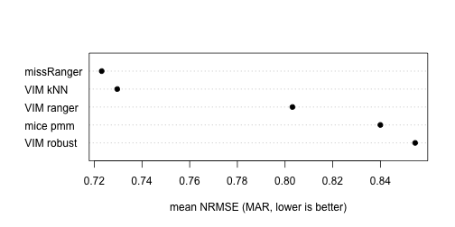

VIM ships the two pieces a fair imputation benchmark needs: `makeMissing()`
generates missingness with a **known mechanism** in complete data, and
`evaluation()`/`nrmse()` score imputations against the withheld truth. This
vignette wires them into a small but complete benchmark harness. The chunks
below were run when the vignette was precomputed (`vignettes/precompute.R` in
the source repository; the code is shown unchanged and runs as is) with


``` r
NREP <- 3     # replications per mechanism -- demo scale!
N    <- 300   # rows drawn from the complete data
```

Three replications only make a smoke test, not evidence: rerun with
`NREP <- 200` (identical code) for stable rankings; that is the setting used
for the accompanying paper.

## Data and scenarios

The `tao` data (Tropical Atmosphere Ocean project) offer strongly correlated
real measurements — exactly the structure conditional imputation can exploit.


``` r
library(VIM)
set.seed(2026)

data(tao, package = "VIM")
vars  <- c("Sea.Surface.Temp", "Air.Temp", "Humidity", "UWind", "VWind")
full  <- na.omit(tao[, vars])
targets <- c("Sea.Surface.Temp", "Air.Temp", "Humidity")
nrow(full)
#> [1] 565
```

Each replication draws `N` rows, amputes 20% of the three target variables
under MCAR or MAR (missingness driven by the observed wind variables), lets
every method impute, and scores the per-variable NRMSE on the amputed cells.

## The harness

Each method is one function `data.frame -> data.frame`; adding a competitor
is one more list entry.


``` r
methods <- list(
  "VIM ranger" = function(d) {
    vimpute(d, spec = list(.default = vs_ranger(num.trees = 100)),
            sequential = FALSE, imp_var = FALSE, verbose = FALSE)
  },
  "VIM robust" = function(d) {
    suppressWarnings(
      vimpute(d, method = "robust", sequential = FALSE,
              imp_var = FALSE, verbose = FALSE))
  },
  "VIM kNN" = function(d) kNN(d, k = 5, imp_var = FALSE)
)
if (has_mice) {
  methods[["mice pmm"]] <- function(d) {
    mice::complete(mice::mice(d, m = 1, maxit = 5, printFlag = FALSE))
  }
}
if (has_missRanger) {
  methods[["missRanger"]] <- function(d) {
    missRanger::missRanger(d, num.trees = 100, verbose = 0)
  }
}

score_run <- function(truth, amputed, imputed) {
  w <- attr(amputed, "where")
  vapply(targets, function(v) {
    nrmse(x = truth[[v]], y = imputed[[v]], m = w[, v])
  }, numeric(1))
}

run_benchmark <- function(mechanism) {
  out <- list()
  for (r in seq_len(NREP)) {
    truth <- full[sample(nrow(full), N), ]
    amp <- makeMissing(truth, prop = 0.2, mechanism = mechanism,
                       vars = targets, seed = 1000 + r)
    for (mth in names(methods)) {
      t0 <- proc.time()[["elapsed"]]
      imp <- as.data.frame(methods[[mth]](amp))
      secs <- proc.time()[["elapsed"]] - t0
      out[[length(out) + 1L]] <- data.frame(
        mechanism = mechanism, rep = r, method = mth,
        nrmse = mean(score_run(truth, amp, imp)), seconds = secs)
    }
  }
  do.call(rbind, out)
}
```

## Results


``` r
res <- rbind(run_benchmark("MCAR"), run_benchmark("MAR"))
```


``` r
summary_tab <- aggregate(cbind(nrmse, seconds) ~ method + mechanism,
                         data = res, FUN = mean)
summary_tab <- summary_tab[order(summary_tab$mechanism, summary_tab$nrmse), ]
knitr::kable(summary_tab, digits = 3, row.names = FALSE,
             caption = sprintf("Mean NRMSE over the amputed cells and mean runtime (seconds), %d replications -- demo scale.", NREP))
```


Table: Mean NRMSE over the amputed cells and mean runtime (seconds), 3 replications -- demo scale.

|method     |mechanism | nrmse| seconds|
|:----------|:---------|-----:|-------:|
|missRanger |MAR       | 0.723|   0.078|
|VIM kNN    |MAR       | 0.730|   0.036|
|VIM ranger |MAR       | 0.803|   0.295|
|mice pmm   |MAR       | 0.840|   0.017|
|VIM robust |MAR       | 0.855|   0.290|
|VIM kNN    |MCAR      | 0.530|   0.038|
|missRanger |MCAR      | 0.566|   0.083|
|mice pmm   |MCAR      | 0.762|   0.023|
|VIM ranger |MCAR      | 0.773|   0.327|
|VIM robust |MCAR      | 0.815|   0.312|


``` r
mar <- summary_tab[summary_tab$mechanism == "MAR", ]
dotchart(rev(mar$nrmse), labels = rev(mar$method), pch = 19,
         xlab = "mean NRMSE (MAR, lower is better)")
```



At this demo scale the ordering is indicative only; with `NREP <- 200` the
Monte-Carlo error of the means becomes negligible and the same code produces
publication-grade comparisons. Other packages drop in the same way — e.g. a
`mixgb` entry (`mixgb::mixgb(d, m = 1)`), when that package is installed.

## Notes on fairness

- All methods see identical amputed datasets (`seed` in `makeMissing()`).
- NRMSE is computed on the amputed cells only, against the withheld truth,
  and is scale-free (RMSE divided by the standard deviation of the true
  values), so it can be averaged over variables.
- Point-prediction accuracy is *one* criterion; it systematically favours
  conditional-mean methods over draw-based ones. For inference the relevant
  yardstick is the coverage of pooled confidence intervals -- see the
  companion vignette *Validating multiple-imputation properness*.
- `overimpute()` provides the complementary calibration check on real data
  where no truth is available.
