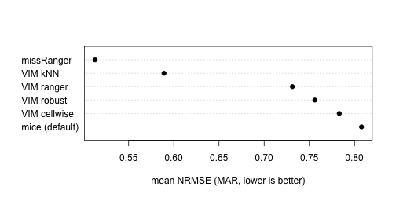
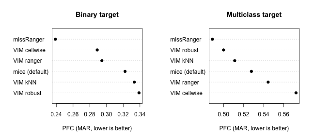

VIM ships the two pieces a fair imputation benchmark needs: `makeMissing()`
generates missingness with a **known mechanism** in complete data, and
`evaluation()`/`nrmse()` score imputations against the withheld truth. This
vignette wires them into a small but complete benchmark harness. The chunks
below were run when the vignette was precomputed (`vignettes/precompute.R` in
the source repository; the code is shown unchanged and runs as is) with


``` r
NREP <- 3     # replications per mechanism -- demo scale!
N    <- 300   # rows drawn from the complete data
```

Three replications only make a smoke test, not evidence: rerun with
`NREP <- 200` (identical code) for stable rankings; that is the setting used
for the accompanying paper.

## Data and scenarios

The `tao` data (Tropical Atmosphere Ocean project) offer strongly correlated
real measurements — exactly the structure conditional imputation can exploit.


``` r
library(VIM)
set.seed(2026)

data(tao, package = "VIM")
vars  <- c("Sea.Surface.Temp", "Air.Temp", "Humidity", "UWind", "VWind")
full  <- na.omit(tao[, vars])
targets <- c("Sea.Surface.Temp", "Air.Temp", "Humidity")
nrow(full)
#> [1] 565
```

Each replication draws `N` rows, amputes 20% of the three target variables
under MCAR or MAR (missingness driven by the observed wind variables), lets
every method impute, and scores the per-variable NRMSE on the amputed cells.

## The harness

Each method is one function `data.frame -> data.frame`; adding a competitor
is one more list entry. The cellwise entry uses the cell-weighted MM
regression engine (`engine = "cellwise-mm"`), which does not require the
optional `crmReg` package. The first scenario has numeric targets; the mixed-data
scenario below also evaluates binary and multiclass targets using
`classif.cellwise`. Regression-only parameters are supplied per numeric target
so they are not passed to the classifier.


``` r
methods <- list(
  "VIM ranger" = function(d) {
    vimpute(d, spec = list(.default = vs_ranger(num.trees = 100)),
            sequential = FALSE, imp_var = FALSE, verbose = FALSE)
  },
  "VIM robust" = function(d) {
    suppressWarnings(
      vimpute(d, method = "robust", sequential = FALSE,
              imp_var = FALSE, verbose = FALSE))
  },
  "VIM cellwise" = function(d) {
    numeric_targets <- names(d)[vapply(d, function(x) is.numeric(x) && anyNA(x),
                                       logical(1))]
    params <- setNames(lapply(numeric_targets, function(v)
      list(engine = "cellwise-mm")), numeric_targets)
    # A failed learner must not silently turn this benchmark into a test
    # of vimpute's fallback method.
    withCallingHandlers(
      vimpute(d, method = "cellwise", learner_params = params,
              sequential = FALSE, imp_var = FALSE, verbose = FALSE),
      warning = function(w) {
        if (grepl("fallback|falling back|not supported|ignored",
                  conditionMessage(w), ignore.case = TRUE)) stop(w)
      })
  },
  "VIM kNN" = function(d) kNN(d, k = 5, imp_var = FALSE)
)
if (has_mice) {
  methods[["mice (default)"]] <- function(d) {
    mice::complete(mice::mice(d, m = 1, maxit = 5, printFlag = FALSE))
  }
}
if (has_missRanger) {
  methods[["missRanger"]] <- function(d) {
    missRanger::missRanger(d, num.trees = 100, verbose = 0)
  }
}

score_run <- function(truth, amputed, imputed) {
  w <- attr(amputed, "where")
  vapply(targets, function(v) {
    nrmse(x = truth[[v]], y = imputed[[v]], m = w[, v])
  }, numeric(1))
}

run_benchmark <- function(mechanism) {
  out <- list()
  for (r in seq_len(NREP)) {
    # Fix the sampled data independently of each method's RNG consumption.
    run_seed <- 2026L + r + if (mechanism == "MAR") 10000L else 0L
    set.seed(run_seed)
    truth <- full[sample(nrow(full), N), ]
    amp <- makeMissing(truth, prop = 0.2, mechanism = mechanism,
                       vars = targets, seed = 1000 + r)
    for (mth in names(methods)) {
      set.seed(run_seed + 100000L)
      t0 <- proc.time()[["elapsed"]]
      imp <- as.data.frame(methods[[mth]](amp))
      secs <- proc.time()[["elapsed"]] - t0
      out[[length(out) + 1L]] <- data.frame(
        mechanism = mechanism, rep = r, method = mth,
        nrmse = mean(score_run(truth, amp, imp)), seconds = secs)
    }
  }
  do.call(rbind, out)
}
```

## Numeric-data results


``` r
res <- rbind(run_benchmark("MCAR"), run_benchmark("MAR"))
```


``` r
summary_tab <- aggregate(cbind(nrmse, seconds) ~ method + mechanism,
                         data = res, FUN = mean)
summary_tab <- summary_tab[order(summary_tab$mechanism, summary_tab$nrmse), ]
knitr::kable(summary_tab, digits = 3, row.names = FALSE,
             caption = sprintf("Mean NRMSE over the amputed cells and mean runtime (seconds), %d replications -- demo scale.", NREP))
```


Table: Mean NRMSE over the amputed cells and mean runtime (seconds), 3 replications -- demo scale.

|method         |mechanism | nrmse| seconds|
|:--------------|:---------|-----:|-------:|
|missRanger     |MAR       | 0.513|   0.090|
|VIM kNN        |MAR       | 0.589|   0.027|
|VIM ranger     |MAR       | 0.731|   0.284|
|VIM robust     |MAR       | 0.756|   0.280|
|VIM cellwise   |MAR       | 0.783|   0.291|
|mice (default) |MAR       | 0.808|   0.014|
|VIM kNN        |MCAR      | 0.565|   0.082|
|missRanger     |MCAR      | 0.565|   0.080|
|VIM robust     |MCAR      | 0.703|   0.573|
|VIM cellwise   |MCAR      | 0.717|   0.336|
|mice (default) |MCAR      | 0.740|   0.015|
|VIM ranger     |MCAR      | 0.751|   0.412|


``` r
mar <- summary_tab[summary_tab$mechanism == "MAR", ]
dotchart(rev(mar$nrmse), labels = rev(mar$method), pch = 19,
         xlab = "mean NRMSE (MAR, lower is better)")
```



## Mixed-data scenario

This reproducible synthetic population contains two fully observed numeric
predictors (`x`, `z`), one fully observed categorical predictor (`group`),
and three targets: a continuous response, a binary factor, and a three-level
factor. All targets depend on the predictors, with independent response noise;
no target is simply a discretized copy of another target. The data are clean:
this evaluates mixed-data imputation, not resistance to cellwise contamination.


``` r
set.seed(7301)
npop <- 2000L
mixed_full <- data.frame(x = rnorm(npop), z = rnorm(npop),
                         group = factor(sample(c("a", "b", "c"), npop, TRUE)))
g <- as.numeric(mixed_full$group) - 2
mixed_full$continuous <- 2 + 1.5 * mixed_full$x - mixed_full$z + .5 * g +
  rnorm(npop, sd = .7)
pr_binary <- plogis(1.5 * mixed_full$x - mixed_full$z + .5 * g)
mixed_full$binary <- factor(ifelse(runif(npop) < pr_binary, "yes", "no"),
                            levels = c("no", "yes"))
eta <- cbind(low = -mixed_full$x + .4 * g,
             middle = .5 * mixed_full$z,
             high = mixed_full$x - .5 * mixed_full$z - .4 * g)
prob <- exp(eta - apply(eta, 1, max))
prob <- prob / rowSums(prob)
mixed_full$category <- factor(vapply(seq_len(npop), function(i)
  sample(colnames(prob), 1, prob = prob[i, ]), character(1)),
  levels = colnames(prob))
mixed_targets <- c("continuous", "binary", "category")
```

Each replication samples `N` rows and amputes 20% of each target under MCAR
or MAR. MAR probabilities depend only on the fully observed `x` and `z`.
We report continuous-target NRMSE and the **proportion falsely classified
(PFC)** separately for the binary and multiclass targets. PFC is the fraction
of withheld labels imputed incorrectly; lower is better for every metric.
No categorical label is scored as a numeric code, and PFC is not averaged
with NRMSE. `mice (default)` uses its type-specific defaults: PMM for the
numeric target, logistic regression for the binary target, and multinomial
regression for the unordered three-level target.


``` r
run_mixed_benchmark <- function(mechanism) {
  out <- list()
  for (r in seq_len(NREP)) {
    run_seed <- 7301L + r + if (mechanism == "MAR") 10000L else 0L
    set.seed(run_seed)
    truth <- mixed_full[sample(nrow(mixed_full), N), ]
    amp <- makeMissing(truth, prop = .2, mechanism = mechanism,
      vars = mixed_targets, seed = 3000L + r,
      weights = if (mechanism == "MAR") c(x = 1, z = -.5) else NULL)
    w <- attr(amp, "where")
    stopifnot(all(colSums(w[, mixed_targets, drop = FALSE]) > 0),
              !any(w[, c("x", "z", "group")]))
    for (mth in names(methods)) {
      set.seed(run_seed + 100000L)
      t0 <- proc.time()[["elapsed"]]
      imp <- as.data.frame(methods[[mth]](amp))
      secs <- proc.time()[["elapsed"]] - t0
      stopifnot(nrow(imp) == nrow(truth), !anyNA(imp),
                all(is.finite(imp$continuous)))
      for (v in names(truth)) {
        stopifnot(all(as.character(imp[[v]][!w[, v]]) ==
                        as.character(truth[[v]][!w[, v]])))
      }
      pfc_target <- function(v) {
        stopifnot(is.factor(imp[[v]]),
                  identical(levels(imp[[v]]), levels(truth[[v]])))
        mean(as.character(imp[[v]][w[, v]]) !=
               as.character(truth[[v]][w[, v]]))
      }
      out[[length(out) + 1L]] <- data.frame(
        mechanism = mechanism, rep = r, method = mth,
        nrmse = nrmse(truth$continuous, imp$continuous, m = w[, "continuous"]),
        pfc_binary = pfc_target("binary"),
        pfc_multiclass = pfc_target("category"), seconds = secs)
    }
  }
  do.call(rbind, out)
}
```

## Mixed-data results

All methods retain the same single-pass/iteration and uncertainty settings
used above. In particular, vimpute uses its default uncertainty setting:
categorical imputations are draws from predicted class probabilities, rather
than deterministic most-probable labels. Consequently, these scores compare
the configured imputation procedures, not just classifier discrimination.


``` r
mixed_res <- rbind(run_mixed_benchmark("MCAR"), run_mixed_benchmark("MAR"))
stopifnot(nrow(mixed_res) == 2L * NREP * length(methods),
          all(is.finite(as.matrix(mixed_res[c("nrmse", "pfc_binary",
                                              "pfc_multiclass", "seconds")]))),
          all(mixed_res$pfc_binary >= 0 & mixed_res$pfc_binary <= 1),
          all(mixed_res$pfc_multiclass >= 0 & mixed_res$pfc_multiclass <= 1))
```


``` r
mixed_summary <- aggregate(cbind(nrmse, pfc_binary, pfc_multiclass, seconds) ~
                             method + mechanism, data = mixed_res, FUN = mean)
mixed_summary <- mixed_summary[order(mixed_summary$mechanism,
                                     mixed_summary$pfc_multiclass), ]
knitr::kable(mixed_summary, digits = 3, row.names = FALSE,
  caption = sprintf("Mixed-data mean NRMSE, binary/multiclass PFC, and runtime (seconds), %d replications -- demo scale.", NREP))
```


Table: Mixed-data mean NRMSE, binary/multiclass PFC, and runtime (seconds), 3 replications -- demo scale.

|method         |mechanism | nrmse| pfc_binary| pfc_multiclass| seconds|
|:--------------|:---------|-----:|----------:|--------------:|-------:|
|missRanger     |MAR       | 0.476|      0.239|          0.489|   0.068|
|VIM robust     |MAR       | 0.530|      0.339|          0.500|   0.216|
|VIM kNN        |MAR       | 0.802|      0.333|          0.511|   0.032|
|mice (default) |MAR       | 0.552|      0.322|          0.528|   0.039|
|VIM ranger     |MAR       | 0.616|      0.294|          0.544|   0.258|
|VIM cellwise   |MAR       | 0.539|      0.289|          0.572|   0.241|
|missRanger     |MCAR      | 0.475|      0.256|          0.439|   0.080|
|VIM kNN        |MCAR      | 0.752|      0.261|          0.472|   0.037|
|VIM robust     |MCAR      | 0.487|      0.267|          0.472|   0.227|
|mice (default) |MCAR      | 0.474|      0.261|          0.483|   0.047|
|VIM cellwise   |MCAR      | 0.513|      0.267|          0.483|   0.247|
|VIM ranger     |MCAR      | 0.579|      0.294|          0.483|   0.289|


``` r
local({
  old_par <- par(mfrow = c(1, 2))
  on.exit(par(old_par))
  mar_mixed <- mixed_summary[mixed_summary$mechanism == "MAR", ]
  for (metric in c("pfc_binary", "pfc_multiclass")) {
    ranked <- mar_mixed[order(mar_mixed[[metric]]), ]
    dotchart(rev(ranked[[metric]]), labels = rev(ranked$method), pch = 19,
             xlab = "PFC (MAR, lower is better)",
             main = if (metric == "pfc_binary") "Binary target" else "Multiclass target")
  }
})
```



At this demo scale the rankings are indicative only. More replications and
Monte Carlo uncertainty estimates are needed for substantive comparisons;
`NREP <- 200` is a useful larger run, not a guarantee of negligible uncertainty.
Other packages drop in the same way, for example a `mixgb` entry when installed.

## Notes on fairness

- All methods see identical amputed datasets (`seed` in `makeMissing()`).
  Sampling and method runs have explicit replication seeds, so adding a
  method does not change the data or random draws seen by the others.
- NRMSE is computed on the amputed cells only, against the withheld truth,
  and is scale-free (RMSE divided by the standard deviation of the true
  values), so it can be averaged over variables.
- Point-prediction accuracy is *one* criterion; it systematically favours
  conditional-mean methods over draw-based ones. For inference the relevant
  yardstick is the coverage of pooled confidence intervals -- see the
  companion vignette *Validating multiple-imputation properness*.
- `overimpute()` provides the complementary calibration check on real data
  where no truth is available.
