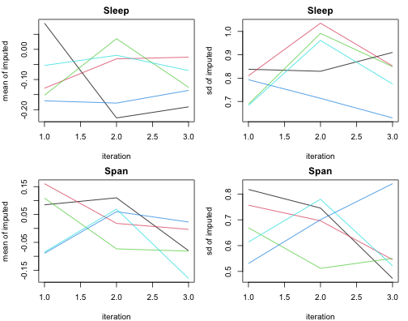
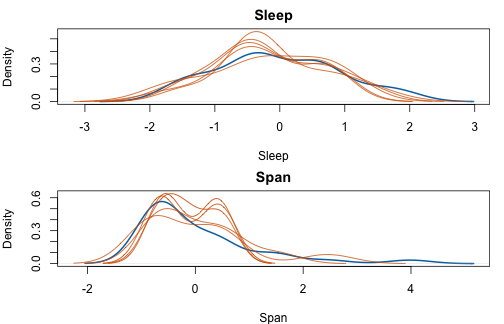
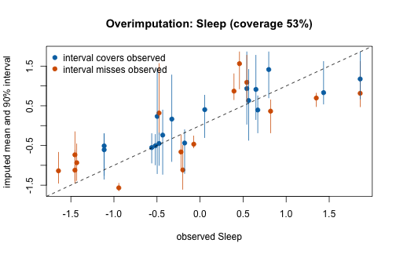

This vignette walks through a complete multiple-imputation workflow with
`vimpute()`: simulate missingness with a known mechanism, impute multiply,
check convergence and calibration, pool with Rubin's rules, and validate
against the truth. The chunks below were run when the vignette was precomputed
(`vignettes/precompute.R` in the source repository); the code is shown
unchanged and runs as is.


``` r
library(VIM)
set.seed(2026)

data(sleep, package = "VIM")
truth <- na.omit(sleep[, c("BodyWgt", "BrainWgt", "NonD", "Sleep", "Span", "Gest")])
truth <- as.data.frame(scale(truth))   # common scale keeps the example compact
nrow(truth)
#> [1] 42
```

## Simulate missingness with a known mechanism

`makeMissing()` generates MCAR/MAR/MNAR missingness in complete data — here
MAR: the probability that `Sleep` and `Span` go missing grows with the other
(observed) variables. The returned `"where"` attribute marks the amputed
cells, so the truth stays available for validation.


``` r
amp <- makeMissing(truth, prop = 0.25, mechanism = "MAR",
                   vars = c("Sleep", "Span"), seed = 1)
colSums(is.na(amp))
#>  BodyWgt BrainWgt     NonD    Sleep     Span     Gest 
#>        0        0        0       10       10        0
```

## Multiple imputation

`m = 5` imputations; with `m > 1`, each imputation refits its models on a
bootstrap sample (`boot = TRUE` is the default for multiple imputation) and
the default `uncert = "pmm"` draws from observed donor values, so the
imputations differ between runs (a prerequisite for Rubin's rules).
Per-variable settings use the spec interface; three sequential iterations
give the convergence chains something to show.


``` r
mi <- vimpute(amp,
              spec = list(.default = vs_ranger(num.trees = 100)),
              m = 5, sequential = TRUE, nseq = 3, seed = 7, verbose = FALSE)
mi
#> Multiply imputed dataset (vimmi)
#>   Observations: 42
#>   Variables:    6
#>   Imputations:  m = 5
#>   Bootstrap:    yes
#>   Uncertainty:  pmm
#>   Missing cells: 20 across 2 variables
#>     Sleep: 10 NAs (ranger; NRMSE = 0.401 [oob])
#>     Span: 10 NAs (ranger; NRMSE = 0.727 [oob])
```

`print()` already answers the practitioner's first question — *can I trust
this?* — with a per-variable model-quality metric (NRMSE, out-of-bag for
ranger; PFC for factors).

## Convergence and distribution diagnostics


``` r
plot(mi)             # chains: mean/sd of the imputed values per iteration
```




``` r
plot(mi, "density")  # observed (blue, bold) vs per-imputation imputed (red)
```



## Pooling with Rubin's rules

`with()` fits a model on each completed dataset and returns a
mice-compatible `mira`, so the standard pipeline applies unchanged.


``` r
fits <- with(mi, lm(Sleep ~ BodyWgt + Span))
pooled <- mice::pool(fits)
summary(pooled)
#>          term    estimate std.error  statistic       df    p.value
#> 1 (Intercept) -0.06347952 0.1326505 -0.4785471 35.42201 0.63520157
#> 2     BodyWgt -0.20018445 0.1532492 -1.3062675 33.80298 0.20028060
#> 3        Span -0.26789463 0.1527491 -1.7538210 32.48761 0.08889201
```

Alternatively, convert the whole object: `vim_as_mids(mi)` yields a genuine
`mice::mids` for any downstream mice infrastructure.


``` r
mids <- vim_as_mids(mi)
class(mids)
#> [1] "mids"
```

## Hyperparameter tuning inside the imputation

Tuning is controlled per variable (spec) and per call (`tune_control`); with
`m > 1` the tuner runs once and all imputations share its parameters. The
tuning log records what was chosen.


``` r
mi_tuned <- vimpute(amp,
                    spec = list(Sleep    = vs_ranger(num.trees = 100, tune = TRUE),
                                .default = vs_ranger(num.trees = 100)),
                    tune_control = vimpute_tune_control(budget = 4, folds = 3),
                    m = 2, sequential = FALSE, seed = 7, verbose = FALSE)
tl <- mi_tuned$tuning_log
tail(tl, 1)[[1]][c("variable", "tuned", "tuned_better", "n_evals", "folds")]
#> $variable
#> [1] "Span"
#> 
#> $tuned
#> [1] FALSE
#> 
#> $tuned_better
#> [1] FALSE
#> 
#> $n_evals
#> NULL
#> 
#> $folds
#> NULL
```

## Calibration: overimputation

`overimpute()` treats the *observed* cells of a variable as missing (fold by
fold), imputes them multiply, and compares observed values with the imputed
intervals — a model-agnostic calibration check that needs no ground truth.


``` r
ov <- overimpute(amp, "Sleep",
                 spec = list(.default = vs_ranger(num.trees = 100)),
                 draws = 5, folds = 3, sequential = FALSE, seed = 3)
ov
#> Overimputation diagnostic for 'Sleep'
#>   32 observed cells, 5 draws each (3 folds)
#>   Empirical coverage of the 90% intervals: 53.1%
#>   Mean absolute error (observed vs imputed mean): 0.4871
plot(ov)
```



## Validation against the truth

Because the missingness was simulated, the imputations can be scored against
the true values — the loop `makeMissing()` → `vimpute()` → `evaluation()`
that any benchmark study needs.


``` r
completed <- vim_complete(mi, 1)
evaluation(truth, completed, where = attr(amp, "where"))
#> $err_num
#> [1] 0.3303824
#> 
#> $err_cat
#> [1] 0
#> 
#> $error
#> [1] 0.3303824
```

## A note on assumptions

Like all conditional imputation, `vimpute()` assumes MAR (which includes
MCAR). Under MNAR — missingness driven by the unobserved values themselves —
estimates can be biased and no imputation method can repair this from the
observed data alone; `makeMissing(mechanism = "MNAR")` supports exactly the
sensitivity simulations such situations call for.
