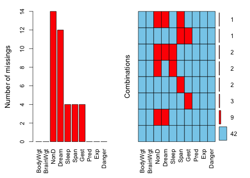
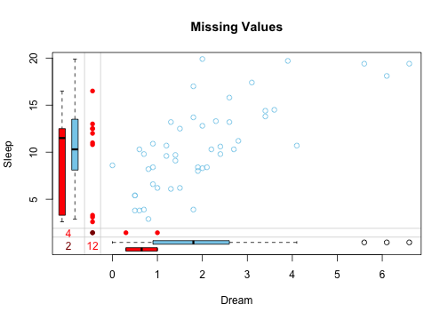
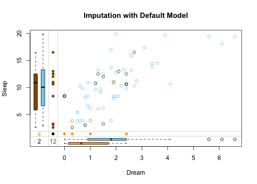
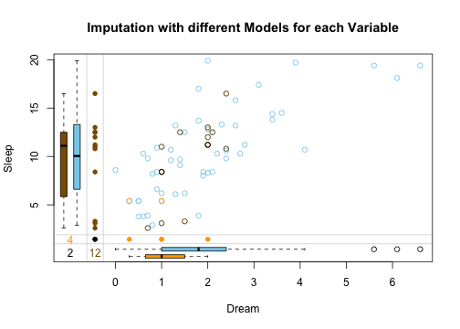
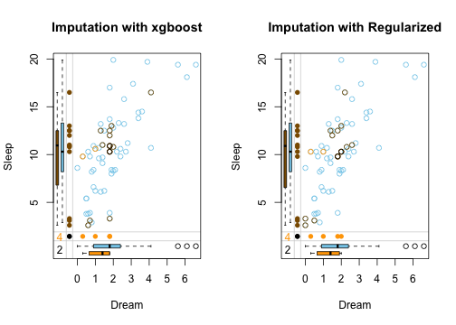
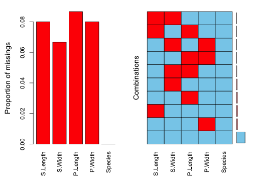
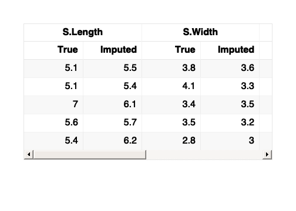
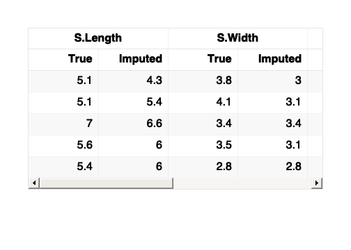

## Introduction

This vignette demonstrates how to use the `vimpute()` function for flexible missing data imputation using machine learning models from the mlr3 ecosystem. The chunks below were run when the vignette was precomputed (`vignettes/precompute.R` in the source repository); the code is shown unchanged and runs as is.

### Function Arguments

- `data`: A datatable or dataframe containing missing values to be imputed.
- `considered_variables`: A character vector of variable names to be either imputed or used as predictors, excluding irrelevant columns from the imputation process. Excluded columns are still returned unchanged by default (`keep_all_columns = TRUE`).
- `method`: A named list specifying the imputation method for each variable. If not set explicitly, `vimpute()` uses `"ranger"` for all considered variables.
- `pmm`: TRUE/FALSE indicating whether predictive mean matching is used.
- `pmm_k`: Number of nearest neighbors used for PMM.
- `pmm_k_method`: Strategy for selecting PMM donor values from the `k` nearest candidates.
- `learner_params`: Optional learner-specific parameter lists for each variable (e.g. `ranger` settings such as `median = TRUE`).
- `formula`: If not all variables are used as predictors, or if transformations or interactions are required 
             (applies to all X, for Y only transformations are possible). Only applicable for the methods `"robust"`, `"regularized"`, `"gam"` and `"robgam"`. Provide as a list for each variable that requires specific conditions.
- `makeNA`: Optional named list of values that should be treated as imputable missing values for selected variables.
- `donorcond`: Optional named list of donor conditions used to restrict the observed training values for selected variables.
- `sequential`: Specifies whether the imputation should be performed sequentially.
- `nseq`: The number of sequential iterations, if `sequential` is TRUE.
- `eps`: The convergence threshold for sequential imputation.
- `imp_var`: Specifies whether to add indicator variables for imputed values.
- `pred_history`: If enabled, saves the prediction history.
- `tune`: Whether to perform hyperparameter tuning.
- `verbose`: If enabled, prints additional debugging output.
- `boot`: Whether to refit models on bootstrap samples to add model uncertainty
  (default: `TRUE` when `m > 1`, `FALSE` for single imputation).
- `robustboot`: Bootstrap sampling strategy used when `boot = TRUE`.
- `uncert`: Prediction uncertainty method (`"pmm"` -- the default: a random draw among the 5 nearest donors -- `"none"`, `"normalerror"`, `"resid"`, `"midastouch"`).
- `m`: Number of multiple imputations. If `m > 1`, a `vimmi` object is returned.

## Data

To demonstrate the function, the `sleep` dataset from the `VIM` package is used. 


``` r
data <- as.data.table(VIM::sleep)
a <- aggr(sleep, plot = FALSE)
plot(a, numbers = TRUE, prop = FALSE)
```

<div class="figure" style="text-align: center">

<p class="caption">plot of chunk setup_2</p>
</div>

The left plot shows the amount of missings for each column in the dataset sleep and the right plot shows how often each combination of missings occur. For example, there are 9 rows wich contain a missing in both NonD and Dream.


``` r
dataDS <- sleep[, c("Dream", "Sleep")]
marginplot(dataDS, main = "Missing Values")
```

<div class="figure" style="text-align: center">

<p class="caption">plot of chunk unnamed-chunk-3</p>
</div>

The __<font color="red">red</font>__ boxplot on the left shows the distrubution of all values of Sleep where Dream contains a missing value. 
The __<font color="#87ceeb">blue</font>__ boxplot on the left shows the distribution of the values of Sleep where Dream is observed.

## Basic Usage

### Default Imputation

In the basic usage, the `vimpute()` function uses the default settings: all variables are imputed with the "ranger" method, sequential imputation is enabled (`nseq = 10`, `eps = 0.005`), PMM is off, formulas are off, no tuning is performed, and imputation indicators are added.


``` r
result <- vimpute(
  data = data,
  pred_history = TRUE)
```

``` r
print(head(result, 3))
#>     BodyWgt BrainWgt  NonD Dream Sleep  Span  Gest  Pred   Exp Danger NonD_imp
#>       <num>    <num> <num> <num> <num> <num> <num> <num> <num>  <num>   <lgcl>
#> 1: 6654.000   5712.0   2.1   1.5   3.3  38.6   645     3     5      3     TRUE
#> 2:    1.000      6.6   6.3   2.0   8.3   4.5    42     3     1      3    FALSE
#> 3:    3.385     44.5  10.4   2.4  12.5  14.0    60     1     1      1     TRUE
#>    Dream_imp Sleep_imp Span_imp Gest_imp
#>       <lgcl>    <lgcl>   <lgcl>   <lgcl>
#> 1:      TRUE     FALSE    FALSE    FALSE
#> 2:     FALSE     FALSE    FALSE    FALSE
#> 3:      TRUE     FALSE    FALSE    FALSE
```

Results and information about missing/imputed values can be shown in the plot margins:


``` r
dataDS <- as.data.frame(result[, c("Dream", "Sleep", "Dream_imp", "Sleep_imp")])
marginplot(dataDS, delimiter = "_imp", main = "Imputation with Default Model")
```

<div class="figure" style="text-align: center">

<p class="caption">plot of chunk unnamed-chunk-6</p>
</div>

The result is the imputed dataset; with `pred_history = TRUE` the prediction history is attached as an attribute.

In this plot three differnt colors are used in the top-right.
These colors represent the structure of missings.

* __<font color="#8b5a00">brown</font>__ points represent values where `Dream` was missing initially
* __<font color="#ffa500">beige</font>__ points represent values where `Sleep` was missing initially
* __black__ points represent values where both `Dream` and `Sleep` were missing
  initially

## Advanced Options

#### Parameter `method` 
<small>*(default: "ranger" for all variables)*</small>  

Specifies the method used for imputation of each variable. If `method` is not provided, `vimpute()` uses `"ranger"` for all variables. In this example, different imputation methods are specified for each variable. The `NonD` variable uses a robust method, `Dream` and `Span` are using ranger, `Sleep` uses xgboost, `Gest` uses a regularized method and `class` uses a robust method.

- **`"robust"`**: Robust Regression Models  
  - `lmrob` for numeric variables: Implements MM-estimation for resistance to outliers
  - `glmrob` for factors: Robust GLM; binary via robust logit, multiclass via one-vs-rest
- **`"regularized"`**: Regularized Regression (`glmnet`)  
  - Uses elastic net regularization  
  - Automatically handles multicollinearity  
- **`"ranger"`**: Random Forest  
  - Fast implementation of random forests  
  - Handles non-linear relationships well  
- **`"xgboost"`**: Gradient Boosted Trees  
  - State-of-the-art tree boosting  
  - Handles mixed data types well  
- **`"gam"`**: Generalized Additive Models (`mgcv`)
  - Supports smooth terms for numeric predictors
  - Can be used for numeric and factor targets
- **`"robgam"`**: Robust GAM
  - Adds robust weighting / refitting to GAM-style models
  - Designed for settings with potential outliers

You can provide `method` globally as a single method name (applies to all variables), or as a named list per variable.

Per-variable settings can also be bundled into **spec objects** — one object per variable instead
of coordinating the parallel `method`/`learner_params`/`formula`/`tune`/... arguments — or written
as a compact **formula grammar**. Both compile to the classic arguments, so results are identical:


``` r
# spec objects: everything about a variable in one place,
# learner parameters validated at the constructor call
res <- vimpute(sleep_data,
  spec = list(
    Sleep    = vs_ranger(num.trees = 300, tune = TRUE),
    NonD     = vs_robust(donorcond = ">= 0"),
    .default = vs_ranger()
  ),
  seed = 1)

# the same as formula grammar: target ~ predictors | method(...)
res <- vimpute(sleep_data,
  Sleep ~ . | ranger(num.trees = 300, tune = TRUE),
  NonD  ~ . | robust(donorcond = ">= 0"),
  .default = vs_ranger(),
  seed = 1)
```

A plain-column right-hand side restricts the predictors (works for every method, including ranger
and xgboost); a right-hand side with transformations such as `s(x)` or `log(x)` becomes a model
formula for the formula-capable methods.

Beyond the built-ins, any pair of mlr3 learners can be registered as an additional method with a
single call — no changes to VIM required. The registered name then works everywhere the built-in
names do (global `method`, per-variable lists, method-keyed `learner_params`, specs and grammar):


``` r
# CART trees via mlr3's rpart learners
register_vimpute_method("cart",
  learner  = list(regr = "regr.rpart", classif = "classif.rpart"),
  packages = "rpart")
imp_cart <- vimpute(sleep_data, method = "cart")

vimpute_methods()  # lists built-ins plus registered methods
```


``` r
result_mixed <- vimpute(
  data = data,
  method = list(NonD = "robust", 
                Dream = "ranger", 
                Sleep = "xgboost", 
                Span = "ranger", 
                Gest = "regularized"),
  pred_history = TRUE,
  sequential = FALSE
  )
```

``` r
dataDS <- as.data.frame(result_mixed[, c("Dream", "Sleep", "Dream_imp", "Sleep_imp")])
marginplot(dataDS, delimiter = "_imp", main = "Imputation with different Models for each Variable")
```

<div class="figure" style="text-align: center">

<p class="caption">plot of chunk unnamed-chunk-10</p>
</div>


The side-by-side margin plots compare the performance of two imputation methods: xgboost (left) and regularized (right): 

<div class="figure" style="text-align: center">

<p class="caption">plot of chunk unnamed-chunk-12</p>
</div>

xgboost handles missing values with data-driven, uneven imputations that capture complex patterns but may be less stable, while regularized methods produce smoother, more conservative estimates that are less prone to overfitting. The key difference lies in flexibility (xgboost) versus shrinkage-based stability (regularization). Note that regularization is not robustness in the statistical sense: it stabilises coefficients against multicollinearity and overfitting, but does not protect against outliers -- for outlier-resistant imputation use the `"robust"` or `"robgam"` methods.

#### Parameter `pmm` 
<small>*(default: FALSE)*</small>


``` r
result <- vimpute(
  data = data,
  method = list(NonD = "robust", 
                Dream = "ranger", 
                Sleep = "xgboost", 
                Span = "ranger", 
                Gest = "regularized"),
  pmm = list(NonD = FALSE, Dream = TRUE, Sleep = FALSE, Span = FALSE , Gest = TRUE)
  )
```

If `pmm = TRUE`, this is applied only to numeric target variables.  
`vimpute()` first computes the model prediction for a missing entry, then compares it to observed values of that target and selects donor candidates by smallest absolute distance to the prediction.  
If `pmm_k = 1` (or `NULL`, which defaults to 1 when PMM is active), the closest observed value is used directly.  
If `pmm_k > 1`, the final imputed value is derived from the `k` nearest donors using `pmm_k_method` (e.g. `"mean"`, `"median"`, `"random"` or a custom function).  
If `pmm = FALSE`, raw model predictions are used.

In sequential imputation, the convergence criterion is computed from the raw model prediction when PMM is active. This avoids unstable stopping behavior caused by stochastic or donor-based PMM values while still returning the PMM-imputed values in the final data.

You can provide `pmm` globally as a single logical value (applies to all numeric variables), or as a named list per variable.

#### Parameter `pmm_k`
<small>*(default: NULL)*</small>

`pmm_k` defines how many nearest donor candidates are considered when PMM is enabled.

You can provide `pmm_k` globally as a single integer value (applies to all variables where PMM is active), or as a named list per variable.

#### Parameter `pmm_k_method`
<small>*(default: "mean")*</small>

`pmm_k_method` controls how the final donor value is derived when `pmm_k > 1`.
Possible values are:

- `"mean"` (default): uses the mean of the `k` nearest observed donor candidates.
- `"median"`: uses the median of the `k` nearest donor candidates (more robust to outliers).
- `"random"`: randomly draws one value from the `k` nearest donor candidates.
- `"custom function"`: a function that gets the `k` nearest donor values and returns one numeric value.

If a variable-specific list contains `NULL`, `vimpute()` falls back to `"mean"` for that variable.

You can provide `pmm_k_method` globally as a single value/function (applies to all numeric variables where `pmm = TRUE` and `pmm_k > 1`), or as a named list per variable.


``` r
result <- vimpute(
  data = data,
  pmm = list(Dream = TRUE, Sleep = TRUE, NonD = FALSE),
  pmm_k = list(Dream = 5, Sleep = 3),
  pmm_k_method = list(
    Dream = "median",
    Sleep = "random"
  )
)
```

Custom aggregation functions are also possible. The function receives the nearest donor values and must return exactly one non-missing numeric value.


``` r
result <- vimpute(
  data = data,
  pmm = list(Dream = TRUE),
  pmm_k = list(Dream = 5),
  pmm_k_method = list(Dream = function(x) mean(x, trim = 0.2))
)
```

#### Parameter `learner_params`
<small>*(default: NULL)*</small>

Use `learner_params` to pass method-specific settings to the underlying learners.  
This is useful if different variables are imputed with different methods and each method should receive its own parameter configuration.

You can provide `learner_params` globally (when one method is used for all variables), as a method-level list, or as a named list per variable.


``` r
result <- vimpute(
  data = data,
  method = list(Dream = "ranger", Sleep = "xgboost"),
  learner_params = list(
    Dream = list(num.trees = 700, min.node.size = 4),
    Sleep = list(nrounds = 250, max_depth = 5, eta = 0.05)
  )
)
```


#### Parameter `formula` 
<small>*(default: FALSE)*</small> 

Specifies custom model formulas for imputation of each variable, offering precise control over the imputation models.

**Key Features:**

1. **Variable-Specific Models**  
   - Each formula specifies which predictors should be used for imputing a particular variable
   - Enables different predictor sets for different target variables
   - Example:  
     ```r
     formula = list(
       income ~ education + age,
       blood_pressure ~ weight + age
     )
     ```

2. **Transformations Support**  
   - Handles common transformations on both sides of the formula:
     - Response transformations: `log(y)`, `sqrt(y)`, `exp(y)`, `I(1/y)`
     - Predictor transformations: `log(x1)`, `poly(x2, 2)`, etc.
   - Example with transformations:  
     ```r
     formula = list(
       log(income) ~ poly(age, 2) + education,
       sqrt(blood_pressure) ~ weight + I(1/age)
     )
     ```

3. **Interaction Terms**  
   - Supports interaction terms using `:` or `*` syntax (on the right side)
   - Example:  
     ```r
     formula = list(
       price ~ sqft * neighborhood + year_built
     )
     ```

**Example Demonstration:**


``` r
result <- vimpute(
  data = data,
  method = setNames(as.list(rep("regularized", ncol(data))), names(data)),
  formula = list(
    NonD ~ Dream + Sleep,              # Linear combination
    Span ~ Dream:Sleep + Gest,         # With interaction term
    log(Gest) ~ Sleep + exp(Span)      # With transformations
  )
)
```

**Interpreting the Example:**

1. For `NonD`:
   - Uses linear combination of `Dream` and `Sleep` variables
   - Model: `NonD = β₀ + β₁*Dream + β₂*Sleep + ε`

2. For `Span`:
   - Includes interaction between `Dream` and `Sleep`
   - Plus main effect of `Gest`
   - Model: `Span = β₀ + β₁*Dream*Sleep + β₂*Gest + ε`

3. For `Gest`:
   - Uses log-transformed response
   - Predictors include `Sleep` and exponential of `Span`
   - Model: `log(Gest) = β₀ + β₁*Sleep + β₂*exp(Span) + ε`
   
4. For `Sleep` and `Dream` all other variables are used as predictors

**Notes:**

- Only works with methods `"robust"`, `"regularized"`, `"gam"` and `"robgam"`
- All model.matrix-compatible functions work for predictors (for more information see ?model.matrix) 
- Response transformations (left side) are automatically back-transformed


``` r
result_gam <- vimpute(
  data = data,
  method = list(Gest = "gam"),
  formula = list(Gest = log(Gest) ~ Sleep + Dream + Span),
  sequential = FALSE
)
```


#### Parameter `makeNA`
<small>*(default: NULL)*</small>

`makeNA` defines values that should be treated as missing for selected variables.
This is useful when special codes such as `-999`, `"unknown"` or `"not measured"` should be imputed, while regular `NA` values in the same variable should remain untouched.


``` r
result <- vimpute(
  data = data,
  method = list(Dream = "ranger"),
  makeNA = list(Dream = -999)
)
```

If a variable is listed in `makeNA`, only the matching values are imputed for that variable. Variables not listed in `makeNA` continue to use regular `NA` values as the imputation target.


#### Parameter `donorcond`
<small>*(default: NULL)*</small>

`donorcond` restricts which observed values are allowed to act as donors / training observations for a target variable.
Conditions are supplied as character strings and evaluated on the target values via the temporary variable `x`.


``` r
result <- vimpute(
  data = data,
  method = list(Dream = "ranger"),
  donorcond = list(Dream = "> quantile(x, 0.1, na.rm = TRUE)")
)
```

This can be useful when implausible observed values should not be used for model fitting, while the target variable itself remains part of the imputation workflow.


#### Parameters `boot`, `robustboot` and `uncert`
<small>*(defaults: `boot = FALSE`, `robustboot = "stratified"`, `uncert = "none"`)*</small>

These arguments control additional imputation uncertainty.

- `boot = TRUE` refits the imputation model on a bootstrap sample.
- `robustboot` controls how bootstrap rows are sampled (`"standard"`, `"stratified"` or `"residual"`).
- `uncert` adds uncertainty to numeric predictions:
  - `"normalerror"` adds normal noise using the model scale estimate.
  - `"resid"` adds sampled residuals.
  - `"pmm"` uses score-based predictive mean matching.
  - `"midastouch"` uses PMM with covariate-distance weighting.


``` r
result <- vimpute(
  data = data,
  method = list(Dream = "ranger"),
  boot = TRUE,
  robustboot = "standard",
  uncert = "normalerror"
)
```

If explicit `pmm = TRUE` is used for a variable, it takes precedence over `uncert`.


#### Parameter `m`
<small>*(default: 1)*</small>

`m` controls multiple imputation. If `m > 1`, `vimpute()` returns a `vimmi` object instead of a single completed dataset.


``` r
mi <- vimpute(
  data = data,
  method = list(Dream = "ranger"),
  m = 5,
  boot = TRUE,
  uncert = "resid",
  imp_var = FALSE
)

completed_1 <- vim_complete(mi, 1)
completed_all <- vim_complete(mi, "all")
completed_long <- vim_complete(mi, "long")
```

The `vimmi` object stores the original data and the imputed values efficiently. It can be inspected with `print()` and `summary()`, completed datasets can be extracted with `vim_complete()` -- or with the familiar `complete()` when `mice` or `tidyr` is attached, since VIM registers its method on their generic -- and `plot()` draws mice-style convergence trace plots of the imputation chains. `with()` fits a model on each completed dataset and returns a mice-compatible `mira` object, ready for `mice::pool()`. If the `mice` package is installed, `vim_as_mids()` (alias `as.mids.vimmi()`) converts a `vimmi` object to a `mice::mids` object for downstream pooling workflows.


#### Parameter `tune` 
<small>*(default: FALSE)*</small>


``` r
result <- vimpute(
  data = data,
  tune = TRUE
  )
```

Whether to perform hyperparameter tuning (only possible if seq = TRUE):

- When TRUE:
   - Conducts randomized parameter search (after half of the iterations)
   - Uses best performing configuration

- When FALSE:
   - Uses default model parameters
   - Recommended: TRUE for optimal performance

You can provide `tune` either as a single global TRUE/FALSE value (applies to all variables), or as a named list per variable.

When tuning is enabled, the tuning report is attached to the imputed dataset as an attribute: `attr(result, "tuning_log")`. If `pred_history = TRUE` is also enabled, both attributes (`"pred_history"` and `"tuning_log"`) are present -- the return value is always the imputed data itself.


#### Parameters `nseq` and `eps`
<small>*(default: 10 and default: 0.005)*</small>


``` r
result <- vimpute(
  data = data,
  nseq = 20,
  eps = 0.01
  )
```

`nseq` describes the number of sequential imputation iterations. Higher values:

- Allow more refinement 
- Increase computation time

`eps` describes the convergence threshold for sequential imputation:

- Stops early if changes between iterations < eps
- Smaller values: Require more precise convergence but may need more iterations
  
  
#### Parameter `imp_var`
<small>*(default: TRUE)*</small>


``` r
result <- vimpute(
  data = data,
  imp_var = TRUE
  )
```

Creating indicator variables for imputed values adds "_imp" columns (TRUE/FALSE) to mark which data points were imputed. This is particularly useful for tracking imputation effects and conducting diagnostic analyses.


#### Parameter `pred_history`
<small>*(default: FALSE)*</small> 


``` r
print(tail(attr(result, "pred_history"), 9))
#>    iteration variable index predicted_values
#>        <int>   <char> <int>            <num>
#> 1:        10    Sleep    62             10.6
#> 2:        10     Span     4              4.5
#> 3:        10     Span    13              2.3
#> 4:        10     Span    35              3.5
#> 5:        10     Span    36              3.9
#> 6:        10     Gest    13             30.0
#> 7:        10     Gest    19            225.0
#> 8:        10     Gest    20             33.0
#> 9:        10     Gest    56             16.0
```

When enabled (TRUE), this option saves prediction trajectories, allowing users to track how imputed values evolve across iterations. This feature is particularly useful for diagnosing convergence issues.

Since VIM 7.3.0, `vimpute()` always returns the imputed dataset itself (classed like the input); the prediction history rides along as an attribute. Access it via `attr(result, "pred_history")` — the result is the imputed data directly.


``` r
result <- vimpute(data = data, pred_history = TRUE)

# Access imputed data
head(result)

# Access prediction history
tail(attr(result, "pred_history"), 9)
```


## Performance 

In order to validate the performance of vimpute() the iris dataset is used. Firstly, some values are randomly set to `NA`.

``` r
library(reactable)

data(iris)
df <- as.data.table(iris)
colnames(df) <- c("S.Length","S.Width","P.Length","P.Width","Species")
# randomly produce some missing values in the data
set.seed(1)
nbr_missing <- 50
y <- data.frame(row=sample(nrow(iris),size = nbr_missing,replace = T),
                col=sample(ncol(iris)-1,size = nbr_missing,replace = T))
y<-y[!duplicated(y),]
df[as.matrix(y)]<-NA

aggr(df)
```

<div class="figure" style="text-align: center">

<p class="caption">plot of chunk unnamed-chunk-28</p>
</div>

``` r
sapply(df, function(x)sum(is.na(x)))
#> S.Length  S.Width P.Length  P.Width  Species 
#>       12       10       13       12        0
```

The data contains missing values across all variables, with some observations missing multiple values. The subsequent step involves variable imputation, and the following tables present the rounded first five imputation results for each variable.

For default model: 


<div class="figure" style="text-align: center">

<p class="caption">plot of chunk unnamed-chunk-31</p>
</div>

For xgboost model: 


<div class="figure" style="text-align: center">

<p class="caption">plot of chunk unnamed-chunk-33</p>
</div>
